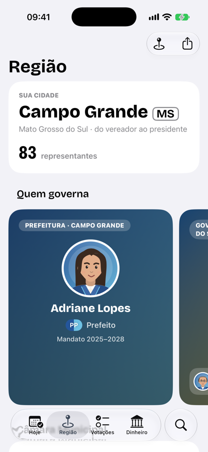
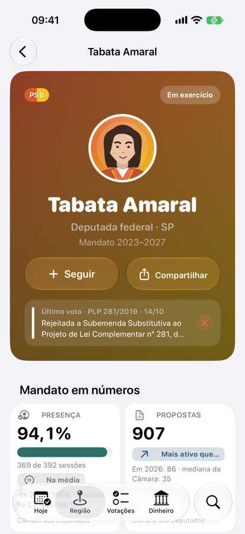
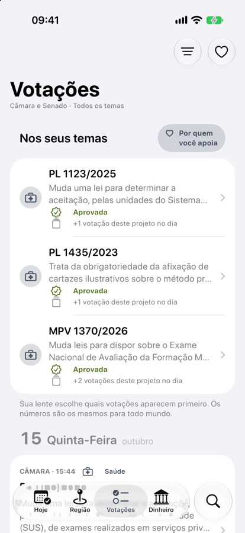
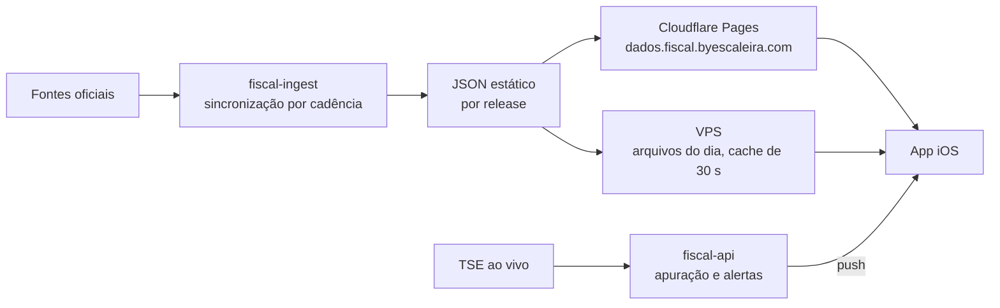

<h1 align="center">
  <picture>
    <source media="(prefers-color-scheme: dark)" srcset=".github/readme/header-dark.png">
    
  </picture>
</h1>

<p align="center">
  Votos, gastos e eleições de quem governa e legisla, do vereador ao presidente.
</p>

<p align="center">
  <a href="https://dados.fiscal.byescaleira.com/v2/release.json">Dados publicados</a> ·
  App Store e site em breve
</p>

<p align="center">
  
  
  
</p>
<p align="center">
  
  
  
</p>

O Fiscal mostra o que os seus representantes fazem com o seu voto: presença, votações, projetos, gastos e campanhas, em linguagem simples e com a fonte oficial ao lado de cada número. É gratuito, sem cadastro e sem anúncio.

## O que tem no app

| | |
| --- | --- |
| **Hoje** | O destaque do momento, o resumo do dia no Congresso, as votações que acabaram de acontecer e a apuração ao vivo nas eleições, com Atividade ao Vivo e widget. |
| **Região** | Quem governa a sua cidade, o seu estado e o país, as bancadas partido por partido e como os seus deputados e senadores votaram. Os 5.570 municípios. |
| **Cada político** | Presença, propostas, discursos e cota comparados com os colegas do mesmo cargo; patrimônio e indicadores de antes e de depois da posse; as checagens do Projeto Comprova. |
| **Votações** | O que foi decidido e o que muda na prática, com o placar por partido. Votações do mesmo projeto no mesmo dia aparecem juntas. |
| **Dinheiro** | Quanto custa um mandato, estado por estado, contra o salário mínimo, para onde vai a cota parlamentar e quem financia as campanhas. |
| **Fiscalizar** | Busca por pessoa, votação, tema ou cidade, investigações que cruzam dados e ficam salvas no iCloud, e a Memória: eleições desde 1989, fases da política brasileira e guias de estudo. |
| **Compartilhar** | Cartazes prontos para Stories, feed ou mensagem, com obras de arte brasileiras em domínio público. |

## Princípios

- **Fato, não opinião.** O Fiscal não toma partido e não dá nota a ninguém. Todo número tem fonte e data.
- **A mesma régua para todos.** Comparações sempre com colegas do mesmo cargo e da mesma casa, com o método publicado no app ("Como medimos").
- **Incerteza explicada.** Quando algo é estimado, o app diz por quê e o que falta para ter certeza.
- **Privacidade.** Sem conta. A Lente (os temas e as pessoas que você apoia) fica só no aparelho. A Apple Intelligence escreve as explicações no próprio aparelho, só a partir dos fatos oficiais.

## De onde vêm os dados

Câmara dos Deputados, Senado Federal, Tribunal Superior Eleitoral, IBGE (municípios e SIDRA), Receita Federal, ANP, Ipeadata, Planalto (legislação), as assembleias com SAPL (AC, AM, PB, PI e RO), Projeto Comprova, Wikipédia e GDELT. Cada fonte é lida no seu ritmo, de 5 em 5 minutos (pauta e votações do dia) até uma vez por mês (eleições passadas), e só quando muda.

## Como funciona



- **Nenhum processamento por requisição.** O servidor prepara tudo antes e publica arquivos estáticos; o app lê direto da CDN. Os dados são públicos; só a escrita no servidor (alertas e Atividades ao Vivo) exige App Attest.
- **Sempre no ar.** Cada release é validada, comparada com a anterior e publicada de uma vez; uma conferência semanal refaz tudo do zero e compara com o incremental. Sem rede, o app usa um pacote offline com o mínimo para consultas recentes.
- Detalhes no [ADR 0008](docs/adr/0008-smart-sync.md) e no [runbook do servidor](docs/server-runbook.md).

## Desenvolvimento

App em SwiftUI para iOS a partir do 26, com os recursos do 27 (e iPadOS, macOS e visionOS no mesmo projeto), SwiftData com sincronização CloudKit, Swift Charts, Lottie e Foundation Models; servidor em Go só com a biblioteca padrão e SQLite. Abra `Fiscal.xcworkspace` no Xcode 27: o scheme `Production` roda o app, `FiscalKitTests` a suíte do pacote e `FiscalUITests` a interface.

```sh
scripts/verify.sh --quick
```

O fluxo é spec-driven: a [constituição](docs/constitution.md) traz as regras inegociáveis, as [specs](docs/specs/README.md) a verdade atual de cada capacidade, as [mudanças](docs/changes/README.md) o que está em andamento e os [ADRs](docs/adr/README.md) as decisões. Para agentes de código, o ponto de partida é o [AGENTS.md](AGENTS.md).

Mais: [arquitetura](docs/architecture.md) · [design system](docs/design-system.md) · [roadmap](docs/roadmap.md) · [site e Fiscal na Web](docs/web.md) · [App Store](docs/app-store/README.md) · [validação antes de distribuir](docs/validation.md).

## Licença

O código está sob a [PolyForm Noncommercial 1.0.0](LICENSE.md): pode ler, estudar, modificar e usar para fins pessoais, educativos e de pesquisa, e por organizações sem fins lucrativos. Qualquer uso comercial é proibido. Os dados exibidos são públicos e vêm das fontes oficiais citadas em cada tela; as obras de arte dos cartazes estão em domínio público ([créditos](FiscalKit/Sources/FiscalResource/art-credits.json)).
