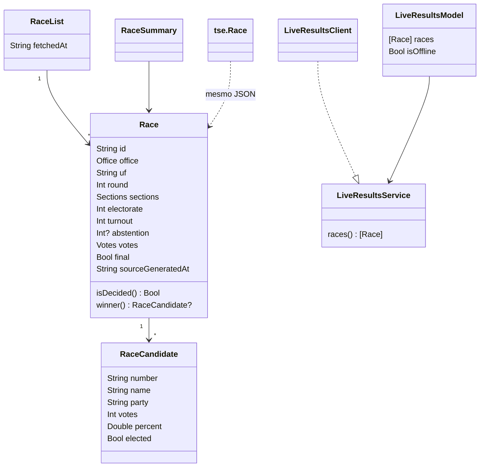

# Apuração ao vivo e Atividade ao Vivo da disputa

## Requirements

Quem acompanha a eleição quer o placar oficial do TSE sem ficar recarregando sites: a tela Apuração (aberta por Fiscalizar, pelo card de Hoje, pela Memória, pelo atalho "Ver a apuração" e por `fiscal://races`) mostra as 7 disputas do 2º turno de 2026 (`presidente-br` e governador de AC, AM, DF, ES, RN e TO), e o placar oficial aparece nessas telas. O servidor lê o TSE e publica arquivos estáticos, que o `fiscal-pages` leva à CDN; o app só lê `v2/races.json` na CDN, com o pacote offline de reserva, e nunca chama a VPS. Pela `FSC-020` (ADR 0028), a Atividade ao Vivo da disputa, o botão de acompanhar, o push e o registro do token saíram até a próxima eleição; o código fica no histórico do git. Fica de fora: projeção, pesquisa ou tendência, apuração por cidade ou mapa, a Atividade ao Vivo da disputa e qualquer push, os alertas de destaque (`HighlightActivities`, outra capacidade) e a Memória das eleições passadas.

Definição de pronto (os nomes de pessoas são fictícios, pela Constituição 14; os testes citados usam os das próprias fixtures):

- **Given** `v2/races.json` na CDN com `presidente-br` apurando e `fetchedAt` de 10 minutos atrás **When** `races()` roda **Then** devolve a lista da CDN e não chama outro endereço; com a CDN fora, usa o `races.json` do pacote offline (`` `LiveResultsClientTests.readsTheRaceListFromTheCDN` ``, `` `LiveResultsClientTests.keepsAnOldListFromTheCDNAndCallsNoOtherAddress` ``; `FSC-020`, cenário 29).
- **Given** todas as disputas com `sections.counted == 0` **When** a tela carrega **Then** `isWaiting` é verdadeiro, o aviso com o símbolo `clock` diz "A apuração começa às 17h (Brasília). Os números vêm direto do TSE, sem projeção nem pesquisa.", o estado da disputa é "Começa às 17h (Brasília)" e percentual e votos de cada candidato são "—", nunca 0 (`` `LiveResultsModelTests.waitsUntilTheCountStarts` ``, `` `LiveResultsModelTests.showsDashesBeforeTheCountStarts` ``).
- **Given** uma leitura anterior com 1 disputa e a próxima `races()` falhando **When** a tela atualiza **Then** `isOffline` é verdadeiro, a disputa continua na tela e o aviso com `wifi.slash` diz "Sem conexão. Mostrando os últimos números recebidos." (`` `LiveResultsModelTests.keepsTheLastNumbersWhenOffline` ``, `` `LiveResultsModelTests.noticeShowsOfflineFirst` ``).
- **Given** o serviço ausente (flag `liveResults` desligada ou sem `FiscalDataURL`) ou a primeira leitura falhando sem nada em memória **When** a tela carrega **Then** `hasLoaded` é verdadeiro com `races` vazio e aparece "Resultados indisponíveis", "Não foi possível falar com o servidor de resultados. O app tenta de novo sozinho." e o botão "Tentar novamente" (`` `LiveResultsModelTests.showsTheUnavailableStateWithoutAServer` ``, `` `ShowcaseLiveResultsTests.unavailableAlwaysFails` ``).
- **Given** uma disputa com `final`, 100% das seções apuradas ou um candidato com `elected` **When** o app calcula `Race.winner` **Then** o vencedor é o eleito pelo TSE; sem eleito, é o primeiro no 2º turno ou com até 2 candidatos; no 1º turno com mais de 2 candidatos não há vencedor (roteiro manual: servidor com `SIMULATE=1` levando uma disputa a 100% e conferir o cartão de vitória e o cartaz).
- **Given** `presidente-br` apurando e `governador-ac` já final **When** a próxima leitura traz `presidente-br` final com Ana eleita **Then** o VoiceOver anuncia "Presidente · Brasil: Ana eleito(a)" uma vez, e nada é anunciado para a disputa que já estava final (`` `LiveResultsModelTests.announcesOnlyRacesThatJustEnded` ``).
- **Given** a apuração no Feed e na tela da disputa, com uma disputa em andamento **When** a tela aparece **Then** os números aparecem como antes, sem botão de acompanhar, pedido de Atividade da disputa nem registro de token (`FSC-020`, cenário 30). Os cenários de seguir, registrar, recusar o token, plano da Atividade e tela de bloqueio saíram com ela.
- **Given** o poller com uma disputa publicada **When** o TSE traz um arquivo novo e depois falha **Then** a disputa e o horário da última leitura continuam guardados, `v1/races.json` só é regravado quando o conteúdo muda, e nenhum push sai, porque o APNs saiu com a `FSC-020` (`` `TestPollKeepsTheLatestRaces` `` em `server/internal/live/service_test.go`, `` `TestPublishRewritesOnlyWhenContentChanges` `` em `server/internal/live/publish_test.go`).
- **Given** o servidor novo **When** chega `POST` ou `DELETE` em `/api/v1/live-activities`, `POST` em `/api/v1/attest/challenge` ou `/keys`, `POST /api/v1/admin/push-test`, ou `GET /api/v1/races` e `/api/v1/races/{id}` **Then** responde 404 `not_found`, e só `GET /api/health` responde 200, com o serviço ouvindo em `127.0.0.1` (`` `TestPublicRoutesAreGone` `` em `server/internal/httpapi/server_test.go`; `FSC-020`, cenário 23).

## Entities

- `Race`, `RaceCandidate` e `RaceList` moram em `FiscalKit/Sources/FiscalDomain/LiveResults/Race.swift`; são o contrato JSON do servidor, com `abstention` opcional; `Race+Decision.swift` acrescenta `isDecided` e `winner`.
- `RaceActivity.swift` (`RaceActivityAttributes`, `RaceContender`, `RaceActivityState`, `RaceStanding`, `RaceActivityRow` e `RaceActivityPlan`) saiu com a `FSC-020`; na extensão de widgets fica só o `RaceStyle`, em `Fiscal/FiscalWidgets/RaceBoard.swift`.
- O protocolo `LiveResultsService`, só com `races()`, e `LiveResultsError` (`rejected(Int)`, `unavailable`) moram em `FiscalKit/Sources/FiscalDomain/LiveResults/LiveResultsService.swift`; `PushEnvironment` saiu com a `FSC-020`.
- `LiveResultsClient` mora em `FiscalKit/Sources/FiscalData/LiveResults/`; o `AppAttestor` saiu com a `FSC-020`.
- `LiveResultsModel`, `RaceSummary`, `RaceRegion`, `RaceStatusFilter` e `RaceGroup` moram em `FiscalKit/Sources/FeatureLiveResults/`; `RaceActivityTracking` e `RaceActivities` saíram com a `FSC-020`.
- `tse.Race` (Go) mora em `server/internal/tse/model.go` e gera o mesmo JSON, com `abstention` sempre presente; `store.Registration` e `apns.Message` saíram com a `FSC-020`.
- Não há schema SwiftData envolvido (nenhum `FiscalSchemaV<N>`, nada no CloudKit) nem estado local desta capacidade; a sobra `AppAttestKeyID` é apagada pelo `clearLegacy` da `FSC-020`.

## Approach

1. **Estratégia da solução:** o contêiner `fiscal-api` (`server/cmd/server`) lê os 7 arquivos do TSE em paralelo a cada 20 s, com `ETag`, e grava `PUBLIC_DIR/v1/races.json` e `v1/races/{id}.json` com `.gz`. O `fiscal-pages` copia esses arquivos para `v2/` no Cloudflare Pages. O app lê `v2/races.json` na CDN e, se ela falhar, o pacote offline; a tela atualiza a cada 15 s enquanto está aberta. Desde a `FSC-020`, não há push, registro, App Attest nem Atividade da disputa, e a VPS não tem rota pública.
2. **Decisões:**
   - Leitura sem código: o poller grava arquivos prontos e o Caddy ou a CDN os entrega; o Go não tem rota pública desde a `FSC-020`; descartada a API dinâmica com cache em memória. ADR: `docs/adr/0002-static-first-server.md`.
   - Só a CDN, sem reserva na VPS e sem conferir a idade de `fetchedAt`, por decisão do usuário na `FSC-020`; o deploy de apuração no Pages sai na hora quando os arquivos mudam; descartado o app lendo o TSE direto (fica como plano B). ADR: `docs/adr/0007-pages-cdn-phased-ingest.md`, `docs/adr/0028-app-reads-only-from-cdn-and-local-alerts.md`.
   - Sem push, registro, App Attest nem Atividade da disputa até a próxima eleição; ela volta pelo git. ADR: `docs/adr/0028-app-reads-only-from-cdn-and-local-alerts.md`, que substitui os itens 5 e 6 do 0002 e o item 7 do 0007.
   - Cor do candidato pela `PartyPalette` do partido, igual para todos e nunca da Lente; descartada a versão neutra sem cor da proposta original. ADR: não precisa (decisão da spec viva).
   - A apuração e a carga de dados rodam em processos separados, e o reinício da apuração só apaga `races*`; descartado o modo `ingest` dentro do servidor da apuração. ADR: `docs/adr/0005-data-ingest-process.md`.
   - `races.json` entra no pacote offline. ADR: `docs/adr/0015-background-fetch-offline-pack.md`.
   - Sem token no servidor, o rótulo proposto na loja é "Dados não coletados". ADR: `docs/adr/0028-app-reads-only-from-cdn-and-local-alerts.md`, que substitui o 0017.
   - App só em pt-BR e números de destaque na Bricolage. ADR: `docs/adr/0003-portuguese-only.md`, `docs/adr/0009-bricolage-emphasis-font.md`.
3. **Tratamento de erros:**
   - Leitura na CDN que falha ou não decodifica cai para o `races.json` do pacote offline e marca `OfflineNotice` (barra "Sem conexão · dados de <data>"); sem pacote, o erro sobe ao model.
   - No model, `CancellationError` e `URLError.cancelled` são ignorados; outro erro liga `isOffline` e mantém os números em memória; sem nada em memória aparece "Resultados indisponíveis".
   - `LiveResultsClient.check` traduz 2xx em sucesso, 4xx (menos 429) em `LiveResultsError.rejected` e o resto em `unavailable`.
   - No servidor, falha de leitura de uma disputa é registrada no log e não apaga a anterior; arquivo do TSE acima de 4 MiB, de outra eleição ou cargo, ou com número inválido é recusado; configuração inválida derruba o processo no boot; pânico vira 500 `internal_error`.
4. **Riscos:**
   - Sem reserva na VPS, a CDN fora deixa só o pacote offline → o app mostra o pacote com a barra offline e, sem ele, o erro que já existe (`FSC-020`, cenário 29); o atraso real da apuração pela CDN não foi medido com a `FSC-020`.
   - Um único poller na VPS → `state.json` guarda as disputas e as encerradas, e o boot republica os arquivos a partir dele.

**Known divergences:**

- Saíram com a `FSC-020`, junto com o código que descreviam: o corpo do `DELETE /api/v1/live-activities`, o vencedor próprio da Live Activity (`RaceBoard.winner`), o prazo do desafio do App Attest, o broadcast previsto no ADR 0002, o rótulo de VoiceOver e o Reduzir movimento da Live Activity, a chave `AppAttestKeyID` sem prefixo e a falta de teste da tela de bloqueio.
- `Spec × código:` a spec diz que, sem rede, o app usa o pacote offline "com o aviso 'Sem conexão. Mostrando os últimos números recebidos.'"; quando o pacote responde, `LiveResultsClient.races()` devolve normalmente, `isOffline` fica falso e o que aparece é a barra global "Sem conexão · dados de <data>" (`OfflineNoticeBar`); o aviso da tela só aparece quando a leitura inteira falha e há números em memória (`LiveResultsModel.refresh()`).
- `Spec × código:` a situação "decididas" do filtro e o `LiveResultsModel.statusText` usam só `race.final`, enquanto `Race.isDecided` e `RaceSummary.statusText` contam também 100% apurado; uma disputa a 100% sem `tf` mostra "Resultado final" no cartão e fica em "Em apuração" (`RaceStatusFilter.includes` em `FiscalKit/Sources/FeatureLiveResults/RaceRegion.swift`).
- `Spec × código:` a spec diz que o job `apuracao` da carga "roda a cada 20 s"; no código ele é só um registro `JobExternal` na cadência (`server/internal/ingest/cadence.go`), e quem lê o TSE é o `fiscal-api`.
- `Playbook:` Constituição 4 (tokens em vez de números soltos): `.minimumScaleFactor(0.5)`, `(0.6)`, `(0.7)` e `(0.8)` em `FiscalKit/Sources/FeatureLiveResults/RaceHeroCard.swift` (linhas 198, 203, 244) e `FiscalKit/Sources/FeatureLiveResults/RaceCompactCard.swift` (linhas 61, 148, 152), enquanto os widgets usam `.widgetScoreShrink` e `.widgetNameShrink`.
- `Sem teste:` a regra de decidido e vencedor (`Race.isDecided`, `Race.winner` em `FiscalKit/Sources/FiscalDomain/LiveResults/Race+Decision.swift`) não tem teste direto.

## Structure

Camadas tocadas, com a regra de dependência do `FiscalKit`: `FiscalDomain` não depende de ninguém; `FiscalData` depende de `FiscalDomain`; `FeatureLiveResults` depende de `FeatureCore`, `FiscalDomain` e `FiscalDesignSystem` e não importa outra feature; `FeatureToday` e `FeatureMemory` chegam à apuração só por `Route.races` e `Route.race(id:)`, e o `AppShell` injeta o `RaceHeroCard` no card de Hoje por closure. A extensão `Fiscal/FiscalWidgets` importa só `FiscalDomain` e `FiscalDesignSystem`. O servidor Go (`server/`, módulo `liveresults`, só biblioteca padrão) não tem dependência com o app além do contrato JSON.

- `FiscalKit/Sources/FiscalDomain/LiveResults/`
  - `Race.swift`, `Race+Decision.swift`, `RaceText.swift`, `PortraitShelf.swift`
  - `LiveResultsService.swift`
  - `RaceScenario.swift` (só Debug)
- `FiscalKit/Sources/FiscalData/LiveResults/`
  - `LiveResultsClient.swift`
- `FiscalKit/Sources/FiscalData/Showcase/ShowcaseLiveResults.swift` (só Debug, `-FiscalLiveScenario`)
- `FiscalKit/Sources/FiscalData/PublicData/Offline/OfflinePackPlan.swift` (inclui `races.json`)
- `FiscalKit/Sources/FeatureLiveResults/`
  - `LiveResultsModel.swift`, `RaceSummary.swift`, `RaceRegion.swift`
  - `LiveResultsScreen.swift`, `RaceDetailScreen.swift`, `RaceHeroCard.swift`, `RaceCompactCard.swift`, `RaceCharts.swift`, `RaceCountBar.swift`, `RaceWinnerCard.swift`
- `FiscalKit/Sources/FeatureToday/TodayRaceBoard.swift` (card de Hoje)
- `FiscalKit/Sources/AppShell/`
  - `FiscalServices.swift` (`liveResults()`, `liveResultsService()`)
  - `DeepLink.swift`, `RouteScreen.swift`, `SectionScreen.swift`, `Integrations/FiscalIntents.swift` (`ShowRacesIntent`)
- `FiscalKit/Sources/FeatureCore/Flags/FeatureFlag.swift` (`liveResults`, ligada por padrão)
- `Fiscal/FiscalWidgets/`
  - `RaceBoard.swift` (só o `RaceStyle`), `FiscalWidgetsBundle.swift`, `Localizable.xcstrings`; `RaceLiveActivity.swift` e `RaceWinnerLockScreen.swift` saíram com a `FSC-020`
- `Fiscal/Fiscal/`
  - `Info.plist` (`FiscalDataURL`), `Localizable.xcstrings`; `FiscalAPIURL`, o App Attest e `NSSupportsLiveActivitiesFrequentUpdates` saíram com a `FSC-020`; `aps-environment` fica só para a sincronização do iCloud
- `server/`
  - `cmd/server/main.go`
  - `internal/tse/` (`model.go`, `fetch.go`, `parse.go`, `simulate.go`)
  - `internal/live/` (`service.go`, `publish.go`)
  - `internal/httpapi/server.go`, `internal/pages/pages.go`, `internal/ingest/cadence.go`; `internal/store/`, `internal/apns/` e `internal/appattest/` saíram com a `FSC-020`
  - `compose.yaml`, `deploy/docker/api.Dockerfile`
- Testes
  - `FiscalKit/Tests/FiscalDomainTests/RaceTests.swift`, `RaceScenarioTests.swift`
  - `FiscalKit/Tests/FiscalDataTests/LiveResultsClientTests.swift`, `ShowcaseLiveResultsTests.swift`
  - `FiscalKit/Tests/FeatureLiveResultsTests/LiveResultsModelTests.swift`
  - `FiscalKit/Tests/FeatureTodayTests/TodayRaceBoardTests.swift`, `FiscalKit/Tests/AppShellTests/DeepLinkTests.swift`, `FiscalKit/Tests/AppShellTests/UpdateBlockTests.swift`
  - `server/internal/tse/tse_test.go`, `server/internal/live/service_test.go`, `server/internal/live/publish_test.go`, `server/internal/httpapi/server_test.go`, `server/cmd/server/main_test.go`

## Operations

1. **Leitura do TSE** (`server/internal/tse/model.go`, `server/internal/tse/fetch.go`, `server/internal/tse/parse.go`): `Definitions() []Definition` devolve `presidente-br` (eleição 6258, cargo 1) e `governador-{ac,am,df,es,rn,to}` (eleição 6260, cargo 3) nessa ordem; `KnownRace(id string) bool` confere o id. `HTTPSource.Fetch(ctx, d Definition) (Race, bool, error)` faz `GET` com `If-None-Match`, devolve `modified=false` no 304, recusa status diferente de 200 e corpo acima de 4 MiB e guarda o `ETag`. `Parse(d, data) (Race, error)` recusa outra eleição ou cargo, lê números em string e porcentagens com vírgula, marca `Final` com `tf == "s"` ou algum `e == "s"`, ordena por votos e, no empate, pelo número (`SortCandidates`), põe o nome de urna em caixa de título com `da`, `de`, `do`, `dos`, `das` e `e` minúsculos (`TitleName`) e converte `dg`/`hg` de Brasília em RFC 3339. `NewSimSource` simula a apuração em 10 min. Verificação: `cd server && go test ./internal/tse/...`.
2. **Removida pela `FSC-020`:** o depósito de registros (`server/internal/store/`) saiu.
3. **Removida pela `FSC-020`:** o push APNs (`server/internal/apns/`) saiu.
4. **Removida pela `FSC-020`:** o App Attest no servidor (`server/internal/appattest/`) saiu.
5. **Serviço da apuração** (`server/internal/live/service.go`, `server/internal/live/publish.go`): `PollOnce(ctx)` busca as 7 disputas em paralelo, cada uma com 10 s; atualiza `fetchedAt` quando alguma leitura dá certo e guarda a disputa quando o arquivo mudou; uma leitura que falha mantém a anterior; chama `publish()`, que grava `v1/races/{id}.json` e só regrava `v1/races.json` quando o conteúdo mudou; por fim `saveState()` grava `state.json`. `LoadState()` e `ResetPublished()` restauram e republicam no boot. `Run(ctx, interval)` repete a cada intervalo. Desde a `FSC-020`, não há envio de push. Depende de: 1. Verificação: `cd server && go test ./internal/live/...`.
6. **API HTTP** (`server/internal/httpapi/server.go`): `New(c Config) http.Handler` registra só `GET /api/health`; qualquer outra rota responde 404 `not_found`, inclusive as antigas `/api/v1/races`, `/api/v1/races/{id}`, `/api/v1/live-activities`, `/api/v1/attest/*` e `/api/v1/admin/push-test`, que saíram com a `FSC-020`. Todas respondem `Cache-Control: no-store` e erros `{"error":{"code","message"}}`; pânico vira 500 `internal_error`. Verificação: `cd server && go test ./internal/httpapi/...`.
7. **Processo `fiscal-api`** (`server/cmd/server/main.go`): `loadConfig(getenv) (config, error)` aplica os padrões (`127.0.0.1:3130`, `POLL_INTERVAL` 20 s entre 5 s e 10 min, `TSE_BASE_URL` https do TSE) e recusa valor inválido; `main` abre o poller e o servidor HTTP local com limites de tempo e encerra gravando tudo no `SIGTERM`. Com `SIMULATE=1`, nada é publicado. O APNs, o App Attest e o depósito saíram com a `FSC-020`. Depende de: 5, 6. Verificação: `cd server && go test ./cmd/server/...`.
8. [P] **Publicação no Pages** (`server/internal/pages/pages.go`): cada ciclo do `fiscal-pages` copia `v1/races.json` e `v1/races/*.json` para `v2/` da release e faz o deploy na hora quando o hash da apuração muda. Depende de: 5. Verificação: `cd server && go test ./internal/pages/...`.
9. **Domínio da disputa** (`FiscalKit/Sources/FiscalDomain/LiveResults/Race.swift`, `Race+Decision.swift`, `RaceText.swift`): `Race` decodifica o contrato e expõe `elected`, `leader` (o primeiro com votos), `hasStarted` (`sections.counted > 0`) e `generatedAt`; `isDecided` é `final`, 100% ou algum eleito; `winner` segue a tabela da definição de pronto. `RaceText` formata título ("Presidente · Brasil"), UF por extenso, porcentagens com 2 e 1 casas, votos, seções ("<n> de <total> seções"), hora e "<Nome> eleito(a)". Verificação: `scripts/test.sh --affected`. Cobre: a regra de vencedor.
10. **Removida pela `FSC-020`:** o estado e o plano da Atividade da disputa (`RaceActivity.swift`) saíram.
11. [P] **Cenários de Debug** (`FiscalKit/Sources/FiscalDomain/LiveResults/RaceScenario.swift`, `FiscalKit/Sources/FiscalData/Showcase/ShowcaseLiveResults.swift`): `RaceScenario` (`waiting`, `early`, `close`, `tie`, `decided`, `finished`, `longNames`, `progressing`, `offline`, `unavailable`, `firstRound`) gera as 7 disputas com votos que somam os válidos e porcentagens que somam 100; `ShowcaseLiveResults` responde por `-FiscalLiveScenario`, falha sempre em `unavailable` e depois da primeira leitura em `offline`, e avança um passo por leitura em `progressing`. Tudo só em Debug. Verificação: `scripts/test.sh --affected`.
12. **Cliente da apuração** (`FiscalKit/Sources/FiscalData/LiveResults/LiveResultsClient.swift`): `fromBundle(_:) -> LiveResultsClient?` lê só `FiscalDataURL` (com sobreposição por `UserDefaults` só em Debug). `races() async throws -> [Race]` lê `v2/races.json` na CDN com 15 s, sem conferir a idade de `fetchedAt`; se falhar, o `races.json` do pacote offline e `OfflineNotice.markOffline`. `follow`, `unfollow` e o `AppAttestor` saíram com a `FSC-020`. Depende de: 9. Verificação: `scripts/test.sh --affected`. Cobre: a leitura só pela CDN.
13. **Montagem no AppShell** (`FiscalKit/Sources/AppShell/FiscalServices.swift`): `liveResultsService() -> (any LiveResultsService)?` devolve `nil` com a flag `liveResults` desligada, o `ShowcaseLiveResults` em Debug com cenário, e senão o `LiveResultsClient`; `liveResults() -> LiveResultsModel` monta o model com ele. O `HeldLiveResultsService` e o `PushEnvironment` saíram com a `FSC-020`. Depende de: 12. Verificação: `scripts/test.sh --affected`.
14. **Removida pela `FSC-020`:** o controle das Atividades da disputa (`RaceActivities.swift`) saiu.
15. **Model da apuração** (`FiscalKit/Sources/FeatureLiveResults/LiveResultsModel.swift`): `LiveResultsModel`, `@MainActor @Observable`, recebe serviço e intervalo (15 s). `run() async` repete `refresh()` a cada intervalo; `refresh() async` lê as disputas, calcula `announcement` ou liga `isOffline`; `groups`, `regionChoices`, `region`, `status`, `scopeText` e `filterSummary` montam os grupos por região e os filtros; `notice`, `statusText`, `percentText`, `votesText`, `accessibilityLabel` e `updatedText` dão os textos; `detailPhase(for:)` e `loadDetail(id:)` decidem entre carregando, pronta e indisponível. Seguir, a fila `pending` e os textos de acompanhar saíram com a `FSC-020`. Depende de: 13. Verificação: `scripts/test.sh --affected`. Cobre: espera, sem conexão, indisponível e anúncio.
16. **Resumo da disputa e filtros** (`FiscalKit/Sources/FeatureLiveResults/RaceSummary.swift`, `FiscalKit/Sources/FeatureLiveResults/RaceRegion.swift`): `RaceSummary(race:)` monta concorrentes (com "—" antes da apuração, `dimmed` para o não eleito na disputa final), vencedor, "Eleito com <x> dos votos válidos", "Diferença: <n> votos", a linha de 50% (`majorityCut`) só no 1º turno com mais de 2 candidatos, a divisão de votos válidos, brancos, nulos e abstenção, o comparecimento, o eleitorado e os rótulos de acessibilidade; `RaceRegion.of(uf:)` agrupa as UFs em Norte, Nordeste, Centro-Oeste, Sudeste e Sul; `RaceStatusFilter` tem "Todas as disputas", "Em apuração" e "Definidas". Depende de: 9. Verificação: `scripts/test.sh --affected`.
17. **Telas** (`FiscalKit/Sources/FeatureLiveResults/LiveResultsScreen.swift`, `RaceDetailScreen.swift`, `RaceHeroCard.swift`, `RaceCompactCard.swift`, `RaceCharts.swift`, `RaceCountBar.swift`, `RaceWinnerCard.swift`): `LiveResultsScreen` com título "Apuração", subtítulo do escopo, menu de filtros na barra, aviso, herói da disputa principal (presidente), grupos por região em `CardGrid`, rodapé "Números direto do TSE, sem projeções nem pesquisas.", atualização ao puxar e anúncio do VoiceOver; `RaceDetailScreen` com o herói e as seções "Candidatos", "Votos das urnas apuradas" e "Apuração" (percentual em Bricolage com `.monospacedDigit()`, `ProgressBar`, "<n> de <total> seções", "Eleitorado" e "Comparecimento", rodapé "Arquivo do TSE das <hora>"); sem botão de acompanhar desde a `FSC-020`; gráficos com `RuleMark` tracejada em 50%; animações desligadas com Reduzir movimento. Depende de: 15, 16.
18. **Integração no app** (`FiscalKit/Sources/AppShell/DeepLink.swift`, `RouteScreen.swift`, `SectionScreen.swift`, `Integrations/FiscalIntents.swift`, `FiscalKit/Sources/FeatureToday/TodayRaceBoard.swift`): `fiscal://races` abre `Route.races` em Fiscalizar e `fiscal://race/<id>` abre `Route.race(id:)`; `ShowRacesIntent` ("Ver a apuração") abre `fiscal://races`; `TodayRaceBoard.featured(in:now:)` destaca a disputa de presidente ao vivo, senão outra ao vivo, senão o presidente final por até 86.400 s, e o card de Hoje usa o `RaceHeroCard` injetado pelo `AppShell`. Depende de: 17. Verificação: `scripts/test.sh --affected`.
19. **Removida pela `FSC-020`:** a Live Activity da disputa (`RaceLiveActivity.swift`, `RaceWinnerLockScreen.swift` e o resto de `RaceBoard.swift`) saiu até a próxima eleição.
20. [P] **Textos** (`Fiscal/Fiscal/Localizable.xcstrings`, `Fiscal/FiscalWidgets/Localizable.xcstrings`, `Fiscal/Fiscal/AppShortcuts.xcstrings`): chaves em inglês com só a tradução `pt-BR`, no app e na extensão de widgets. Verificação: `scripts/strings.sh`.

## Norms

- Constituição 1 e ADR `docs/adr/0003-portuguese-only.md`: código, chaves de texto e nomes de tipos em inglês; o catálogo do app e o dos widgets têm só `pt-BR`; texto visível pela chave (`Text("Key")` nas telas, `String(appLocalized:)` no model, no domínio e no widget).
- Constituição 3: features não se importam; a apuração é aberta por `Route.races` e `Route.race(id:)`, e o card de Hoje recebe o `RaceHeroCard` por injeção do `AppShell`; `LiveResultsModel` é `@MainActor @Observable`, injetado por `@Environment(LiveResultsModel.self)`, com `@Bindable var results = results` dentro do `body`; lógica, formatação e ações ficam no model e no `RaceSummary`, as views só desenham, uma subview por seção.
- Constituição 3: a leitura fica atrás de `LiveResultsService`, para que o model seja testado com dublês.
- Constituição 4: zero comentários, zero warnings, Swift Testing para toda lógica nova no app e `go test` para o servidor; espaçamentos, raios, tamanhos, opacidades e fontes pelos tokens do `FiscalDesignSystem` (`.spaceL`, `.radiusGroup`, `.badgeXL`, `.opacitySoft`, `.scoreboardTitle`).
- Constituição 5: nunca anel nem progresso circular para a apuração; o percentual apurado usa `ProgressBar` e barras que preenchem.
- Constituição 5 e ADR `docs/adr/0009-bricolage-emphasis-font.md`: números e títulos de destaque na Bricolage (`Font.emphasis`, `.scoreboardTitle`, `.scoreboardNumber`, `.candidatePercentLarge`), sempre com `.monospacedDigit()`; nunca SF condensada, arredondada, mono, nem SF heavy ou black em tamanho fixo.
- Constituição 5: Reduzir movimento respeitado nas telas com `@ReducesMotion` (sem `numericText`, sem revelação animada das barras e gráficos).
- Constituição 5: toolbar sem `.fill` (o filtro usa `line.3.horizontal.decrease`, com o número de filtros ativos no próprio botão) e rodapés que explicam a fonte e a linha de 50%.
- Constituição 13: o que for do iOS 27 fica atrás de `#available(iOS 27, *)`, com alternativa no 26.
- Constituição 14: só o número oficial do TSE, com a hora do arquivo ("Arquivo do TSE das <hora>"), sem projeção, pesquisa, tendência ou adjetivo; dado ausente antes da apuração é "—", nunca 0; a mesma cor da `PartyPalette` para cada partido, para todo mundo, nunca a da Lente.
- ADR `docs/adr/0002-static-first-server.md`: leitura nunca chama código no caminho da CDN; o app nunca consulta o TSE.
- ADR `docs/adr/0007-pages-cdn-phased-ingest.md` e ADR `docs/adr/0028-app-reads-only-from-cdn-and-local-alerts.md`: o app lê `v2/races.json` no Pages e nunca a VPS; o servidor não tem rota pública nem escrita pública.
- ADR `docs/adr/0028-app-reads-only-from-cdn-and-local-alerts.md`: sem Atividade da disputa nem push até a próxima eleição; ela volta pelo git.
- Playbook de backend (skill `byescaleira-workspace:backend`): Go só com a biblioteca padrão, configuração que falha fechada no boot, erros `{"error":{"code","message"}}` em `snake_case`, `Cache-Control: no-store` nas respostas da API, log sem segredo nem token completo, escrita atômica com `0600`.
- Verificação (Constituição 7): `scripts/test.sh --affected` para o Swift e `cd server && go test ./internal/<pacote>/...` para o servidor durante o trabalho.

## Safeguards

- **Funcional:** o app nunca mostra projeção, tendência ou número que não veio do TSE; nunca mostra 0 no lugar de "—" antes da apuração; nunca anuncia no VoiceOver uma disputa que já estava final na leitura anterior; o app nunca chama a VPS, nem como reserva, e o servidor não tem rota pública (`FSC-020`).
- **Desempenho:** o poller lê o TSE a cada 20 s (`POLL_INTERVAL` de 5 s a 10 min), com 10 s por pedido e arquivo de até 4 MiB; o app atualiza a cada 15 s com a tela aberta e espera 15 s por pedido; o cache da CDN para a apuração é de 10 s.
- **Privacidade:** o app não envia nada ao servidor: só lê arquivos públicos da CDN, sem token nem identificador do aparelho (`FSC-020`); a tela não envia nada ao TSE.
- **Dados:** nenhum dado da pessoa é salvo pelo app; não há schema SwiftData nem CloudKit nesta capacidade; no servidor, `state.json` é gravado de forma atômica, e o reinício só apaga e republica `races.json` e `races/`, nunca os arquivos da carga.
- **Compatibilidade da versão publicada:** não quebram sem nova mudança: as chaves JSON de `Race` (`id`, `office`, `uf`, `round`, `sections`, `electorate`, `turnout`, `abstention` opcional, `votes`, `candidates`, `final`, `sourceGeneratedAt`) e de `RaceList` (`races`, `fetchedAt`) em `v1/` e `v2/races.json`; os ids das 7 disputas; os deep links `fiscal://races` e `fiscal://race/<id>`; o `ShowRacesIntent`; as chaves de texto já no catálogo. **QUEBRA** da `FSC-020`, com o app ainda não publicado: saíram o `content-state` do push e os campos de `RaceActivityAttributes`, as rotas `POST` e `DELETE /api/v1/live-activities`, `POST /api/v1/attest/challenge` e `/keys`, `GET /api/v1/races` e `/api/v1/races/{id}`, os cabeçalhos `X-Fiscal-Attest-Key` e `X-Fiscal-Attest-Assertion`, o tópico `.push-type.liveactivity` e a chave `AppAttestKeyID`, apagada do aparelho pelo `clearLegacy`.
- **Fora do escopo:** uma geração nesta área não pode acrescentar sem nova mudança: projeção, pesquisa ou "tendência"; leitura do TSE pelo app; rota de busca, cálculo por acesso ou qualquer rota pública no servidor; push, Atividade da disputa ou chamada do app à VPS (voltam só com uma mudança nova, perto da próxima eleição); apuração por cidade, mapa ou cargos além dos 7; dado da pessoa ou da Lente em qualquer pedido; dependência externa no servidor Go; novo idioma no catálogo; anel ou progresso circular.
