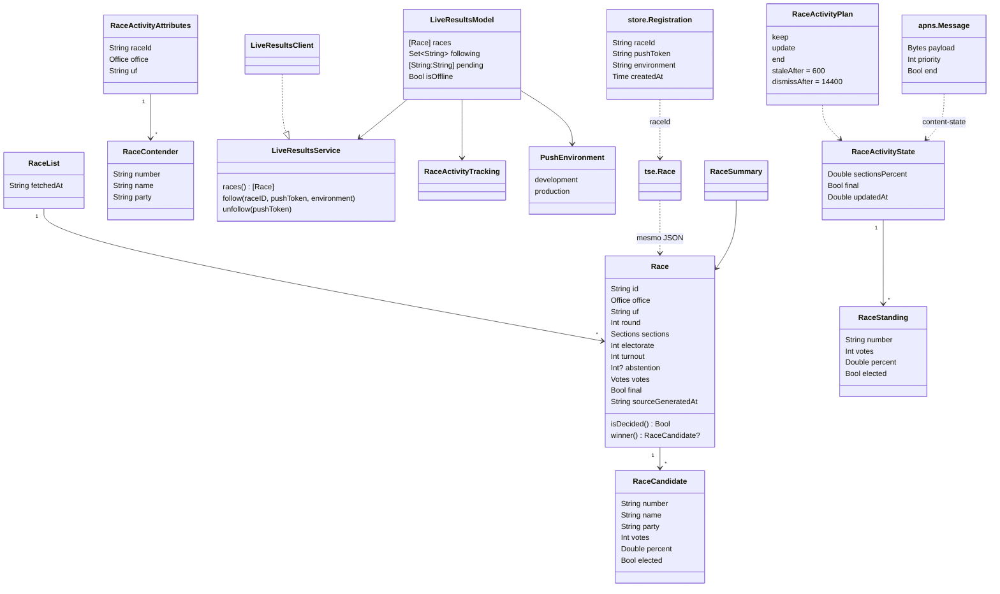

# Apuração ao vivo e Atividade ao Vivo da disputa

## Requirements

Quem acompanha a eleição quer o placar oficial do TSE sem ficar recarregando sites: a tela Apuração (aberta por Fiscalizar, pelo card de Hoje, pela Memória, pelo atalho "Ver a apuração" e por `fiscal://races`) mostra as 7 disputas do 2º turno de 2026 (`presidente-br` e governador de AC, AM, DF, ES, RN e TO), e a pessoa pode seguir uma disputa na tela de bloqueio e na Dynamic Island, com o placar empurrado pelo servidor por push. O servidor lê o TSE, publica arquivos estáticos e manda os pushes; o app só lê arquivos, recebe push e registra o token. Fica de fora: projeção, pesquisa ou tendência, apuração por cidade ou mapa, push-to-start da Atividade, canais de broadcast do APNs, os alertas de destaque (`HighlightActivities`, outra capacidade) e a Memória das eleições passadas.

Definição de pronto (os nomes de pessoas são fictícios, pela Constituição 14; os testes citados usam os das próprias fixtures):

- **Given** `v2/races.json` na CDN com `fetchedAt` `2026-10-25T20:42:15Z` e `presidente-br` apurando (25%, não final) **When** o app lê às 20:43:15Z (60 s depois) **Then** usa a CDN; às 20:52:15Z (600 s) cai para `GET /api/v1/races`; com a disputa final, a CDN vale mesmo 86.400 s depois (`` `LiveResultsClientTests.distrustsALiveCountThatStoppedUpdating` ``, `` `LiveResultsClientTests.readsTheRaceList` ``).
- **Given** todas as disputas com `sections.counted == 0` **When** a tela carrega **Then** `isWaiting` é verdadeiro, o aviso com o símbolo `clock` diz "A apuração começa às 17h (Brasília). Os números vêm direto do TSE, sem projeção nem pesquisa.", o estado da disputa é "Começa às 17h (Brasília)" e percentual e votos de cada candidato são "—", nunca 0 (`` `LiveResultsModelTests.waitsUntilTheCountStarts` ``, `` `LiveResultsModelTests.showsDashesBeforeTheCountStarts` ``).
- **Given** uma leitura anterior com 1 disputa e a próxima `races()` falhando **When** a tela atualiza **Then** `isOffline` é verdadeiro, a disputa continua na tela e o aviso com `wifi.slash` diz "Sem conexão. Mostrando os últimos números recebidos." (`` `LiveResultsModelTests.keepsTheLastNumbersWhenOffline` ``, `` `LiveResultsModelTests.noticeShowsOfflineFirst` ``).
- **Given** o serviço ausente (flag `liveResults` desligada ou sem `FiscalAPIURL`) ou a primeira leitura falhando sem nada em memória **When** a tela carrega **Then** `hasLoaded` é verdadeiro com `races` vazio e aparece "Resultados indisponíveis", "Não foi possível falar com o servidor de resultados. O app tenta de novo sozinho." e o botão "Tentar novamente" (`` `LiveResultsModelTests.showsTheUnavailableStateWithoutAServer` ``, `` `ShowcaseLiveResultsTests.unavailableAlwaysFails` ``).
- **Given** uma disputa com `final`, 100% das seções apuradas ou um candidato com `elected` **When** o app calcula `Race.winner` **Then** o vencedor é o eleito pelo TSE; sem eleito, é o primeiro no 2º turno ou com até 2 candidatos; no 1º turno com mais de 2 candidatos não há vencedor (roteiro manual: servidor com `SIMULATE=1` levando uma disputa a 100% e conferir o cartão de vitória e o cartaz).
- **Given** `presidente-br` apurando e `governador-ac` já final **When** a próxima leitura traz `presidente-br` final com Ana eleita **Then** o VoiceOver anuncia "Presidente · Brasil: Ana eleito(a)" uma vez, e nada é anunciado para a disputa que já estava final (`` `LiveResultsModelTests.announcesOnlyRacesThatJustEnded` ``).
- **Given** `presidente-br` não final e as Atividades ao Vivo ligadas **When** a pessoa toca "Acompanhar na tela de bloqueio" **Then** a Atividade começa com `pushType: .token`, o token `abc123` vai em `POST /api/v1/live-activities` com `{"raceId":"presidente-br","pushToken":"abc123","environment":"production"}` e sai da fila `pending`; ao tocar "Parar de acompanhar", a Atividade acaba na hora e o app manda `DELETE /api/v1/live-activities` com `{"pushToken":"abc123"}` (`` `LiveResultsModelTests.followingRegistersThePushToken` ``, `` `LiveResultsClientTests.registersWithTheContractKeys` ``, `` `LiveResultsClientTests.unregistersWithTheTokenInTheBody` ``).
- **Given** o registro do token falhando com `LiveResultsError.unavailable` (rede, 429 ou 5xx) **When** a fila é enviada **Then** o token fica em `pending` para a próxima tentativa; com `LiveResultsError.rejected(422)` o token sai da fila e o alerta diz "O servidor não aceitou esta Atividade ao Vivo. Tente acompanhar de novo." (`` `LiveResultsModelTests.keepsTheTokenWhenTheServerIsDownAndDropsItWhenRejected` ``, `` `LiveResultsClientTests.separatesRejectionsFromOutages` ``).
- **Given** o ActivityKit recusando o pedido **When** a pessoa tenta seguir **Then** a disputa não fica seguida e o alerta diz "Não foi possível iniciar a Atividade ao Vivo. Tente de novo." ou, com as Atividades desligadas, "As Atividades ao Vivo do Fiscal estão desligadas nos Ajustes." (`` `LiveResultsModelTests.explainsWhenActivitiesAreOff` ``).
- **Given** uma Atividade seguida e a tela aberta **When** chega uma leitura nova **Then** `RaceActivityPlan.next` devolve `.keep` com o mesmo estado ou com `updatedAt` mais antigo, `.update` enquanto apura e `.end(_, dismissAfter: 14_400)` quando a disputa é final; a relevância é 100 para presidente e 50 para governador (`` `RaceActivityPlanTests` ``, `` `LiveResultsModelTests.updatesFollowedActivitiesWithFreshNumbers` ``).
- **Given** a Atividade de `presidente-br` na tela de bloqueio **When** chega o push de fim com a Pessoa A eleita, ou passam 600 s sem atualização **Then** a tela de bloqueio mostra "ELEITO", o nome e o percentual do eleito, e some 4 h depois; sem atualização, o rodapé vira "Sem atualização desde <hora> · TSE" com a opacidade reduzida (roteiro manual: servidor com `SIMULATE=1` e Atividade iniciada no iPhone físico).
- **Given** o poller com 2 tokens registrados em `presidente-br` **When** o TSE traz o primeiro arquivo, repete o mesmo, muda o placar e depois marca final **Then** saem 2, 0, 2 e 2 pushes (o último com `event` `end`) e nenhum push depois do fim; o push de fim tem prioridade 10, `dismissal-date` = agora + 14.400 s e o alerta "Resultado" / "{nome} foi eleito(a)" (`` `TestPollPushesOnlyOnChangeAndStopsAfterEnd` `` em `server/internal/live/service_test.go`, `` `TestBuildEndPayloadExact` `` em `server/internal/apns/apns_test.go`).
- **Given** um `POST /api/v1/live-activities` com token de 31 ou 401 caracteres, token não hexadecimal, `raceId` `senador-sp` ou `environment` `staging` **When** o servidor valida **Then** responde 422 `invalid_request`; com corpo acima de 4 KiB, 413 `body_too_large`; e nada é guardado (`` `TestRegisterValidation` `` em `server/internal/httpapi/server_test.go`).
- **Given** um token já registrado em `presidente-br` / `development` **When** ele chega para `governador-df` ou para `production` **Then** o servidor responde 409 `token_bound_to_other_race`; a 21ª inscrição do mesmo IP (ou do mesmo /64 IPv6) recebe 429 `too_many_registrations` e o depósito cheio recebe 507 `capacity_reached` (`` `TestTokenStaysBoundToItsRace` ``, `` `TestRegistrationCapPerAddress` `` e `` `TestRegisterCapacity` `` em `server/internal/httpapi/server_test.go`).

## Entities

- `Race`, `RaceCandidate` e `RaceList` moram em `FiscalKit/Sources/FiscalDomain/LiveResults/Race.swift`; são o contrato JSON do servidor, com `abstention` opcional; `Race+Decision.swift` acrescenta `isDecided` e `winner`.
- `RaceActivityAttributes` (só iOS com ActivityKit), `RaceContender`, `RaceActivityState`, `RaceStanding`, `RaceActivityRow` e `RaceActivityPlan` moram em `FiscalKit/Sources/FiscalDomain/LiveResults/RaceActivity.swift` e são compartilhados com a extensão de widgets.
- `PushEnvironment`, o protocolo `LiveResultsService` e `LiveResultsError` (`rejected(Int)`, `unavailable`) moram em `FiscalKit/Sources/FiscalDomain/LiveResults/LiveResultsService.swift`.
- `LiveResultsClient` e o ator `AppAttestor` moram em `FiscalKit/Sources/FiscalData/LiveResults/`.
- `LiveResultsModel`, o protocolo `RaceActivityTracking` com a implementação `RaceActivities`, `RaceSummary`, `RaceRegion`, `RaceStatusFilter` e `RaceGroup` moram em `FiscalKit/Sources/FeatureLiveResults/`.
- `tse.Race` (Go) mora em `server/internal/tse/model.go` e gera o mesmo JSON, com `abstention` sempre presente; `store.Registration` mora em `server/internal/store/store.go` (a origem com hash não é gravada, `json:"-"`); `apns.Message` mora em `server/internal/apns/payload.go`.
- Não há schema SwiftData envolvido (nenhum `FiscalSchemaV<N>`, nada no CloudKit); o único estado local é a chave `AppAttestKeyID` em `UserDefaults` e as Atividades guardadas pelo próprio ActivityKit.

## Approach

1. **Estratégia da solução:** o contêiner `fiscal-api` (`server/cmd/server`) lê os 7 arquivos do TSE em paralelo a cada 20 s, com `ETag`, grava `PUBLIC_DIR/v1/races.json` e `v1/races/{id}.json` com `.gz` antes de empurrar, e manda push APNs só aos tokens da disputa cujo placar mudou, até o fim. O `fiscal-pages` copia esses arquivos para `v2/` no Cloudflare Pages. O app lê `v2/races.json` na CDN quando está fresco, senão `GET /api/v1/races` na VPS, senão o pacote offline; a tela atualiza a cada 15 s enquanto está aberta e atualiza localmente as Atividades seguidas; com o app fechado, só o push mexe na Atividade.
2. **Decisões:**
   - Leitura sem código: o poller grava arquivos prontos e o Caddy ou a CDN os entrega; o Go só recebe o registro de token e responde a API de reserva; descartada a API dinâmica com cache em memória. ADR: `docs/adr/0002-static-first-server.md`.
   - CDN primeiro, com 300 s de validade enquanto há disputa ao vivo, e a VPS como reserva; o deploy de apuração no Pages sai na hora quando os arquivos mudam; descartado o app lendo o TSE direto (fica como plano B). ADR: `docs/adr/0007-pages-cdn-phased-ingest.md`.
   - Push por token registrado, com prazo de 12 h; descartados por ora os canais de broadcast do APNs e o push-to-start, previstos para depois. ADR: `docs/adr/0002-static-first-server.md` (item 5).
   - App Attest no registro, `optional` por padrão e `required` na VPS, com teto próprio para o que vem sem asserção; descartado aceitar só por limite de taxa. ADR: `docs/adr/0007-pages-cdn-phased-ingest.md` (item 7).
   - `updatedAt` como segundos Unix em `Double`, não `Date`, porque o decodificador padrão do ActivityKit lê `Date` como segundos desde 2001; descartado `Date`. ADR: não precisa (registrado na mudança `docs/changes/archive/2026-10-29-live-results/proposal.md`).
   - A Atividade guarda nome e partido nos atributos fixos e só números no `content-state`, juntados pelo `number`; descartado mandar nomes em todo push. ADR: não precisa.
   - Cor do candidato pela `PartyPalette` do partido, igual para todos e nunca da Lente; descartada a versão neutra sem cor da proposta original. ADR: não precisa (decisão da spec viva).
   - A apuração e a carga de dados rodam em processos separados, e o reinício da apuração só apaga `races*`; descartado o modo `ingest` dentro do servidor da apuração. ADR: `docs/adr/0005-data-ingest-process.md`.
   - `races.json` entra no pacote offline; a Atividade nunca busca dado, só recebe push. ADR: `docs/adr/0015-background-fetch-offline-pack.md`, `docs/adr/0018-widgets-read-public-data.md`.
   - Tokens de push declarados no rótulo de privacidade da loja. ADR: `docs/adr/0017-app-store-privacy-label.md`.
   - App só em pt-BR e números de destaque na Bricolage, inclusive na Live Activity. ADR: `docs/adr/0003-portuguese-only.md`, `docs/adr/0009-bricolage-emphasis-font.md`.
3. **Tratamento de erros:**
   - Leitura na CDN que falha, não decodifica ou está velha cai em silêncio para a API; a API que falha cai para o `races.json` do pacote offline e marca `OfflineNotice` (barra "Sem conexão · dados de <data>"); sem pacote, o erro sobe ao model.
   - No model, `CancellationError` e `URLError.cancelled` são ignorados; outro erro liga `isOffline` e mantém os números em memória; sem nada em memória aparece "Resultados indisponíveis".
   - `LiveResultsClient.check` traduz 2xx em sucesso, 4xx (menos 429) em `LiveResultsError.rejected` e o resto em `unavailable`; rejeitado tira o token da fila e mostra o alerta, indisponível mantém o token em `pending`.
   - Durante o bloqueio de atualização obrigatória, `HeldLiveResultsService.follow` lança `unavailable` e o token espera.
   - Com `401 attest_unknown_key`, o `AppAttestor` esquece a chave e o pedido é refeito uma vez; sem suporte ao App Attest, ou se a asserção falha, o pedido vai sem cabeçalhos.
   - `ActivityKit` que recusa `pushType: .token` recebe um segundo pedido sem push; se este falhar, o alerta explica.
   - No servidor, falha de leitura de uma disputa é registrada no log e não apaga a anterior; arquivo do TSE acima de 4 MiB, de outra eleição ou cargo, ou com número inválido é recusado; token que o APNs recusa (410, `BadDeviceToken`, `Unregistered`, `ExpiredToken`) é apagado; configuração inválida derruba o processo no boot; pânico vira 500 `internal_error`.
4. **Riscos:**
   - `races.json` só é regravado quando alguma disputa muda, então numa apuração parada por mais de 300 s o app sai da CDN e vai à VPS → limite de 120 leituras por minuto por IP e resposta montada do instantâneo em memória.
   - Token na fila `pending` vive só em memória → ao reabrir, `RaceActivities.resume()` volta a observar `pushTokenUpdates` e reenvia o token.
   - Um único poller na VPS → `state.json` guarda as disputas e as encerradas, e o boot republica os arquivos a partir dele.
   - Abuso do registro → teto de 50.000 registros, 20 por origem, 12 h de validade, App Attest `required` na VPS.
   - Chave APNs ausente → o boot falha a menos que `APNS_DISABLED=1`.

**Known divergences:**

- `Spec × código:` a spec diz que o `DELETE /api/v1/live-activities` leva "o mesmo corpo" do registro; o código manda só `{pushToken, challenge}` (`Removal` em `FiscalKit/Sources/FiscalData/LiveResults/LiveResultsClient.swift`) e o servidor lê só `pushToken` (`unregister` em `server/internal/httpapi/server.go`).
- `Spec × código:` a regra de vencedor da spec vale no app (`Race.winner`), mas a Live Activity usa a própria: `RaceBoard.winner` em `Fiscal/FiscalWidgets/RaceBoard.swift` toma o primeiro como vencedor sempre que a disputa é final ou chega a 100%, inclusive no 1º turno com mais de 2 candidatos, e mostra "ELEITO".
- `Spec × código:` a spec diz que, sem rede, o app usa o pacote offline "com o aviso 'Sem conexão. Mostrando os últimos números recebidos.'"; quando o pacote responde, `LiveResultsClient.races()` devolve normalmente, `isOffline` fica falso e o que aparece é a barra global "Sem conexão · dados de <data>" (`OfflineNoticeBar`); o aviso da tela só aparece quando a leitura inteira falha e há números em memória (`LiveResultsModel.refresh()`).
- `Spec × código:` a situação "decididas" do filtro e o `LiveResultsModel.statusText` usam só `race.final`, enquanto `Race.isDecided` e `RaceSummary.statusText` contam também 100% apurado; uma disputa a 100% sem `tf` mostra "Resultado final" no cartão e fica em "Em apuração" (`RaceStatusFilter.includes` em `FiscalKit/Sources/FeatureLiveResults/RaceRegion.swift`).
- `Spec × código:` o ADR 0007 diz que os desafios do App Attest valem 5 minutos; o código usa 2 minutos (`ChallengeTTL` em `server/internal/appattest/service.go`), como a spec.
- `Spec × código:` o ADR 0002 prevê o registro por token só enquanto o app estiver no TestFlight e a migração para os canais de broadcast; o código continua registrando por token.
- `Spec × código:` a spec diz que o job `apuracao` da carga "roda a cada 20 s"; no código ele é só um registro `JobExternal` na cadência (`server/internal/ingest/cadence.go`), e quem lê o TSE é o `fiscal-api`.
- `Playbook:` Constituição 14 (dado ausente é "—"): o rótulo de VoiceOver da Live Activity (`RaceWidgetText.row` em `Fiscal/FiscalWidgets/RaceBoard.swift`) fala "0,00%" e "0 votos" antes da apuração começar, enquanto a tela mostra "—".
- `Playbook:` Constituição 4 (tokens em vez de números soltos): `.minimumScaleFactor(0.5)`, `(0.6)`, `(0.7)` e `(0.8)` em `FiscalKit/Sources/FeatureLiveResults/RaceHeroCard.swift` (linhas 198, 203, 244) e `FiscalKit/Sources/FeatureLiveResults/RaceCompactCard.swift` (linhas 61, 148, 152), enquanto os widgets usam `.widgetScoreShrink` e `.widgetNameShrink`.
- `Playbook:` Reduzir movimento: `Fiscal/FiscalWidgets/RaceLiveActivity.swift` aplica `.contentTransition(.numericText(...))` sem consultar Reduzir movimento, ao contrário das telas do app, que usam `@ReducesMotion`.
- `Playbook:` chaves de `UserDefaults` com prefixo `fiscal.`: o id da chave do App Attest fica em `AppAttestKeyID` (`FiscalKit/Sources/FiscalData/LiveResults/AppAttestor.swift`).
- `Sem teste:` a regra de decidido e vencedor (`Race.isDecided`, `Race.winner` em `FiscalKit/Sources/FiscalDomain/LiveResults/Race+Decision.swift`) não tem teste direto.
- `Sem teste:` a tela de bloqueio, a Dynamic Island e o cartaz de eleito da Live Activity (`Fiscal/FiscalWidgets/RaceLiveActivity.swift`, `Fiscal/FiscalWidgets/RaceWinnerLockScreen.swift`) não têm teste; o ponta a ponta no iPhone físico segue no backlog.

## Structure

Camadas tocadas, com a regra de dependência do `FiscalKit`: `FiscalDomain` não depende de ninguém; `FiscalData` depende de `FiscalDomain`; `FeatureLiveResults` depende de `FeatureCore`, `FiscalDomain` e `FiscalDesignSystem` e não importa outra feature; `FeatureToday` e `FeatureMemory` chegam à apuração só por `Route.races` e `Route.race(id:)`, e o `AppShell` injeta o `RaceHeroCard` no card de Hoje por closure. A extensão `Fiscal/FiscalWidgets` importa só `FiscalDomain` e `FiscalDesignSystem`. O servidor Go (`server/`, módulo `liveresults`, só biblioteca padrão) não tem dependência com o app além do contrato JSON e do push.

- `FiscalKit/Sources/FiscalDomain/LiveResults/`
  - `Race.swift`, `Race+Decision.swift`, `RaceText.swift`, `PortraitShelf.swift`
  - `RaceActivity.swift`, `LiveResultsService.swift`
  - `RaceScenario.swift` (só Debug)
- `FiscalKit/Sources/FiscalData/LiveResults/`
  - `LiveResultsClient.swift`, `AppAttestor.swift`
- `FiscalKit/Sources/FiscalData/Showcase/ShowcaseLiveResults.swift` (só Debug, `-FiscalLiveScenario`)
- `FiscalKit/Sources/FiscalData/PublicData/Offline/OfflinePackPlan.swift` (inclui `races.json`)
- `FiscalKit/Sources/FeatureLiveResults/`
  - `LiveResultsModel.swift`, `RaceActivities.swift`, `RaceSummary.swift`, `RaceRegion.swift`
  - `LiveResultsScreen.swift`, `RaceDetailScreen.swift`, `RaceHeroCard.swift`, `RaceCompactCard.swift`, `RaceCharts.swift`, `RaceCountBar.swift`, `RaceWinnerCard.swift`
- `FiscalKit/Sources/FeatureToday/TodayRaceBoard.swift` (card de Hoje)
- `FiscalKit/Sources/AppShell/`
  - `FiscalServices.swift` (`liveResults()`, `liveResultsService()`), `Update/UpdateConnections.swift` (`HeldLiveResultsService`)
  - `DeepLink.swift`, `RouteScreen.swift`, `SectionScreen.swift`, `Integrations/FiscalIntents.swift` (`ShowRacesIntent`)
- `FiscalKit/Sources/FeatureCore/Flags/FeatureFlag.swift` (`liveResults`, ligada por padrão)
- `Fiscal/FiscalWidgets/`
  - `RaceLiveActivity.swift`, `RaceBoard.swift`, `RaceWinnerLockScreen.swift`, `FiscalWidgetsBundle.swift`, `Localizable.xcstrings`
- `Fiscal/Fiscal/`
  - `Info.plist` (`FiscalAPIURL`), `Fiscal.entitlements` (`aps-environment`, `com.apple.developer.devicecheck.appattest-environment` = `production`), `Localizable.xcstrings`; `NSSupportsLiveActivities` e `NSSupportsLiveActivitiesFrequentUpdates` no `Fiscal/Fiscal.xcodeproj/project.pbxproj`
- `server/`
  - `cmd/server/main.go`
  - `internal/tse/` (`model.go`, `fetch.go`, `parse.go`, `simulate.go`)
  - `internal/live/` (`service.go`, `publish.go`)
  - `internal/store/store.go`, `internal/apns/` (`client.go`, `jwt.go`, `payload.go`), `internal/appattest/` (`appattest.go`, `cbor.go`, `service.go`)
  - `internal/httpapi/` (`server.go`, `attest.go`, `ratelimit.go`), `internal/pages/pages.go`, `internal/ingest/cadence.go`
  - `compose.yaml`, `deploy/docker/api.Dockerfile`
- Testes
  - `FiscalKit/Tests/FiscalDomainTests/RaceTests.swift`, `RaceScenarioTests.swift`, `RaceActivityPlanTests.swift`
  - `FiscalKit/Tests/FiscalDataTests/LiveResultsClientTests.swift`, `ShowcaseLiveResultsTests.swift`
  - `FiscalKit/Tests/FeatureLiveResultsTests/LiveResultsModelTests.swift`
  - `FiscalKit/Tests/FeatureTodayTests/TodayRaceBoardTests.swift`, `FiscalKit/Tests/AppShellTests/DeepLinkTests.swift`, `FiscalKit/Tests/AppShellTests/UpdateBlockTests.swift`
  - `server/internal/tse/tse_test.go`, `server/internal/live/service_test.go`, `server/internal/live/publish_test.go`, `server/internal/store/store_test.go`, `server/internal/apns/apns_test.go`, `server/internal/appattest/appattest_test.go`, `server/internal/httpapi/server_test.go`, `server/internal/httpapi/attest_test.go`, `server/cmd/server/main_test.go`, `server/cmd/server/attest_test.go`

## Operations

1. **Leitura do TSE** (`server/internal/tse/model.go`, `server/internal/tse/fetch.go`, `server/internal/tse/parse.go`): `Definitions() []Definition` devolve `presidente-br` (eleição 6258, cargo 1) e `governador-{ac,am,df,es,rn,to}` (eleição 6260, cargo 3) nessa ordem; `KnownRace(id string) bool` confere o id. `HTTPSource.Fetch(ctx, d Definition) (Race, bool, error)` faz `GET` com `If-None-Match`, devolve `modified=false` no 304, recusa status diferente de 200 e corpo acima de 4 MiB e guarda o `ETag`. `Parse(d, data) (Race, error)` recusa outra eleição ou cargo, lê números em string e porcentagens com vírgula, marca `Final` com `tf == "s"` ou algum `e == "s"`, ordena por votos e, no empate, pelo número (`SortCandidates`), põe o nome de urna em caixa de título com `da`, `de`, `do`, `dos`, `das` e `e` minúsculos (`TitleName`) e converte `dg`/`hg` de Brasília em RFC 3339. `NewSimSource` simula a apuração em 10 min. Verificação: `cd server && go test ./internal/tse/...`.
2. [P] **Depósito de registros** (`server/internal/store/store.go`): `Open(dir string, o Options) (*Store, error)` cria a pasta `0700`, lê `registrations.json` e descarta os vencidos. `Put(r Registration) error` normaliza o token em minúsculas, renova `createdAt` se o mesmo token volta para a mesma disputa e ambiente, devolve `ErrBound` se volta para outra, `ErrCapacity` no teto e `ErrSourceLimit` na origem cheia. `Delete(token string) bool`, `ForRace(raceID string) []Registration` (só os vigentes) e `Flush() error`, que grava de forma atômica com `0600` (`WriteFileAtomic`) a cada 2 s pelo `Run`. Verificação: `cd server && go test ./internal/store/...`.
3. [P] **Push APNs** (`server/internal/apns/payload.go`, `server/internal/apns/client.go`, `server/internal/apns/jwt.go`): `BuildMessage(r tse.Race, now time.Time) (Message, error)` monta `aps` com `timestamp`, `event` `update`, `content-state` (`sectionsPercent`, `candidates` com `number`, `votes`, `percent`, `elected`, `final`, `updatedAt` = hora do arquivo do TSE ou agora) e `stale-date` = agora + 600 s, prioridade 5; com a disputa final, `event` `end`, `dismissal-date` = agora + 14.400 s, alerta "Resultado" / "<Nome> foi eleito(a)" ou "Apuração encerrada", prioridade 10. `Client.Send(ctx, n Notification) Result` usa HTTP/2 com JWT ES256, `apns-push-type: liveactivity`, `apns-topic` terminado em `.push-type.liveactivity`, `apns-expiration` de 5 min, host sandbox para `development` e produção para `production`; `Result.TokenInvalid()` é verdadeiro em 410 e em `BadDeviceToken`, `Unregistered` e `ExpiredToken`. Verificação: `cd server && go test ./internal/apns/...`.
4. [P] **App Attest no servidor** (`server/internal/appattest/`): `Service.Challenge(client string) (string, error)` cria um desafio de 32 bytes válido por 2 min, até 8 abertos por cliente; `Register(keyID, attestation, challenge)` verifica a cadeia até a raiz da Apple embutida, o nonce, o `rpIdHash` e o `aaguid` e guarda a chave em `attest-keys.json`; `Check(keyID, assertion, body)` confere a asserção sobre o corpo exato e o contador, com `ErrUnknownKey` e `ErrChallenge`; chave parada há 400 dias sai. Verificação: `cd server && go test ./internal/appattest/...`.
5. **Serviço da apuração** (`server/internal/live/service.go`, `server/internal/live/publish.go`): `PollOnce(ctx)` busca as 7 disputas em paralelo, cada uma com 10 s; atualiza `fetchedAt` quando alguma leitura dá certo; separa as disputas novas ou com `Changed(old, cur) bool` verdadeiro (seções apuradas, `final`, número de candidatos ou votos de algum candidato) e ainda não encerradas; chama `publish()`, que grava `v1/races/{id}.json` e só regrava `v1/races.json` quando alguma disputa mudou; depois `dispatch(ctx, r) Stats` manda o push a cada registro da disputa com até 8 trabalhadores, apaga os tokens recusados e registra no log só os 6 primeiros caracteres do token; com `event` `end`, marca a disputa como encerrada; por fim `saveState()` grava `state.json`. `LoadState()` e `ResetPublished()` restauram e republicam no boot. `Run(ctx, interval)` repete a cada intervalo. Depende de: 1, 2, 3. Verificação: `cd server && go test ./internal/live/...`.
6. **API HTTP** (`server/internal/httpapi/server.go`, `server/internal/httpapi/attest.go`, `server/internal/httpapi/ratelimit.go`): `New(c Config) http.Handler` registra `GET /api/health`, `GET /api/v1/races` (503 `not_ready` com `Retry-After: 20` antes do primeiro dado), `GET /api/v1/races/{id}` (404 `race_not_found` para id desconhecido), `POST /api/v1/attest/challenge`, `POST /api/v1/attest/keys`, `POST` e `DELETE /api/v1/live-activities` e a rota de administração `POST /api/v1/admin/push-test` (só com `ADMIN_TOKEN` de 32 ou mais caracteres). Todas respondem `Cache-Control: no-store` e erros `{"error":{"code","message"}}`. `limit` aplica 120 leituras e 120 escritas por minuto por IP (último endereço de proxy confiável, IPv6 agrupado por /64), com 429 `rate_limited` e `Retry-After: 60`; `attested` passa direto em `off`, exige asserção em `required` (401 `attest_required`) e, em `optional`, aplica 10 por minuto a quem vem sem asserção; `register` valida corpo, disputa, token e ambiente e grava com a origem como hash SHA-256 com sal aleatório do boot, truncado em 32 caracteres. Depende de: 2, 4, 5. Verificação: `cd server && go test ./internal/httpapi/...`.
7. **Processo `fiscal-api`** (`server/cmd/server/main.go`): `loadConfig(getenv) (config, error)` aplica os padrões (`127.0.0.1:3130`, `POLL_INTERVAL` 20 s entre 5 s e 10 min, `TSE_BASE_URL` https do TSE) e falha fechado sem as variáveis do APNs, salvo `APNS_DISABLED=1`; `attestConfig` decide `optional` quando há app id e `off` sem ele, e só aceita o ambiente de desenvolvimento com `APPATTEST_ALLOW_DEVELOPMENT=1`; `main` abre o depósito (50.000 registros, 20 por origem, 12 h), o poller, o App Attest e o servidor HTTP com limites de tempo e encerra gravando tudo no `SIGTERM`. Com `SIMULATE=1`, nada é publicado. Depende de: 6. Verificação: `cd server && go test ./cmd/server/...`.
8. [P] **Publicação no Pages** (`server/internal/pages/pages.go`): cada ciclo do `fiscal-pages` copia `v1/races.json` e `v1/races/*.json` para `v2/` da release e faz o deploy na hora quando o hash da apuração muda. Depende de: 5. Verificação: `cd server && go test ./internal/pages/...`.
9. **Domínio da disputa** (`FiscalKit/Sources/FiscalDomain/LiveResults/Race.swift`, `Race+Decision.swift`, `RaceText.swift`): `Race` decodifica o contrato e expõe `elected`, `leader` (o primeiro com votos), `hasStarted` (`sections.counted > 0`) e `generatedAt`; `isDecided` é `final`, 100% ou algum eleito; `winner` segue a tabela da definição de pronto. `RaceText` formata título ("Presidente · Brasil"), UF por extenso, porcentagens com 2 e 1 casas, votos, seções ("<n> de <total> seções"), hora e "<Nome> eleito(a)". Verificação: `scripts/test.sh --affected`. Cobre: a regra de vencedor.
10. [P] **Estado da Atividade** (`FiscalKit/Sources/FiscalDomain/LiveResults/RaceActivity.swift`): `RaceActivityState.init(race:now:)` copia seções e candidatos e usa a hora do arquivo do TSE em `updatedAt`; `rows(with contenders: [RaceContender]) -> [RaceActivityRow]` junta pelo `number`, com o número no lugar do nome quando falta; `RaceActivityAttributes.init(race:)` fixa id, cargo, UF e candidatos; `RaceActivityPlan.next(current:race:now:) -> RaceActivityPlan` devolve `.keep` sem mudança ou com estado mais antigo, `.end` com 14.400 s para a disputa final e `.update` no resto; `relevance(for:)` dá 100 ou 50. Verificação: `scripts/test.sh --affected`. Cobre: o plano da Atividade.
11. [P] **Cenários de Debug** (`FiscalKit/Sources/FiscalDomain/LiveResults/RaceScenario.swift`, `FiscalKit/Sources/FiscalData/Showcase/ShowcaseLiveResults.swift`): `RaceScenario` (`waiting`, `early`, `close`, `tie`, `decided`, `finished`, `longNames`, `progressing`, `offline`, `unavailable`, `firstRound`) gera as 7 disputas com votos que somam os válidos e porcentagens que somam 100; `ShowcaseLiveResults` responde por `-FiscalLiveScenario`, falha sempre em `unavailable` e depois da primeira leitura em `offline`, e avança um passo por leitura em `progressing`. Tudo só em Debug. Verificação: `scripts/test.sh --affected`.
12. **Cliente da apuração** (`FiscalKit/Sources/FiscalData/LiveResults/LiveResultsClient.swift`, `FiscalKit/Sources/FiscalData/LiveResults/AppAttestor.swift`): `fromBundle(_:) -> LiveResultsClient?` lê `FiscalAPIURL` (com sobreposição por `UserDefaults` só em Debug) e a URL de dados públicos. `races() async throws -> [Race]` tenta `v2/races.json` e o aceita se `isCurrent(_:now:)` (nenhuma disputa ao vivo, ou `fetchedAt` há no máximo 300 s); senão `v1/races` com 15 s; se falhar, o `races.json` do pacote offline e `OfflineNotice.markOffline`. `follow(raceID:pushToken:environment:)` e `unfollow(pushToken:)` passam por `attested`, que pede ao `AppAttestor.prepare` um desafio e a chave (atestada uma vez e guardada em `AppAttestKeyID`), assina o corpo exato e manda `X-Fiscal-Attest-Key` e `X-Fiscal-Attest-Assertion`; com 401 `attest_unknown_key`, esquece a chave e tenta de novo uma vez; sem App Attest, manda sem cabeçalhos. Depende de: 9. Verificação: `scripts/test.sh --affected`. Cobre: a CDN fresca e o registro do token.
13. **Montagem no AppShell** (`FiscalKit/Sources/AppShell/FiscalServices.swift`, `FiscalKit/Sources/AppShell/Update/UpdateConnections.swift`): `liveResultsService() -> (any LiveResultsService)?` devolve `nil` com a flag `liveResults` desligada, o `ShowcaseLiveResults` em Debug com cenário, e senão o `LiveResultsClient` embrulhado em `HeldLiveResultsService`, que recusa `follow` com `unavailable` enquanto a atualização obrigatória segura as conexões; `liveResults() -> LiveResultsModel` usa `PushEnvironment.development` em Debug e `production` no resto. Depende de: 12. Verificação: `scripts/test.sh --affected`.
14. [P] **Controle das Atividades** (`FiscalKit/Sources/FeatureLiveResults/RaceActivities.swift`): `RaceActivities`, `@MainActor`, implementa `RaceActivityTracking`. `start(_ race: Race) throws` pede `Activity.request` com `staleDate` = agora + 600 s, relevância do plano e `pushType: .token`, e repete sem push se o sistema recusar; `resume()` volta a observar as Atividades vivas; `update(_ race: Race) async` aplica o `RaceActivityPlan` a cada Atividade da disputa (fim com `dismissalPolicy: .after(agora + 14.400 s)`); `end(raceID:) async -> [String]` encerra na hora e devolve os tokens; `observe` converte `pushTokenUpdates` em hex e chama `onToken`, e chama `onFinish` quando a Atividade acaba ou é dispensada. Fora do iOS, uma versão vazia com `isAvailable` falso. Depende de: 10.
15. **Model da apuração** (`FiscalKit/Sources/FeatureLiveResults/LiveResultsModel.swift`): `LiveResultsModel`, `@MainActor @Observable`, recebe serviço, rastreador, ambiente e intervalo (15 s). `run() async` lê as Atividades vivas e repete `refresh()` a cada intervalo; `refresh() async` envia a fila `pending`, lê as disputas, calcula `announcement`, atualiza as Atividades seguidas ou liga `isOffline`; `flushPending() async` registra cada token e trata `rejected` e `unavailable`; `toggle(_ race: Race) async` segue ou deixa de seguir, com `changing` impedindo toque duplo; `groups`, `regionChoices`, `region`, `status`, `scopeText` e `filterSummary` montam os grupos por região e os filtros; `notice`, `statusText`, `percentText`, `votesText`, `followLabel`, `accessibilityLabel`, `updatedText` e `showsFollow` (seguir só antes do fim, ou para quem já segue) dão os textos; `detailPhase(for:)` e `loadDetail(id:)` decidem entre carregando, pronta e indisponível. Depende de: 13, 14. Verificação: `scripts/test.sh --affected`. Cobre: espera, sem conexão, indisponível, anúncio, seguir, erros de registro e de início.
16. **Resumo da disputa e filtros** (`FiscalKit/Sources/FeatureLiveResults/RaceSummary.swift`, `FiscalKit/Sources/FeatureLiveResults/RaceRegion.swift`): `RaceSummary(race:)` monta concorrentes (com "—" antes da apuração, `dimmed` para o não eleito na disputa final), vencedor, "Eleito com <x> dos votos válidos", "Diferença: <n> votos", a linha de 50% (`majorityCut`) só no 1º turno com mais de 2 candidatos, a divisão de votos válidos, brancos, nulos e abstenção, o comparecimento, o eleitorado e os rótulos de acessibilidade; `RaceRegion.of(uf:)` agrupa as UFs em Norte, Nordeste, Centro-Oeste, Sudeste e Sul; `RaceStatusFilter` tem "Todas as disputas", "Em apuração" e "Definidas". Depende de: 9. Verificação: `scripts/test.sh --affected`.
17. **Telas** (`FiscalKit/Sources/FeatureLiveResults/LiveResultsScreen.swift`, `RaceDetailScreen.swift`, `RaceHeroCard.swift`, `RaceCompactCard.swift`, `RaceCharts.swift`, `RaceCountBar.swift`, `RaceWinnerCard.swift`): `LiveResultsScreen` com título "Apuração", subtítulo do escopo, menu de filtros na barra, aviso, herói da disputa principal (presidente), grupos por região em `CardGrid`, rodapé "Números direto do TSE, sem projeções nem pesquisas.", atualização ao puxar e anúncio do VoiceOver; `RaceDetailScreen` com o herói e as seções "Candidatos", "Votos das urnas apuradas" e "Apuração" (percentual em Bricolage com `.monospacedDigit()`, `ProgressBar`, "<n> de <total> seções", "Eleitorado" e "Comparecimento", rodapé "Arquivo do TSE das <hora>"); o botão de seguir do herói e do cartão compacto, com rótulo e dica para o VoiceOver; gráficos com `RuleMark` tracejada em 50%; animações desligadas com Reduzir movimento. Depende de: 15, 16.
18. **Integração no app** (`FiscalKit/Sources/AppShell/DeepLink.swift`, `RouteScreen.swift`, `SectionScreen.swift`, `Integrations/FiscalIntents.swift`, `FiscalKit/Sources/FeatureToday/TodayRaceBoard.swift`): `fiscal://races` abre `Route.races` em Fiscalizar e `fiscal://race/<id>` abre `Route.race(id:)`; `ShowRacesIntent` ("Ver a apuração") abre `fiscal://races`; `TodayRaceBoard.featured(in:now:)` destaca a disputa de presidente ao vivo, senão outra ao vivo, senão o presidente final por até 86.400 s, e o card de Hoje usa o `RaceHeroCard` injetado pelo `AppShell`. Depende de: 17. Verificação: `scripts/test.sh --affected`.
19. **Live Activity** (`Fiscal/FiscalWidgets/RaceLiveActivity.swift`, `Fiscal/FiscalWidgets/RaceBoard.swift`, `Fiscal/FiscalWidgets/RaceWinnerLockScreen.swift`, `Fiscal/FiscalWidgets/FiscalWidgetsBundle.swift`): `RaceLiveActivity` declara a `ActivityConfiguration` de `RaceActivityAttributes`: tela de bloqueio com "AO VIVO" ou "FINAL", título, "Arquivo do TSE das <hora>" (ou "Sem atualização desde <hora> · TSE" quando velha, com opacidade reduzida), os dois primeiros com foto do `PortraitShelf`, percentual em Bricolage, partido, o centro com o percentual apurado e uma `ProgressBar`, e a barra de divisão; com vencedor, `WinnerLockScreen` com "ELEITO"; Dynamic Island expandida, compacta (só o símbolo quando a ilha é estreita, atrás de `#available(iOS 27, *)`) e mínima; toque abre `fiscal://races`. `RaceBoard(context:)` junta atributos e estado e decide vencedor, cores do partido e textos. O pacote registra a língua e a Bricolage no `init()`. Depende de: 10. Cobre: a tela de bloqueio da Atividade.
20. [P] **Textos** (`Fiscal/Fiscal/Localizable.xcstrings`, `Fiscal/FiscalWidgets/Localizable.xcstrings`, `Fiscal/Fiscal/AppShortcuts.xcstrings`): chaves em inglês com só a tradução `pt-BR`, no app e na extensão de widgets; o texto do push de fim vem pronto em pt-BR do servidor. Verificação: `scripts/strings.sh`.

## Norms

- Constituição 1 e ADR `docs/adr/0003-portuguese-only.md`: código, chaves de texto e nomes de tipos em inglês; o catálogo do app e o dos widgets têm só `pt-BR`; texto visível pela chave (`Text("Key")` nas telas, `String(appLocalized:)` no model, no domínio e no widget).
- Constituição 3: features não se importam; a apuração é aberta por `Route.races` e `Route.race(id:)`, e o card de Hoje recebe o `RaceHeroCard` por injeção do `AppShell`; `LiveResultsModel` é `@MainActor @Observable`, injetado por `@Environment(LiveResultsModel.self)`, com `@Bindable var results = results` dentro do `body`; lógica, formatação e ações ficam no model e no `RaceSummary`, as views só desenham, uma subview por seção.
- Constituição 3: o acesso ao ActivityKit fica atrás de `RaceActivityTracking`, e o servidor atrás de `LiveResultsService`, para que o model seja testado com dublês.
- Constituição 4: zero comentários, zero warnings, Swift Testing para toda lógica nova no app e `go test` para o servidor; espaçamentos, raios, tamanhos, opacidades e fontes pelos tokens do `FiscalDesignSystem` (`.spaceL`, `.radiusGroup`, `.badgeXL`, `.opacitySoft`, `.scoreboardTitle`).
- Constituição 5: nunca anel nem progresso circular para a apuração; o percentual apurado usa `ProgressBar` e barras que preenchem.
- Constituição 5 e ADR `docs/adr/0009-bricolage-emphasis-font.md`: números e títulos de destaque na Bricolage (`Font.emphasis`, `.scoreboardTitle`, `.scoreboardNumber`, `.candidatePercentLarge`), inclusive na Live Activity, sempre com `.monospacedDigit()`; nunca SF condensada, arredondada, mono, nem SF heavy ou black em tamanho fixo.
- Constituição 5: Reduzir movimento respeitado nas telas com `@ReducesMotion` (sem `numericText`, sem revelação animada das barras e gráficos).
- Constituição 5: toolbar sem `.fill` (o filtro usa `line.3.horizontal.decrease`, com o número de filtros ativos no próprio botão) e rodapés que explicam a fonte e a linha de 50%.
- Constituição 13: o que é do iOS 27 (`isDynamicIslandLimitedInWidth`) fica atrás de `#available(iOS 27, *)`, com alternativa no 26.
- Constituição 14: só o número oficial do TSE, com a hora do arquivo ("Arquivo do TSE das <hora>"), sem projeção, pesquisa, tendência ou adjetivo; dado ausente antes da apuração é "—", nunca 0; a mesma cor da `PartyPalette` para cada partido, para todo mundo, nunca a da Lente.
- ADR `docs/adr/0002-static-first-server.md`: leitura nunca chama código no caminho da CDN; a única escrita pública é o registro de token, pequeno, com limite e teto; o app nunca consulta o TSE.
- ADR `docs/adr/0007-pages-cdn-phased-ingest.md`: o app lê primeiro `v2/races.json` no Pages e só depois `api/v1/races` da VPS; os dois `POST` com dados aceitam App Attest.
- ADR `docs/adr/0018-widgets-read-public-data.md`: a Live Activity da apuração recebe números só por push e não busca nada.
- Playbook de backend (skill `byescaleira-workspace:backend`): Go só com a biblioteca padrão, configuração que falha fechada no boot, erros `{"error":{"code","message"}}` em `snake_case`, `Cache-Control: no-store` nas respostas da API, log sem segredo nem token completo, escrita atômica com `0600`.
- Verificação (Constituição 7): `scripts/test.sh --affected` para o Swift e `cd server && go test ./internal/<pacote>/...` para o servidor durante o trabalho; nunca dizer que a Live Activity foi verificada sem o iPhone físico.

## Safeguards

- **Funcional:** o app nunca mostra projeção, tendência ou número que não veio do TSE; nunca mostra 0 no lugar de "—" antes da apuração; nunca anuncia no VoiceOver uma disputa que já estava final na leitura anterior; nunca volta a Atividade para números mais antigos (`updatedAt` menor) nem a atualiza depois do fim; o servidor nunca empurra push com o placar igual nem depois do `end` de uma disputa; um token nunca troca de disputa ou de ambiente enquanto vale (409).
- **Desempenho:** o poller lê o TSE a cada 20 s (`POLL_INTERVAL` de 5 s a 10 min), com 10 s por pedido e arquivo de até 4 MiB; o app atualiza a cada 15 s com a tela aberta e espera 15 s por pedido; a CDN vale por 300 s com disputa ao vivo; a Atividade fica velha 600 s depois da última atualização e some 14.400 s depois do fim; push com até 8 envios paralelos e `apns-expiration` de 5 min; 120 leituras e 120 escritas por minuto por IP, 10 por minuto sem App Attest; corpo de até 4 KiB no registro e 16 KiB na chave; o depósito grava a cada 2 s.
- **Privacidade:** o registro leva só `raceId`, `pushToken`, `environment` e o desafio, nada da pessoa nem da Lente; o IP nunca é gravado (só o hash SHA-256 com sal aleatório do boot, truncado, e só em memória para a contagem por origem); o log mostra no máximo os 6 primeiros caracteres do token, e o caminho com token é truncado; os tokens ficam por até 12 h em `registrations.json` (`0600`, pasta `0700`) e estão declarados no rótulo de privacidade (ADR 0017); a Atividade e a tela não enviam nada ao TSE.
- **Dados:** nenhum dado da pessoa é salvo pelo app além do id da chave do App Attest; não há schema SwiftData nem CloudKit nesta capacidade; no servidor, `state.json`, `registrations.json` e `attest-keys.json` são gravados de forma atômica, e o reinício só apaga e republica `races.json` e `races/`, nunca os arquivos da carga.
- **Compatibilidade da versão publicada:** não quebram sem nova mudança: as chaves JSON de `Race` (`id`, `office`, `uf`, `round`, `sections`, `electorate`, `turnout`, `abstention` opcional, `votes`, `candidates`, `final`, `sourceGeneratedAt`) e de `RaceList` (`races`, `fetchedAt`) em `v1/` e `v2/races.json`; os ids das 7 disputas; o `content-state` do push (`sectionsPercent`, `candidates` com `number`, `votes`, `percent`, `elected`, `final`, `updatedAt` em segundos Unix `Double`) e os campos de `RaceActivityAttributes` (`raceId`, `office`, `uf`, `candidates`), lidos pelas Atividades já abertas nos aparelhos; as rotas `POST` e `DELETE /api/v1/live-activities` com o token no corpo, `POST /api/v1/attest/challenge` e `/keys`, os cabeçalhos `X-Fiscal-Attest-Key` e `X-Fiscal-Attest-Assertion` e os códigos de erro; o tópico `.push-type.liveactivity`; os deep links `fiscal://races` e `fiscal://race/<id>`; o `ShowRacesIntent`; a chave `AppAttestKeyID` (renomear força nova atestação); as chaves de texto já no catálogo. A antiga rota `DELETE /api/v1/live-activities/{pushToken}` da primeira versão já saiu (`TestOldDeleteRouteIsGoneAndStaysRedacted`).
- **Fora do escopo:** uma geração nesta área não pode acrescentar sem nova mudança: projeção, pesquisa ou "tendência"; leitura do TSE pelo app; rota de busca ou cálculo por acesso no servidor; push-to-start ou canais de broadcast; apuração por cidade, mapa ou cargos além dos 7; dado da pessoa ou da Lente no registro; dependência externa no servidor Go; novo idioma no catálogo; anel ou progresso circular.
