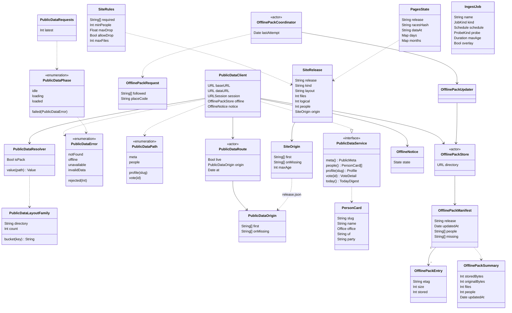

# Dados públicos: arquivos, CDN, cache, erros, pacote offline e carga

## Requirements

O Fiscal lê tudo que não é a apuração (perfis, votações, pauta, dinheiro, lugares, Hoje, destaques, indicadores e a Memória) de arquivos JSON estáticos, preparados pela carga das fontes oficiais na VPS e servidos pela CDN `dados.fiscal.byescaleira.com` (Cloudflare Pages). O valor para quem usa é abrir qualquer tela rápido, mesmo em pico de acesso, ver a cópia guardada com aviso quando a rede some e nunca receber uma release quebrada. O escopo é o contrato dos arquivos (`v1` na origem e `v2` agrupado na CDN), o `PublicDataClient` com a rota, o cache HTTP e a leitura da origem para os arquivos quentes, a classificação dos erros e o que a tela mostra para cada um (`PublicDataPhase`, `PublicDataContent`, `OfflineNoticeBar`), o pacote offline com a tarefa em segundo plano, e no servidor a cadência da carga, a montagem e validação da release `v2` e a publicação no Pages. Ficam de fora a apuração ao vivo (`races.json` só entra como arquivo do pacote offline), o conteúdo e o cálculo de cada família de arquivo (perfis, peso, destaques, checagens, indicadores e Memória têm canvas próprios), a ligação entre fontes e os slugs, a Lente, a tela de Ajustes › Dados offline e o deploy das imagens na VPS.

Definição de pronto:

- **Given** `v2/release.json` responde 200 com `layout: "v2"` **When** o app pede `cityRepresentatives(code: "1200708")` e `votes(slug: "lula", year: 2026)` **Then** lê o membro `place` de `v2/places/city/1200708.json` e o membro `files › votes-2026.json` de `v2/people/lula.json`, baixa `people/lula.json` uma única vez, nenhum pedido vai a `FiscalAPIURL`, e `proposals(slug: "lula", year: 2026)` sem membro dá `PublicDataError.notFound` (`PublicDataLayoutTests.readsTheGroupedFilesWhenTheReleaseIsLive`).
- **Given** `v2/release.json` responde 404, ou a release está ao vivo mas `v2/today.json` responde 503 **When** o app pede `today()` **Then** lê `https://fiscal.byescaleira.com/api/v1/today.json` (`PublicDataLayoutTests.fallsBackToTheCurrentServerUntilTheReleaseIsLive`, `PublicDataLayoutTests.fallsBackWhenTheCDNIsDown`).
- **Given** a release com `origin.first` contendo `today.json` **When** o app pede `today()` **Then** lê primeiro `/api/v1/today.json` na origem com limite de 6 s e não pede `v2/today.json`; com 503 ou `cannotConnectToHost` na origem, lê `v2/today.json` no Pages em vez da cópia guardada da origem (`PublicDataOriginTests.readsTheHotFilesFromTheOriginFirst`, `PublicDataOriginTests.theOriginGetsAShortTimeout`, `PublicDataOriginTests.fallsBackToPagesInsteadOfTheCachedOriginCopy`).
- **Given** `today.json` já recebido com `ETag: "v1"` **When** o app pede de novo e o servidor responde 304 **Then** o pedido leva `If-None-Match: "v1"` e o valor devolvido é igual ao primeiro (`PublicDataClientTests.revalidatesWithTheETagAndKeepsTheCachedCopy`).
- **Given** o arquivo responde 404 ou 410 **When** a tela carrega **Then** o estado é `PublicDataPhase.failed(.notFound)` e a tela mostra "Não foi possível carregar os dados", "Este dado ainda não foi publicado." e "Tentar novamente" (`PublicDataClientTests.tellsMissingFilesFromRejectionsAndOutages`; texto: roteiro manual `-FiscalDataScenario empty` abrindo um perfil).
- **Given** o arquivo responde 403 **When** o app pede `money()` **Then** o erro é `PublicDataError.rejected(403)` e a tela mostra "Não foi possível falar com o servidor de dados públicos. Tente de novo daqui a pouco." (`PublicDataClientTests.tellsMissingFilesFromRejectionsAndOutages`; texto: roteiro manual em `docs/validation.md`, estados de erro).
- **Given** resposta 429 ou 503 sem cópia guardada, ou a origem e o Pages fora do ar sem cópia **When** o app pede `money()` ou `today()` **Then** o erro é `PublicDataError.unavailable`, com o mesmo texto do caso anterior (`PublicDataClientTests.tellsMissingFilesFromRejectionsAndOutages`, `PublicDataOriginTests.failsWhenTheOriginAndPagesAreDownWithoutACopy`; texto: roteiro manual `-FiscalDataScenario unavailable`).
- **Given** o corpo 200 "not json" **When** o app pede `today()` **Then** o erro é `PublicDataError.invalidData` e a tela mostra "Os dados públicos chegaram num formato que o Fiscal não consegue ler." (`PublicDataClientTests.tellsMissingFilesFromRejectionsAndOutages`; texto: roteiro manual com `FiscalDataURL` apontando para um arquivo inválido).
- **Given** sem rede (`notConnectedToInternet`) e o arquivo fora do cache e do pacote offline **When** o app pede `money()` ou `profile(slug: "ninguem")` **Then** o erro é `PublicDataError.offline` e a tela mostra "Disponível com conexão" e "Isso não está salvo para uso offline. Conecte-se à internet para ver." (`OfflinePackTests.readsThePackWhenThereIsNoConnection`; texto: roteiro manual `-FiscalDataScenario offline`).
- **Given** sem rede e `today.json` no pacote offline atualizado em `1_793_000_000` (26/10, 04:33 em Brasília), ou `votes/recent.json` no cache HTTP **When** o app pede o arquivo **Then** devolve a cópia guardada, `OfflineNotice.state` vira `.offline` com a data mais antiga mostrada até a rede voltar, e a barra no topo diz "Sem conexão · dados de 26/10, 04:33" (`OfflinePackTests.readsThePackWhenThereIsNoConnection`, `OfflinePackTests.showsTheOldestSavedDateUntilTheConnectionReturns`, `PublicDataClientTests.fallsBackToTheCachedCopyWhenOffline`; barra: roteiro manual "Modo avião e reabrir" em `docs/validation.md`).
- **Given** a release `r1`, `followed: ["seguida"]` e `placeCode: "sp"` com deputada, senadora e governador em `places/sp.json` **When** o pacote offline atualiza **Then** guarda 5 arquivos e 3 pessoas, pedidas na ordem `seguida`, `governador`, `senadora` (deputados ficam fora), com `updatedAt` igual ao relógio; uma segunda atualização com a mesma release pede só `/v2/release.json` (`OfflinePackTests.downloadsTheMinimumSetForThePersonAndTheirRegion`, `OfflinePackTests.skipsTheNetworkWhenTheReleaseDidNotChange`).
- **Given** o pacote da release `r1` guardado **When** a atualização roda sem rede, ou a release vira `r2` e `people/seguida.json` cai com `networkConnectionLost` **Then** `refresh` lança `PublicDataError.offline`, o resumo do pacote fica igual, `people/seguida.json` continua legível e o manifesto segue em `r1` (`OfflinePackTests.keepsThePackWhenTheConnectionDrops`).
- **Given** uma release de preparo sem `today.json`, com `meta.json` contando 9 pessoas contra 5 no índice, acima de `SITE_MAX_FILES` ou com mais de 20% menos pessoas que a anterior **When** o `fiscal-ingest` monta o site **Then** a montagem falha com `ErrValidation`, o link `ready` continua na release anterior e a pasta recusada é apagada (`TestStageRejectsBrokenReleasesAndKeepsTheReadyOne` em `server/internal/site/site_test.go`).
- **Given** uma release `live` montada logo depois do deploy de uma `full` **When** o `fiscal-pages` roda **Then** não publica ("data waits for the interval") até passar 1 h de `PAGES_DATA_INTERVAL`, uma release `full` e um rollback publicam na hora, e com o teto mensal atingido o deploy falha com `ErrBudget` mesmo com `-force` (`TestLiveDataWaitsForTheIntervalButFullAndRollbackDoNot`, `TestMonthlyBudgetSpreadsRoutineDeploys` em `server/internal/pages/pages_test.go`).

## Entities

- `PublicDataService` é o protocolo do contrato em `FiscalKit/Sources/FiscalDomain/PublicData/PublicDataService.swift`, com valor padrão `nil` para os arquivos opcionais (custo do mandato, dinheiro por lugar, ações, destaques, peso, indicadores, contexto, fatos e Memória).
- `PublicDataClient` mora em `FiscalKit/Sources/FiscalData/PublicData/PublicDataClient.swift` e é a única implementação de rede; o `ShowcasePublicData` (só em Debug, `FiscalKit/Sources/FiscalData/PublicData/Showcase/`) implementa o mesmo protocolo para os cenários `normal`, `empty`, `offline`, `longNames` e `unavailable`.
- `PublicDataError` e `PublicDataPath` moram no mesmo arquivo do protocolo; `HistoryPath` (caminhos da Memória) mora em `FiscalKit/Sources/FiscalDomain/PublicData/History.swift`.
- `PublicDataLayoutFamily` é o `PublicDataLayout.Family` de `FiscalKit/Sources/FiscalData/PublicData/PublicDataLayout.swift` (`index/city-people` com 256 baldes e `votes/by-id` com 512), junto de `PublicDataRoute`, `PublicDataOrigin`, `PublicDataMember` e `PublicDataRecent`.
- `PublicDataResolver` mora em `FiscalKit/Sources/FiscalData/PublicData/PublicDataResolver.swift` e transforma um caminho `v1` no arquivo e nas chaves do `v2`.
- `PersonCard` (`FiscalKit/Sources/FiscalDomain/PublicData/PersonCard.swift`) representa os DTOs do contrato; os demais (`Profile`, `VoteSummary`, `VoteDetail`, `MoneyOverview`, `TodayDigest`, `Agenda`, `Indicator`, `ElectionHistory`…) moram na mesma pasta e são descritos pelos canvas das telas que os usam.
- `OfflinePackRequest`, `OfflinePackSummary`, `OfflinePackService` e `OfflineNotice` moram em `FiscalKit/Sources/FiscalDomain/PublicData/OfflinePack.swift`; `OfflinePackStore`, `OfflinePackManifest` e `OfflinePackEntry` em `FiscalKit/Sources/FiscalData/PublicData/Offline/OfflinePackStore.swift`; `OfflinePackUpdater` e `OfflinePackCoordinator` em `FiscalKit/Sources/FiscalData/PublicData/Offline/OfflinePackUpdater.swift`.
- `PublicDataPhase` e `PublicDataRequests` moram em `FiscalKit/Sources/FeatureCore/PublicData/PublicDataPhase.swift`.
- `SiteRelease`, `SiteOrigin` e `SiteRules` são `site.Release`, `site.Origin` e `site.Rules` de `server/internal/site/site.go`; `PagesState` é `pages.State` de `server/internal/pages/pages.go`, gravado em `DATA_DIR/pages-state.json`; `IngestJob` é `ingest.Job` de `server/internal/ingest/cadence.go`.
- Nenhum schema SwiftData é criado ou alterado: o pacote offline só lê os seguidos pelo repositório do schema atual (`FiscalSchemaV3`) e guarda os arquivos fora do SwiftData e do CloudKit. O `release.json` publicado continua compatível com a versão na loja, que lê só `release`, `layout` e `origin.first`/`origin.onMissing` e ignora os outros campos.

## Approach

1. **Estratégia da solução:** a carga (`fiscal-ingest`) roda por cadência num timer de 5 min, lê só as fontes devidas e que mudaram, guarda tudo num SQLite com histórico e grava no preparo (`PUBLIC_DIR/v1`) só os arquivos cujo hash mudou. Um stager transforma o `v1` no site `v2` agrupado, valida a release inteira e troca o link `ready` de forma atômica; o `fiscal-pages` publica a release pronta no Pages com `wrangler pages deploy`, dentro de um orçamento diário e mensal. No app, o `PublicDataClient` consulta `v2/release.json` (8 s), usa o `v2` só com 200 e `layout == "v2"`, lê os arquivos quentes primeiro na origem quando o `origin` manda, cai para o `v1` da origem quando o `v2` não está ao vivo ou o Pages falha, revalida com `ETag` num `URLCache` próprio e, sem rede, serve a cópia do cache HTTP ou do pacote offline com o aviso `OfflineNotice`. As telas tratam carregando, erro com "Tentar novamente" e vazio pelo `PublicDataContent`, com a fase decidida por `PublicDataPhase.settle`.
2. **Decisões:**
   - Arquivos prontos, nada calculado por acesso; o app só faz `GET` e a busca roda no aparelho — a VPS de 2 vCPU não aguenta milhões de leituras com código no caminho; descartada a API dinâmica com cache em memória. ADR: `docs/adr/0002-static-first-server.md`.
   - Carga num processo próprio, separado da apuração, com falha fechada — um pico da carga não derruba a apuração em dia de eleição; descartado o modo `ingest` dentro do `liveresults-server`. ADR: `docs/adr/0005-data-ingest-process.md`.
   - SQLite (`modernc.org/sqlite`, Go puro) como fonte da verdade e histórico, com os arquivos gerados dele e fallback para a última leitura de uma fonte fora do ar — guarda "desde quando" e não derruba a publicação por uma fonte; descartados JSON soltos em `DATA_DIR` e Postgres em outro container. ADR: `docs/adr/0006-ingest-sqlite-store.md`.
   - Leitura pública só pelo Pages `fiscal-dados`, com layout `v2` agrupado (perfil com listas em `people/{slug}.json`, cidade com mandatários em `places/city/{ibge}.json`, 256 baldes de pessoas por cidade e 512 de votações, pelos 2 primeiros bytes do SHA-256 módulo o número de baldes), release validada e troca atômica — cabe nos 20.000 arquivos do plano Free a custo zero e sem tirar o DNS da Vercel; descartados R2 com manifesto, a zona na Cloudflare e o plano pago. ADR: `docs/adr/0007-pages-cdn-phased-ingest.md`.
   - Catálogo de cadência, sonda de mudança antes de baixar, reconstrução incremental por partição, manifesto de hashes, release por delta, orçamento mensal de deploys e quente lido primeiro na origem (`HOT_FROM_ORIGIN`) — o tique quente sem novidade caiu de 158 s para 1 s e o Pages não estoura a cota; descartados o deploy a cada 5 min e a dependência por entidade dentro do `Build`. ADR: `docs/adr/0008-smart-sync.md`.
   - Pacote offline atualizado ao abrir (mais de 600 s desde a última tentativa) e por uma `BGAppRefreshTask` com pelo menos 4 h de intervalo — o pacote fica fresco para quem abre pouco; descartados só atualizar ao abrir, push silencioso e `BGProcessingTask`. ADR: `docs/adr/0015-background-fetch-offline-pack.md`.
   - As pessoas apoiadas na Lente ficam fora do pacote offline e de qualquer pedido em segundo plano — a CDN veria quem a pessoa apoia; decidido na revisão de segurança da mudança `align-workspace`. ADR: `docs/adr/0015-background-fetch-offline-pack.md`.
   - Os widgets leem os dados públicos direto pelo `PublicDataClient.fromBundle()`, sem retrato gravado pelo app — votações e destaques mudam durante o dia; descartado o `WidgetSnapshot` do playbook. ADR: `docs/adr/0018-widgets-read-public-data.md`.
   - Pacote comprimido em LZFSE, um arquivo por caminho, com manifesto e `ETag` por arquivo, e release igual reaproveitando o que está guardado — orçamento de 12 MiB comprimidos e nenhuma rede quando nada mudou; nenhuma alternativa registrada. ADR: não precisa.
   - `PublicDataPhase.settle` com contador de pedido e `Task.checkCancellation` — uma resposta atrasada de um pedido antigo não sobrescreve a tela; vindo da etapa A.7 da mudança `align-workspace`, sem alternativa registrada. ADR: não precisa.
   - Um `PublicDataClient` por processo em `FiscalServices` (etapa A.5 da `align-workspace`) e sessão com `URLCache` de 8 MB em memória e 128 MB em disco em `Caches/PublicData` — um cache e uma rota para o app inteiro; sem alternativa registrada. ADR: não precisa.
3. **Tratamento de erros:**
   - **Cliente:** 2xx grava no cache e marca `OfflineNotice` online; 304 devolve a cópia guardada (sem cópia, `unavailable`); 404 e 410 viram `notFound`; outro 4xx, menos 429, vira `rejected(status)`; 429 e 5xx devolvem a cópia guardada quando existe e, sem ela, viram `unavailable`; resposta que não é HTTP vira `unavailable`; falha de rede com código de `offlineCodes` (`notConnectedToInternet`, `networkConnectionLost`, `dataNotAllowed`, `internationalRoamingOff`, `cannotConnectToHost`, `cannotFindHost`, `dnsLookupFailed`, `timedOut`) devolve a cópia e marca o aviso offline com o cabeçalho `Date` dela, ou vira `offline`; outra falha de rede devolve a cópia ou vira `unavailable`; `cancelled` vira `CancellationError`; JSON que não decodifica vira `invalidData`; membro ausente num arquivo agrupado vira `notFound`.
   - **Arquivos opcionais:** `notFound` vira `nil` (`optional`, `checks`, `cityRepresentatives`), e a tela trata como ausente.
   - **Rota:** sem resposta de `v2/release.json`, vale a última rota da memória ou o booleano `PublicDataLayoutLive` do `UserDefaults`, sem `origin`; `unavailable` no Pages cai para o `v1` (cópia guardada da origem quando o arquivo é quente); `offline` no Pages com arquivo quente lê a cópia guardada da origem; `notFound` no Pages com prefixo em `origin.onMissing` lê a origem.
   - **Pacote:** `offline` ou `unavailable` no caminho online tenta o pacote; arquivo fora do pacote devolve o erro original; achado no pacote, marca o aviso offline com `updatedAt` do pacote. A atualização do pacote lança o erro e não grava o manifesto (a release antiga continua), pula arquivos `notFound` e `invalidData` e pessoas `rejected`.
   - **Tela:** `PublicDataPhase.failure` transforma cancelamento em `idle` (ou mantém a fase anterior) e qualquer erro que não é `PublicDataError` em `unavailable`; `PublicDataContent` só mostra o erro quando não há conteúdo, com `EmptyStateView`, título, mensagem, "Tentar novamente" e a linha "Fontes oficiais"; com conteúdo, a cópia continua na tela e a barra `OfflineNoticeBar` aparece no topo pela `.offlineNotice()` do `SectionStack`.
   - **Servidor:** release inválida falha com `ErrValidation` sem mexer no `ready`; deploy que falha tenta 3 vezes e o site anterior continua no Pages; teto diário ou mensal falha com `ErrBudget`; outro deploy em andamento (`pages.lock`) faz a execução sair com "skipped"; o token do Cloudflare sai dos logs como "[redacted]".
4. **Riscos:**
   - O Direct Upload pode contar na cota de 500 builds do Pages Free → `PAGES_MAX_DEPLOYS_PER_MONTH` como teto duro (450 por padrão), espaçamento pelo resto do mês e o quente lido na origem; produção usa 4.500 com `PAGES_DATA_INTERVAL=10m` e volta para 450 se o Pages recusar (`docs/server-runbook.md`, seção 6).
   - O quente na origem põe carga de volta na VPS em pico → `HOT_FROM_ORIGIN=0` tira o `origin` no próximo deploy, sem versão nova do app.
   - A reconstrução incremental pode divergir da completa → a `memoria` de quarta 00:20 refaz tudo, compara arquivo por arquivo, grava `DATA_DIR/consistency.json` e sai com código 3, deixando a release incremental no ar.
   - O site passar de 20.000 arquivos → validação em `SITE_MAX_FILES` (18.000) e recusa do `fiscal-pages` acima de 20.000.
   - Release ruim chegar ao público → validação completa antes do `ready`, trava de queda de 20%, 3 releases guardadas e `-site rollback`.
   - A rota em memória ficar velha → validade de 600 s com `v2` ao vivo e 120 s sem.
   - Pacote velho para quem abre pouco → tarefa em segundo plano com pelo menos 4 h e atualização ao abrir.
   - O contrato publicado divergir do app → `PublishedContractTests` (`FISCAL_PUBLISHED_CONTRACT=1`) e `PublishedCompletenessTests` (`FISCAL_PUBLISHED_CONTRACT=all`) leem a CDN real.

**Known divergences:**

- `Spec × código:` a spec diz que o pacote offline leva "até 40 pessoas (seguidas, apoiadas na Lente e até 12 representantes)"; o código leva só as seguidas e os representantes, porque `OfflinePackRequest` tem apenas `followed` e `placeCode` (`FiscalKit/Sources/FiscalDomain/PublicData/OfflinePack.swift`, `OfflineDataCenter.request()` em `FiscalKit/Sources/AppShell/Offline/OfflineDataCenter.swift`), como diz o ADR 0015; o roteiro de `docs/validation.md` (linha 62) ainda diz que "os apoiados abrem do pacote".
- `Spec × código:` a spec diz que, "com falha e cópia guardada, o app mostra a cópia e marca o aviso offline"; o código só marca o `OfflineNotice` quando a falha é um código de `offlineCodes` ou quando o pacote responde; com 429, 5xx ou outra falha de rede e uma cópia no cache, `load` devolve a cópia sem a barra (`FiscalKit/Sources/FiscalData/PublicData/PublicDataClient.swift`, linhas 302 a 304 e 323).
- `Spec × código:` a spec diz que os arquivos quentes são lidos na VPS "com 6 s de limite e `maxAge` de 30 s"; o app decodifica só `first` e `onMissing` (`PublicDataOrigin` em `FiscalKit/Sources/FiscalData/PublicData/PublicDataLayout.swift`); o `maxAge: 30` vai no `release.json` (`originMaxAge` em `server/cmd/ingest/main.go`), e os 30 s vêm do bloco `@hot` do Caddy.
- `Spec × código:` a spec diz que uma "queda de 20% ou mais no número de arquivos bloqueia a publicação"; o código bloqueia só quando a queda passa de 20% (comparação estrita), e compara também o número de pessoas, não só o de arquivos lógicos (`validate` em `server/internal/site/site.go`).
- `Spec × código:` a spec diz "3 tentativas e 30 s entre elas"; o código dobra a espera, 30 s e depois 60 s, com 20 min de limite por tentativa (`deploy` em `server/internal/pages/pages.go`).
- `Spec × código:` a spec diz que o `fiscal-pages` publica "no máximo uma vez por hora (`PAGES_DATA_INTERVAL`)"; o intervalo vale só para as releases quentes (`live`, `hot`, `destaques`, `incremental`), as outras de rotina esperam o espaçamento mensal (`Spread`), e `full`, `memoria`, rollback, `-force` e mudança na apuração saem na hora (`Cycle` em `server/internal/pages/pages.go`).
- `Spec × código:` a spec trata o orçamento de 12 MiB como limite do pacote; o código confere o total comprimido antes de cada pessoa e para de acrescentar pessoas quando passa dele, sem contar os arquivos-base e da região como trava, então a última pessoa pode deixar o pacote acima de 12 MiB (`OfflinePackUpdater.refresh` em `FiscalKit/Sources/FiscalData/PublicData/Offline/OfflinePackUpdater.swift`).
- `Spec × código:` a spec diz que, ao abrir, o pacote atualiza "se a última vez tem mais de 600 s"; a última tentativa fica só na memória do `OfflinePackCoordinator`, então todo processo novo atualiza na primeira abertura (`refreshIfDue` em `FiscalKit/Sources/FiscalData/PublicData/Offline/OfflinePackUpdater.swift`).
- `Sem teste:` os textos de cada `PublicDataError` na tela ("Não foi possível carregar os dados", "Disponível com conexão", "Tentar novamente" e as mensagens) e a barra "Sem conexão · dados de …" não têm teste automatizado; só o erro e o estado `OfflineNotice` são testados (`FiscalKit/Sources/FeatureCore/PublicData/PublicDataContent.swift`, `FiscalKit/Sources/FeatureCore/PublicData/OfflineNoticeBar.swift`).
- `Sem teste:` o agendamento da `BGAppRefreshTask` `com.byescaleira.fiscal.offline-refresh` com 4 h e a atualização ao abrir em `MainScreen` não têm teste; só a trava da atualização obrigatória (`UpdateBlockTests.theBackgroundRefreshWaitsForTheUpdate`) e o intervalo do coordenador (`OfflinePackTests.refreshesOnOpenOnlyAfterTheInterval`) são testados (`FiscalKit/Sources/AppShell/Offline/OfflineDataCenter.swift`).
- `Sem teste:` a parada do pacote no orçamento de 12 MiB não tem teste (`OfflinePackUpdater.refresh`).

## Structure

- **`server/` (Go, módulo `liveresults`):** `cmd/ingest` (`fiscal-ingest`: configuração, `-sync`, `-job`, `-site rollback`), `cmd/pages` (`fiscal-pages`), `internal/ingest` (cadência, sonda, partições quente, derivada, sobreposição e ligação, verificação semanal), `internal/publicdata` (montagem dos arquivos do contrato e `HotPaths`), `internal/publish` (escrita atômica com `.gz` e manifesto de hashes), `internal/site` (stager `v2`, validação, delta, rollback), `internal/pages` (deploy no Pages e orçamento), `internal/datastore` (SQLite) e `internal/sources/*` (uma fonte por pacote, só lê e converte). Nenhuma leitura pública passa pelo Go.
- **`FiscalDomain`:** protocolo, DTOs, caminhos, erros, formatação (`PublicFormat`) e os tipos do pacote offline; não importa nenhum outro target.
- **`FiscalData`:** cliente, layout, resolvedor, pacote offline e o `ShowcasePublicData` de Debug; importa só o `FiscalDomain`.
- **`FeatureCore`:** `PublicDataPhase`, `PublicDataRequests`, `PublicDataContent` e `OfflineNoticeBar`, usados pelos models e telas de cada feature (`FeatureToday`, `FeatureVotes`, `FeatureProfile`, `FeatureMoney`, `FeatureSearch`, `FeatureMemory`, `FeatureMine`, `FeatureShare`); as features não se importam e navegam por `Route`.
- **`FeatureSettings`:** `OfflineDataModel` e `OfflineDataScreen` só consomem o `OfflinePackService` (capacidade de Ajustes).
- **`AppShell`:** `FiscalServices.publicData()` escolhe o cliente (ou o showcase em Debug), `OfflineDataCenter` liga o coordenador, `MainScreen` atualiza ao abrir e agenda ao ir para o segundo plano, `UpdateConnections` pausa o agendamento durante a atualização obrigatória, `SectionStack` aplica `.offlineNotice()`.
- **App e widgets:** `Fiscal/Fiscal/Info.plist` declara `FiscalDataURL`, `FiscalAPIURL` e `BGTaskSchedulerPermittedIdentifiers`; `Fiscal/Fiscal/FiscalApp.swift` registra a `.backgroundTask(.appRefresh(...))`; `Fiscal/FiscalWidgets/Info.plist` repete as duas URLs e `Fiscal/FiscalWidgets/WidgetSupport.swift` cria o `WidgetFeed` sobre `PublicDataClient.fromBundle()`.

Árvore dos arquivos principais:

- `server/cmd/ingest/main.go`, `server/cmd/ingest/sync.go`, `server/cmd/ingest/oneshot.go`
- `server/cmd/ingest/main_test.go`, `server/cmd/ingest/oneshot_test.go`
- `server/cmd/pages/main.go`, `server/cmd/pages/main_test.go`
- `server/internal/ingest/cadence.go`, `server/internal/ingest/sync.go`, `server/internal/ingest/probe.go`, `server/internal/ingest/hot.go`, `server/internal/ingest/overlay.go`, `server/internal/ingest/verify.go`
- `server/internal/ingest/cadence_test.go`, `server/internal/ingest/sync_test.go`, `server/internal/ingest/snapshot_test.go`
- `server/internal/publicdata/hot.go`
- `server/internal/publish/publish.go`, `server/internal/publish/manifest.go`, `server/internal/publish/publish_test.go`, `server/internal/publish/manifest_test.go`
- `server/internal/site/site.go`, `server/internal/site/bundle.go`, `server/internal/site/delta.go`, `server/internal/site/diff.go`, `server/internal/site/site_test.go`, `server/internal/site/delta_test.go`
- `server/internal/pages/pages.go`, `server/internal/pages/pages_test.go`
- `FiscalKit/Sources/FiscalDomain/PublicData/PublicDataService.swift`, `OfflinePack.swift`, `PublicFormat.swift`, `History.swift` e os DTOs da pasta
- `FiscalKit/Sources/FiscalData/PublicData/PublicDataClient.swift`, `PublicDataLayout.swift`, `PublicDataResolver.swift`
- `FiscalKit/Sources/FiscalData/PublicData/Offline/OfflinePackPlan.swift`, `OfflinePackStore.swift`, `OfflinePackUpdater.swift`
- `FiscalKit/Sources/FiscalData/PublicData/Showcase/PublicDataScenario.swift`, `ShowcasePublicData.swift` e os demais `Showcase*.swift`
- `FiscalKit/Sources/FeatureCore/PublicData/PublicDataPhase.swift`, `PublicDataContent.swift`, `OfflineNoticeBar.swift`
- `FiscalKit/Sources/AppShell/Offline/OfflineDataCenter.swift`, `FiscalKit/Sources/AppShell/FiscalServices.swift`, `FiscalKit/Sources/AppShell/MainScreen.swift`, `FiscalKit/Sources/AppShell/Update/UpdateConnections.swift`
- `FiscalKit/Tests/FiscalDomainTests/PublicDataDecodingTests.swift`, `PublicFormatTests.swift`, `VoteSummaryRelatedTests.swift`
- `FiscalKit/Tests/FiscalDataTests/PublicDataClientTests.swift`, `PublicDataLayoutTests.swift`, `PublicDataOriginTests.swift`, `OfflinePackTests.swift`, `PublishedContractTests.swift`, `PublishedCompletenessTests.swift`, `ShowcasePublicDataTests.swift`, `PublicDataStub.swift`, `LayoutHarness.swift`
- `FiscalKit/Tests/FeatureCoreTests/PublicDataPhaseTests.swift`, `FiscalKit/Tests/AppShellTests/UpdateBlockTests.swift`

## Operations

1. **Catálogo de cadência** (`server/internal/ingest/cadence.go`): `Job.Due(now time.Time, loc *time.Location, st JobState) (bool, string)` no fuso `America/Sao_Paulo`. Trabalho com `Every` roda quando passou o intervalo menos 1 min de folga; fora da `Window` usa `Off` ou não roda. `hot` a cada 5 min de segunda a sexta das 9 h às 24 h e de hora em hora fora disso; `checagens` a cada 45 min das 7 h às 24 h; `repercussao` a cada 3 h; `senado` 01:10, `assembleias` 02:00, `sidra` 03:30 e `camara` 05:00 todo dia; `anp` 03:20 e `receita` 03:40 às segundas; `cidades` sábado e `tse` domingo às 00:20; `memoria` quarta 00:20; `historia` dia 1 às 03:50. Trabalho com âncora roda uma vez por período e, depois de falhar, espera 30 min; `destaques` roda só com votação nova pendente e no máximo a cada 20 min; `apuracao` é externo e só vale nos `ElectionDays`. Verificação: `cd server && go test ./internal/ingest/...`.
2. **Sincronização** (`server/internal/ingest/sync.go`, `server/internal/ingest/probe.go`, `server/cmd/ingest/sync.go`): `Ingest.Plan(now, st SyncState, force map[string]bool) []Decision` e `Ingest.Sync(ctx, force, hooks) ([]Outcome, error)`. Na primeira execução semeia `DATA_DIR/sync-state.json` com tudo em dia, menos o quente; a sonda (`HEAD` com `ETag`, `Last-Modified` e tamanho, ou consulta mínima) pula a fonte com impressão digital igual até a idade máxima; o quente monta só `today.json`, `agenda/today.json`, `votes/recent.json` e as votações de hoje; derivados, sobreposições e ligação seguem o ADR 0008. Depende de: 1. Verificação: `cd server && go test ./internal/ingest/...`.
3. [P] **Escrita e manifesto** (`server/internal/publish/publish.go`, `server/internal/publish/manifest.go`): `WritePair(path string, data []byte) (bool, error)` grava o JSON e o `.gz` de forma atômica e não regrava conteúdo igual; o `Manifest` guarda o hash de cada arquivo do preparo sem o `generatedAt`, lista o que mudou e regrava um arquivo que sumiu do disco. Verificação: `cd server && go test ./internal/publish/...`.
4. **Stager da release `v2`** (`server/internal/site/site.go`, `server/internal/site/bundle.go`, `server/internal/site/delta.go`): `Stager.Stage(kind string, paths []string) (Release, error)` e `Stager.StageDelta(kind string, paths, changed []string) (Release, error)`. Valida nome e caminhos, agrupa pessoas, cidades, os 256 baldes de pessoas por cidade e os 512 de votações, copia os avulsos, recusa arquivo acima de 25 MiB, escreve `_headers` (cache por família, de 10 s em `races` a 86.400 s na Memória), `404.html` e `v2/release.json` com `files` somando 9 arquivos vivos; valida obrigatórios (`meta.json`, `index/people.json`, `today.json`), índice ⇄ perfis, `meta.counts.people`, `generatedAt`, `today.date`, mínimo de pessoas, `MaxFiles`, JSON válido e a trava de queda; renomeia, troca o link `ready` e guarda as 3 últimas; `Rollback(target string) (string, error)` volta à anterior ou a uma nomeada. Depende de: 3. Verificação: `cd server && go test ./internal/site/...`.
5. **Configuração do `fiscal-ingest`** (`server/cmd/ingest/main.go`): `siteConfig(getenv func(string) string, c config) (config, error)` lê `SITE_MIN_PEOPLE` (500 na carga nacional, 1 na limitada), `SITE_MAX_DROP` (0,2), `SITE_MAX_FILES` (18.000, de 100 a 20.000), `SITE_KEEP` (3, de 2 a 20), `HOT_FROM_ORIGIN` (1 ou 0) e a guarda de carga (load 2, 1.536 MiB livres, espera de 20 min), recusando valor fora da faixa; `config.stager()` põe o `origin` com `HotPaths`, `onMissing: ["votes/"]` e `maxAge: 30`. Depende de: 4. Verificação: `cd server && go test ./cmd/ingest/...`.
6. **Publicação no Pages** (`server/internal/pages/pages.go`, `server/cmd/pages/main.go`): `loadConfig(getenv, dryRun) (pages.Config, error)` com `PAGES_DATA_INTERVAL` (1 h, de 10 min a 24 h), `PAGES_MAX_DEPLOYS_PER_DAY` (400) e `PAGES_MAX_DEPLOYS_PER_MONTH` (450) e o token lido de `CLOUDFLARE_API_TOKEN_FILE`; `Config.Cycle(ctx) (Outcome, error)` lê a release do `ready`, junta `races*.json` e `status.json` do preparo, sai sem deploy quando nada mudou, espera o `Spread` (tempo até o fim do mês ÷ deploys restantes) e, nas quentes, também o `PAGES_DATA_INTERVAL`, recusa acima do teto diário ou mensal e de 20.000 arquivos, monta a pasta com links físicos, chama `wrangler pages deploy` até 3 vezes e só depois de "Deployment complete" grava `pages-state.json` e copia `highlights.json` para `public/published/`. Um `pages.lock` impede dois deploys. Depende de: 4. Verificação: `cd server && go test ./internal/pages/... ./cmd/pages/...`.
7. **Contrato no domínio** (`FiscalKit/Sources/FiscalDomain/PublicData/PublicDataService.swift`, `History.swift`, `PublicFormat.swift`, `OfflinePack.swift`): `PublicDataService` com uma função assíncrona por arquivo; `PublicDataPath` e `HistoryPath` com os caminhos `v1`; `PublicDataError` com `message` e `title` por `String(appLocalized:)`; `PublicDataCoding.decoder()` aceita ISO 8601 e `AAAA-MM-DD`; `PublicFormat.missing` é "—" e `PublicFormat.updated(_:)` dá "dd/MM, HH:mm" em 24 h; `OfflineNotice` guarda `.online` ou `.offline(Date?)` num `Mutex` e mantém a data mais antiga até `markOnline()`. Depende de: 4. Verificação: `scripts/test.sh --affected`.
8. **Layout e rota** (`FiscalKit/Sources/FiscalData/PublicData/PublicDataLayout.swift`): `Family.bucket(_ key: String) -> String` (dois primeiros bytes do SHA-256 módulo `count`, em hexadecimal com zeros à esquerda); `PublicDataLayout.locate(_ path: String) -> Location` mapeia `people/{slug}.json` para `.profile`, `people/{slug}/{arquivo}` para `.member("people/{slug}.json", ["files", arquivo])`, `places/city/{ibge}.json` para `.member(..., ["place"])` e `votes/{id}.json` (menos `recent`) para o balde de votações; `PublicDataRoute.isLive(_:session:)` e `origin(_:session:)` leem `v2/release.json` com 8 s, guardam por 600 s ou 120 s e gravam `PublicDataLayoutLive`; `PublicDataRecent` guarda até 12 respostas do `v2` por 30 s. Depende de: 7. Cobre: o `v2` agrupado com a rota ao vivo e os baldes iguais aos do servidor.
9. **Resolvedor** (`FiscalKit/Sources/FiscalData/PublicData/PublicDataResolver.swift`): `value<Value>(_ path: String) async throws -> Value` busca o arquivo e decodifica o membro; perfil ausente em `people/{slug}.json` cai para o índice de pessoas por cidade e o arquivo da cidade; no pacote (`isPack`), perfil fora dele também tenta a cidade e devolve `offline` se não achar; `decode` transforma falha em `invalidData` e membro ausente em `notFound`. Depende de: 8. Cobre: o membro ausente em `notFound` e o vereador encontrado pelo índice.
10. **Cliente** (`FiscalKit/Sources/FiscalData/PublicData/PublicDataClient.swift`): `PublicDataClient.fromBundle(_:) -> PublicDataClient?` lê `FiscalAPIURL` e `FiscalDataURL` (com substituição por `UserDefaults` só em Debug) e liga `OfflinePackStore.shared` e `OfflineNotice.shared`; `get<Value>(_ path:)` chama `online` e, com `offline` ou `unavailable`, tenta o pacote; `online` lê a origem primeiro quando `origin.readsFirst(path)` (modo `strict`, 6 s, sem cair para a cópia), senão o `v2` pelo resolvedor, e cai para o `v1` conforme o erro; `load(_:fallsBackToCache:)` monta o pedido com `Accept: application/json`, 20 s e `If-None-Match`, e classifica a resposta como descrito em Approach. Depende de: 9. Cobre: a leitura `v2`, a queda para o `v1`, o quente na origem, o `ETag` e cada caso de erro.
11. [P] **Plano e loja do pacote** (`FiscalKit/Sources/FiscalData/PublicData/Offline/OfflinePackPlan.swift`, `OfflinePackStore.swift`): `OfflinePackPlan.baseFiles` (meta, índices de pessoas e lugares, Hoje, pauta, destaques, votações recentes e `races.json`), `regionFiles(placeCode:)` (UF e, com código IBGE de 7 dígitos, a cidade), `representatives(in:)` (presidente, vice, governador, vice, senador, prefeito e vice, até 12), `people(for:representatives:)` (seguidos em ordem alfabética e depois os representantes, só slugs minúsculos sem `..`, até 40); `OfflinePackStore` grava cada arquivo em `Application Support/OfflinePack/files/<caminho>.lzfse` com caminho seguro, manifesto atômico e pasta fora do backup, e `commit` apaga o que não ficou. Depende de: 7. Cobre: o pacote mínimo da pessoa e da região.
12. **Atualizador e coordenador do pacote** (`FiscalKit/Sources/FiscalData/PublicData/Offline/OfflinePackUpdater.swift`): `OfflinePackUpdater.refresh(_ request: OfflinePackRequest) async throws -> OfflinePackSummary` lê `v2/release.json` (falha vira `unavailable`), reaproveita arquivos e ausências quando a release é a mesma, revalida com `ETag` quando muda, sincroniza base e região, escolhe as pessoas e para quando o total comprimido passa de 12 MiB, e só então faz `commit`; sessão sem `URLCache`, 20 s por pedido. `OfflinePackCoordinator.refresh()` junta pedidos simultâneos numa tarefa e `refreshIfDue(every:)` pula se a última tentativa tem menos que o intervalo. Depende de: 10, 11. Cobre: o pacote mínimo, a release igual sem rede e a queda de conexão que preserva o pacote.
13. [P] **Cenários de Debug** (`FiscalKit/Sources/FiscalData/PublicData/Showcase/`): `ShowcasePublicData.fromLaunchArguments(roster:indicators:)` lê `-FiscalDataScenario normal|empty|offline|longNames|unavailable`; `offline` e `unavailable` falham toda chamada com o erro do nome, `empty` devolve listas vazias e `notFound` no perfil. Depende de: 7. Verificação: `scripts/test.sh --affected`.
14. **Fase da tela** (`FiscalKit/Sources/FeatureCore/PublicData/PublicDataPhase.swift`): `PublicDataPhase.settle(after:in:fetch:apply:) async -> PublicDataPhase` numera o pedido em `PublicDataRequests`, aplica o valor só se for o pedido mais recente e não cancelado, devolve `.loaded` ou `failure(error, after:)`, e um pedido antigo que termina antes do novo deixa a fase em `.loading`. Depende de: 7. Verificação: `scripts/test.sh --affected`.
15. **Telas de carregando, erro e aviso** (`FiscalKit/Sources/FeatureCore/PublicData/PublicDataContent.swift`, `OfflineNoticeBar.swift`): `PublicDataContent(phase:isEmpty:retry:content:empty:)` mostra o conteúdo sempre que há algo; sem conteúdo, `ProgressView("Loading")` em `idle` e `loading`, `EmptyStateView` com título, mensagem, "Tentar novamente" e "Fontes oficiais" em `failed`, e o vazio da tela em `loaded`; `.offlineNotice(_:)` põe a `OfflineNoticeBar` no topo com "Sem conexão · dados salvos" ou "Sem conexão · dados de <data>", em cápsula, combinada para o VoiceOver, com transição de opacidade quando Reduzir movimento está ligado. Depende de: 14. Cobre: os textos de cada erro e a barra offline.
16. **Integração no app** (`FiscalKit/Sources/AppShell/Offline/OfflineDataCenter.swift`, `FiscalKit/Sources/AppShell/MainScreen.swift`, `FiscalKit/Sources/AppShell/Update/UpdateConnections.swift`, `Fiscal/Fiscal/FiscalApp.swift`, `Fiscal/Fiscal/Info.plist`): `OfflineDataCenter` só existe com `PublicDataClient` real e `FiscalDataURL`; `refreshIfDue()` roda com 600 s quando o lançamento termina e a cada volta ao primeiro plano; ao ir para o segundo plano agenda `BGAppRefreshTaskRequest` `com.byescaleira.fiscal.offline-refresh` com `earliestBeginDate` de 4 h; `refreshInBackground(store:)` não baixa nada com a atualização obrigatória bloqueando, reagenda e atualiza; `request()` monta o pedido com os seguidos do repositório e `fiscal.mine.place`; a atualização obrigatória cancela e retoma o agendamento. Depende de: 12. Cobre: a atualização ao abrir e em segundo plano.
17. [P] **Serviços e widgets** (`FiscalKit/Sources/AppShell/FiscalServices.swift`, `Fiscal/FiscalWidgets/WidgetSupport.swift`, `Fiscal/FiscalWidgets/Info.plist`): `FiscalServices.publicData()` cria um único serviço por processo, o showcase quando há cenário em Debug e senão `PublicDataClient.fromBundle()`; os widgets montam o `WidgetFeed` sobre o mesmo cliente, com o cache HTTP no processo do widget. Depende de: 10. Verificação: `scripts/test.sh --affected`.

## Norms

- Constituição 3: o contrato e os erros ficam no `FiscalDomain`, a rede e o pacote no `FiscalData`, a fase e as peças de tela no `FeatureCore`; os models das features são `@MainActor @Observable`, carregam por `PublicDataPhase.settle` e as telas só montam `PublicDataContent`; nenhuma feature importa outra.
- Constituição 4: zero comentários e zero warnings no Swift e no Go desta área; Swift Testing para toda lógica nova do cliente, do layout e do pacote, com `PublicDataStub` em vez de rede real; espaçamentos por token (`.space2XS`, `.spaceXS`, `.spaceM`) e cores do design system (`.retroDenim`, `.plainBackground`).
- Constituição 5: carregando é `ProgressView()` sem valor, nunca `ProgressView(value:)` nem anel; a barra offline usa `.opacity` quando Reduzir movimento ou o modo leve estão ligados e `.move(edge: .top)` com opacidade nos demais casos.
- Constituição 6 e ADR 0003: textos com chave em inglês, `String(appLocalized:)` nos tipos do domínio e `LocalizedStringKey` nas telas, só a tradução `pt-BR` no `Fiscal/Fiscal/Localizable.xcstrings`; a barra usa `Text(verbatim:)` sobre o texto já localizado.
- Constituição 14: os números chegam como a fonte publicou, com fonte e data; dado ausente é "—" (`PublicFormat.missing`), nunca 0; a data de atualização é "dd/MM, HH:mm" em 24 h.
- Constituição 7: `scripts/verify.sh --quick` durante o trabalho e `scripts/verify.sh --full` antes do merge, que roda `go test ./...` no `server/`; `PublishedContractTests` só com `FISCAL_PUBLISHED_CONTRACT=1` e `PublishedCompletenessTests` só com `FISCAL_PUBLISHED_CONTRACT=all`.
- Constituição 9: deploy do `fiscal-ingest` e do `fiscal-pages` na VPS só com o ok explícito, por `scripts/server-deploy.sh` (plano por padrão, ação só com `--apply`), um serviço por vez.
- ADR 0002: nenhuma leitura pública chama código; o app só faz `GET` de arquivo e busca no aparelho; o servidor não tem rota de busca.
- ADR 0005 e 0006: carga em processo próprio, falha fechada em fonte obrigatória sem leitura guardada, SQLite como fonte da verdade, nada apagado quando a fonte muda, CPF nunca em claro.
- ADR 0007: leitura pública pelo Pages `fiscal-dados` em `v2`, sem `.gz` no Pages, release validada antes do `ready`, 3 releases guardadas e rollback.
- ADR 0008: cadência pelo catálogo versionado em `server/internal/ingest/cadence.go`, sonda antes de baixar, só o que mudou é gravado e publicado, orçamento mensal de deploys e `HOT_FROM_ORIGIN` como chave de volta.
- ADR 0015: a `BGAppRefreshTask` só atualiza o pacote offline, sem processamento, upload nem notificação, e nunca com o app bloqueado pela atualização obrigatória.
- ADR 0018: widgets leem a CDN pelo mesmo cliente e nunca abrem o SwiftData nem o CloudKit.
- Pedido sem identidade: todo pedido de dado público é um `GET` anônimo com `Accept: application/json` e, quando há cópia, `If-None-Match`; nenhum leva conta, token ou identificador do aparelho.
- Playbook de backend (skill `byescaleira-workspace:backend`): configuração que falha fechada (cada variável com faixa e mensagem), segredo só por arquivo (`CLOUDFLARE_API_TOKEN_FILE`) e trocado por "[redacted]" nos logs, biblioteca padrão do Go mais só o `modernc.org/sqlite` com `CGO_ENABLED=0`.

## Safeguards

- **Funcional:** nunca trocar o `ready` por uma release que falhou na validação, nem publicar no Pages uma release sem `meta.json`, `index/people.json` e `today.json`; nunca mostrar tela vazia sem motivo quando há cópia no cache ou no pacote; nunca aplicar na tela a resposta de um pedido que não é o mais recente; um erro desconhecido vira `PublicDataError.unavailable`, nunca um texto técnico; uma atualização do pacote que falha nunca apaga o pacote anterior nem troca a release do manifesto.
- **Desempenho:** pedido de dado com 20 s de limite, leitura quente na origem com 6 s e `release.json` com 8 s; rota válida por 600 s (ao vivo) ou 120 s; até 12 respostas do `v2` reaproveitadas por 30 s; `URLCache` de 8 MB em memória e 128 MB em disco; pacote com até 40 pessoas, 12 representantes e 12 MiB comprimidos; atualização ao abrir no máximo a cada 600 s por processo e em segundo plano com pelo menos 4 h; cache da CDN de 10 s (apuração), 60 s (`meta`, `today`, `highlights`, `status`, `release`), 300 s (índices e pauta), 3.600 s (pessoas, votações, lugares, dinheiro, método, indicadores) e 86.400 s (Memória); site com até 18.000 arquivos (máximo configurável 20.000), 25 MiB por arquivo, trava de queda acima de 20%; deploy com até 3 tentativas, 20 min de limite cada, até 400 por dia e 450 por mês por padrão, quentes espaçados por 1 h.
- **Privacidade:** nenhum pedido de dado público leva conta, token, identificador do aparelho ou dado da pessoa na URL; as pessoas apoiadas na Lente nunca entram no pacote offline nem em pedido em segundo plano; o pacote fica em `Application Support/OfflinePack`, fora do backup, e o cache em `Caches/PublicData`, ambos só no aparelho; o servidor não guarda nada do app e não registra quem leu; o token do Cloudflare nunca aparece em log.
- **Dados:** nenhum schema SwiftData muda nem é escrito por esta capacidade; o SQLite da carga nunca apaga uma versão (fecha com `valid_to`) e tem backup diário com os 14 mais novos; o manifesto de hashes (`DATA_DIR/v1-manifest.json`) preserva as mudanças ainda não publicadas depois de uma queda; o pacote só troca o manifesto depois de baixar tudo e apaga apenas os arquivos que saíram do plano.
- **Compatibilidade da versão publicada:** o layout `v1` em `FiscalAPIURL/v1/<caminho>` continua servido pelo Caddy para builds antigos e como reserva; o `v2/release.json` mantém `release`, `layout: "v2"` e o `origin` opcional com `first` e `onMissing`; os baldes não mudam de função nem de número (256 e 512, com `camara-2416587` em `111`, `senado-7106` em `01d` e `vereador-b` em `0e`, conferidos por `PublicDataLayoutTests.bucketsMatchTheServer` e `TestFamilyBucketIsStable` em `server/internal/site/site_test.go`); os caminhos de `PublicDataPath` e `HistoryPath` e as formas agrupadas (`{profile, files}`, `{place, people}`, `{items}`) não mudam; as chaves de `Info.plist` `FiscalDataURL` e `FiscalAPIURL`, o identificador `com.byescaleira.fiscal.offline-refresh`, as chaves de `UserDefaults` `PublicDataLayoutLive` e `fiscal.mine.place` e as chaves de texto dos erros continuam as mesmas. Nenhuma **QUEBRA**.
- **Fora do escopo:** uma geração futura nesta área não pode acrescentar rota dinâmica, busca no servidor, autenticação ou cabeçalho de identificação nos pedidos de dado público, cache compartilhado no App Group, retrato `WidgetSnapshot`, push silencioso para o pacote, `BGProcessingTask`, as apoiadas na Lente no pacote, gravação de dado público no SwiftData ou CloudKit, novo provedor de CDN ou plano pago do Pages, nem `.gz` no site do Pages, sem uma mudança nova com canvas e, quando couber, ADR.
