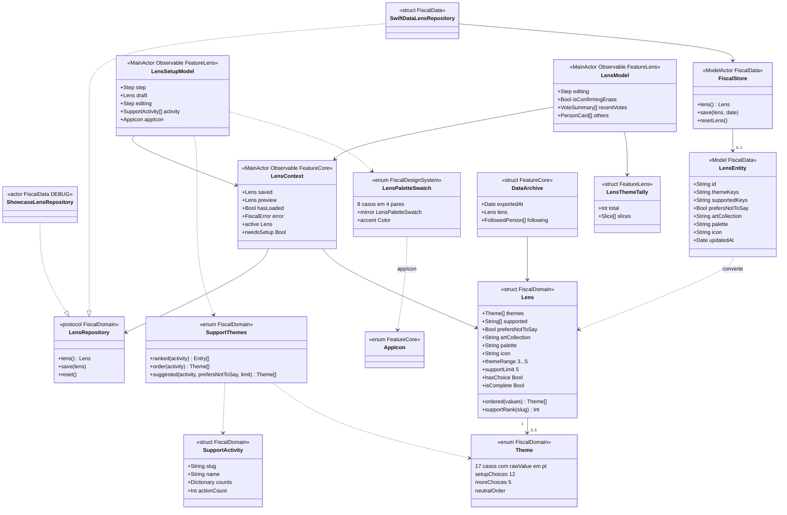

# Lente: quem você apoia, temas e visual, só no aparelho

## Requirements

O Fiscal mostra os mesmos fatos para todo mundo, mas cada pessoa quer ver primeiro o que importa para ela. A Lente guarda quem a pessoa apoia (até 5 políticos, ou "Prefiro não dizer"), de 3 a 5 temas e o visual (paleta, ícone e coleção de arte), e com isso só muda a ordem e os destaques de Hoje, Votações, Dinheiro e Perfil, nunca o conteúdo, os números, a cor de um partido ou o que existe na lista. Quem a pessoa apoia é opinião política, dado sensível na LGPD, e por isso a Lente vive num banco só do aparelho, fora do iCloud e do backup. Ela aparece no setup da primeira abertura, no botão "Quem você apoia" da toolbar de Hoje e de Votações, no selo de Dinheiro e no cartão "Seu Fiscal" dos Ajustes. Fica de fora: sincronizar a Lente entre aparelhos, enviá-la a qualquer servidor, notificações por tema e o botão que abre a confirmação de apagar (item P1 do `docs/backlog.md`).

Definição de pronto (os nomes de pessoas são fictícios, pela Constituição 14; os testes citados usam os das próprias fixtures):

- **Given** um banco sem `LensEntity`, ou com uma Lente antiga só de temas (`[.health, .taxes, .security]`, sem apoiado nem "Prefiro não dizer") **When** `LensContext.load()` termina e a tela de abertura some **Then** `needsSetup` é verdadeiro e, 450 ms depois, o setup abre em `LensSetupModel.Step.welcome` com o botão "Começar · 1 min", em tela cheia no iPhone, no iPad e no visionOS e em folha no Mac (`LensContextTests.asksForTheSetupOnlyAfterLoadingWithoutASide`; o atraso e a apresentação: roteiro manual: instalar limpo no iPhone, abrir e esperar a abertura sumir).
- **Given** o setup em `.welcome` **When** a pessoa avança, toca na Pessoa A no passo `.support`, avança por `.themes` e `.look` e toca em "Concluído" **Then** "Continuar" fica desabilitado em `.support` até a escolha, os temas chegam a 5, a paleta sugerida é `graphite`, `isFinished` vira verdadeiro, `needsSetup` vira falso e o banco guarda `supported == ["pessoa-a"]` igual ao rascunho (`LensSetupModelTests.walksTheThreeStepsAndSavesOnTheDevice`).
- **Given** 5 pessoas apoiadas e o contador "5 de 5 pessoas escolhidas" **When** a pessoa toca numa sexta linha **Then** a linha está desabilitada com opacidade `.opacitySoft`, `Lens.toggleSupport` não acrescenta ninguém e `Lens(supported:)` corta qualquer lista em `Lens.supportLimit` (roteiro manual: escolher 5 pessoas no passo "Quem você apoia?" e tentar a sexta).
- **Given** a Pessoa A escolhida no passo `.support` **When** a pessoa toca em "Prefiro não dizer" **Then** `supported` fica vazio, `prefersNotToSay` é verdadeiro e os temas viram os 5 primeiros da ordem neutra (`[.health, .education, .security, .economy, .taxes]`); tocar depois na Pessoa B desliga "Prefiro não dizer" (`LensSetupModelTests.preferNotToSayClearsWhoIsSupported`).
- **Given** a pessoa fictícia "Pessoa A" (slug `pessoa-a`) apoiada, com 6 ações recentes cujos temas somam saúde 3, impostos 2 e educação 1, e nenhum toque nos temas **When** o passo `.themes` abre **Then** os temas sugeridos são saúde, impostos, educação, segurança e economia, e a mensagem diz "Na ordem do que quem você apoia mais faz. Reordene ou tire como quiser. Calculado a partir de 6 ações recentes de Pessoa A. Estimado: o tema de cada ação vem de palavras-chave da ementa oficial e pode errar." (roteiro manual: escolher uma pessoa com ações recentes e conferir o passo "Seus temas").
- **Given** a lista `[.health, .health, .taxes, .security, .education, .rights, .women]` **When** vira uma `Lens` **Then** sobram 5 temas distintos na ordem de chegada, `canAddTheme` é falso e o rótulo diz "Tire um tema para adicionar outro. Até 5."; no setup, mover o primeiro tema uma posição o põe em segundo e tirar todos para em 3 (`LensTests.keepsThreeToFiveDistinctThemes`, `LensSetupModelTests.topicsCanBeReorderedAndRemovedWithinTheLimit`).
- **Given** uma Lente salva com temas `[.health, .taxes, .security]`, a Pessoa A, arte `academia` e paleta `sea` **When** a pessoa abre "Mudar Quem Você Apoia", acrescenta a Pessoa B e toca em "Salvar" **Then** o banco guarda `["pessoa-a", "pessoa-b"]` e mantém os temas e a paleta (`LensSetupModelTests.editingOneStepKeepsTheRest`).
- **Given** a Lente com temas `[.security, .health, .environment]` e a lista de votações do cenário de exemplo **When** Votações carrega **Then** os três primeiros temas do menu são `[.security, .health, .environment]`, há 3 destaques (`VotesModel.highlightLimit`), todos nos temas da pessoa, a lista filtrada continua com as mesmas 6 votações sem repetir nenhuma, e com o filtro `.camara` ligado os destaques somem (`VotesModelTests.theLensPutsItsTopicsFirstWithoutHidingAnything`).
- **Given** uma pessoa que apoia a Pessoa A e outra que apoia a Pessoa B, com temas diferentes **When** Hoje carrega e um cartaz é gerado **Then** os eventos e as votações recentes de Hoje são os mesmos, o conteúdo do cartaz é igual com e sem apoiados, e nenhum slug apoiado aparece no texto, no rótulo de acessibilidade ou na mensagem de compartilhar (`TodayModelTests.eachSupportSeesItsTopicsFirstButTheSameFacts`, `ShareModelTests.theCardNeverCarriesWhoTheUserSupports`).
- **Given** a Lente salva com a Pessoa A **When** a pessoa toca em "Ordem neutra" na seção "Outra lente" e depois em "Voltar à minha" **Then** a faixa "Ordem neutra por um momento. Nada é salvo." aparece, `LensContext.active` fica sem apoiados, o banco continua com a Lente da Pessoa A e, ao voltar, `active` é a Lente salva (`LensModelTests.anotherLensIsNeverSaved`).
- **Given** o banco aberto em disco com a Lente salva **When** o app abre **Then** o arquivo é `Device.store`, marcado fora do backup, o `Fiscal.store` não é marcado, `LensEntity` está só em `deviceModels`, e o Spotlight indexa só seguidos e perfis abertos, sem as palavras "support", "apoio", "lens" ou "lente" (`LensPrivacyTests.theLensStoreStaysOutOfBackups`, `DeviceStoreTests.theLensNeverJoinsTheSyncedStore`, `IntegrationCenterTests.indexesFollowedAndOpenedProfilesWithoutTheLens`).
- **Given** "Prefiro não dizer" salvo e uma prévia neutra aberta **When** `LensModel.erase()` roda pela confirmação "Apagar sua lente?" com "Apagar minha escolha" **Then** o banco fica sem Lente, a prévia some, a confirmação fecha e `needsSetup` volta a ser verdadeiro (`LensModelTests.deletingTheChoiceClearsTheDeviceStore`, `LensContextTests.erasingAsksForTheSetupAgain`).
- **Given** o `LensRepository` falha ao ler **When** `LensContext.load()` roda **Then** `error` é `FiscalError.onFetch`, `hasLoaded` continua falso, o setup não abre, e na tela "Quem você apoia" o alerta diz "Não foi possível carregar os dados. Tente novamente." (roteiro manual: simular a falha com um repositório que lança e abrir a tela da Lente).
- **Given** o `LensRepository` falha ao gravar **When** a pessoa toca em "Concluído" no setup **Then** `LensContext.save` devolve falso, `isFinished` continua falso, ninguém é seguido, o setup fica em `.look` com o botão de novo habilitado e `LensContext.error` vira `FiscalError.onSave` ("Não foi possível salvar. Confira os campos e tente novamente."), que só a `LensScreen` mostra em alerta (roteiro manual: simular a falha de gravação e concluir o setup).

## Entities

- `Lens` (`FiscalKit/Sources/FiscalDomain/PublicData/Lens.swift`): o valor da Lente, com os limites, a ordem e as regras; o inicializador e o `Decodable` limpam repetidos e cortam em 5 temas e 5 apoiados, e "Prefiro não dizer" esvazia os apoiados.
- `Theme` (`FiscalKit/Sources/FiscalDomain/PublicData/Theme.swift`, extensão em `Lens.swift`): os 17 temas com `rawValue` em pt (`saude`, `impostos`…), `setupChoices` (12), `moreChoices` (5) e `neutralOrder` (os 12 seguidos dos 5).
- `SupportActivity` e `SupportThemes` (`FiscalKit/Sources/FiscalDomain/PublicData/SupportThemes.swift`): contam os temas das ações recentes de cada apoiado (ou, sem ações, das propostas e discursos do perfil) e sugerem os 5 temas, completando com a ordem neutra.
- `LensRepository` (`FiscalKit/Sources/FiscalDomain/Repositories/LensRepository.swift`): o contrato de ler, salvar e apagar a Lente, parte de `Repositories`.
- `SwiftDataLensRepository` (`FiscalKit/Sources/FiscalData/Repositories/SwiftDataRepositories.swift`): repassa ao `FiscalStore`.
- `ShowcaseLensRepository` e `LensScenario` (`FiscalKit/Sources/FiscalData/PublicData/Showcase/ShowcaseLens.swift`): só em DEBUG, Lente em memória escolhida pelo argumento `FiscalLensScenario` (`setup`, `none`, `support:<slugs>`), sem tocar no banco.
- `FiscalStore` (`FiscalKit/Sources/FiscalData/Store/FiscalStore.swift`): lê a `LensEntity` mais recente por `updatedAt` com `fetchLimit` 1, atualiza ou insere, apaga todas no reset e desfaz com `rollback` em erro.
- `LensEntity` (`FiscalKit/Sources/FiscalData/Store/Entities/LensEntity.swift`): o `@Model` da Lente, com temas e apoiados em texto separado por vírgula e todos os campos com valor padrão; está em `FiscalSchemaV3.deviceModels` (`FiscalKit/Sources/FiscalData/Store/Schema/FiscalSchema.swift`), igual à de `FiscalSchemaV2`; a V1 tinha `stance`, retirado pela etapa leve `dropStance`; `FiscalSchemaV3` só acrescentou `InvestigationEntity` do lado da nuvem, então a Lente salva pela V2 abre sem perda.
- `LensContext` (`FiscalKit/Sources/FeatureCore/Identity/LensContext.swift`): o estado da Lente na janela, com a salva, a prévia de "Outra lente", se precisa de setup e o erro.
- `LensSetupModel` (`FiscalKit/Sources/FeatureLens/LensSetupModel.swift`, `LensSetupModel+Look.swift`): o setup e a edição de um passo, com o rascunho, a busca de pessoas, a sugestão de temas e o visual.
- `LensModel` (`FiscalKit/Sources/FeatureLens/LensModel.swift`, `LensModel+Look.swift`): a tela da Lente, com apoiados, temas, gráfico das votações recentes, "Outra lente" e o apagar.
- `LensThemeTally` (`FiscalKit/Sources/FeatureLens/LensChoices.swift`): conta as votações recentes por tema da pessoa para as barras da tela da Lente.
- `LensPaletteSwatch` (`FiscalKit/Sources/FiscalDesignSystem/Styles/LensPaletteSwatch.swift`): as 8 paletas em 4 pares espelhados (`forest`/`annatto`, `indigo`/`ipe`, `savanna`/`sea`, `graphite`/`sand`), com a cor de destaque clara e escura.
- `AppIcon` (`FiscalKit/Sources/FeatureCore/Icons/AppIcon.swift`): os ícones alternativos; cada paleta aponta para um `theme…` por `LensPaletteSwatch.appIcon` (`FiscalKit/Sources/FeatureLens/LensChoices.swift`).
- `DataArchive` (`FiscalKit/Sources/FeatureCore/Export/DataArchive.swift`): a exportação em JSON que a própria pessoa pede, com a Lente e os seguidos; é a única saída da Lente do aparelho.

## Approach

1. **Estratégia da solução:** a Lente é um `Lens` salvo numa `LensEntity` da configuração `Device` do `ModelContainer`, sem CloudKit e fora do backup. Na janela, `LensContext` carrega a Lente uma vez; o modificador `lensExperience(isReady:)` abre o setup 450 ms depois da abertura quando não há escolha, pinta o app com a cor da paleta e mostra a faixa de "Outra lente". O setup (`LensSetupModel`) passa por boas-vindas, quem você apoia, temas e visual; ao salvar, segue os apoiados. As outras features recebem o `LensRepository` pela sessão e só reordenam: temas por `Lens.ordered`, pessoas por `Lens.supportRank`, com o selo `LensBadge` ("Por quem você apoia") onde a ordem mudou. A tela da Lente (`LensScreen`, `Route.lens`, `fiscal://lens`) mostra os apoiados, os temas com as barras das votações recentes, a "Outra lente" e a privacidade.
2. **Decisões:**
   - Banco só do aparelho, com duas configurações no mesmo `ModelContainer` (`Device` para `LensEntity`, `Fiscal` para seguidos e investigações) — opinião política é dado sensível na LGPD; descartados tudo no CloudKit privado e a Lente no `UserDefaults`, que entra no backup. ADR: `docs/adr/0004-lens-on-device-store.md`.
   - "Quem você apoia", com "Prefiro não dizer" valendo tanto quanto apoiar — substituiu o "Como você se vê?" (posicionamento) da proposta `setup-lens-art`, retirado do schema na V2; descartado o posicionamento ideológico. ADR: não precisa (`docs/changes/archive/2026-10-29-setup-lens-art/proposal.md`, substituída pela `app-1.0`).
   - A Lente ordena e marca, nunca filtra nem reescreve — mesma regra para todos os lados; descartado esconder o que não está nos temas. ADR: `docs/adr/0012-constitution-version-and-facts.md`.
   - Temas sugeridos pelas ações dos apoiados, com a linha "Estimado: …" — o tema vem de palavras-chave da ementa e pode errar; descartado sugerir temas sem dizer de onde vêm. ADR: `docs/adr/0012-constitution-version-and-facts.md`.
   - Paletas em pares espelhados, nunca tiradas da cor de um partido, aplicadas só à estrutura; gráficos, placares e marcas de partido mantêm a cor do dado — descartada a paleta por partido. ADR: não precisa (brief e `docs/changes/archive/2026-10-29-setup-lens-art/proposal.md`).
   - Setup que não se pula, em tela cheia (folha no Mac), com "Prefiro não dizer" como saída neutra — descartada a folha opcional que a `setup-lens-art` recomendava. ADR: não precisa.
   - "Outra lente" como prévia em memória (`LensContext.preview`), nunca salva — descartado trocar a Lente salva para comparar. ADR: não precisa.
   - Entrada pelo botão `heart` na toolbar de Hoje, ao lado de Ajustes — ADR: `docs/adr/0014-settings-in-today-toolbar.md`.
   - O pacote offline nunca lê a Lente — ADR: `docs/adr/0015-background-fetch-offline-pack.md`; o rótulo de privacidade conta com a Lente fora do aparelho só pela exportação — ADR: `docs/adr/0017-app-store-privacy-label.md`.
   - Textos só em pt-BR, com chaves em inglês — ADR: `docs/adr/0003-portuguese-only.md`; ênfase em Bricolage — ADR: `docs/adr/0009-bricolage-emphasis-font.md`.
3. **Tratamento de erros:**
   - Leitura da Lente falha: `LensContext.error = .onFetch`, `hasLoaded` fica falso, o setup não abre e a próxima chamada de `load()` tenta de novo; só a `LensScreen` mostra o alerta com `errorAlert`.
   - Gravação falha: `FiscalStore` faz `rollback`, `LensContext.save` devolve falso e põe `.onSave`; no setup, `isFinished` fica falso e o botão volta; `LensModel.update` ignora o retorno e o alerta aparece na `LensScreen`.
   - Apagar falha: `.onRemove`, e a confirmação continua aberta.
   - Lista de pessoas falha: `try?` deixa a lista vazia e a tela mostra "Ninguém com esse nome"; a cidade de casa só entra com `fiscal.mine.place` de mais de 2 caracteres.
   - Ações ou perfil de um apoiado falham: a atividade fica sem contagem, a mensagem vira "Ainda não há ações recentes de quem você apoia. Escolha de 3 a 5 temas." e os temas sugeridos caem na ordem neutra; uma resposta atrasada é descartada se a escolha mudou (`refreshActivity` compara `chosen`).
   - Troca de ícone falha: `appIcon` volta ao anterior e `draft.icon` não muda.
   - Votações recentes falham na `LensScreen`: `recentVotes` vira lista vazia e a seção mostra os temas sem barras.
   - Catálogo de arte não carrega: `catalog` é nulo, o seletor de coleção some e a coleção sugerida `brasil-agora` continua no rascunho.
4. **Riscos:**
   - `LensEntity` passar para `cloudModels` → `FiscalDatabase.open` monta a configuração `Device` só com `deviceModels` e `cloudKitDatabase: .none`; `DeviceStoreTests` e `LensPrivacyTests` conferem a separação (na V2).
   - `-wal` e `-shm` criados depois da abertura ficarem no backup → `excludeDeviceStoreFromBackup` marca os três arquivos a cada abertura do banco.
   - Duas `LensEntity` no banco → a leitura pega a mais recente por `updatedAt`, a gravação atualiza essa e o reset apaga todas.
   - A pessoa não consegue apagar a escolha pela interface → a confirmação e `LensModel.erase()` existem e são testados, falta o botão (P1 do backlog); a exportação continua disponível.
   - Apoiados viram seguidos ao salvar e os seguidos sincronizam no iCloud privado quando a sincronização está ligada → o `FollowEntity` não guarda a marca de apoio; nada mitiga a presença do slug no iCloud.
   - Pedidos públicos dos apoiados no setup (`people/<slug>/actions.json`, `people/<slug>.json`) revelarem o apoio à CDN → são `GET` anônimos iguais a abrir um perfil, como a política de privacidade diz.

**Known divergences:**

- `Spec × código:` a spec diz que em "Outra lente" a pessoa vê o app na ordem neutra ou de quem apoia outra pessoa; o código só mostra a faixa e mantém a cor, porque Hoje, Votações, Dinheiro e Perfil recebem `session.repositories.lens` e leem a Lente salva, e nenhum model lê `LensContext.preview` (`FiscalKit/Sources/AppShell/SectionScreen.swift`, `FiscalKit/Sources/AppShell/RouteScreen.swift`, `FiscalKit/Sources/FeatureLens/LensExperience.swift`).
- `Spec × código:` a spec diz que o passo de temas mostra 12 temas e guarda 5 em "mais"; o código mostra os temas escolhidos e, em "Adicionar um tema", todos os outros na ordem de `SupportThemes.order(activity)`; `Theme.setupChoices` e `moreChoices` só servem para montar `neutralOrder` (`FiscalKit/Sources/FeatureLens/LensThemesStep.swift`, `FiscalKit/Sources/FeatureLens/LensSetupModel.swift`).
- `Spec × código:` a spec chama o botão final de "Concluir"; o catálogo traduz a chave "Done" como "Concluído" (`LensSetupModel.primaryTitle`, `Fiscal/Fiscal/Localizable.xcstrings`).
- `Spec × código:` a spec nomeia o par "Mata e Urucum"; o título de `.forest` é "Mata e ouro" (`FiscalKit/Sources/FeatureLens/LensLook.swift`).
- `Spec × código:` a spec diz que salvar segue os apoiados "no aparelho" e o cartão de cadeado diz que a escolha "não entra no iCloud"; os seguidos ficam na configuração `Fiscal`, com o CloudKit privado quando a sincronização está ligada, então os slugs apoiados vão ao iCloud como seguidos, sem a marca de apoio (`LensSetupModel.finish`, `SupportedPeople.follow` em `FiscalKit/Sources/FeatureCore/Identity/SupportedPeople.swift`, `FiscalKit/Sources/FiscalData/FiscalDatabase.swift`).
- `Spec × código:` a spec diz que o pacote offline nunca baixa os perfis das pessoas apoiadas; o pedido não lê a Lente (`FiscalKit/Sources/AppShell/Offline/OfflineDataCenter.swift:73`), mas os apoiados viram seguidos ao salvar e entram no pacote como seguidos, e o rodapé de Dados offline fala no perfil de quem você "segue, apoia" (`FiscalKit/Sources/FeatureSettings/OfflineDataScreen.swift:16`).
- `Spec × código:` a spec diz que a `LensScreen` faz a edição; ela só abre a edição de apoiados ("Mudar Quem Você Apoia") e de temas ("Mudar os temas"); `choose(_:)` de paleta e coleção e `setIcon(_:)` de `LensModel+Look.swift` e `LensModel.swift` não são chamados por nenhuma tela e `edit(.look)` não existe, então paleta e arte não mudam depois do setup (`FiscalKit/Sources/FeatureLens/LensModel+Look.swift`, `FiscalKit/Sources/FeatureLens/LensScreen.swift`).
- `Spec × código:` o ADR 0004 fala em `FiscalSchemaV1`; o banco abre com `FiscalSchemaV3` (versão 3.0.0) e o plano de migração `FiscalMigrationPlan` (`FiscalKit/Sources/FiscalData/Store/Schema/FiscalSchema.swift`).
- `Playbook:` indicadores de carregamento com o círculo indeterminado `ProgressView()`, contra "nunca progresso circular, só barras" da regra 5 (`FiscalKit/Sources/FeatureLens/LensSetupScreen.swift:108`, `FiscalKit/Sources/FeatureLens/LensThemesStep.swift:20`, `FiscalKit/Sources/FeatureLens/LensSupportStep.swift:203`, `FiscalKit/Sources/FeatureLens/LensEditSections.swift:127`).
- `Playbook:` números soltos em vez de tokens: `.smooth(duration: 0.45)` e `.easeInOut(duration: 0.6)` (`FiscalKit/Sources/FeatureLens/LensSetupScreen.swift:36-37`), `.milliseconds(450)` (`FiscalKit/Sources/FeatureLens/LensExperience.swift:50`), `.scale(scale: 0.96)` (`FiscalKit/Sources/FeatureLens/LensThemesStep.swift:31`), `.minimumScaleFactor(0.7)` (`FiscalKit/Sources/FeatureLens/LensScreen.swift:102`) e `0.8` e `0.6` (`FiscalKit/Sources/FeatureLens/LensLookPreview.swift:84`, `:108`).
- `Playbook:` a falha ao salvar no setup não aparece na tela do setup, que não tem `errorAlert`; o erro fica em `LensContext.error` e só a `LensScreen` o mostra (`FiscalKit/Sources/FeatureLens/LensSetupScreen.swift`).
- `Sem teste:` o atraso de 450 ms e a apresentação em tela cheia ou folha do setup (`FiscalKit/Sources/FeatureLens/LensExperience.swift`, `FiscalKit/Sources/AppShell/MainScreen.swift`).
- `Sem teste:` o limite de 5 apoiados (`Lens.supportLimit`, `LensSetupModel.canToggle`); `LensTests` não cobre `toggleSupport` nem o corte em 5.
- `Sem teste:` a sugestão de temas pelas ações dos apoiados e a linha "Estimado" (`SupportThemes`, `LensSetupModel.refreshActivity`, `LensSetupModel.themesBasis`); os testes do setup rodam sem `service`.
- `Sem teste:` a falha de leitura (`FiscalError.onFetch`) e a de gravação (`FiscalError.onSave`) da `LensContext`.
- `Sem teste:` `LensPrivacyTests.theLensModelIsOnlyInTheLocalStore` e `DeviceStoreTests.theLensNeverJoinsTheSyncedStore` conferem `FiscalSchemaV2`, não o `FiscalSchemaV3` que o banco usa (`FiscalKit/Tests/FiscalDataTests/LensPrivacyTests.swift`, `FiscalKit/Tests/FiscalDataTests/DeviceStoreTests.swift`).

## Structure

Camadas e regra de dependência: `FiscalDomain` (valor e contrato) ← `FiscalData` (SwiftData e cenário DEBUG) ← `FeatureCore` (contexto, selo, pessoas apoiadas, exportação) ← `FeatureLens` (setup e tela) ← `AppShell` (apresentação, rota e link). `FiscalDesignSystem` traz as paletas. `FeatureLens` depende só de `FiscalDomain`, `FiscalDesignSystem`, `FiscalResource` e `FeatureCore`; as features não se importam, e Hoje, Votações e Dinheiro abrem a Lente por `Route.lens`. `FeatureToday`, `FeatureVotes`, `FeatureMoney`, `FeatureProfile`, `FeatureSearch`, `FeatureShare` e `FeatureSettings` leem o `LensRepository` que recebem do `AppShell` e usam `LensBadge` do `FeatureCore`. O app (`Fiscal/`) e os widgets não leem a Lente.

Árvore:

- `FiscalKit/Sources/FiscalDomain/PublicData/Lens.swift`, `Theme.swift`, `SupportThemes.swift`
- `FiscalKit/Sources/FiscalDomain/Repositories/LensRepository.swift`, `Repositories.swift`
- `FiscalKit/Sources/FiscalData/Store/Entities/LensEntity.swift`
- `FiscalKit/Sources/FiscalData/Store/Schema/FiscalSchemaV1.swift`, `FiscalSchemaV2.swift`, `FiscalSchema.swift`
- `FiscalKit/Sources/FiscalData/Store/FiscalStore.swift`
- `FiscalKit/Sources/FiscalData/FiscalDatabase.swift`, `FiscalDatabase+Backup.swift`
- `FiscalKit/Sources/FiscalData/Repositories/SwiftDataRepositories.swift`
- `FiscalKit/Sources/FiscalData/PublicData/Showcase/ShowcaseLens.swift`
- `FiscalKit/Sources/FiscalDesignSystem/Styles/LensPaletteSwatch.swift`
- `FiscalKit/Sources/FeatureCore/Identity/LensContext.swift`, `LensBadge.swift`, `LensFaces.swift`, `SupportedPeople.swift`
- `FiscalKit/Sources/FeatureCore/Export/DataArchive.swift`
- `FiscalKit/Sources/FeatureLens/LensSetupModel.swift`, `LensSetupModel+Look.swift`, `LensSetupScreen.swift`, `LensSupportStep.swift`, `LensThemesStep.swift`, `LensLookStep.swift`, `LensLookChoices.swift`, `LensLookPreview.swift`, `LensLook.swift`, `LensChoices.swift`, `LensArt.swift`
- `FiscalKit/Sources/FeatureLens/LensModel.swift`, `LensModel+Look.swift`, `LensScreen.swift`, `LensEditSections.swift`, `LensLookSections.swift`, `LensThemeChart.swift`, `LensExperience.swift`
- `FiscalKit/Sources/AppShell/MainScreen.swift` (`LensSetupCover`), `RouteScreen.swift` (`LensDestination`), `DeepLink.swift`, `FiscalWindow.swift`, `Update/UpdateRecommendation.swift`
- `FiscalKit/Sources/FeatureToday/TodayScreen.swift` (`TodayToolbar`), `FiscalKit/Sources/FeatureVotes/VotesToolbar.swift`, `FiscalKit/Sources/FeatureMoney/MoneyScreen.swift` (`MoneyLensHeader`), `FiscalKit/Sources/FeatureSettings/SettingsLensCard.swift`, `SettingsLensModel.swift`, `LensSummary.swift`
- Testes: `FiscalKit/Tests/FiscalDomainTests/LensTests.swift`; `FiscalKit/Tests/FiscalDataTests/LensPrivacyTests.swift`, `DeviceStoreTests.swift`, `SchemaMigrationTests.swift`; `FiscalKit/Tests/FiscalDesignSystemTests/LensPaletteSwatchTests.swift`; `FiscalKit/Tests/FeatureCoreTests/LensContextTests.swift`, `DataExportModelTests.swift`; `FiscalKit/Tests/FeatureLensTests/LensSetupModelTests.swift`, `LensModelTests.swift`; `FiscalKit/Tests/FeatureSettingsTests/SettingsLensModelTests.swift`; `FiscalKit/Tests/AppShellTests/DeepLinkTests.swift`, `IntegrationCenterTests.swift`; nas features que reordenam, `VotesModelTests`, `VoteDetailModelTests`, `TodayModelTests`, `MoneyModelTests`, `ProfileModelTests`, `SearchModelTests` e `ShareModelTests`.

## Operations

1. **`Lens` e `Theme`** (`FiscalKit/Sources/FiscalDomain/PublicData/Lens.swift`): `init(themes:supported:prefersNotToSay:artCollection:palette:icon:)` tira repetidos, corta em 5 temas e 5 apoiados e esvazia os apoiados com "Prefiro não dizer"; `suggested(supported:prefersNotToSay:)` devolve a Lente com os 5 primeiros temas da ordem neutra, arte `brasil-agora` e paleta `graphite`; `hasChoice` (prefere não dizer ou ao menos 1 apoiado), `isComplete` (escolha e de 3 a 5 temas), `toggle(_:)` respeita o máximo, `toggleSupport(_:)` respeita `supportLimit` e desliga "Prefiro não dizer", `choosePrefersNotToSay()` esvazia os apoiados, `moveTheme(from:to:)`, `moveTheme(_:by:)` e `moveTheme(_:before:)` reordenam, `ordered(_:) -> [Theme]` ordena pela posição na Lente mantendo a ordem original no empate e sem tirar nada, `supportRank(of:) -> Int` dá a posição do apoiado ou o fim; o `Decodable` limpa uma Lente gravada fora dos limites. Verificação: `scripts/test.sh --affected`.
2. [P] **`SupportActivity` e `SupportThemes`** (`FiscalKit/Sources/FiscalDomain/PublicData/SupportThemes.swift`): `SupportActivity(slug:name:actions:profile:)` conta os temas das ações (ou, sem ações, propostas mais discursos do perfil); `ranked(_:) -> [Entry]` soma por tema, ordena por contagem e desempata pela ordem neutra; `order(_:)` completa com a ordem neutra; `suggested(_:prefersNotToSay:limit:) -> [Theme]` devolve os 5 primeiros, ou a ordem neutra com "Prefiro não dizer". Cobre: sugestão de temas pelas ações.
3. **`LensRepository`** (`FiscalKit/Sources/FiscalDomain/Repositories/LensRepository.swift`): `lens() async throws -> Lens?`, `save(_ lens: Lens) async throws`, `reset() async throws`, entregue em `Repositories.lens`. Depende de: 1. Verificação: `scripts/test.sh --affected`.
4. **`LensEntity` e schema** (`FiscalKit/Sources/FiscalData/Store/Entities/LensEntity.swift`, `FiscalKit/Sources/FiscalData/Store/Schema/FiscalSchema.swift`): `init(lens:updatedAt:)` e `update(with:at:)` gravam temas pelo `rawValue` e apoiados por slug, separados por vírgula; `lens` refaz o valor descartando temas desconhecidos; `FiscalSchemaV3.deviceModels == [LensEntity]`, `cloudModels == [FollowEntity, InvestigationEntity]`; `FiscalMigrationPlan` vai de V1 a V3 por `dropStance` e `addInvestigations`, as duas leves. Depende de: 1. Verificação: `scripts/test.sh --affected`.
5. **`FiscalStore`** (`FiscalKit/Sources/FiscalData/Store/FiscalStore.swift`): `lens() throws -> Lens?` lê a entidade mais recente; `save(_:at:)` atualiza ou insere e chama `commit()`, que salva e publica `.local` no `changeHub`; `resetLens()` apaga todas as `LensEntity`; erro desfaz com `rollback` e relança. Verificação: `scripts/test.sh --affected`.
6. **`FiscalDatabase` e backup** (`FiscalKit/Sources/FiscalData/FiscalDatabase.swift`, `FiscalDatabase+Backup.swift`): `open(inMemory:cloudSync:directory:)` monta a configuração `Fiscal` com `.private("iCloud.fiscal")` só quando há sincronização e a `Device` sempre com `.none`, abre o container sob um `NSLock` e chama `excludeDeviceStoreFromBackup`, que marca `isExcludedFromBackup` no `Device.store`, no `-wal` e no `-shm` que existirem; `repositories` entrega `SwiftDataLensRepository`. Cobre: a Lente fica em `Device.store`, fora do backup.
7. [P] **`ShowcaseLensRepository` e `LensScenario`** (`FiscalKit/Sources/FiscalData/PublicData/Showcase/ShowcaseLens.swift`): só em DEBUG; `named(_:)` aceita `setup`, `none` e `support:<slugs>` e recusa o resto; `FiscalWindow` troca o repositório quando o argumento `FiscalLensScenario` vem no lançamento. Verificação: `scripts/test.sh --affected`.
8. [P] **`LensPaletteSwatch`** (`FiscalKit/Sources/FiscalDesignSystem/Styles/LensPaletteSwatch.swift`): 8 casos, `leading` com os 4 primeiros de cada par, `mirror` simétrico, `named(_:)` pelo `rawValue`, `accent` com contraste de pelo menos 4,5 no fundo claro e escuro. Verificação: `scripts/test.sh --affected`.
9. **`LensContext`** (`FiscalKit/Sources/FeatureCore/Identity/LensContext.swift`): `load() async` lê uma vez e marca `hasLoaded` (erro vira `.onFetch`); `save(_:) async -> Bool` grava, troca `saved`, encerra a prévia (erro vira `.onSave`); `erase() async -> Bool` apaga e limpa salva e prévia (erro vira `.onRemove`); `show(_:)` e `endPreview()` controlam a prévia; `active` é a prévia ou a salva; `needsSetup` é `hasLoaded` e a salva sem escolha. Depende de: 3. Verificação: `scripts/test.sh --affected`.
10. [P] **`SupportedPeople`** (`FiscalKit/Sources/FeatureCore/Identity/SupportedPeople.swift`): `cards(for:service:follows:) async -> [PersonCard]` resolve os slugs pelos seguidos e depois pelo índice de pessoas; `activity(for:service:) async -> [SupportActivity]` busca em paralelo as ações de cada pessoa e, sem ações, o perfil; `follow(_:in:at:) async` segue quem ainda não é seguido; `names(_:)` junta os nomes em lista com "e". Cobre: sugestão de temas e seguir os apoiados ao salvar.
11. [P] **`LensBadge` e `LensFaces`** (`FiscalKit/Sources/FeatureCore/Identity/LensBadge.swift`, `LensFaces.swift`): o selo "Por quem você apoia" com o `heart` na cor de destaque e os retratos sobrepostos com um único rótulo de acessibilidade. Cobre: marca onde a ordem mudou.
12. **`LensSetupModel`** (`FiscalKit/Sources/FeatureLens/LensSetupModel.swift`, `LensSetupModel+Look.swift`): `init(context:catalog:editing:icons:service:follows:placeCode:)` começa da Lente salva ou de `Lens.suggested()`, no passo editado ou em `.welcome`; `canContinue` segue a tabela (boas-vindas sempre, apoio com escolha, temas com a Lente completa, visual com paleta e coleção); `primaryTitle` ("Salvar" na edição, "Começar · 1 min", "Continuar", "Concluído"); `stepText` ("Passo N de 3"); `advance()` avança ou chama `finish()`, que salva pelo contexto e segue os apoiados; `goBack()`; `results` dobra acento e caixa sobre nome, partido, cargo e UF, até 40 sugestões (escolhidos, representantes da cidade, presidente, vice e governadores, todos) e até 80 resultados; `toggle(_:)` e `choosePrefersNotToSay()` refazem a atividade; `refreshActivity()` troca os temas pela sugestão enquanto a pessoa não mexeu neles; `add`, `remove` e `move` respeitam 3 a 5; `choose(_:)` de paleta, coleção e ícone. Depende de: 9, 10. Verificação: `scripts/test.sh --affected`.
13. **`LensModel`, `LensThemeTally`, `LensIcons`** (`FiscalKit/Sources/FeatureLens/LensModel.swift`, `LensModel+Look.swift`, `LensChoices.swift`): `heroTitle` (nomes dos apoiados, "Prefiro não dizer" ou "—"); `previewNeutral()` e `preview(_:) async` montam a prévia com os temas sugeridos e a paleta e a arte da pessoa; `loadSupport()` resolve os apoiados e tira até 4 outras pessoas dos destaques; `loadVotes()` lê as votações recentes; `update(_:)` grava só se mudou; `moveThemes`, `moveTheme`, `removeTheme`; `erase()` apaga e fecha a confirmação; `editor(for:)` cria o `LensSetupModel` do passo; `LensThemeTally(votes:themes:)` conta por tema e ordena pela contagem, desempatando pela posição na Lente. Depende de: 9, 12. Verificação: `scripts/test.sh --affected`.
14. **Telas do setup** (`FiscalKit/Sources/FeatureLens/LensSetupScreen.swift`, `LensSupportStep.swift`, `LensThemesStep.swift`, `LensLookStep.swift`, `LensLookChoices.swift`, `LensLookPreview.swift`, `LensArt.swift`): barra de cima com voltar ou cancelar e `ProgressBar` do passo; boas-vindas com o carrossel de obras; "Quem você apoia?" com os apoiados, "Prefiro não dizer", a busca e o cartão "Só neste iPhone"; "Seus temas" com cartões numerados, barras de ações e "Adicionar um tema"; "O seu visual" com prévia, grade de paletas (1 coluna nos tamanhos de acessibilidade), coleções quando há mais de uma e ícones quando o sistema permite; botão de ação embaixo. Depende de: 12. Cobre: setup em três passos.
15. **Tela da Lente** (`FiscalKit/Sources/FeatureLens/LensScreen.swift`, `LensEditSections.swift`, `LensLookSections.swift`, `LensThemeChart.swift`): título "Quem você apoia"; herói com arte, retratos e crédito; "Quem você apoia" com "Mudar Quem Você Apoia"; "Seus temas" com as barras das votações recentes ou a lista reordenável e "Mudar os temas"; "Outra lente" com "Ordem neutra", até 4 pessoas e "Voltar à minha"; "Privacidade"; folha de edição e a confirmação "Apagar sua lente?" em `GuideSheet`; `errorAlert` do contexto. Depende de: 13. Cobre: "Outra lente" e apagar.
16. **`LensExperience` e `LensSetupFlow`** (`FiscalKit/Sources/FeatureLens/LensExperience.swift`): `lensExperience(isReady:)` carrega o contexto, aplica `appTint` com a cor da paleta ativa, mostra a faixa "Outra lente" no topo, recarrega a sessão quando a Lente salva muda e, com `isReady` e `needsSetup`, espera 450 ms e liga `FiscalNavigation.isShowingLensSetup`; `LensSetupFlow(service:follows:)` hospeda o `LensSetupModel` com o catálogo e o trocador de ícone do sistema. Depende de: 14. Cobre: o setup abre sozinho.
17. **Integração no `AppShell`** (`FiscalKit/Sources/AppShell/MainScreen.swift`, `RouteScreen.swift`, `DeepLink.swift`, `FiscalWindow.swift`, `Update/UpdateRecommendation.swift`): `LensSetupCover` apresenta o setup em `sheet` com `interactiveDismissDisabled` no Mac e em `fullScreenCover` nas outras plataformas; `LensDestination` monta o `LensModel` para `Route.lens` e para o cartão dos Ajustes; `fiscal://lens` abre `Route.lens` em Hoje; a recomendação de atualização espera `needsSetup` falso. Depende de: 16. Verificação: `scripts/test.sh --affected`.
18. **Entradas e consumidores** (`FiscalKit/Sources/FeatureToday/TodayScreen.swift`, `FiscalKit/Sources/FeatureVotes/VotesToolbar.swift`, `FiscalKit/Sources/FeatureMoney/MoneyScreen.swift`, `FiscalKit/Sources/FeatureSettings/SettingsLensCard.swift`; `VotesModel`, `VoteDetailModel`, `TodayModel`, `TodayModel+Highlights`, `MoneyModel`, `ProfileModel+Lens`, `SearchModel`, `ShareModel`, `ArtistsModel`): o botão `heart` "Quem você apoia" em Hoje e Votações e o selo em Dinheiro abrem `Route.lens`; Votações põe os temas da pessoa primeiro e, sem filtro, até 3 destaques; o detalhe põe os votos dos apoiados primeiro pela ordem da Lente; Hoje ordena destaques e representantes pela ordem dos apoiados; Dinheiro ordena as seções pelos temas; Perfil ordena as linhas de tema; Compartilhar usa só a coleção de arte. Depende de: 3, 11. Cobre: a Lente ordena sem filtrar e os mesmos fatos para todos.
19. [P] **`DataArchive`** (`FiscalKit/Sources/FeatureCore/Export/DataArchive.swift`): `encoded()` gera JSON com datas ISO 8601 e chaves ordenadas, com a Lente e os seguidos; `decoded(from:)` lê de volta. Verificação: `scripts/test.sh --affected`.

## Norms

- Constituição 3: `LensContext`, `LensSetupModel`, `LensModel` e `SettingsLensModel` são `@MainActor @Observable`, injetados por `@Environment(Tipo.self)` com `@Bindable` dentro do `body`; lógica, texto e formatação ficam nos models; uma subview por seção; `FeatureLens` não importa outra feature e as outras chegam à Lente só por `Route.lens`.
- Constituição 4: zero comentários; zero warnings; tokens do `FiscalDesignSystem` para espaço, raio, opacidade e tamanhos (`.spaceL`, `.radiusL`, `.opacitySoft`, `.badgeXL`, `.lensSwatchHeight`, `.lensArtCardWidth`); toda lógica nova com Swift Testing sobre `FiscalDatabase.open(inMemory: true)`.
- Constituição 5: progresso do setup e barras de tema com `ProgressBar` e `ShareBarChart`, nunca anéis; títulos e números de destaque em Bricolage (`.emphasis`, `sectionTitle()`, `primaryButton()`, `.scoreboardTitle`) com `.monospacedDigit()`; Reduzir movimento e o modo leve (`liteMode.reducesMotion`) trocam toda animação por nenhuma e toda transição por `.opacity`; confirmação de apagar como `GuideSheet` com a animação `privacy`; grades para escolhas visuais.
- Constituição 6 e ADR 0003: chaves em inglês, só a tradução `pt-BR` no catálogo; `Text("Key")` nas telas e `String(appLocalized:)` nos models.
- Constituição 14: a Lente muda a ordem e marca com "Por quem você apoia", nunca muda número, conteúdo, cor de partido ou o que existe na lista; a mesma regra para todos os políticos e lados; dado ausente é "—" (`heroTitle`, `paletteTitle`); a sugestão de temas diz ao lado "Estimado: o tema de cada ação vem de palavras-chave da ementa oficial e pode errar."
- ADR 0004: `LensEntity` só na configuração `Device`, com `cloudKitDatabase: .none`, nunca em `cloudModels`; `Device.store`, `-wal` e `-shm` fora do backup; a Lente não vai a servidor nem a telemetria e só sai pela exportação da própria pessoa.
- ADR 0014: a Lente abre pelo botão `heart` "Quem você apoia" na toolbar de Hoje, ao lado de Ajustes.
- ADR 0015 e ADR 0017: o pacote offline e o rótulo de privacidade nunca contam com a Lente; a Lente nunca entra em notificação, cartaz, Spotlight, widget ou registro.
- Paletas em pares espelhados, nunca tiradas da cor de um partido; a cor da paleta vale só para a estrutura (destaque, fundos, ícone), e gráficos, placares e marcas de partido mantêm a cor do dado.
- Erros passam por `FiscalError` em `LensContext.error` e aparecem com `errorAlert`; gravação no `FiscalStore` sempre com `rollback` em falha.
- Acessibilidade: elementos combinados, ações "Mover para Cima", "Mover para Baixo" e "Remover" nos temas, traço `isSelected` nas escolhas, grade de paletas em uma coluna nos tamanhos de acessibilidade, decorativos ocultos.

## Safeguards

- **Funcional:** nunca mais de 5 apoiados nem fora de 3 a 5 temas numa Lente completa; "Prefiro não dizer" nunca convive com apoiados; a Lente nunca tira item de lista, nunca muda número, cor de partido ou cor de dado; "Outra lente" nunca grava (`LensContext.preview` só em memória); o setup nunca abre antes da Lente carregar (`hasLoaded`) nem com uma Lente que já tem escolha.
- **Desempenho:** até 40 sugestões e 80 resultados na busca; até 4 pessoas em "Outra lente"; até 5 votações por tema focado (`focusLimit`); até 3 destaques em Votações (`highlightLimit`); leitura da Lente com `fetchLimit` 1; setup aberto 450 ms depois da abertura; transição de passo de 0,45 s e de fundo de 0,6 s, nenhuma com Reduzir movimento; atividade dos apoiados buscada em paralelo, com a resposta antiga descartada.
- **Privacidade:** quem a pessoa apoia nunca vai a servidor, telemetria, log, notificação, cartaz, mensagem de compartilhar, Spotlight ou widget; a `LensEntity` nunca vai ao CloudKit nem ao backup do aparelho; os únicos pedidos de rede ligados à Lente são `GET` anônimos de arquivos públicos (`index/people.json`, `people/<slug>.json`, `people/<slug>/actions.json`, `places/city/<código>.json`, destaques e votações recentes), iguais a abrir um perfil; a cidade de casa vem só de `fiscal.mine.place`; o cartão "Só neste iPhone" e o rodapé "A lente nunca vai em requisições, registros, notificações, cards compartilhados nem no Spotlight." descrevem isso.
- **Dados:** a Lente salva nunca se perde numa atualização: `FiscalSchemaV1` → `V2` → `V3` por etapas leves, com `SchemaMigrationTests.aSecondVersionStoreOpensWithTheCurrentSchema` abrindo uma loja V2 com `supported == ["pessoa-a"]`; todos os atributos de `LensEntity` têm valor padrão; apagar a Lente só pela confirmação "Apagar minha escolha"; a exportação `DataArchive` leva a Lente inteira.
- **Compatibilidade da versão publicada:** não quebram o formato de `LensEntity` (temas pelo `rawValue` em pt como `saude` e `impostos`, apoiados por slug, separados por vírgula, `id` `lens`), os `rawValue` das paletas (`forest`, `annatto`, `indigo`, `ipe`, `savanna`, `sea`, `graphite`, `sand`) e das coleções (`brasil-agora`, `acervo-historico`), as chaves JSON do `Lens` na exportação (`themes`, `supported`, `prefersNotToSay`, `artCollection`, `palette`, `icon`), o link `fiscal://lens`, a rota `Route.lens`, a chave `fiscal.mine.place`, o argumento DEBUG `FiscalLensScenario` e as chaves de texto em inglês já traduzidas; nenhuma **QUEBRA** registrada.
- **Fora do escopo:** sem sincronizar a Lente entre aparelhos, sem guardá-la em `UserDefaults`, no iCloud ou no servidor, sem filtrar listas pela Lente, sem paleta tirada de partido, sem notificação por tema, sem nova tela ou dependência e sem mudar o schema numa geração futura desta área sem nova mudança com análise e ADR.
