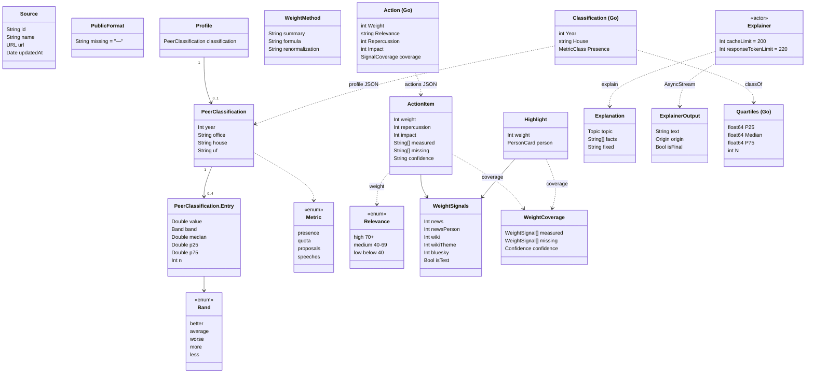

# Credibilidade: fonte, "—", colegas, peso, "Estimado" e explicações

## Requirements

Quem abre o Fiscal precisa confiar que o app mostra fatos e não opinião. Para isso, cada bloco diz de onde veio e de quando é. O dado que falta aparece como "—", nunca como 0. Os números do mandato são comparados com os colegas do mesmo cargo e da mesma casa por uma régua pública. As ações ganham um peso que ordena sem qualificar. Tudo que não é número oficial diz ao lado, em uma linha "Estimado: …", por que é estimado e o que ficou sem medir. As explicações em linguagem simples são geradas no aparelho e, quando não dá, fica um texto fixo escrito por regra. A capacidade vale no perfil, em Comparar, em Fiscalizar, na Lente, em Hoje, em Região, em Dinheiro, nos widgets, na Live Activity e nos cartazes. Fica de fora a regra do Destaque do momento e do alerta na tela de bloqueio (decaimento, limite de peso 85), que é da capacidade de destaques; aqui entram só o peso, a faixa e a linha de incerteza que ela mostra.

Definição de pronto:

- **Given** as fontes "Câmara dos Deputados" (atualizada em 24/10/2026 às 09:00), "TSE" (25/10/2026 às 06:00) e de novo "Câmara dos Deputados" sem data, no fuso `America/Sao_Paulo` **When** `SourceFootnote.text` monta o rodapé **Then** cada nome aparece uma vez, separado por vírgula, com a data mais recente: "Fonte: Câmara dos Deputados, TSE · atualizado 25/10, 06:00" (`SourceFootnoteTests.namesEachSourceOnceWithTheLatestUpdate`).
- **Given** nenhuma fonte, ou só "TSE" sem data **When** o rodapé é montado **Then** sem fonte não há rodapé (`nil`); com fonte e sem data sai "Fonte: TSE", sem nenhuma "/" (`SourceFootnoteTests.staysQuietWithoutSources`).
- **Given** dinheiro, número ou porcentagem ausentes (`nil`) ou uma porcentagem `.nan` **When** `PublicFormat` formata **Then** sai "—" (`PublicFormat.missing`). No perfil de "eduardo-suplicy" do showcase, sem dado da assembleia, Presença e Cota mostram "—" com legenda. O arquivo publicado do governador traz `null`, nunca 0 (`PublicFormatTests.showsADashForMissingData`, `ProfileModelTests.aStateDeputyWithoutAssemblyDataShowsDashesAndSaysWhy`, `TestBuildFieldsMatchTheContract` em `server/internal/publicdata/build_test.go`).
- **Given** um grupo de 5 ou mais colegas com p25 80 e p75 90 na presença **When** `BandOf` classifica 92, 90 e 79 **Then** saem `better`, `average` e `worse`, nessa ordem. Na cota, a mesma posição se inverte (acima do p75 é `worse`). Em propostas e discursos, saem `more` e `less`, sem direção (roteiro manual: abrir o perfil de um senador em exercício e conferir o selo de Presença contra a faixa do "Como medimos").
- **Given** menos de 5 colegas com dado numa métrica (`BenchmarkMinPeers` = 5) **When** a carga calcula os quartis **Then** `quartilesOf` devolve `nil`, a métrica fica sem classificação, o perfil não mostra selo nem o botão "Como medimos" e Fiscalizar diz "A comparação com colegas não é publicada para <cargo>." (roteiro manual: perfil de um governador).
- **Given** a classificação de 2026 do Senado com presença 92, mediana 85, p25 80, p75 90, 81 colegas e faixa `better` **When** o perfil abre **Then** o cartão de Presença mostra o selo "Melhor que a média" em oliva com o símbolo `arrow.up.circle` e a linha "Em 2026: 92% · mediana do Senado: 85%". Em "Como medimos", a página da pessoa acrescenta "Faixa da média: de 80% a 90%, entre 81 colegas em 2026." e "Mais alta é melhor." (roteiro manual: perfil de um senador no iPhone).
- **Given** uma ação com impacto 60 e repercussão 80 **When** a carga calcula o peso **Then** o peso é 70 e a faixa é "Alta relevância". Com peso 69 a faixa é "Média relevância", com 39 é "Baixa relevância", e o detalhe diz "Peso 70 de 100". Sem nenhum sinal medido, o peso é o impacto arredondado e `repercussion` é `null` (roteiro manual: ações no perfil, com os chips "Repercussão N" e "Impacto N").
- **Given** uma ação de político com `news` e `wikiTheme` medidos e `newsPerson`, `wiki` e `bluesky` nulos **When** a linha de incerteza é montada **Then** a confiança é `partial` e a linha diz "Estimado: repercussão medida só com notícias da proposição e o artigo do tema na Wikipédia; faltaram notícias que citam o político, o artigo do político na Wikipédia e Bluesky nesta carga.". O chip curto diz "Estimado: só notícias da proposição e o artigo do tema na Wikipédia" (roteiro manual: Destaque do momento em Hoje com dado parcial).
- **Given** os quatro sinais com peso medidos e só o Bluesky ausente **When** a cobertura é calculada **Then** a confiança é `full` e nenhuma linha "Estimado" aparece, porque o Bluesky não muda a confiança (roteiro manual: ação com cobertura completa no perfil).
- **Given** uma ação de político sem nenhum sinal medido **When** a linha é montada **Then** a confiança é `impactOnly`, aparecem o chip "Repercussão não medida" e a linha "Estimado: peso só pelo impacto; nenhum sinal de repercussão foi medido nesta carga (faltaram notícias, Wikipédia e Bluesky).". O chip curto diz "Estimado: só o impacto" (roteiro manual: widget do Destaque com dado só de impacto).
- **Given** a Lente montada com ações recentes das pessoas apoiadas, o grupo de temas de Comparar e os temas do perfil **When** a tela mostra os temas **Then** cada um traz a sua linha. A Lente diz "Calculado a partir de N ações recentes de X. Estimado: o tema de cada ação vem de palavras-chave da ementa oficial e pode errar.". Comparar diz "Estimado: o tema de cada proposta vem de palavras-chave da ementa oficial e pode errar.". O perfil diz "… Estimado: o tema de cada uma vem de palavras-chave da ementa oficial e pode errar." (roteiro manual: abrir os três no iPhone).
- **Given** a flag `FeatureFlag.intelligence` ligada, o `SystemLanguageModel.default` disponível e aceitando pt-BR, e uma explicação com fatos **When** o `ExplainerCard` aparece sob "O que isso quer dizer" **Then** o texto fixo aparece primeiro. Quando o modelo termina, ele dá lugar ao texto gerado, com até 3 frases e o selo "Explicação gerada pela Apple Intelligence no seu iPhone · pode errar; vale o texto oficial" (no iPad, Mac ou Apple Vision Pro, o nome do aparelho muda) (roteiro manual: "Números do mandato" no perfil de um iPhone com Apple Intelligence).
- **Given** o modelo indisponível, sem suporte a pt-BR, a flag desligada, uma explicação sem fatos ou uma geração que lança erro **When** o `ExplainerCard` aparece **Then** fica só o texto fixo, sem o selo (roteiro manual: o mesmo perfil num aparelho sem Apple Intelligence).
- **Given** um texto gerado com uma palavra de valor da lista da guarda (por exemplo "preocupante") que não está nos fatos, ou com um número que não aparece nos fatos **When** `ExplainerGuard.accepts` confere o trecho **Then** a geração é abandonada e fica o texto fixo, sem selo (roteiro manual: sem gatilho reproduzível; conferir pela leitura de `ExplainerGuard`).

## Entities

- `Source` (`FiscalKit/Sources/FiscalDomain/PublicData/`) é a fonte com nome e data de atualização que vem em cada arquivo público. Ela alimenta o rodapé.
- `PublicFormat` (`FiscalKit/Sources/FiscalDomain/PublicData/PublicFormat.swift`) guarda o "—" e formata dinheiro, número e porcentagem em pt-BR.
- `Profile` (`FiscalKit/Sources/FiscalDomain/PublicData/Profile.swift`) traz a `classification` opcional, decodificada do perfil publicado.
- `PeerClassification`, `PeerClassification.Entry`, `Metric` e `Band` (`FiscalKit/Sources/FiscalDomain/PublicData/PeerClassification.swift`) são a comparação com os colegas. Com elas vêm os rótulos, a direção e os textos de mediana e de faixa. `Entry.p25`, `p75` e `n` são opcionais, para ler arquivos antigos.
- `Relevance` (no mesmo arquivo) transforma o peso em faixa, com 70 e 40 fixos no app.
- `WeightSignals`, `ActionItem`, `Highlight` e `WeightMethod` (`FiscalKit/Sources/FiscalDomain/PublicData/ActionWeight.swift`) trazem o peso, a repercussão, o impacto, os sinais e os campos de cobertura publicados.
- `WeightSignal` e `WeightCoverage` (`FiscalKit/Sources/FiscalDomain/PublicData/WeightCoverage.swift`) montam a linha "Estimado". Usam `measured`, `missing` e `confidence` quando vêm no arquivo e, sem eles, recalculam a cobertura pelos sinais.
- `Explanation`, `Explainer`, `ExplainerOutput` e `ExplainerGuard` (`FiscalKit/Sources/FeatureCore/Explain/`) são a explicação: os fatos, o texto fixo, a geração no aparelho e a guarda.
- `Classification`, `MetricClass`, `Quartiles`, `BenchmarkMethod` (`server/internal/publicdata/benchmarks.go`), `Action` e `SignalCoverage` (`server/internal/publicdata/weight.go`) são os tipos que a carga publica. O `WeightMethod` do Go (`server/internal/publicdata/highlights.go`) também.
- Nenhum schema SwiftData entra na capacidade: nada é salvo no `FiscalData` nem no CloudKit. O cache das explicações vive só na memória do `Explainer`.

## Approach

1. **Estratégia da solução:** a carga em Go faz a conta e publica o resultado nos arquivos estáticos (`v2`): os quartis e a faixa de cada métrica do mandato vão no perfil, e o peso, a faixa, os sinais e a cobertura vão em cada ação e destaque. O app só lê, formata e mostra. O "—" vem de `PublicFormat`. O rodapé vem de `SourceFootnote`. A linha "Estimado" do peso sai de `WeightCoverage`, e as linhas de tema são textos fixos do catálogo ao lado de cada lista. A explicação começa no texto fixo escrito por regra. Quando a flag e o aparelho permitem, o `Explainer` pede ao Foundation Models um texto com os mesmos fatos, a guarda confere o texto, e ele só substitui o fixo quando passa.
2. **Decisões:**
   - **A régua dos colegas é calculada no servidor** e vai no perfil, porque a mesma conta vale para todos e o app só mostra. A alternativa de calcular no app ficou só no showcase de Debug (`ShowcaseBenchmarks`). ADR: `docs/adr/0002-static-first-server.md`.
   - **Quartis por interpolação linear, "Na média" de p25 a p75 com os dois limites incluídos e mínimo de 5 colegas com dado.** A régua é pública e quem não tem dado fica fora da conta. A alternativa descartada é nota ou ranking de pessoas, que a regra 14 proíbe. A régua vai em `method/benchmarks.json`. ADR: `docs/adr/0012-constitution-version-and-facts.md`.
   - **Direção só em presença ("Mais alta é melhor.") e cota ("Mais baixa é melhor, por mês de mandato.").** Propostas e discursos não têm direção e saem em azul-jeans, porque "mais propostas não quer dizer propostas melhores". A cota é dividida pelos meses de mandato no ano (`MandateMonths`), para não punir quem entrou depois. A alternativa descartada é a cor de bom e ruim em contagens. ADR: `docs/adr/0012-constitution-version-and-facts.md`.
   - **Peso = arredondar(0,5 × repercussão + 0,5 × impacto)**, com os sinais 0,40, 0,20, 0,25 e 0,15 em escala logarítmica até um teto. O sinal ausente sai da conta e os pesos dos medidos são divididos pela soma deles. Sem nenhum sinal medido, o peso é o impacto. O Bluesky não tem peso e aparece sempre como ausente. Tudo isso vem da mudança arquivada `docs/changes/archive/2026-10-29-app-1.0/weight.md`. A alternativa descartada é contar o sinal ausente como zero. ADR: não precisa (a regra é publicada em `method/weight.json`, versão 2).
   - **Na tela, o peso aparece como faixa** (decisão do usuário em 2026-10-26): "Alta relevância" com 70 ou mais, "Média relevância" de 40 a 69 e "Baixa relevância" abaixo de 40. O número fica no detalhe, "Peso N de 100", com os chips. A alternativa descartada é o número em destaque. ADR: não precisa.
   - **A linha "Estimado" do peso é montada só dos campos publicados** (`measured`, `missing`, `confidence`). Quando eles faltam, o app recalcula a cobertura pelos sinais, para ler arquivos antigos. ADR: `docs/adr/0012-constitution-version-and-facts.md`.
   - **As explicações são geradas no aparelho com o Foundation Models**, em amostragem gulosa, até 220 tokens e 3 frases. As instruções pedem só fatos, sem adjetivo de valor nem lado. O texto fixo aparece primeiro e o cache guarda 200 textos. O selo diz "Apple Intelligence" em vez de "Siri" (decisão em `docs/changes/archive/2026-10-29-app-1.0/feedback.md`). A flag remota `intelligence` troca o `Explainer.shared` pelo `Explainer.fixed`. O código não chama nenhum serviço de texto fora do aparelho. ADR: não precisa.
   - **Os dois "Como medimos" têm origens diferentes.** O dos colegas (`PeerMethodSheet`) usa textos fixos do catálogo. O do peso (`WeightMethodSheet`) lê o `WeightMethod` publicado pelo servidor. ADR: não precisa.
3. **Tratamento de erros:**
   - **Dado ausente:** o valor ausente vira "—" em `PublicFormat` e `IndicatorFormat`. O cartão do perfil pinta o "—" em `.tertiary` e o rodapé diz "Um traço quer dizer que a fonte não publica esse número. Cada número mostra de onde vem.".
   - **Sem classificação:** o perfil não mostra selo nem o botão "Como medimos" dos colegas. Fiscalizar diz "A comparação com colegas não é publicada para <cargo>." e, ao lado, "Dado não publicado: comparação com colegas para este cargo.".
   - **Peso sem método ou sem sinais:** sem `method/weight.json`, o `WeightMethodButton` não aparece. Se a fórmula publicada não tiver as porcentagens, o cartão da fórmula mostra "—". Com o dado de teste do showcase, aparece o chip "Dado de teste" no lugar da repercussão.
   - **Explicação:** sem fatos, com a flag desligada, com o modelo indisponível ou sem suporte a pt-BR, sai só o texto fixo. Se a guarda recusa um trecho no meio do fluxo, se a geração lança erro ou se a tarefa é cancelada, o `Explainer` devolve o texto fixo final. Num placeholder (`redactionReasons.placeholder`), nada é gerado.
   - **Na carga:** um grupo sem nenhuma métrica com 5 colegas não publica item nem classificação. O ano usado é o mais recente com dado até a data da carga.
4. **Riscos:**
   - **As faixas de relevância estão no app e no servidor** (`Relevance.highMinimum` e `mediumMinimum`, `RelevanceHighMin` e `RelevanceMediumMin`), e o app ignora o campo `relevance` publicado. Mitigação: os mesmos números, 70 e 40, nos dois lados. Nenhum teste confere.
   - **O "Como medimos" dos colegas no app pode divergir de `method/benchmarks.json`**, que o app não lê. Mitigação: nenhuma além da revisão de textos.
   - **A guarda confere número por substring**: "1" passa se os fatos têm "10". A lista `valueWords` também não cobre os adjetivos que as instruções proíbem, como "alto", "baixo", "muitos" e "poucos". Mitigação: as instruções ao modelo, o selo "pode errar; vale o texto oficial" e o texto fixo que aparece primeiro.
   - **Homônimos e cobertura parcial da imprensa** podem inflar ou baixar a repercussão. Mitigação: os limites publicados em `method/weight.json` e a linha "Estimado" quando falta sinal.
   - **Quem chama `PeerMethodButton(classification: nil)` ou o "Como medimos" do peso sem método** ficaria com uma folha vazia. Mitigação: os dois botões não aparecem sem itens ou sem método.

**Known divergences:**

- `Spec × código:` a seção "Construção" da spec cita testes de classificação e cobertura em `FiscalDomainTests` e testes do servidor para quartis, mínimo de 5 colegas e faixas de peso. Eles não existem. `FiscalKit/Tests/FiscalDomainTests` só tem `PublicFormatTests` nessa área, e nenhum `_test.go` de `server/internal/publicdata` chama `BandOf`, `quartilesOf`, `RelevanceOf`, `repercussionOf` ou `weightOf`. `LensSetupModelTests`, `CompareModelTests` e `ProfileModelTests` também não conferem as linhas "Estimado".
- `Spec × código:` a spec descreve um rodapé só ("Fonte: X, Y · atualizado DD/MM, HH:MM", sem fonte nenhum rodapé). O código tem outros formatos:
  - `TodayModel.sourceLine` (`FiscalKit/Sources/FeatureToday/TodayModel+Text.swift`) junta os nomes com "e" e usa outro carimbo de data.
  - `MoneyText.sourceLine` (`FiscalKit/Sources/FeatureMoney/MoneyText.swift`) não tira nomes repetidos, junta com "e" e mostra "Fonte: —" quando não há fonte.
  - `MemoryText.sources` (`FiscalKit/Sources/FeatureMemory/MemoryText.swift`) junta com "; ".
  - `SourceFootnote.stamp` e `PublicFormat.updated` são duas implementações do mesmo "DD/MM, HH:MM".
- `Spec × código:` a spec diz que o rodapé `SourceFootnote` é usado na Memória. A Memória usa só `SourceFootnote.day` para datas, e o rodapé dela vem de `MemoryText.sources`.
- `Spec × código:` a spec diz que as linhas de colegas mostram a faixa da média (p25 a p75) com o número de colegas. No cartão do perfil (`FiscalKit/Sources/FeatureProfile/ProfileScreen.swift`) aparecem só o valor e a mediana (`detailText`), e Comparar mostra só a mediana (`medianText`). A faixa (`rangeText`) aparece apenas na página da pessoa do `PeerMethodSheet` (`FiscalKit/Sources/FeatureCore/PublicData/PeerBadge.swift`).
- `Spec × código:` a spec põe contagem e preço entre os temas da explicação. `Explanation.count`, `Explanation.price`, `Explanation.attendance`, `Explanation.proposals`, `Explanation.speeches` e `Explanation.allowance` existem em `FiscalKit/Sources/FeatureCore/Explain/` mas nenhuma tela os usa. Só `Explanation.term` (perfil), `Explanation.vote` (votação), `Explanation.topicBars` e `Explanation.topicCadence` (Temas) chegam a um `ExplainerCard`.
- `Playbook:` a regra 14 da constituição proíbe ranking de pessoas, mas `placeQuota` (`server/internal/publicdata/money_places.go`) publica só quem ficou "Pior que a média" na cota, ordenado do maior gasto mensal para o menor. Dinheiro mostra essa lista com o `PeerBadge` e "Ver todos (N)" (`FiscalKit/Sources/FeatureMoney/SpendingSections.swift`).
- `Playbook:` a regra 3 da constituição pede a lógica no model, em `<Feature>Model+<Assunto>.swift`. A extensão `ProfileModel.numbersExplanation` mora no arquivo da view, `FiscalKit/Sources/FeatureProfile/ProfileNumbersExplainer.swift`.
- `Sem teste:` faixas de `BandOf` e mínimo de 5 colegas em `quartilesOf` (`server/internal/publicdata/benchmarks.go`).
- `Sem teste:` fórmula do peso, renormalização dos sinais, `impactOnly` e `RelevanceOf` (`server/internal/publicdata/weight.go`, `server/internal/publicdata/benchmarks.go`).
- `Sem teste:` `Relevance(weight:)`, `PeerClassification.detailText`, `rangeText` e `medianText` (`FiscalKit/Sources/FiscalDomain/PublicData/PeerClassification.swift`).
- `Sem teste:` `WeightCoverage.uncertainty` e `uncertaintyShort` nos casos `partial`, `full` só sem Bluesky e `impactOnly` (`FiscalKit/Sources/FiscalDomain/PublicData/WeightCoverage.swift`).
- `Sem teste:` as linhas "Estimado" de tema na Lente, em Comparar e no perfil (`FiscalKit/Sources/FeatureLens/LensSetupModel.swift`, `FiscalKit/Sources/FeatureSearch/CompareScreen.swift`, `FiscalKit/Sources/FeatureProfile/ProfileModel+Lens.swift`).
- `Sem teste:` `Explainer` (texto fixo primeiro, cache de 200, queda para o fixo), `ExplainerGuard.accepts`, `clean` e `limited`, e o selo do `ExplainerCard` (`FiscalKit/Sources/FeatureCore/Explain/`).
- `Sem teste:` `IndicatorFormat.value` e `change` com valor ausente ou não finito (`FiscalKit/Sources/FeatureCore/PublicData/IndicatorFormat.swift`).

## Structure

Camadas tocadas, com a regra de dependência: features não se importam e navegam por `Route`; tudo que é comum mora em `FeatureCore`; o domínio não conhece SwiftUI.

- `FiscalDomain`: `PublicFormat`, `PeerClassification` e `Relevance`, `WeightSignal`, `WeightCoverage`, `WeightSignals`, `ActionItem`, `Highlight`, `WeightMethod` e `HighlightBoard`, lido pelos widgets.
- `FiscalData`: `PublicDataClient.weightMethod()` e a leitura do perfil com a `classification`. Em Debug, `ShowcaseBenchmarks` e `ShowcaseWeight`.
- `FiscalDesignSystem`: reexporta o byescaleira-kit (`docs/adr/0010-byescaleira-kit.md`), que traz as cores `retroOlive`, `retroRust`, `retroDenim` e `retroTeal`, os tokens de fonte e espaço e os componentes `GuideSheet`, `Chip`, `FlowLayout`, `RankedBarChart` e `StatusCircle`.
- `FeatureCore`:
  - `PublicData/`: rodapé, formatos, selos e as duas folhas "Como medimos".
  - `Explain/`: as explicações.
  - `Components/IndicatorCard.swift` e `Flags/FeatureFlag.swift`.
- Features que mostram a capacidade:
  - `FeatureProfile`: números do mandato, ações, temas e explicação.
  - `FeatureSearch`: Comparar, Fiscalizar e Temas.
  - `FeatureLens`: a base dos temas.
  - `FeatureToday`: destaques.
  - `FeatureMine`: Região e Agora.
  - `FeatureMoney`: quem gasta acima da média.
  - `FeatureVotes`: explicação da votação.
  - `FeatureShare`: linha de incerteza no cartaz.
- `AppShell`: `FiscalServices.explainer` e a injeção de `\.explainer` em `MainScreen`.
- Widgets: `Fiscal/FiscalWidgets/HighlightWidgetViews.swift` e `Fiscal/FiscalWidgets/HighlightLiveActivity.swift`, com a faixa e a linha curta.
- Servidor: `server/internal/publicdata`, com quartis, faixas, peso, cobertura, método e a lista de gasto por lugar.

Árvore dos arquivos principais:

- `server/internal/publicdata/`
  - `benchmarks.go`: `BenchmarkMinPeers`, `quartilesOf`, `percentile`, `BandOf`, `MandateMonths`, `RelevanceOf`, `BenchmarkRules`; publica `index/benchmarks.json` e `method/benchmarks.json`.
  - `weight.go`: sinais, `repercussionOf`, `weightOf`, `impactOf`, `Action`, `SignalCoverage`.
  - `highlights.go`: `Method`; publica `method/weight.json`.
  - `build.go`: liga `classes` ao `Profile.Classification`.
  - `types.go`: o campo `classification` do perfil.
  - `money_places.go`: `placeQuota` e a lista de quem gasta acima da média.
  - `build_test.go`: `TestBuildFieldsMatchTheContract`, `TestBuildPublishesEveryContractFile`.
- `FiscalKit/Sources/FiscalDomain/PublicData/`
  - `PublicFormat.swift`, `PeerClassification.swift`, `WeightCoverage.swift`, `ActionWeight.swift`, `Profile.swift`, `MoneyPlaces.swift`.
- `FiscalKit/Sources/FiscalDomain/Integrations/HighlightBoard.swift`
- `FiscalKit/Sources/FiscalData/PublicData/`
  - `PublicDataClient.swift`
  - `Showcase/ShowcaseBenchmarks.swift`
- `FiscalKit/Sources/FeatureCore/PublicData/`
  - `SourceFootnote.swift`, `IndicatorFormat.swift`.
  - `PeerBadge.swift`: `PeerBadge`, `RelevanceBadge`, `PeerMethodButton`, `PeerMethodSheet`.
  - `WeightMethodSheet.swift`: `WeightMethodButton`, `WeightChips`, `WeightUncertaintyLine`, `WeightMethodSheet`.
  - `WeightMethodCards.swift`.
- `FiscalKit/Sources/FeatureCore/Explain/`
  - `Explanation.swift`, `Explanation+Term.swift`, `Explanation+Vote.swift`, `Explanation+Topics.swift`, `Explainer.swift`, `ExplainerGuard.swift`, `ExplainerCard.swift`.
- `FiscalKit/Sources/FeatureCore/Flags/FeatureFlag.swift`
- `FiscalKit/Sources/FeatureProfile/`
  - `ProfileModel+Numbers.swift`, `ProfileModel+Actions.swift`, `ProfileModel+Lens.swift`, `ProfileScreen.swift`, `ProfileActionsSection.swift`, `ProfileNumbersExplainer.swift`.
- `FiscalKit/Sources/FeatureSearch/`
  - `CompareTable.swift`, `CompareParts.swift`, `CompareScreen.swift`, `InvestigationLinks.swift`, `InvestigationLinks+People.swift`, `ThemeExplainers.swift`, `ThemesSection.swift`.
- `FiscalKit/Sources/FeatureLens/LensSetupModel.swift`
- `FiscalKit/Sources/FeatureToday/`
  - `TodayModel+Highlights.swift`, `TodayHighlightSection.swift`, `TodayHighlightHero.swift`.
- `FiscalKit/Sources/FeatureMine/`
  - `MineModel.swift`, `MineModel+Region.swift`, `MineNow.swift`, `MineGovernment.swift`.
- `FiscalKit/Sources/FeatureVotes/VoteExplainSection.swift`
- `FiscalKit/Sources/AppShell/`
  - `FiscalServices.swift`, `MainScreen.swift`.
- `FiscalKit/Tests/`
  - `FiscalDomainTests/PublicFormatTests.swift`
  - `FeatureCoreTests/SourceFootnoteTests.swift`
  - `FeatureProfileTests/ProfileModelTests.swift`
  - `FeatureSearchTests/CompareModelTests.swift`
  - `FeatureTodayTests/TodayModelTextTests.swift`
  - `FeatureMoneyTests/MoneyTextTests.swift`

## Operations

1. **Quartis e faixas dos colegas** (`server/internal/publicdata/benchmarks.go`):
   - `(b *builder) benchmarks(people []*Person) map[*Person]*Classification` agrupa quem está no exercício do mandato. Deputados federais formam um grupo nacional, senadores outro, e deputados estaduais são agrupados por UF. O ano é o mais recente com dado, até a data da carga.
   - Para cada pessoa, `peerValues` calcula:
     - a presença, como 100 × presentes ÷ sessões aptas;
     - a cota, em centavos ÷ `MandateMonths`;
     - as contagens de propostas e de discursos.

     Só entra o que tem cobertura `available`.
   - `quartilesOf(values, pick, digits) *Quartiles` devolve `nil` com menos de `BenchmarkMinPeers` (5). Fora disso, arredonda e calcula p25, mediana e p75 com `percentile(sorted, q) float64`, que interpola linearmente.
   - `classOf` e `BandOf(metric string, v float64, q Quartiles) string` classificam o valor: acima do p75 ou abaixo do p25 com direção para presença e cota, `more` e `less` para as contagens, `average` entre os dois limites, inclusive.
   - Publica `index/benchmarks.json` e `method/benchmarks.json` (`BenchmarkRules`).

   Verificação: `cd server && go test ./internal/publicdata/...`.
2. [P] **Peso, repercussão e cobertura** (`server/internal/publicdata/weight.go`):
   - `scaled(v *int64, cap float64) float64` aplica a escala log10 até o teto.
   - `repercussionOf(sig ActionSignals, personal bool) (*float64, SignalCoverage)` soma só os sinais medidos com os pesos 0,40, 0,20, 0,25 e 0,15 e divide pela soma dos pesos medidos. Ignora os sinais pessoais quando `personal` é falso. Põe `bluesky` em `missing` quando nulo, define `full`, `partial` ou `impactOnly` e devolve `nil` sem nenhum sinal.
   - `weightOf(rep *float64, imp float64) int` arredonda e limita entre 0 e 100.
   - `RelevanceOf(weight int) string`, em `benchmarks.go`, usa 70 e 40.
   - `(d draft) action(sig, personal) Action` preenche `weight`, `relevance`, `repercussion`, `impact`, `signals`, `measured`, `missing` e `confidence`.

   Verificação: `cd server && go test ./internal/publicdata/...`.
3. **Método publicado do peso** (`server/internal/publicdata/highlights.go`): `Method(sources []Source) WeightMethod` escreve, em pt-BR:
   - o resumo, a fórmula "Peso = 50% repercussão + 50% impacto; sem nenhum sinal de repercussão medido, peso = impacto" e a renormalização;
   - a confiança, as partes, os sinais (GDELT, Wikimedia e o Bluesky não medido) e as tabelas de tipo, abrangência, estágio e tema;
   - as regras, os limites, os níveis e o `levelsText`.

   O resultado sai em `method/weight.json` e em `highlights.json › method`.

   Depende de: 2. Verificação: `cd server && go test ./internal/publicdata/...`.
4. **Perfil publicado com classificação e nulos** (`server/internal/publicdata/build.go`, `types.go`): `Build` chama `b.benchmarks` e põe `b.classes[p]` em `Profile.Classification`. Número ausente sai como `null`.

   Depende de: 1. Cobre: o dado ausente como "—" (`TestBuildFieldsMatchTheContract`).
5. [P] **Formato e "—"** (`FiscalKit/Sources/FiscalDomain/PublicData/PublicFormat.swift`):
   - `PublicFormat.missing` é "—".
   - `money(cents: Int?, locale:) -> String`, `compactMoney(cents:locale:) -> String` e `number(_ value: Int?, locale:) -> String` devolvem "—" com `nil`.
   - `percent(_ fraction: Double?, locale:) -> String` devolve "—" com `nil` ou valor não finito.
   - `updated(_ date: Date, calendar:) -> String` escreve "DD/MM, HH:MM".

   Verificação: `scripts/test.sh --affected`.
6. **Classificação e faixa no domínio** (`FiscalKit/Sources/FiscalDomain/PublicData/PeerClassification.swift`):
   - `Metric.title`, `direction`, `hasDirection` e `format(_ value: Double) -> String`. A cota sai como "<valor compacto>/mês".
   - `Band.title`, `tone` e `symbol`.
   - `PeerClassification.entry(_ metric) -> Entry?` e `entries`.
   - `medianText(_ metric) -> String?` escolhe Senado, Câmara, Câmara Legislativa (UF `df`) ou Assembleia.
   - `detailText(_ metric) -> String?` dá "Em <ano>: <valor> · <mediana>". `rangeText(_ metric) -> String?` dá "Faixa da média: de <p25> a <p75>, entre <n> colegas em <ano>.". `spoken(_ metric) -> String?` junta os dois para o VoiceOver.
   - `Relevance(weight: Int)` aplica os limites 70 e 40. Também traz `title`, `shortTitle`, `range`, `filledSegments` (3, 2 ou 1 de `segments` = 3) e `detail(weight:) -> String` ("Peso N de 100").

   Depende de: 5. Cobre: as faixas, o texto do cartão do perfil e as faixas de relevância.
7. **Cobertura e linha "Estimado"** (`FiscalKit/Sources/FiscalDomain/PublicData/WeightCoverage.swift`, `ActionWeight.swift`, `FiscalKit/Sources/FiscalDomain/Integrations/HighlightBoard.swift`):
   - `WeightCoverage(measured: [String]?, missing: [String]?, confidence: String?, signals:, personal:)` usa os campos publicados quando os três existem. Sem eles, `init(signals:personal:)` recalcula: os sinais esperados são os quatro com peso (sem `newsPerson` e `wiki` quando não é pessoal), o Bluesky entra em `missing` sem mudar a confiança, e o resultado é `impactOnly`, `full` ou `partial`.
   - `uncertainty: String?` monta a linha longa e `uncertaintyShort: String?` a curta. `names` junta os sinais: os dois de notícia viram "notícias" e os dois da Wikipédia viram "Wikipédia". A lista sai com `.list(type: .and)` em pt-BR.
   - `spoken(weight:repercussion:impact:) -> String` monta o texto do VoiceOver.
   - `ActionItem.coverage` é pessoal. `Highlight.coverage` é pessoal quando há `person`. `HighlightBoard.uncertainty` e `uncertaintyShort` repassam a linha.

   Depende de: 6. Cobre: a cobertura parcial, a completa sem Bluesky e a só de impacto.
8. **Leitura dos arquivos** (`FiscalKit/Sources/FiscalData/PublicData/PublicDataClient.swift`):
   - `weightMethod() async throws -> WeightMethod?` lê `method/weight.json` e devolve `nil` sem o arquivo.
   - O perfil decodifica `classification`.
   - Em Debug, `ShowcaseBenchmarks.classification(for:peers:year:month:)` repete a régua do servidor no showcase.

   Depende de: 4, 7. Verificação: `scripts/test.sh --affected`.
9. [P] **Rodapé e formatos de indicador** (`FiscalKit/Sources/FeatureCore/PublicData/SourceFootnote.swift`, `IndicatorFormat.swift`):
   - `SourceFootnote.text(_ sources: [Source], calendar:) -> String?` tira os nomes repetidos, junta com ", " e põe a data mais recente com `stamp(_:calendar:) -> String` ("DD/MM, HH:MM"). Sem data, sai só "Fonte: X". Sem fonte, sai `nil`.
   - `day(_ day: CalendarDay) -> String` dá "DD/MM/AAAA".
   - `IndicatorFormat.value(_:kind:locale:)` e `change(_:locale:)` devolvem "—" com valor ausente ou não finito.

   Depende de: 5. Cobre: o rodapé com as fontes e o caso sem fonte ou sem data.
10. **Selos e "Como medimos" dos colegas** (`FiscalKit/Sources/FeatureCore/PublicData/PeerBadge.swift`):
    - `PeerBadge(band:)` é um `Label` com o título e o símbolo, a cor (`retroOlive`, `retroRust`, `retroDenim` ou secundária) e o fundo em `opacityTint`. Em tamanho de acessibilidade, a linha não é cortada.
    - `RelevanceBadge(weight:color:)` é um `Chip` com a faixa.
    - `PeerMethodButton(classification:)` e `PeerMethodButton(items:)` só aparecem com itens.
    - `PeerMethodSheet(items:)` é uma `GuideSheet` com N + 2 páginas: a régua com as cinco faixas, uma página por pessoa (`detailText`, `rangeText` e `direction`) e os limites ("Menos de 5 pares com dado", "O número fica sem classificação.").

    Depende de: 6.
11. **Peso na tela e "Como medimos" do peso** (`FiscalKit/Sources/FeatureCore/PublicData/WeightMethodSheet.swift`, `WeightMethodCards.swift`):
    - `WeightChips(repercussion:impact:isTest:coverage:)` mostra "Repercussão N" ou "Repercussão não medida", depois "Impacto N", "Dado de teste" quando for o caso, e a `WeightUncertaintyLine` com a linha longa.
    - `WeightMethodButton(method:)` só aparece com método.
    - `WeightMethodSheet(method:)` tem 6 páginas:
      - a fórmula, com os termos em `scoreboardTitle` e `.monospacedDigit()`;
      - as faixas de relevância;
      - a repercussão, com o `RankedBarChart` das partes e os sinais "Medido" e "Não medido";
      - o impacto;
      - o que acontece quando falta sinal, o destaque e o alerta;
      - os detalhes técnicos.

    Depende de: 7, 8.
12. **Fatos e texto fixo** (`FiscalKit/Sources/FeatureCore/Explain/Explanation.swift` e extensões):
    - `Explanation(topic:facts:fixed:)` descarta os fatos vazios. `Explanation(topic:facts:sentences:)` junta até `sentenceLimit` (3) frases não vazias.
    - `id` é o tema somado aos fatos e `isEmpty` diz se o texto fixo está vazio.
    - `term(_ numbers: Profile.Numbers, houseAverage:) -> Explanation` entra só com os números publicados. `vote(_:requiredYes:)` faz a explicação da votação. `topicBars(_:total:)` e `topicCadence(...)` fazem as dos temas.

    Depende de: 5.
13. [P] **Guarda** (`FiscalKit/Sources/FeatureCore/Explain/ExplainerGuard.swift`):
    - `clean(_ text: String) -> String` tira as marcas de markdown (asterisco, cerquilha, sublinhado, crase e sinal de maior) e junta os espaços.
    - `accepts(_ text: String, facts: [String], isFinal: Bool) -> Bool` dobra acentos e caixa. Recusa uma palavra de `valueWords` que não está nos fatos e um número que não aparece no texto dos fatos. No meio do fluxo, ignora a última palavra e o último número. No fim, exige texto não vazio.
    - `limited(_ text: String, sentences:) -> String` corta em 3 frases.

    Verificação: `scripts/test.sh --affected`.
14. **Gerador no aparelho** (`FiscalKit/Sources/FeatureCore/Explain/Explainer.swift`):
    - `actor Explainer` tem `shared` e `fixed` (`usesModel: false`), `cacheLimit` = 200, `responseTokenLimit` = 220, `language` = `pt_BR` e `instructions` (só fatos, até 3 frases, sem adjetivo de valor, sem causa, sem lado, sem markdown).
    - `isModelAvailable: Bool` exige o `SystemLanguageModel.default` disponível e com suporte a pt-BR.
    - `nonisolated explain(_ explanation: Explanation, streaming: Bool) -> AsyncStream<ExplainerOutput>`:
      - com o texto em cache, entrega o texto do modelo;
      - sem modelo ou sem fatos, entrega o texto fixo final;
      - fora disso, entrega o fixo não final e abre `LanguageModelSession` com amostragem `.greedy`;
      - confere cada parte com a guarda e emite a parte quando `streaming`;
      - no fim, limita a 3 frases, confere de novo, guarda no cache (removendo o mais antigo acima de 200) e entrega o texto do modelo;
      - em qualquer falha, entrega o texto fixo final.
    - Sem `FoundationModels`, sempre sai o fixo.

    Depende de: 12, 13. Cobre: a explicação gerada e o texto fixo quando o modelo falha ou a guarda recusa.
15. **Cartão e selo** (`FiscalKit/Sources/FeatureCore/Explain/ExplainerCard.swift`, `FiscalKit/Sources/AppShell/FiscalServices.swift`, `MainScreen.swift`):
    - `ExplainerCard(_:style:streaming:)` lê `\.explainer` e começa pelo texto fixo.
    - Em `.task(id: explanation.id)`, percorre o fluxo com `withAnimation(reduceMotion ? nil : .smooth)` e não gera nada em placeholder.
    - Mostra "O que isso quer dizer" no estilo `card` e, só quando `origin == .model`, o `ExplainerBadge`, com o nome do aparelho: iPhone, iPad, Mac ou Apple Vision Pro.
    - `FiscalServices.explainer` devolve `.shared` com `FeatureFlag.intelligence` ligada (padrão) e `.fixed` com ela desligada.

    Depende de: 14. Cobre: a explicação gerada e o caso sem modelo.
16. **Models das features** (`FiscalKit/Sources/FeatureProfile/ProfileModel+Numbers.swift`, `ProfileModel+Actions.swift`, `ProfileModel+Lens.swift`, `ProfileNumbersExplainer.swift`, `FiscalKit/Sources/FeatureSearch/CompareTable.swift`, `InvestigationLinks+People.swift`, `ThemeExplainers.swift`, `FiscalKit/Sources/FeatureLens/LensSetupModel.swift`, `FiscalKit/Sources/FeatureToday/TodayModel+Highlights.swift`, `FiscalKit/Sources/FeatureMine/MineModel.swift`, `MineModel+Region.swift`):
    - **Perfil:**
      - `facts` monta os 9 cartões com `PublicFormat` e põe `peer` em presença, propostas, discursos e cota.
      - `numbersFootnote` explica o traço.
      - `numbersExplanation` usa `Explanation.term`.
      - As ações têm a voz da faixa e o rodapé.
      - Os temas têm a linha "Estimado".
    - **Comparar:** `classified(_:in:)` põe a faixa e a mediana em cada valor. O grupo `themes` tem a linha "Estimado".
    - **Fiscalizar:**
      - a pergunta de colegas, ou "A comparação com colegas não é publicada para <cargo>.";
      - o par lado a lado, com "Casas ou anos diferentes: cada número se compara com os próprios colegas.";
      - o destaque, com a linha de incerteza ou "Estimado: a relevância é um peso de repercussão e impacto, não um número oficial.".
    - **Lente:** `themesBasis`.
    - **Hoje e Região:** o rodapé com `SourceFootnote.text`.

    Depende de: 9, 10, 11, 15. Verificação: `scripts/test.sh --affected`.
17. **Telas e integração** (`FiscalKit/Sources/FeatureProfile/ProfileScreen.swift`, `ProfileActionsSection.swift`, `FiscalKit/Sources/FeatureSearch/CompareScreen.swift`, `CompareParts.swift`, `FiscalKit/Sources/FeatureToday/TodayHighlightSection.swift`, `TodayHighlightHero.swift`, `FiscalKit/Sources/FeatureMine/MineNow.swift`, `MineGovernment.swift`, `FiscalKit/Sources/FeatureMoney/SpendingSections.swift`, `FiscalKit/Sources/FeatureShare/SharePoster.swift`, `ShareInvestigationPoster.swift`, `Fiscal/FiscalWidgets/HighlightWidgetViews.swift`, `HighlightLiveActivity.swift`):
    - O cartão de número mostra o valor em `amountTitle` com `.monospacedDigit()`, o "—" em `.tertiary`, a `ProgressBar` de presença, o `PeerBadge`, a linha de detalhe e a fonte.
    - As ações mostram o `RelevanceBadge`, "Peso N de 100" e os `WeightChips`.
    - Hoje e Região mostram o `RelevanceBadge` e o chip curto `uncertaintyShort`.
    - Os cartazes levam a linha de incerteza.
    - O widget do Destaque mostra a faixa curta e a linha longa ou curta, conforme o tamanho. A Live Activity mostra a faixa curta.

    Depende de: 16. Cobre: o cartão de Presença do perfil, a cobertura só de impacto no widget e as linhas de tema.

## Norms

- **Constituição 14:**
  - Os números e textos oficiais aparecem como vieram, com fonte e data no bloco: "Fonte: X, Y · atualizado DD/MM, HH:MM".
  - Dado ausente é "—" (`PublicFormat.missing`), nunca 0, e o sinal que faltou sai da conta.
  - Nenhum texto do app, do servidor ou do modelo leva adjetivo de valor, causa atribuída, nota ou ranking de pessoas.
  - Tudo que é estimado (peso, repercussão, temas, explicação gerada) mostra ao lado uma linha "Estimado: …" que diz o que ficou sem medir.
  - A mesma regra vale para todos os políticos, partidos e lados.
- **Constituição 14, colegas e peso:**
  - A comparação é só com colegas do mesmo cargo e da mesma casa, no mesmo ano, com no mínimo 5 colegas com dado.
  - "Na média" vai do p25 ao p75, com os dois limites incluídos.
  - Só presença e cota têm direção.
  - O peso aparece como faixa ("Alta relevância" com 70 ou mais, "Média relevância" de 40 a 69, "Baixa relevância" abaixo de 40), e o número fica no detalhe.
  - O peso ordena e destaca; nunca qualifica.
- **ADR 0012** (`docs/adr/0012-constitution-version-and-facts.md`): um texto, uma explicação gerada ou um cartaz que qualifique pessoa, voto ou partido é bloqueador de revisão, e mudar esta capacidade não pode afrouxar a regra 14.
- **A cor nunca é o único sinal:** o `PeerBadge` leva o título e o símbolo junto com a cor. As cores são oliva para melhor, ferrugem para pior, azul-jeans para mais ou menos ativo e secundária para na média.
- **Explicação:**
  - O texto fixo, escrito por regra, aparece primeiro e fica sempre que o modelo não está disponível, não há fatos, a geração falha ou a guarda recusa.
  - O modelo roda só no aparelho, com o `SystemLanguageModel.default` em pt-BR, amostragem gulosa, até 220 tokens e 3 frases.
  - O selo da Apple Intelligence aparece só com o texto do modelo.
- **Constituição 3:**
  - A lógica, a formatação e os textos ficam no model ou no domínio (`String(appLocalized:)`), e as views só mostram.
  - Features não se importam; o comum mora em `FeatureCore` e a navegação é por `Route`.
  - Os models são `@MainActor @Observable` e são injetados por `@Environment`.
- **Constituição 4:** zero comentários, zero warnings, Swift Testing para toda lógica nova e tokens do `FiscalDesignSystem` e do byescaleira-kit (`spaceS`, `radiusS`, `opacityTint`, `guideScrollMax`) em vez de números soltos.
- **Constituição 5 e ADR 0009:**
  - Os números de destaque saem em Bricolage (`amountTitle`, `scoreboardTitle`) com `.monospacedDigit()`.
  - Barra só com `ProgressBar`, nunca anel nem progresso circular.
  - O "Como medimos" é uma `GuideSheet`.
  - Reduzir movimento é sempre respeitado (`@ReducesMotion` no `ExplainerCard` e no cartão de número).
- **Constituição 6 e ADR 0003:**
  - O app é só em pt-BR, com as chaves em inglês no catálogo `Fiscal/Fiscal/Localizable.xcstrings` e só a tradução `pt-BR`.
  - As views usam `Text("Key")` e os models usam `String(appLocalized:)`.
  - Texto já localizado ou que vem do servidor vai em `Text(verbatim:)`.
- **ADR 0010:** as peças genéricas (`GuideSheet`, `Chip`, `FlowLayout`, `RankedBarChart`, `StatusCircle`, tokens de cor e de fonte) vêm do byescaleira-kit. Peça nova genérica vai para o kit, não para uma cópia aqui.
- **ADR 0002 e ADR 0007:** a régua e o peso são calculados na carga e publicados em arquivos estáticos; o app não recalcula a régua, a não ser no showcase de Debug.
- **Acessibilidade** (playbook `accessibility.md`):
  - Os cartões e linhas usam `.accessibilityElement(children: .combine)`.
  - Os botões "Como medimos" têm dica: "Explica como cada número é comparado com o dos colegas".
  - A voz junta a faixa e o detalhe (`spoken`).
  - Em tamanho de acessibilidade, o selo não corta e a folha rola sem limite de altura.
- **Constituição 7:** a verificação é por `scripts/test.sh --affected`, por `cd server && go test ./internal/publicdata/...` e no iPhone físico para as telas.

## Safeguards

- **Funcional:**
  - Nunca mostrar 0 no lugar de dado ausente.
  - Nunca classificar uma métrica com menos de 5 colegas com dado (`BenchmarkMinPeers`).
  - Nunca contar um sinal de repercussão ausente como zero.
  - Nunca mostrar o selo da Apple Intelligence sobre o texto fixo.
  - Nunca mostrar texto do modelo que a guarda recusou.
  - Nunca dar cor de bom ou ruim a propostas e discursos.
  - Nunca ordenar pessoas por uma nota.
  - Toda faixa de peso abaixo de `full` mostra a linha "Estimado".
- **Desempenho:**
  - Até 220 tokens por resposta, 3 frases e cache de 200 explicações em memória, removendo a mais antiga.
  - Cada tarefa de geração é cancelada quando o cartão some.
  - Até 40 ações por pessoa (`ActionsPerPerson`), dos 2 últimos anos carregados.
  - As folhas "Como medimos" rolam dentro de 340 pt (`guideScrollMax`) fora dos tamanhos de acessibilidade.
- **Privacidade:**
  - A explicação é gerada só no aparelho, pelo Foundation Models, sem rede.
  - O prompt leva só fatos públicos do arquivo.
  - Nada da pessoa (Lente, apoios, cidade) entra no prompt da explicação.
  - Nenhum texto gerado ou fato é registrado em log.
  - A carga guarda só contagens de terceiros; nenhum texto de notícia ou post é guardado nem publicado.
- **Dados:**
  - Nenhum schema SwiftData nem registro do CloudKit entra na capacidade (nenhum `FiscalSchemaV<N>` muda).
  - O cache de explicações some ao fechar o app, de propósito.
  - A flag `intelligence` mora nas chaves `fiscal.flags.remote` e `fiscal.flags.overrides` do `UserDefaults`.
- **Compatibilidade da versão publicada:** sem **QUEBRA**. Os contratos são estes:
  - O perfil `v2` com `classification` (`year`, `office`, `house`, `uf` e `presence`, `quota`, `proposals`, `speeches`, cada um com `value`, `band`, `median`, `p25`, `p75`, `n`).
  - As faixas `better`, `average`, `worse`, `more` e `less`.
  - `Action` e `Highlight` com `weight`, `repercussion` (`null` em `impactOnly`), `impact`, `signals` (com `test`), `measured`, `missing` e `confidence` (`full`, `partial`, `impactOnly`).
  - `method/weight.json` na versão 2 e `method/benchmarks.json` na versão 1.
  - O app lê os arquivos antigos: `p25`, `p75` e `n` são opcionais, e sem `measured`, `missing` e `confidence` a cobertura é recalculada pelos sinais.
  - As chaves de texto em inglês já no catálogo e o `rawValue` `intelligence` da `FeatureFlag` não mudam.
- **Fora do escopo:** uma geração futura nesta área não pode acrescentar, sem uma mudança nova:
  - nota, ranking, adjetivo de valor ou cor de bom e ruim para contagens;
  - geração de texto fora do aparelho ou por serviço pago;
  - um sinal de repercussão novo com peso, ou o Bluesky entrando na conta, sem subir a versão de `method/weight.json`;
  - mudar os limites 70 e 40, ou o mínimo de 5 colegas, só de um lado (app ou servidor);
  - guardar a explicação gerada em disco ou no iCloud;
  - classificar proposições ou votos como bons ou ruins.
