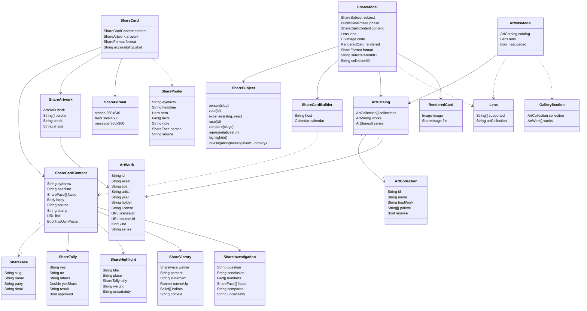

# Cartazes de compartilhar, acervo de arte e créditos

## Requirements

Quem usa o Fiscal quer levar um fato público para o Stories, o feed ou uma conversa sem montar a imagem à mão e sem que a imagem diga o lado da pessoa. A capacidade gera um cartaz pronto em três formatos a partir de oito assuntos (pessoa, votação, gastos de um ano, disputa, comparação, bancada da UF, destaque do momento e investigação), com a fonte oficial, a data, o QR para o site e o crédito da obra que veste o fundo, e mostra a galeria Artistas com cada obra, a licença e os links. O acervo é empacotado no app e só entra pelo portão de licença dos scripts. Ficam de fora a marca visível "Ilustração do Fiscal", a regra das 72 h antes e 24 h depois de uma votação para cartaz com retrato, arte encomendada, texto junto da imagem e qualquer deep link `fiscal://` para abrir um cartaz.

Definição de pronto (os nomes de pessoas são fictícios, pela Constituição 14; os testes citados usam os das próprias fixtures):

- **Given** o `ShowcasePublicData` no cenário `.normal` e os assuntos `.person(slug: "tabata-amaral")`, `.vote(id: "camara-18732026")`, `.expenses(slug: "nikolas-ferreira", year: 2026)`, `.compare(slugs: ["kim-kataguiri", "erika-hilton"])` e `.representatives(uf: "sp")` **When** o cartaz carrega e a pessoa troca entre Stories, Feed e Mensagem **Then** a fase é `PublicDataPhase.loaded`, os textos desenhados trazem "fiscal.byescaleira.com", a linha de fonte e o crédito com artista, obra e ano; e a disputa `presidente-br` encerrada (`ShowcaseLiveResults(scenario: .finished)`) vira o pôster de vitória, com `hasOwnPoster`, sem obra e sem o seletor "Arte" (`ShareModelTests.everyArtCardCarriesTheCreditInEveryFormat`).
- **Given** a Lente salva com `supported` `["lula", "tabata-amaral"]` e coleção `brasil-agora`, e depois com "Prefiro não dizer" **When** cada um dos sete assuntos gera o cartaz **Then** nenhum texto desenhado contém "Lens", nenhum slug apoiado aparece no rótulo de acessibilidade, e o conteúdo é idêntico entre as duas Lentes (`ShareModelTests.theCardNeverCarriesWhoTheUserSupports`).
- **Given** a pessoa `lula` sem Lente e com a Lente na coleção `acervo-historico` **When** o cartaz carrega **Then** o conteúdo é igual nos dois, a obra vem de `acervo-historico` (`ShareModel.neutralCollection`), a primeira coleção do seletor é "Acervo histórico" e o selo da Lente só aparece com a Lente (`ShareModelTests.theLensOnlyChangesTheArt`).
- **Given** a votação `camara-18732026` carregada **When** a pessoa toca na última obra do seletor e o model desenha o cartaz na escala 1 **Then** o crédito desenhado passa a ser o da obra escolhida, o PNG não é vazio e se chama "Fiscal.png", e a outra coleção mostra só as próprias obras (`ShareModelTests.pickingAnotherWorkKeepsTheCreditInStep`, `ShareModelTests.theModelRendersTheCardAndPicksTheArtShelf`).
- **Given** um deputado federal sem nenhum número publicado **When** o cartaz de perfil é montado **Then** as quatro métricas valem "—", nunca 0, e o herói é "—"; com a primeira métrica ausente e "R$ 3 mi" na segunda, o herói é "R$ 3 mi" e "—" vai para os fatos (`ShareCardBuilderTests.missingNumbersShowADashNeverZero`, `SharePosterTests.aMissingLeadFigureGivesWayToTheFirstPublishedOne`, `SharePosterTests.aProfileWithNothingPublishedShowsADash`).
- **Given** o perfil `ana-souza` com a fonte "Câmara dos Deputados" atualizada em 25/10/2026 às 05:42 (São Paulo) **When** o cartaz é montado **Then** a fonte diz "Fonte: Câmara dos Deputados · atualizado 25/10, 05:42", o carimbo começa por "CAMARA·PER·ANA-SOUZA·2026-10-25", o link é `https://fiscal.byescaleira.com/?person=ana-souza` e o QR desse link é gerado (`ShareCardBuilderTests.theSourceLineNamesTheHouseAndTheTime`, `ShareCardBuilderTests.theCodeOpensTheLink`).
- **Given** gastos com total "R$ 386.637,50", "Notas: 47" e a maior categoria de "R$ 70.000,00" **When** o pôster é montado em cada formato **Then** o herói é o total com a legenda das notas, o único fato é "Maior gasto: …", o herói encolhe até caber (13 caracteres × tamanho × 0,6 ≤ largura útil) e "98%" mantém 132, 96 e 72 pt; com cinco categorias, ficam as três maiores mais "Outras categorias", somando 100% (`SharePosterTests.spendingLeadsWithTheTotalAndTheLargestCategory`, `SharePosterTests.longFiguresShrinkToFitAndShortOnesKeepTheirSize`, `ShareCardBuilderTests.spendingKeepsEveryCategoryInTheTotal`).
- **Given** uma investigação salva com uma pessoa e um destaque do momento com votação **When** a pessoa abre Compartilhar **Then** a investigação desenha o pôster próprio com "INVESTIGAÇÃO", a pergunta entre aspas, "LEITURA", até 3 números (2 na Mensagem), o link `?person=<slug>` e o rodapé "O card leva só os números encontrados, as fontes e a data. Sua pergunta fica neste aparelho, a menos que você compartilhe."; o destaque traz a ementa como veio, o placar SIM × NÃO e "Alta relevância · repercussão + impacto" nos três formatos (roteiro manual: abrir Compartilhar numa investigação de Buscar e no destaque de Hoje, trocar os três formatos).
- **Given** o `art-credits.json` empacotado, com 44 obras de 29 artistas em `brasil-agora` (22, CC BY-SA 4.0) e `acervo-historico` (22, domínio público, `reserve`) **When** a galeria Artistas carrega **Then** mostra "Artistas: 29 · licença conferida obra a obra", todas as 44 obras, "Acervo histórico" só com domínio público e "Licença aberta" só com as outras, e cada obra tem imageset JPEG com o mesmo nome do `asset` (`ArtistsModelTests.showsEveryBundledWorkWithItsCredit`, `ArtCatalogTests.bundledManifestMatchesTheAssetCatalog`, `ArtCatalogTests.publicDomainBecomesTheHistoricalReserve`).
- **Given** o aparelho sem conexão (`ShowcasePublicData` no cenário `.offline`) **When** o cartaz carrega **Then** a fase é `PublicDataPhase.failed(.offline)` e a tela mostra "Disponível com conexão", "Isso não está salvo para uso offline. Conecte-se à internet para ver." e "Tentar novamente" (`ShareModelTests.reportsWhyTheCardDidNotLoad`).
- **Given** o dado ainda não publicado (cenário `.empty`) ou a disputa `nowhere` **When** o cartaz carrega **Then** a fase é `PublicDataPhase.failed(.notFound)` e a tela mostra "Não foi possível carregar os dados" e "Este dado ainda não foi publicado." (`ShareModelTests.reportsWhyTheCardDidNotLoad`).
- **Given** o model sem serviço de dados públicos, ou uma disputa sem serviço de apuração **When** o cartaz carrega **Then** a fase é `PublicDataPhase.failed(.unavailable)` e a tela mostra "Não foi possível falar com o servidor de dados públicos. Tente de novo daqui a pouco." (`ShareModelTests.reportsWhyTheCardDidNotLoad`).
- **Given** o manifesto `art-credits.json` ausente (`ArtCatalogError.missingManifest`) **When** a galeria carrega **Then** `hasLoaded` é verdadeiro, `isEmpty` também, e a tela mostra "Nenhuma obra ainda" com "Os artistas dos cards de compartilhar aparecem aqui, com cada obra, a licença e o link para a fonte." (`ArtistsModelTests.aMissingManifestIsAnHonestEmptyState`).
- **Given** uma obra de `scripts/art-works.json` cuja licença curta no Commons não é "Public domain" nem "CC0", ou cujo autor morreu depois de 1955 **When** roda `python3 -I scripts/art.py check` ou `fetch` **Then** a linha da obra diz "recusada: …" com o motivo, o script sai com "Some works failed the license gate; nothing was downloaded." e nada é baixado (roteiro manual: `python3 -I scripts/art.py check`, também no `scripts/verify.sh --full`).

## Entities

- `ShareSubject` mora em `FiscalKit/Sources/FeatureCore/Navigation/ShareSubject.swift` e é o argumento de `Route.share`; o caso `investigation` carrega o `InvestigationSummary` de `FeatureCore/Navigation/InvestigationSummary.swift`.
- `ShareModel` (`FeatureShare/ShareModel.swift`) é o model `@MainActor @Observable` da tela de compartilhar: busca o dado, guarda a Lente lida, o QR, o formato, a obra e a coleção escolhidas e o PNG desenhado.
- `ShareCardBuilder` (`FeatureShare/ShareCardBuilder.swift`, `+Groups`, `+Highlight`, mais as extensões em `ShareVictory.swift` e `ShareInvestigation.swift`) transforma `Profile`, `VoteDetail`, `ExpenseList`, `Race`, `PlaceRepresentatives`, `Highlight` e `InvestigationSummary` do `FiscalDomain` em `ShareCardContent`.
- `ShareCardContent`, `ShareFace`, `ShareMetric`, `ShareTally`, `ShareSpending`, `ShareRace`, `ShareCompareRow`, `ShareGroup` e `ShareHighlight` moram em `FeatureShare/ShareCardContent.swift`; `ShareVictory` em `ShareVictory.swift` e `ShareInvestigation` em `ShareInvestigation.swift`. São valores sem persistência.
- `SharePoster` (`FeatureShare/SharePoster.swift`) escolhe o herói, os fatos (até 2), a nota e a identidade de cada assunto, e é a fonte dos textos desenhados e do rótulo de acessibilidade.
- `ShareCard`, `ShareArtwork` e `HexColor` moram em `FeatureShare/ShareArtwork.swift`, com as extensões de `ArtWork` (`isPublicDomain`, `licenseLabel`, `archive`).
- `ShareFormat` é o `ByescaleiraUI.ShareFormat` do byescaleira-kit (tamanhos 360 × 640, 360 × 450 e 360 × 360), estendido em `FeatureShare/ShareFormat.swift`, `ShareFormat+Victory.swift`, `ShareFormat+Highlight.swift` e `ShareInvestigationPoster.swift`.
- `RenderedCard` (`FeatureShare/ShareRenderer.swift`) guarda a imagem de prévia e o `ShareImage` do kit, que é `Transferable` como PNG.
- `ArtCatalog`, `ArtCollection`, `ArtSeries` e `ArtWork` moram em `FiscalResource/ArtCatalog.swift` e decodificam `FiscalResource/art-credits.json`; as imagens estão em `FiscalResource/Assets/Art.xcassets`.
- `ArtistsModel`, `GallerySection` e `GalleryKind` moram em `FeatureShare/ArtistsModel.swift`.
- `Lens` (`FiscalDomain/PublicData/Lens.swift`) é só lida: o campo `artCollection` vem do `LensEntity`, que está em `deviceModels` do `FiscalSchemaV3` e nunca vai ao CloudKit. A capacidade não cria nem altera schema SwiftData; o que a versão publicada já gravou em `artCollection` (`brasil-agora`, `acervo-historico`) continua válido.

## Approach

1. **Estratégia da solução:** a tela de compartilhar recebe um `ShareSubject`, o `ShareModel` busca o dado público (ou a apuração, ou usa o resumo da investigação já pronto), o `ShareCardBuilder` monta um `ShareCardContent` neutro, e o `SharePoster` decide o que entra no cartaz. O `ShareCardView` desenha uma peça gráfica fixa em modo escuro e Dynamic Type `.large`; o `ShareRenderer` a converte em PNG pelo `ImageRenderer` do kit, na escala da tela, e o `ShareLink` exporta só esse arquivo. A obra vem do catálogo empacotado e veste só o fundo, atrás de um véu; vitória e investigação desenham o próprio pôster, sem obra. A galeria Artistas lê o mesmo catálogo e mostra licença, fonte e acervo de cada obra.
2. **Decisões:**
   - Cartaz é peça gráfica, não tela: uma ideia, herói enorme, no máximo duas ou três linhas de apoio, sem `List`, `Form`, `Label`, `Gauge`, `ProgressView` nem `Divider` na imagem — referências Apple Music Replay, Apple Sports, Flighty Passport, Strava, Apple Invites, Spotify Wrapped e o rodapé de fonte do NYT e do The Athletic, vistas em 2026-10-25; descartada a versão anterior, que parecia uma tela de Ajustes colada numa foto. ADR: não precisa (registro em `docs/changes/archive/2026-10-29-app-1.0/share-cards.md`).
   - Números e títulos de destaque em Bricolage Grotesque (`posterFigure`, `posterTitle`, `posterName`, `posterParty`, `posterBrand`, por `Font.emphasis(fixed:weight:)`), texto pequeno do cartaz em SF Pro de tamanho fixo — um tipo só para destaque; descartada a SF condensada pesada do desenho de 2026-10-25. ADR: `docs/adr/0009-bricolage-emphasis-font.md`.
   - Toda obra preenche o fundo (`scaledToFill`, recortada) atrás de um véu de 94%, e a foto de licença aberta leva no crédito "adaptada" — o recorte com véu é uma adaptação permitida pela CC BY-SA com crédito; descartada a placa sem recorte com etiqueta de museu, que deixava a arte como uma faixa estreita (o código da placa ficou, inalcançável, porque `ShareArtwork.isBackdrop` é sempre verdadeiro). ADR: não precisa.
   - A coleção padrão do cartaz é o Acervo histórico, quando existe, e só depois a coleção da Lente; a obra padrão é a `leadWork` do Acervo (`pedro-americo-independencia-ou-morte`), e as paisagens vão por último no seletor — mesma arte padrão para qualquer pessoa ou partido; descartada a arte escolhida pela Lente por padrão (`docs/changes/archive/2026-10-29-setup-lens-art/proposal.md`, substituída). ADR: não precisa.
   - A Lente fica só no aparelho e nunca entra na imagem, no rótulo de acessibilidade nem em texto; ela muda só a ordem das coleções e o selo. ADR: `docs/adr/0004-lens-on-device-store.md`.
   - Obra só entra pelo portão de licença: `scripts/art.py` confere domínio público no Wikimedia Commons (licença curta "Public domain" ou "CC0", código `pd` ou `cc0`, categoria declarada, autor morto até 1955, arquivo de imagem com miniatura) e recusa tudo se uma obra reprova; `scripts/art-photos.py` confere as fotos do Wiki Loves Earth Brasil (`cc-by-sa-4.0`, `cc-by-4.0` ou `cc0`, com autor, sem restrição, JPEG) — pesquisa em `docs/research/2026-10-25-art-and-licensing.md`; descartados o download manual e as licenças pagas, que pedem contrato. ADR: não precisa.
   - Exportar só a imagem, um PNG `Fiscal.png` pelo `ShareImage` do kit — sem texto junto, o lado da pessoa não vaza na legenda; descartado o texto de mensagem (`ShareModel.shareMessage` existe e não é usado pela tela). ADR: `docs/adr/0010-byescaleira-kit.md`.
   - Retratos só desenhados pelo Fiscal (`PersonPortrait`, rig e traços do `PortraitLibrary`), congelados com `portraitsStill()` e `partyMarksStill()`, e só nos pôsteres de vitória e de investigação — nunca foto nem IA a partir de foto; a marca "Ilustração do Fiscal" e a regra das 72 h ficaram para o backlog. ADR: não precisa.
   - O QR leva `https://fiscal.byescaleira.com/?{tipo}={id}` com correção M, gerado pelo Core Image (`ShareCode`); descartado um link `fiscal://`, que não abre fora do app. ADR: não precisa.
   - Texto só em pt-BR, com chaves em inglês e `String(appLocalized:)` no builder. ADR: `docs/adr/0003-portuguese-only.md`.
3. **Tratamento de erros:**
   - Falha na busca: `ShareModel.load` passa por `PublicDataPhase.settle`, e o `PublicDataContent` mostra o estado vazio do erro (`.offline`: "Disponível com conexão"; os outros: "Não foi possível carregar os dados", com o texto de `notFound`, `unavailable`/`rejected` ou `invalidData`) e "Tentar novamente", que chama `load()` de novo.
   - Sem serviço de dados públicos, ou disputa sem serviço de apuração: `PublicDataError.unavailable`. Disputa ausente, comparação sem slugs, bancada sem ninguém ou destaque fora da lista: `PublicDataError.notFound`.
   - Conteúdo vazio depois de carregar: "Nada para compartilhar ainda" e "Este dado ainda não foi publicado."
   - Lente ilegível: ignorada (`try?`), o cartaz sai com a arte padrão e sem selo. Votação do destaque ou ações da pessoa que falham: ignoradas, o destaque sai sem placar ou sem estágio.
   - Catálogo de arte ausente: `artwork` é nulo, o cartaz sai no campo `scoreboard` sem obra e sem crédito, e o seletor fica vazio. Na galeria, "Nenhuma obra ainda".
   - QR que não gera: o rodapé sai sem o código. PNG que não renderiza: `rendered` fica nulo e o botão dá lugar a "Preparando a imagem".
   - Número ausente: "—" (`PublicFormat.missing`); o herói do perfil pula para o primeiro número publicado.
   - `art.py` e `art-photos.py`: obra reprovada imprime "recusada: <motivos>" e o script termina com erro antes de baixar; coleção acima do limite de bytes interrompe o `fetch` antes de instalar.
4. **Riscos:**
   - Número longo truncado → `ShareFormat.figureSize` encolhe pelo número de caracteres e `minimumScaleFactor(.posterShrink)` (0,45) segura o resto.
   - Licença de uma obra muda no Commons → `python3 -I scripts/art.py check` no `scripts/verify.sh --full` reprova antes do merge.
   - O acervo pesa no app (23 MB em disco hoje) → `ArtCatalogTests.collectionStaysUnderTheSizeBudget` barra acima de 25.000.000 bytes, e os scripts limitam a 1600 px e a 15.000.000 (histórico) e 25.000.000 bytes (fotos).
   - O `install` de `scripts/art-photos.py` troca os imagesets antes de conferir o limite de bytes, então um estouro deixa imagens novas com o manifesto antigo → `ArtCatalogTests.bundledManifestMatchesTheAssetCatalog` e `everyWorkHasImageCreditLicenseAndLink` reprovam o descompasso.
   - O selo da Lente aparece quando a Lente tem uma coleção, mesmo com a arte padrão vindo do Acervo histórico → o conteúdo do cartaz é o mesmo com ou sem Lente (`theLensOnlyChangesTheArt`).
   - O QR abre a raiz do site, que não lê `?person=` e o link universal só cobre `/link` → a landing abre normalmente; o cartaz já traz a fonte e a data por escrito.
   - Código morto (placa, `plateSpansWidth`, `plateWidth`, `shareMessage`, tokens antigos em `ShareCardTokens.swift`) pode induzir uma geração a reativá-lo → `ShareArtwork.isBackdrop` é fixo em verdadeiro e `SharePosterTests.onlyPublicDomainWorksBecomeTheBackdrop` confere que toda obra vira fundo.
   - Retrato de candidato perto de uma votação → ainda sem mitigação no código; a regra está no backlog P1.

**Known divergences:**

- `Spec × código:` a spec diz que fatos e nota aparecem só no Stories; o código mostra os grupos da bancada (`SharePoster.factsAreEssential`) e a nota da disputa, do destaque e da investigação (`SharePoster.noteIsEssential`) nos três formatos (`FiscalKit/Sources/FeatureShare/SharePoster.swift`, `ShareLead` em `FiscalKit/Sources/FeatureShare/ShareCardView.swift`).
- `Spec × código:` a spec diz que o VoiceOver lê "Ilustração de {nome}" no retrato; na tela de compartilhar o retrato está dentro do PNG, e a prévia lê só `ShareCard.accessibilityLabel` (textos desenhados e crédito), sem essa frase (`ShareCardPreview` em `FiscalKit/Sources/FeatureShare/ShareScreen.swift`).
- `Spec × código:` a spec diz que a galeria mostra "{ano} · {acervo}", com "Wikimedia Commons" quando a imagem vem de lá; a galeria mostra "{ano} · {holder}" (por exemplo "Wiki Loves Earth 2025 · Brasil" ou "Museu Paulista da USP"), e só o crédito do cartaz usa `ArtWork.archive` (`ArtworkCard` em `FiscalKit/Sources/FeatureShare/ArtistsScreen.swift`).
- `Spec × código:` a spec diz que o QR aponta para `?{tipo}={id}`; a bancada usa a chave `place`, e a investigação com nenhuma ou mais de duas pessoas aponta para `https://fiscal.byescaleira.com/` sem consulta (`investigationLink` em `FiscalKit/Sources/FeatureShare/ShareInvestigation.swift`).
- `Playbook:` o `byescaleira-sdd` (`motion-and-lottie.md`) diz que cartaz de compartilhar não leva retrato; os pôsteres de vitória e de investigação desenham `PersonPortrait`, ainda sem a marca "Ilustração do Fiscal" (`FiscalKit/Sources/FeatureShare/ShareVictoryPoster.swift`, `FiscalKit/Sources/FeatureShare/ShareInvestigationPoster.swift`).
- `Playbook:` ADR 0009 proíbe SF heavy em tamanho fixo para número; o percentual de válidos, brancos e nulos do pôster de vitória usa `.posterLabel` (SF 11) com `.fontWeight(.heavy)` (`ShareVictoryBallots` em `FiscalKit/Sources/FeatureShare/ShareVictoryPoster.swift`).
- `Playbook:` ADR 0009 pede `.monospacedDigit()` em número de destaque; a contagem de obras da galeria usa `.amountHero` sem ele (`ArtistsHero` em `FiscalKit/Sources/FeatureShare/ArtistsScreen.swift`).
- `Playbook:` número solto em feature, `.scaleEffect(selected ? 1 : 0.94)` na miniatura da obra (`ShareArtCard` em `FiscalKit/Sources/FeatureShare/ShareScreen.swift`).
- `Playbook:` Constituição 14 pede a explicação ao lado de toda classificação; a faixa "Melhor que a média" vai na legenda do herói do perfil nos três formatos, mas a linha que a explica (`peerDetail`, "Em 2026: … · mediana …") só sai no Stories (`SharePoster.swift`, `ShareFormat.showsNote`).
- `Sem teste:` o pôster de investigação e o cartaz do destaque do momento não têm teste automatizado; `ShareCardBuilder.highlight`, `ShareCardBuilder.investigation` e `investigationLink` só são exercitados pelo roteiro manual (`FiscalKit/Sources/FeatureShare/ShareCardBuilder+Highlight.swift`, `FiscalKit/Sources/FeatureShare/ShareInvestigation.swift`).
- `Sem teste:` o portão de licença de `scripts/art.py` e `scripts/art-photos.py` não tem teste automatizado; depende da rede do Commons e roda no `scripts/verify.sh --full`.

## Structure

Camadas tocadas e regra de dependência: o app fino não tem código da capacidade; `FiscalResource` guarda o catálogo e as imagens; `FiscalDesignSystem` guarda os tokens do cartaz e o `PersonPortrait`; `FeatureCore` define `ShareSubject`, `InvestigationSummary` e `Route.share`/`Route.artists`; `FeatureShare` depende de `FiscalDomain`, `FiscalResource`, `FiscalDesignSystem` e `FeatureCore`, nunca de outra feature; as features que abrem um cartaz (`FeatureProfile`, `FeatureVotes`, `FeatureMoney`, `FeatureSearch`, `FeatureLiveResults`, `FeatureToday`, `FeatureMine`) só devolvem `Route.share(ShareSubject)`; o `AppShell` monta o `ShareModel` e o `ArtistsModel` com os serviços e a Lente da sessão e trata `fiscal://artists`. Os scripts de arte rodam fora do app e escrevem só o manifesto e o catálogo de imagens.

- `scripts/art.py`, `scripts/art-works.json` (acervo histórico: 22 obras, 8 artistas, `deathYearLimit` 1955)
- `scripts/art-photos.py`, `scripts/art-photos.json` (Brasil agora: 22 fotos)
- `FiscalKit/Sources/FiscalResource/`
  - `ArtCatalog.swift`, `art-credits.json`, `Assets/Art.xcassets` (44 imagesets `art-<id>`)
  - `PortraitLibrary.swift`, `Assets/fiscal-portrait-rig.json`, `Assets/fiscal-portrait-traits.json`
- `FiscalKit/Sources/FiscalDesignSystem/`
  - `Tokens/SharePosterTokens.swift`, `Tokens/ShareCardTokens.swift`, `Tokens/ShareVictoryTokens.swift`, `Tokens/ShareHighlightTokens.swift`, `Tokens/InvestigationTokens.swift`
  - `Components/PersonPortrait.swift`, `Components/PortraitArtwork.swift`, `Components/TallyBar.swift`, `Components/CelebrationConfetti.swift`, `Components/PartyMark.swift`
- `FiscalKit/Sources/FeatureCore/Navigation/ShareSubject.swift`, `InvestigationSummary.swift`, `Route.swift`
- `FiscalKit/Sources/FeatureShare/`
  - Model e conteúdo: `ShareModel.swift`, `ShareCardContent.swift`, `ShareCardBuilder.swift`, `ShareCardBuilder+Groups.swift`, `ShareCardBuilder+Highlight.swift`, `ShareVictory.swift`, `ShareInvestigation.swift`, `SharePoster.swift`, `ShareArtwork.swift`, `ShareCode.swift`
  - Formatos: `ShareFormat.swift`, `ShareFormat+Victory.swift`, `ShareFormat+Highlight.swift`
  - Desenho: `ShareCardView.swift`, `SharePosterHeroes.swift`, `SharePosterHighlight.swift`, `ShareVictoryPoster.swift`, `ShareInvestigationPoster.swift`, `ShareRenderer.swift`
  - Telas: `ShareScreen.swift`, `ArtistsModel.swift`, `ArtistsScreen.swift`
- `FiscalKit/Sources/AppShell/RouteScreen.swift` (`ShareModel`, `ArtistsDestination`), `FiscalKit/Sources/AppShell/DeepLink.swift` (`fiscal://artists`)
- `FiscalKit/Sources/FeatureSettings/SettingsScreen.swift` (linha "Artistas" em "Seu Fiscal")
- `Fiscal/Fiscal/Localizable.xcstrings` (textos pt-BR)
- Testes:
  - `FiscalKit/Tests/FeatureShareTests/ShareModelTests.swift`, `ShareCardBuilderTests.swift`, `SharePosterTests.swift`, `ShareCardSnapshotTests.swift`, `ArtistsModelTests.swift`
  - `FiscalKit/Tests/FiscalResourceTests/ArtCatalogTests.swift`, `PortraitLibraryTests.swift`
  - `FiscalKit/Tests/FiscalDesignSystemTests/PortraitTests.swift`
  - `FiscalKit/Tests/AppShellTests/DeepLinkTests.swift`

## Operations

1. **Portão de licença e coleta do acervo histórico** (`scripts/art.py`, `scripts/art-works.json`): `main()` lê o modo `check` ou `fetch`; `metadata(titles, width)` consulta a API do Commons em lotes, com `User-Agent` próprio e timeout de 30 s; `gate(work, artist, info, limit)` devolve os motivos de recusa (licença curta fora de "Public domain"/"CC0", código fora de `pd`/`cc0`, categoria declarada ausente, autor morto depois de `deathYearLimit`, tipo que não é imagem, sem miniatura); `check(source, found)` imprime uma linha por obra e devolve se todas passaram; sem todas aprovadas, sai com "Some works failed the license gate; nothing was downloaded."; `fetch(source, found)` baixa a miniatura, converte para JPEG com `sips` (lado máximo 1600, qualidade 70), tira a paleta da `leadWork`, recusa acima de 15.000.000 bytes e `install(...)` troca só os imagesets e as linhas da coleção `acervo-historico` no `art-credits.json`. Verificação: `python3 -I scripts/art.py check`.
2. [P] **Portão das fotos de licença aberta** (`scripts/art-photos.py`, `scripts/art-photos.json`): modos `check`, `stage <pasta>`, `install <pasta>` e `fetch`; `gate(photo, info, licenses)` exige licença `cc-by-sa-4.0`, `cc-by-4.0` ou `cc0`, a categoria "Images from Wiki Loves Earth <ano> in Brazil", nenhuma categoria bloqueante, nenhuma restrição, autor e usuário, e JPEG com miniatura; com alguma reprovada, sai com "Some photos failed the license gate; nothing was downloaded."; `stage` baixa e converte (lado máximo 1600, qualidade 74) e monta o crédito "Foto: …"; `install` troca os imagesets de `brasil-agora`, tira a paleta da `leadWork` e só grava o manifesto se o catálogo inteiro ficar até 25.000.000 bytes. Depende de: 1 (reusa as funções do `art.py`). Verificação: `python3 -I scripts/art-photos.py check`.
3. **Catálogo de arte** (`FiscalKit/Sources/FiscalResource/ArtCatalog.swift`): `ArtCatalog.bundled() throws -> ArtCatalog` lê `art-credits.json` do bundle ou lança `ArtCatalogError.missingManifest`; `decode(_ data: Data) throws -> ArtCatalog`; consultas `collection(id:)`, `work(id:)`, `works(in:)`, `works(inSeries:)`, `works(forState:)`, `leadWork(of:)`, `assets` e `featuredCollections` (sem `reserve`); `ArtWork.image` abre o imageset `asset` do `Bundle.module`. Depende de: 1, 2. Verificação: `scripts/test.sh --affected`.
4. [P] **Tokens e retrato** (`FiscalKit/Sources/FiscalDesignSystem/Tokens/SharePosterTokens.swift`, `ShareVictoryTokens.swift`, `ShareHighlightTokens.swift`, `ShareCardTokens.swift`, `Components/PersonPortrait.swift`): margens 24 e 18 pt, herói 132/96/72 pt, placar 72/64/50 pt, fatos 30/24/20 pt, linhas 40/30/24 pt, QR 38 pt com 3 pt de margem, `posterShrink` 0,45, `posterFigureAdvance` 0,6, opacidades do véu (0,94), da etiqueta (0,86), do tom do campo (0,32) e do texto secundário (0,74); fontes `posterFigure(_:)` e `posterTitle(_:)` em Bricolage heavy fixa, `posterEyebrow`, `posterLabel`, `posterSource`, `posterCredit` e `posterHost` em SF fixa; `PersonPortrait(slug:name:party:size:expression:)` com rótulo "Ilustração de {nome}". Verificação: `scripts/test.sh --affected`.
5. **Assunto e rota** (`FiscalKit/Sources/FeatureCore/Navigation/ShareSubject.swift`, `Route.swift`): enum `ShareSubject` com os oito casos; `Route.share(ShareSubject)` e `Route.artists`. Verificação: `scripts/test.sh --affected`.
6. **Conteúdo do cartaz** (`FiscalKit/Sources/FeatureShare/ShareCardContent.swift`, `ShareVictory.swift`, `ShareInvestigation.swift`): `ShareCardContent(eyebrow:headline:faces:body:source:stamp:link:)` com `Body` de nove casos (`person`, `vote`, `expenses`, `race`, `compare`, `representatives`, `highlight`, `victory`, `investigation`); `hasOwnPoster` é verdadeiro para vitória e investigação; `ShareInvestigation.numberLimit` 3 e `faceLimit` 5, e `numbers(for:)` corta para 2 na Mensagem. Depende de: 5. Verificação: `scripts/test.sh --affected`.
7. **Montagem do conteúdo** (`FiscalKit/Sources/FeatureShare/ShareCardBuilder.swift`, `+Groups`, `+Highlight`, extensões em `ShareVictory.swift` e `ShareInvestigation.swift`): `ShareCardBuilder(calendar:)`; `person(_ profile: Profile) -> ShareCardContent` com quatro métricas (legislador: presença, votações nominais, propostas, cota usada, com a faixa de pares; executivo: votos na última eleição, bens, receita de campanha, fim do mandato) e "—" para o ausente; `vote(_:)` com o placar, "Aprovada"/"Rejeitada" e a proposição; `expenses(_:list:year:)` com o total, "Notas: N" e as três maiores categorias mais "Outras categorias" quando há mais de quatro; `race(_:)` vira `victory` quando `Race.winner` existe, senão lista os candidatos por votos com "Urnas apuradas: …" e "Brancos … · Nulos …"; `compare(_:)` com cinco linhas e as fontes sem repetir; `representatives(_:)` só com grupos não vazios; `highlight(_:vote:stage:sources:)` com a ementa, "Casa · proposição · estágio", o placar e "{relevância} · repercussão + impacto"; `investigation(_:)` com a pergunta, a leitura, os números e as pessoas. Em todos: rótulo em caixa alta unido por " · ", `sourceLine` "Fonte: {nome} · atualizado dd/MM, HH:mm", carimbo `ORIGEM·CÓDIGO·REFERÊNCIA·AAAA-MM-DD·FISCAL.BYESCALEIRA.COM` e `link(key, value)` para `https://fiscal.byescaleira.com/?{key}={value}`. Depende de: 6. Verificação: `scripts/test.sh --affected`.
8. **Pôster** (`FiscalKit/Sources/FeatureShare/SharePoster.swift`): `SharePoster(_ content: ShareCardContent)` escolhe o herói (`figure`, `place`, `tally`, `race`, `versus`, `highlight`, `victory`, `investigation`); no perfil, o herói é a primeira métrica publicada e os fatos são as duas seguintes; nos gastos, o total e a maior categoria; na comparação, duas pessoas e três linhas; na bancada, todos os grupos como fatos essenciais; nota essencial na disputa, no destaque e na investigação; `texts` e `accessibilitySummary` juntam tudo o que é desenhado. Depende de: 7. Cobre: o perfil sem número mostra "—" e o herói pula para o primeiro publicado.
9. **Arte e cartão** (`FiscalKit/Sources/FeatureShare/ShareArtwork.swift`): `ShareArtwork(work:palette:)` com `credit` "Arte: {artista}, {obra} ({ano}) · Domínio público · {acervo}" ou "Foto: {autor}, {obra} ({ano}) · {licença}, adaptada · {acervo}", `shade` (a cor mais saturada da paleta) e `isBackdrop` sempre verdadeiro; `ArtWork.isPublicDomain` quando a licença começa com "PD" ou o link tem "publicdomain"; `archive` é "Wikimedia Commons" quando a fonte é do Commons, senão `holder`; `ShareCard(content:artwork:format:)` com `texts` (pôster, crédito, "Fiscal", host) e `accessibilityLabel` (resumo e crédito). Depende de: 3, 8. Verificação: `scripts/test.sh --affected`.
10. [P] **Formatos** (`FiscalKit/Sources/FeatureShare/ShareFormat.swift`, `ShareFormat+Victory.swift`, `ShareFormat+Highlight.swift`): `raceRowLimit` 8/5/3, `headlineLines` 4/3/2, `statementLines(withTally:)` 7/5/4 sem placar e 5/3/2 com placar, `figureSize(_:for:in:)` igual ao mínimo entre a base e largura ÷ (caracteres × 0,6), `showsFacts` e `showsNote` só no Stories, `showsCode` fora da Mensagem, `compareRows` 2 na Mensagem. Depende de: 4. Cobre: o herói longo encolhe e o curto mantém 132/96/72 pt.
11. [P] **QR** (`FiscalKit/Sources/FeatureShare/ShareCode.swift`): `ShareCode.image(for url: URL) -> CGImage?` pelo `CIFilter.qrCodeGenerator` com `correctionLevel` "M". Cobre: o QR do link é gerado.
12. **Model da tela** (`FiscalKit/Sources/FeatureShare/ShareModel.swift`): `init(subject:service:races:lens:catalog:calendar:)`; `load() async` marca `.loading` quando não há conteúdo, lê a Lente e o conteúdo dentro de `PublicDataPhase.settle(after:in:)`, e gera o QR do `link`; `fetch()` resolve disputa pelo serviço de apuração, investigação sem rede e o resto pelo `PublicDataService`, lançando `unavailable` ou `notFound`; `preferredCollectionID` é `acervo-historico`, senão a coleção da Lente, senão a primeira; `collections`, `works` (paisagens por último), `selectedWork` (escolhida, senão a `leadWork` da coleção preferida), `currentCollectionID`, `currentWorks`, `selectedCredit` "{artista} · {obra}, {ano} · {licença}"; `card` sem obra quando há pôster próprio; `select(_:)`, `show(_:)` e `render(scale:portraits:)`. Depende de: 7, 9, 11. Verificação: `scripts/test.sh --affected`.
13. **Desenho do cartaz** (`FiscalKit/Sources/FeatureShare/ShareCardView.swift`, `SharePosterHeroes.swift`, `SharePosterHighlight.swift`, `ShareVictoryPoster.swift`, `ShareInvestigationPoster.swift`): `ShareCardView(card:code:)` fixa o tamanho do formato, texto branco, modo escuro e `dynamicTypeSize(.large)`; o cartaz padrão é o campo (`scoreboard` misturado a 32% com o tom da obra, com brilho de 8% no topo), a obra em `scaledToFill`, a etiqueta do crédito a 86% no topo e o conteúdo sobre o véu a 94% que sobe 96 pt; ordem: rótulo, título, herói, fatos, nota, identidade (nome, sigla e duas faixas de `PartyPalette`), fonte, "Fiscal", domínio e QR; placar com SIM e NÃO em colunas iguais, barra de três cores de dado e OUTROS; vitória com o campo nas cores do partido, retrato comemorando, "ELEITO", percentual, "Eleito com X dos votos válidos", segundo colocado, barra de válidos, brancos e nulos e o contexto "cargo · lugar · turno · Resultado final do TSE às HH:MM"; investigação com grade de pontos, "INVESTIGAÇÃO", pergunta entre aspas, retratos ligados por um fio, "LEITURA", números, comparação (só Stories), incerteza e carimbo. Depende de: 4, 9, 10. Verificação: `scripts/test.sh --affected`.
14. **Renderização** (`FiscalKit/Sources/FeatureShare/ShareRenderer.swift`): `ShareRenderer.render(_ card: ShareCard, code: CGImage?, scale: CGFloat, portraits: PortraitArtwork?) -> ShareImage?` desenha o `ShareCardView` com retratos e marcas de partido parados e devolve o PNG `Fiscal.png`; `RenderedCard(file:scale:)` decodifica a prévia. Depende de: 13. Cobre: o PNG não é vazio e se chama "Fiscal.png".
15. **Tela de compartilhar** (`FiscalKit/Sources/FeatureShare/ShareScreen.swift`): `ShareScreen` com título "Compartilhar" inline e `PublicDataContent` (erro, carregando ou "Nada para compartilhar ainda"); `ShareEditor` re-renderiza a cada mudança de `card` na escala da tela; prévia com o rótulo de acessibilidade do cartão, até 520 pt de altura; seletor de formato com o retângulo na proporção; seletor "Arte" (só quando não há pôster próprio) com as coleções, a fila de obras e o crédito; `ShareLink` "Compartilhar imagem" com prévia "Card do Fiscal", ou "Preparando a imagem"; rodapé que muda para investigação, cartaz com arte ou apuração. Animações e `sensoryFeedback` só sem Reduzir movimento e sem modo leve. Depende de: 12, 14. Cobre: os estados de erro e o crédito acompanha a obra escolhida.
16. [P] **Galeria Artistas** (`FiscalKit/Sources/FeatureShare/ArtistsModel.swift`, `ArtistsScreen.swift`): `ArtistsModel(lens:loader:)`; `load() async` lê o catálogo e a Lente (falhas viram nulo) e marca `hasLoaded`; `collections` põe a coleção da Lente primeiro; `openLicense` e `historical` separam por `isPublicDomain`; `current(on:)` e `show(_:on:)` lembram a coleção de cada prateleira; a tela mostra "ACERVO", a contagem, "Artistas: N · licença conferida obra a obra", as prateleiras "Licença aberta" e "Acervo histórico" com os rodapés, e por obra o chip da licença (verde `positive` para domínio público, azul `info` para licença aberta), "{ano} · {holder}" e os links "Licença" e "Fonte"; sem obras, "Nenhuma obra ainda". Depende de: 3. Verificação: `scripts/test.sh --affected`.
17. **Integração** (`FiscalKit/Sources/AppShell/RouteScreen.swift`, `DeepLink.swift`, `FeatureSettings/SettingsScreen.swift`): `Route.share(subject)` monta `ShareModel` com o serviço público, o `liveResultsService()` e a Lente da sessão; `Route.artists` e a linha "Artistas" ("As obras dos cards de compartilhar, com as licenças") em Ajustes › Seu Fiscal montam `ArtistsModel`; `fiscal://artists` abre a galeria na aba Hoje; perfil, votação, gastos, comparação, investigação, disputa, destaque, resumo do dia e bancada devolvem `Route.share`. Depende de: 15, 16. Verificação: `scripts/test.sh --affected`.
18. **Imagens de conferência** (`FiscalKit/Tests/FeatureShareTests/ShareCardSnapshotTests.swift`): `rendersEveryCardToDisk` só roda com `FISCAL_SHARE_SNAPSHOTS`, registra a Bricolage, instala o idioma e grava `{prefixo}-{assunto}-{formato}.png` na escala 3, mais `-historical` para perfil e votação. Depende de: 14. Verificação: `FISCAL_SHARE_SNAPSHOTS=<pasta> scripts/test.sh --affected`.

## Norms

- Constituição 3: `ShareModel` e `ArtistsModel` são `@MainActor @Observable`, injetados por `ModelHost` e lidos com `@Environment(Tipo.self)`, com `@Bindable var model = model` dentro do `body`; busca, escolha de arte, crédito e renderização ficam no model, e o `ShareCardBuilder` e o `SharePoster` são valores puros sem SwiftUI.
- Constituição 3: features não se importam; quem abre um cartaz devolve `Route.share(ShareSubject)` do `FeatureCore`, e só o `AppShell` monta o `ShareModel`.
- Constituição 4: zero comentários, zero warnings, Swift Testing para toda lógica nova, e tokens do `FiscalDesignSystem` (`posterMargin`, `posterHero*`, `opacityPoster*`, `space*`, `radius*`) em vez de números soltos.
- Constituição 5 e ADR 0009: número e título de destaque do cartaz só em Bricolage (`posterFigure`, `posterTitle`, `posterName`, `posterParty`, `posterBrand`, `posterVictoryChip`), com `.monospacedDigit()` nos números; texto pequeno (rótulo, fonte, crédito, domínio) em SF Pro de tamanho fixo; nada de SF condensada, arredondada ou mono.
- Constituição 5: nunca anel nem progresso circular com valor; a barra do placar é desenhada e a de válidos, brancos e nulos é o `TallyBar` do design system; `ProgressView()` sem valor só enquanto carrega ou prepara a imagem.
- Constituição 5: Reduzir movimento sempre respeitado; toda animação do seletor de formato, do seletor de arte e da galeria vira `nil` com `accessibilityReduceMotion` ou modo leve, e os retratos e marcas do PNG saem parados.
- Constituição 6 e ADR 0003: só pt-BR; chaves em inglês no `Localizable.xcstrings`, `String(appLocalized:)` no builder e no model, `Text(verbatim:)` para dado e nome de obra.
- Constituição 14: dado ausente é "—" (`PublicFormat.missing`), nunca 0; todo cartaz traz a fonte oficial e a data; a ementa do destaque vai como veio; o peso do destaque diz ao lado que é "repercussão + impacto"; o mesmo molde, a mesma arte padrão e o mesmo crédito para qualquer pessoa, partido ou lado.
- Peça gráfica (`byescaleira-sdd`, `icons-and-imagery.md` §4.2): a imagem não usa `List`, `Form`, `GroupBox`, `Label`, `Section`, `Gauge`, `ProgressView` nem `Divider`; uma ideia por cartaz, herói que encolhe pelo número de caracteres e nunca trunca.
- Cor de dado (`voteYes`, `voteNo`, `voteAbstain`) só no placar e no resultado; cor de partido (`PartyPalette`) só nas faixas da identidade e no campo da vitória; a paleta da coleção só no tom do campo; a obra nunca muda número, cor de partido nem texto.
- O cartaz é desenhado sempre igual para todos: tamanho fixo do formato, modo escuro e `dynamicTypeSize(.large)`, e exportado só como PNG pelo `ShareImage`, sem texto junto.
- Licença: obra entra só pelo `scripts/art.py` ou `scripts/art-photos.py` aprovados e com linha no `art-credits.json`; obra sem linha no manifesto não aparece; todo cartaz com obra leva o crédito gravado na imagem.
- Retrato é sempre o desenho do Fiscal (`PersonPortrait`), nunca foto nem imagem gerada a partir de foto, e só nos pôsteres de vitória e de investigação.
- Acessibilidade: a prévia é um elemento único com os textos desenhados e o crédito; obras e faixas decorativas ficam `accessibilityHidden`; seleção marcada com `.isSelected`; o seletor de obra lê "{obra}, {artista}, {ano}".
- Constituição 7: `scripts/verify.sh --quick` durante o trabalho e `scripts/verify.sh --full` (que roda `python3 -I scripts/art.py check`) antes do merge; o visual do cartaz é conferido no iPhone físico.

## Safeguards

- **Funcional:** o cartaz nunca traz quem a pessoa apoia, os temas da Lente nem a pergunta de uma investigação que ela não compartilhou; nunca mostra 0 no lugar de dado ausente; nunca sai sem a linha de fonte, "Fiscal" e "fiscal.byescaleira.com"; cartaz com obra nunca sai sem o crédito; a obra nunca altera número, texto ou cor de dado; a Lente nunca muda o conteúdo, só a arte e o selo.
- **Desempenho:** formatos de 360 × 640, 360 × 450 e 360 × 360 pt desenhados na escala da tela (1080 × 1920, 1080 × 1350 e 1080 × 1080 a 3x); herói até 132/96/72 pt; até 8/5/3 linhas de disputa, 4/3/2 linhas de título, 2 fatos, 3 linhas de comparação (2 na Mensagem), 3 números de investigação (2 na Mensagem) e 5 pessoas; prévia até 520 pt de altura; acervo abaixo de 25.000.000 bytes no total, imagens até 1600 px de lado; chamadas ao Commons com timeout de 30 s, só nos scripts.
- **Privacidade:** a Lente (`LensEntity`) fica só no aparelho, fora do iCloud e dos backups, e o compartilhamento não faz nenhuma chamada além da leitura do dado público já usada pelo app; o arquivo exportado é só o PNG; nada da pessoa vai para log; as obras vêm do bundle, sem rede no app.
- **Dados:** a capacidade não grava nada no SwiftData; lê `Lens.artCollection` do `FiscalSchemaV3` sem mudar schema nem migração; o `art-credits.json` e o `Art.xcassets` só mudam pelos scripts, que trocam apenas a própria coleção e mantêm a outra.
- **Compatibilidade da versão publicada:** o link `https://fiscal.byescaleira.com/?{tipo}={id}` com as chaves `person`, `vote`, `expenses`, `compare`, `place`, `race` e `highlight` fica impresso em imagens já compartilhadas e não muda; `fiscal://artists` continua abrindo a galeria; os ids de coleção `brasil-agora` e `acervo-historico`, gravados em `Lens.artCollection`, e os nomes de imageset `art-<id>` não mudam; o arquivo continua `Fiscal.png`; as chaves de texto em inglês já traduzidas não mudam. Nenhuma **QUEBRA**.
- **Fora do escopo:** texto ou link junto da imagem; foto real ou retrato gerado por IA de político; retrato em cartaz além de vitória e investigação; a marca "Ilustração do Fiscal" e a regra das 72 h e 24 h sem mudança própria; obra nova sem o `art.py check` e sem o ok do usuário; arte encomendada ou licença paga; download de arte em tempo de execução; deep link `fiscal://` para cartaz; contagem ou rastreio de compartilhamentos; novas coleções de arte escolhidas pela Lente como padrão.
