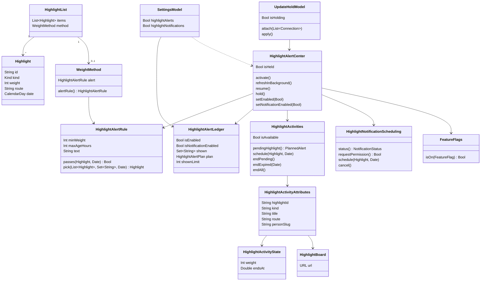

# Alertas: destaque do momento e resultado da disputa

## Requirements

O Fiscal avisa a pessoa do destaque do momento de maior peso, o mesmo para todo mundo, pela Atividade ao Vivo e, se ela quiser, por uma notificação local. Desde a `FSC-020` (ADR 0028), o próprio aparelho escolhe e agenda os dois, uma vez por dia, sem enviar nada a servidor nenhum; a regra "só por Atividades ao Vivo, nunca por notificação comum" acabou só para essa notificação, e o alerta "Resultado" do fim da disputa saiu com a Atividade da disputa até a próxima eleição. O valor é saber do fato raro e importante na tela de bloqueio sem que nada saia do aparelho. O escopo é a regra de elegibilidade do destaque, a Atividade e a notificação do destaque, a preferência em Ajustes, a flag remota `highlightAlerts` e a pausa durante a atualização obrigatória. O plano do horário (hábito, com 08:00 e 19:00 só sem histórico), o agendamento, a permissão e o bonequinho estão descritos na `FSC-020`, que é a verdade atual dessa parte. Ficam de fora a tela da Apuração (capacidade da apuração ao vivo), o cálculo do peso (capacidade dos destaques), push de qualquer tipo, canal de broadcast do APNs e alerta por tema ou pessoa seguida.

Definição de pronto (os nomes de pessoas são fictícios, pela Constituição 14; os testes citados usam os das próprias fixtures):

- **Given** o servidor novo **When** chega `POST` ou `DELETE` em `/api/v1/highlight-activities` **Then** responde 404, e não há vigia, registro nem push (`TestPublicRoutesAreGone` em `server/internal/httpapi/server_test.go`; `FSC-020`, cenário 23). Os cenários do vigia saíram com ele.
- **Given** o app liberado pela atualização obrigatória, a preferência ligada, a flag `highlightAlerts` ligada, as Atividades ao Vivo permitidas e um destaque de peso 70 ou mais, de até 24 h depois do fim do dia dele em Brasília no horário do alerta, fora dos 60 ids em `fiscal.highlightAlerts.shown` **When** o app abre ou volta para o primeiro plano **Then** a Atividade do destaque fica pendente para o próximo horário, com fim 8 h depois dele, e nada começa na hora; o id entra em `shown` na primeira abertura depois do horário (`HighlightAlertCenterTests.openingSchedulesAndDoesNotStartNow`, `HighlightAlertCenterTests.aPassedAlertIsNotChosenAgain`; `FSC-020`, cenários 1, 6 e 8).
- **Given** um destaque de peso 84, ou um de peso 90 de dois dias atrás **When** `HighlightAlertRule.standard.pick(from:shown:now:)` roda **Then** nenhum é escolhido e nada começa (roteiro manual: showcase com destaques abaixo da regra, nenhuma Atividade na tela de bloqueio).
- **Given** a linha "Notificações" em Ajustes › Geral, com o interruptor "Destaques de maior peso na tela de bloqueio" ligado e o texto "Só peso 70 ou mais, do último dia, uma vez por dia, num horário em que você costuma usar o app. O horário é calculado neste aparelho e não sai dele." **When** a pessoa desliga, desliga de novo e religa **Then** o observador recebe só `[false, true]`, a linha mostra "Ligado" e, ao desligar, o `HighlightAlertCenter` encerra a pendente e a Atividade do destaque na tela (`SettingsModelTests.tellsTheInjectedObserverWhenHighlightAlertsChange`, `HighlightAlertCenterTests.turningItOffEndsEverythingAndStopsPlanning`; `FSC-020`, cenário 10). Abaixo fica o interruptor "Notificação de destaque", desligado por padrão (`FSC-020`, cenários 16 a 18).
- **Given** o app aberto e livre **When** chega uma política que exige atualização (`AppUpdateModel.isRequired`) e depois uma que libera **Then** o `UpdateHoldModel` chama `stop` em todas as conexões (o centro do destaque cancela a pendente e a notificação agendada) e, na liberação, `start` de novo, na ordem "start", "stop", "start" (`UpdateHoldModelTests.aBlockWhileOpenStopsAndTheReleaseStartsAgain`, `HighlightAlertCenterTests.holdingCancelsAndOnlyPlansAfterTheRelease`; `FSC-020`, cenário 11). O `HoldGate` da disputa saiu com a `FSC-020`.
- **Given** a Atividade de um destaque de ação, de votação ou de dinheiro **When** a pessoa toca nela **Then** abre `fiscal://person/{slug}` no Meu, `fiscal://vote/{id}` em Votações e `fiscal://today` em Hoje (`DeepLinkTests.opensTheRightPlace` para a leitura dos links; a escolha do link por tipo em `IntegrationLink.highlight`: roteiro manual, tocar nas três Atividades do showcase); a notificação entregue abre o mesmo destino (`FSC-020`, cenário 19).
- O alerta "Resultado" do fim da disputa, o plano da Atividade da disputa, acompanhar, o aviso das Atividades desligadas na apuração e o registro do token saíram com a `FSC-020`, até a próxima eleição.

## Entities

- `Highlight`, `HighlightList` e `WeightMethod` moram em `FiscalKit/Sources/FiscalDomain/PublicData/ActionWeight.swift` e vêm de `highlights.json`; `WeightMethod.alert` é a regra publicada e `alertRule` devolve `HighlightAlertRule.standard` quando ela falta.
- `HighlightAlertRule` e `HighlightAlertLedger` moram em `FiscalKit/Sources/FiscalDomain/PublicData/HighlightAlertRule.swift`: a regra (70, 24 h, duração de 8 h em `lifetime`) e o registro local em `UserDefaults` da suíte `group.com.byescaleira` (`fiscal.highlightAlerts.enabled`, `fiscal.highlightAlerts.shown` e, desde a `FSC-020`, `notification`, `plan`, `offset` e `openings`; `fiscal.highlightAlerts.token` e `AppAttestKeyID` são apagados por `clearLegacy`). O plano, o hábito e o `HighlightAlertPlanner` da `FSC-020` moram em `HighlightAlertPlan.swift` e `HighlightAlertHabit.swift`, na mesma pasta.
- `HighlightActivityState` e `HighlightActivityAttributes` moram em `FiscalKit/Sources/FiscalDomain/LiveResults/HighlightActivity.swift`; os atributos só existem com ActivityKit no iOS. O protocolo `HighlightAlertService` saiu com a `FSC-020`.
- `HighlightBoard` mora em `FiscalKit/Sources/FiscalDomain/Integrations/HighlightBoard.swift` e dá o `url` do toque pela `IntegrationLink.highlight` de `FiscalKit/Sources/FiscalDomain/Integrations/VoteBoard.swift`.
- `HighlightActivities` mora em `FiscalKit/Sources/FeatureLiveResults/HighlightActivities.swift`, atrás do protocolo `HighlightActivityTracking`, com uma versão vazia fora do iOS.
- `HighlightNotificationScheduling` e a implementação `HighlightNotifications` moram em `FiscalKit/Sources/AppShell/Integrations/HighlightNotifications.swift` (`FSC-020`).
- `HighlightAlertCenter` mora em `FiscalKit/Sources/AppShell/Integrations/HighlightAlertCenter.swift`, singleton `@MainActor` que junta regra, registro local, plano, Atividades, notificação, dados públicos e flag.
- `SettingsModel` mora em `FiscalKit/Sources/FeatureSettings/SettingsModel.swift`; `FeatureFlags` e `FeatureFlag.highlightAlerts` em `FiscalKit/Sources/FeatureCore/Flags/`; `UpdateHoldModel` em `FiscalKit/Sources/FeatureCore/Update/`.
- Saíram com a `FSC-020`: `HoldGate`, `RaceActivityState`, `RaceActivityPlan`, o `Watcher` e o `Item` do vigia, `Registration` e `Message`.
- Não há schema SwiftData envolvido: nada desta capacidade entra no `FiscalSchemaV1` nem no CloudKit. O que precisa ficar compatível com a versão publicada são as chaves `fiscal.highlightAlerts.*`, os nomes e campos de `HighlightActivityAttributes` e `HighlightActivityState`, lidos pelas Atividades já agendadas, e o bloco `method.alert` de `highlights.json`.

## Approach

1. **Estratégia da solução:** no aparelho, o `HighlightAlertCenter` é ativado na abertura e a cada volta ao primeiro plano (`SystemIntegrations`), lê `highlights.json` pelo `PublicDataService` e aplica a regra publicada (ou a padrão) para montar o plano do próximo horário da Atividade e da notificação, agendados no próprio aparelho, nunca repetindo um id já mostrado. O horário, o hábito, a notificação e o bonequinho seguem a `FSC-020`. Desde ela, não há vigia, push-to-start, registro de token, App Attest nem Atividade da disputa.
2. **Decisões:**
   - Atividade ao Vivo e uma notificação local opcional, com interruptor próprio desligado por padrão e a pergunta do iOS só ao ligá-lo; a regra "só por Atividades ao Vivo, nunca por notificação comum" acabou só para essa notificação, por decisão do usuário na `FSC-020`. ADR: `docs/adr/0028-app-reads-only-from-cdn-and-local-alerts.md`.
   - Regra fixa e pública, peso 70 ou mais e até 24 h depois do fim do dia em Brasília, a mesma para todos e publicada em `method.alert` — credibilidade e nada de escolha pela Lente; descartado alerta por tema ou por pessoa seguida. ADR: `docs/adr/0012-constitution-version-and-facts.md`.
   - Só no aparelho, sem push nem servidor: cada abertura agenda o próximo horário, e quem não abre o app para de receber. Descartados o push com um código por aparelho, que não escala, e o canal de broadcast, que ainda exige código para iniciar. ADR: `docs/adr/0028-app-reads-only-from-cdn-and-local-alerts.md`.
   - Atividade do destaque ligada por padrão e desligável em Ajustes; a notificação vem desligada. ADR: `docs/adr/0028-app-reads-only-from-cdn-and-local-alerts.md`, que substitui o 0017.
   - Flag remota `highlightAlerts` (padrão ligada, gerida pelo admin) — desligar os alertas sem nova versão; descartado só a preferência local. ADR: não precisa.
   - Pausa na atualização obrigatória por `UpdateHoldModel.Connection` — com o app bloqueado, a pendente e a notificação agendada são canceladas; descartado deixar cada feature checar a política sozinha. ADR: não precisa (mudança `docs/changes/archive/2026-10-29-align-workspace/`).
   - A Lente nunca entra no alerta nem na escolha. ADR: `docs/adr/0004-lens-on-device-store.md`.
3. **Tratamento de erros:**
   - O `HighlightAlertCenter` engole o erro em silêncio: sem dados públicos, sem destaque elegível ou com o iOS recusando o agendamento, nada novo é agendado, o plano já agendado continua e a próxima abertura tenta de novo; a recusa da permissão de notificações mostra o aviso em Ajustes, sem nova pergunta (`FSC-020`).
4. **Riscos:**
   - Destaque repetido no mesmo aparelho → ids mostrados no App Group (últimos 60), e o que já passou do horário entra em `shown` na abertura seguinte.
   - Duas Atividades do destaque ao mesmo tempo → no máximo 1 pendente, 1 notificação pendente e 1 Atividade do destaque na tela (`FSC-020`).
   - Destaque velho no horário do alerta → a regra é conferida para o horário do alerta, não o da abertura (`FSC-020`, cenário 6).
   - O texto da preferência fixa "70" enquanto a regra pode vir outra do `method.alert` → hoje o servidor publica 70 e 24 h, iguais ao texto.
   - Atividade do destaque fica na tela durante a atualização obrigatória → `hold` cancela a pendente e a notificação; a que já está na tela acaba 8 h depois do horário.

**Known divergences:**

- `Spec × código:` a spec põe o `HighlightAlertCenter` em `FeatureLiveResults`; o código o mantém em `FiscalKit/Sources/AppShell/Integrations/HighlightAlertCenter.swift`, junto da extensão `SettingsModel.fiscal()`.
- `Spec × código:` a spec põe o interruptor em Ajustes › Seus dados e privacidade; o código o mostra em Ajustes › Geral › "Notificações", só no iOS (`FiscalKit/Sources/FeatureSettings/SettingsScreen.swift`, linhas 118 a 124).
- Saíram com a `FSC-020`, junto com o código que descreviam: o toque da Atividade da disputa, o envio por versão do arquivo, o 401 antes do 404 com `HIGHLIGHT_ALERTS=0`, o broadcast do ADR 0002 e a falta de teste das rotas do destaque.
- `Spec × código:` a spec fala do `method.alertRule` publicado; o campo publicado é `method.alert` e `alertRule` é a propriedade calculada do app (`FiscalKit/Sources/FiscalDomain/PublicData/ActionWeight.swift`, linha 342; `server/internal/publicdata/highlights.go`, linha 141).
- `Playbook:` a constituição 4 pede Swift Testing para toda lógica, e `HighlightActivities` e `IntegrationLink.highlight` não têm testes; a regra, o ledger, o plano e o centro têm testes desde a `FSC-020` (`HighlightAlertRuleTests`, `HighlightAlertPlanTests`, `HighlightAlertHabitTests`, `HighlightAlertCenterTests`).
- `Playbook:` a constituição 5 pede título de destaque só na Bricolage, inclusive em Live Activity, e nada de heavy em tamanho fixo; a Atividade do destaque usa `.font(.headline)` e `.subheadline.weight(.semibold)` no título e `.caption2.weight(.heavy)` e `.caption.weight(.heavy)` no selo, no kicker e no peso compacto (`Fiscal/FiscalWidgets/HighlightLiveActivity.swift`, linhas 28, 45, 67 e 77; `Fiscal/FiscalWidgets/HighlightWidgetViews.swift`, linha 15).
- `Sem teste:` a escolha do link do toque por tipo de destaque (`IntegrationLink.highlight` em `FiscalKit/Sources/FiscalDomain/Integrations/VoteBoard.swift`).

## Structure

Targets e camadas tocados, com a regra de dependência: `FiscalDomain` não depende de nada do app; `FiscalData` depende só de `FiscalDomain`; `FeatureCore` traz flags e a pausa da atualização; `FeatureLiveResults` e `FeatureSettings` não se importam entre si e falam pelo `AppShell`, que é o único que junta as duas (o `HighlightAlertCenter` importa as duas features e injeta o callback no `SettingsModel`); navegação por `Route` e `DeepLink`; o app chama `FiscalServices.holdConnections()`; os widgets leem só `FiscalDomain` e o design system; o servidor Go é independente do pacote e só publica `highlights.json` com o bloco `method.alert` (`FSC-020`).

- `FiscalKit/Sources/FiscalDomain/PublicData/HighlightAlertRule.swift`
- `FiscalKit/Sources/FiscalDomain/PublicData/HighlightAlertPlan.swift` e `HighlightAlertHabit.swift` (`FSC-020`)
- `FiscalKit/Sources/FiscalDomain/PublicData/ActionWeight.swift`
- `FiscalKit/Sources/FiscalDomain/LiveResults/HighlightActivity.swift`
- `FiscalKit/Sources/FiscalDomain/Integrations/HighlightBoard.swift`
- `FiscalKit/Sources/FiscalDomain/Integrations/VoteBoard.swift`
- `FiscalKit/Sources/FeatureCore/Flags/FeatureFlag.swift`
- `FiscalKit/Sources/FeatureCore/Flags/FeatureFlags.swift`
- `FiscalKit/Sources/FeatureCore/Update/UpdateHoldModel.swift`
- `FiscalKit/Sources/FeatureLiveResults/HighlightActivities.swift`
- `FiscalKit/Sources/FeatureSettings/SettingsModel.swift`
- `FiscalKit/Sources/FeatureSettings/SettingsModel+Rows.swift`
- `FiscalKit/Sources/FeatureSettings/SettingsScreen.swift`
- `FiscalKit/Sources/AppShell/Integrations/HighlightAlertCenter.swift`
- `FiscalKit/Sources/AppShell/Integrations/HighlightNotifications.swift` (`FSC-020`)
- `FiscalKit/Sources/AppShell/Integrations/SystemIntegrations.swift`
- `FiscalKit/Sources/AppShell/Update/UpdateConnections.swift`
- `FiscalKit/Sources/AppShell/FiscalServices.swift`
- `FiscalKit/Sources/AppShell/DeepLink.swift`
- `Fiscal/Fiscal/FiscalApp.swift`
- `Fiscal/FiscalWidgets/HighlightLiveActivity.swift`
- `Fiscal/FiscalWidgets/HighlightWidgetViews.swift`
- `server/internal/publicdata/highlights.go`
- Saíram com a `FSC-020`: `RaceActivity.swift`, `LiveResultsClient.swift` (no papel de registro), `AppAttestor.swift`, `HoldGate.swift`, `RaceActivities.swift`, `RaceLiveActivity.swift`, `server/internal/highlightalert/`, `server/internal/apns/`, `server/internal/store/` e as rotas do destaque em `server/internal/httpapi/server.go`, `server/cmd/server/main.go` e `server/compose.yaml`.
- Testes: `FiscalKit/Tests/FiscalDomainTests/HighlightAlertRuleTests.swift`, `HighlightAlertPlanTests.swift`, `HighlightAlertHabitTests.swift`, `FiscalKit/Tests/AppShellTests/HighlightAlertCenterTests.swift`, `FiscalKit/Tests/FeatureSettingsTests/SettingsModelTests.swift`, `FiscalKit/Tests/FeatureCoreTests/UpdateHoldModelTests.swift`, `FiscalKit/Tests/FeatureCoreTests/FeatureFlagsTests.swift`, `FiscalKit/Tests/AppShellTests/UpdateBlockTests.swift`, `FiscalKit/Tests/AppShellTests/DeepLinkTests.swift`, `server/internal/httpapi/server_test.go`.

## Operations

1. [P] **Regra publicada** (`server/internal/publicdata/highlights.go`): as constantes `AlertMinWeight` 70 e `AlertMaxAgeHours` 24 entram no método do peso como `MethodAlert` (`minWeight`, `maxAgeHours`, `text`), publicado no campo `alert` do método, com o texto pt-BR que a `FSC-020` reescreveu, "Na tela de bloqueio (Atividade ao Vivo) só entra destaque com peso 70 ou mais…", que fala do horário aprendido no aparelho sem citar hora. Verificação: `cd server && go test ./internal/publicdata/...`.
2. **Removida pela `FSC-020`:** a elegibilidade e a carga do push no servidor (`server/internal/highlightalert/`) saíram.
3. **Removida pela `FSC-020`:** o vigia saiu.
4. **Removida pela `FSC-020`:** os registros (`server/internal/store/`) saíram.
5. **Removida pela `FSC-020`:** as rotas `/api/v1/highlight-activities` saíram; o servidor responde 404.
6. **Removida pela `FSC-020`:** `HIGHLIGHT_ALERTS` e a ligação do vigia no `fiscal-api` saíram.
7. **Removida pela `FSC-020`:** a mensagem do fim da disputa (`server/internal/apns/`) saiu.
8. **Regra no app** (`FiscalKit/Sources/FiscalDomain/PublicData/HighlightAlertRule.swift`): `HighlightAlertRule.standard` (70, 24), `lifetime` 8 h, `summary` com o texto publicado ou o padrão do catálogo; `passes(_ highlight: Highlight, now: Date) -> Bool` com o calendário de `America/Sao_Paulo`; `pick(from:shown:now:) -> Highlight?` devolve o primeiro elegível fora de `shown`; `HighlightAlertLedger(suiteName:)` lê e grava `isEnabled` (padrão ligado), `shown` (últimos 60, sem repetir) e, desde a `FSC-020`, a preferência da notificação, o plano, o atraso e o histórico de aberturas; `clearLegacy` apaga o token antigo e `AppAttestKeyID`. Verificação: `scripts/test.sh --affected`.
9. **Atributos, estado e link** (`FiscalKit/Sources/FiscalDomain/LiveResults/HighlightActivity.swift`, `FiscalKit/Sources/FiscalDomain/Integrations/HighlightBoard.swift`, `FiscalKit/Sources/FiscalDomain/Integrations/VoteBoard.swift`): `HighlightActivityState(highlight:now:)` com `endsAt` 8 h depois do instante dado, que no agendamento é o horário do alerta (`FSC-020`); `HighlightActivityAttributes(highlight:)` com os mesmos campos que o servidor manda; `board(weight:) -> HighlightBoard`; `HighlightBoard.url` por `IntegrationLink.highlight(kind:route:)`: ação abre `fiscal://person/{route}`, votação `fiscal://vote/{route}`, dinheiro, indicador ou rota vazia `fiscal://today`. Depende de: 8. Cobre: a linha do toque na Atividade do destaque.
10. **Removida pela `FSC-020`:** o plano da Atividade da disputa saiu.
11. **Removida pela `FSC-020`:** o cliente do registro do destaque saiu.
12. [P] **Flag e pausa** (`FiscalKit/Sources/FeatureCore/Flags/FeatureFlag.swift`, `FiscalKit/Sources/FeatureCore/Update/UpdateHoldModel.swift`): `FeatureFlag.highlightAlerts` com padrão ligado, título "Alertas do destaque"; `UpdateHoldModel.attach(_:)` liga as conexões uma vez e `apply()` chama `stop` de todas quando `AppUpdateModel.isRequired` e `start` quando libera, sem reentrar; o `HoldGate` saiu com a `FSC-020`. Verificação: `scripts/test.sh --affected`.
13. **Atividades do destaque** (`FiscalKit/Sources/FeatureLiveResults/HighlightActivities.swift`): `isAvailable` pelas permissões do sistema; `pendingHighlight()` lê a pendente; `schedule(_:at:) async throws` pede a Atividade para o horário, sem push, com o alerta do título e do subtítulo e som padrão, relevância 50 e fim no horário + 8 h; `endPending()`, `endExpired(now:)` e `endAll()` encerram; `start(_:now:)` fica só para a vitrine de DEBUG. `observe`, o token de push-to-start e o início na hora saíram com a `FSC-020`. Depende de: 9. Cobre: a linha do agendamento local.
14. **Removida pela `FSC-020`:** acompanhar a disputa saiu.
15. **Preferência** (`FiscalKit/Sources/FeatureSettings/SettingsModel.swift`, `FiscalKit/Sources/FeatureSettings/SettingsModel+Rows.swift`, `FiscalKit/Sources/FeatureSettings/SettingsScreen.swift`): `highlightAlerts` lê o `HighlightAlertLedger` e, a cada mudança real, grava e chama `highlightAlertsChanged`; `highlightAlertsValue` dá "Ligado" ou "Desligado"; a página "Notificações" (só iOS) traz o interruptor "Destaques de maior peso na tela de bloqueio" com o detalhe "Só peso 70 ou mais, do último dia, uma vez por dia, num horário em que você costuma usar o app. O horário é calculado neste aparelho e não sai dele." e, abaixo, "Notificação de destaque" (`FSC-020`). Depende de: 8. Verificação: `scripts/test.sh --affected`.
16. **Centro do destaque** (`FiscalKit/Sources/AppShell/Integrations/HighlightAlertCenter.swift`): começa retido; `activate()` apaga o legado, grava a abertura no hábito quando algum alerta está ligado ou apaga o histórico quando os dois estão desligados, encerra as vencidas, marca o que passou do horário e monta e aplica o plano do próximo horário; `refreshInBackground()` só troca a notificação; `resume()` solta e reativa; `hold()` retém e cancela a pendente e a notificação; `setEnabled(_:)` e `setNotificationEnabled(_:)` ligam ou desligam cada alerta; em DEBUG, a chave `FiscalHighlightAlert` força a vitrine; `SettingsModel.fiscal()` liga as preferências ao centro. O detalhe do plano está na operação 4 da `FSC-020`. Depende de: 12, 13, 15. Cobre: as linhas do agendamento, da regra e do desligar.
17. **Conexões da pausa** (`FiscalKit/Sources/AppShell/Update/UpdateConnections.swift`, `FiscalKit/Sources/AppShell/FiscalServices.swift`): `holdConnections()` devolve o centro do destaque (`resume`/`hold`) e a atualização em segundo plano; `isOn(.highlightAlerts)` lê a flag ou o padrão. O `HoldGate` da disputa, o `HeldLiveResultsService` e o `highlightAlertService()` saíram com a `FSC-020`. Depende de: 12, 16. Verificação: `scripts/test.sh --affected`.
18. **Ativação e arranque** (`FiscalKit/Sources/AppShell/Integrations/SystemIntegrations.swift`, `Fiscal/Fiscal/FiscalApp.swift`): a cada nova sessão e a cada `scenePhase` ativo, `HighlightAlertCenter.shared.activate()`; o `FiscalBootstrap` cria `UpdateHoldModel`, liga `holdConnections()` depois de abrir o banco e reaplica quando `isRequired` muda. Depende de: 17. Cobre: a linha da pausa na atualização obrigatória.
19. [P] **Atividade nos widgets** (`Fiscal/FiscalWidgets/HighlightLiveActivity.swift`, `Fiscal/FiscalWidgets/HighlightWidgetViews.swift`): a do destaque mostra selo "DESTAQUE", kicker, faixa de peso, título, linha de incerteza e quem, com o bonequinho na tela de bloqueio e na Ilha expandida desde a `FSC-020`, `widgetURL(board.url)` e opacidade menor quando vencida; a da disputa saiu com a `FSC-020`. Depende de: 9. Verificação: `scripts/build.sh Debug ios`.
20. **Links** (`FiscalKit/Sources/AppShell/DeepLink.swift`): `DeepLink(url:)` leva `person` ao Meu, `vote` a Votações, `races` à lista de disputas em Fiscalizar e qualquer link desconhecido a Hoje. Depende de: 19. Verificação: `scripts/test.sh --affected`.

## Norms

- Constituição 1 e 6, ADR `docs/adr/0003-portuguese-only.md`: o app é só pt-BR; chaves em inglês no catálogo com a tradução pt-BR, `String(appLocalized:)` nos models e `Text("Key")` nas telas; os textos da Atividade, do alerta dela e da notificação vêm do catálogo em pt-BR, e nenhum cita hora (`FSC-020`).
- Constituição 3: features não se importam; só o `AppShell` junta `FeatureLiveResults` e `FeatureSettings`; o `SettingsModel` recebe o efeito por um callback injetado; models `@MainActor @Observable`.
- Constituição 4: zero comentários, zero warnings, Swift Testing para toda lógica nova, tokens do `FiscalDesignSystem` (`.spaceS`, `.spaceXL`, `.opacityStrong`, `.widgetTextShrink`) em vez de números soltos.
- Constituição 5: na Live Activity, número com `.monospacedDigit()`, nada de anel nem progresso circular, Reduzir movimento respeitado e marcas de partido paradas (`partyMarksStill()`).
- Constituição 14 e ADR `docs/adr/0012-constitution-version-and-facts.md`: a regra do destaque é a mesma para todos os políticos, partidos e lados; a Atividade mostra a linha de incerteza do peso (`confidence`, `measured`, `missing`) e nunca qualifica o fato.
- ADR `docs/adr/0004-lens-on-device-store.md`: nada da Lente, do lugar ou dos seguidos entra no alerta nem na escolha; o destaque nunca é escolhido nem mudado pela Lente.
- ADR `docs/adr/0028-app-reads-only-from-cdn-and-local-alerts.md`: nenhum dado sai do aparelho, nem seguidos, apoio, horário, histórico de aberturas, atraso ou código de aparelho; o rótulo proposto é "Dados não coletados"; toda saída nova de dado do aparelho muda o ADR, a política e o rótulo antes da loja.
- ADR `docs/adr/0002-static-first-server.md`: a leitura de `highlights.json` é de arquivo estático na CDN; não há escrita pública.
- ADR `docs/adr/0015-background-fetch-offline-pack.md`: o modo `fetch` só pode trocar a notificação pendente pelo destaque mais novo; nunca agenda Atividade nem mostra alerta na hora (`FSC-020`, cenário 20).
- Atualização obrigatória: com o app bloqueado, a pendente e a notificação agendada são canceladas, e o plano só volta depois da liberação.
- Servidor: só publica `method.alert`; sem vigia, push, registro ou rota do destaque (`FSC-020`).

## Safeguards

- **Funcional:** a pergunta de notificações só aparece quando a pessoa liga "Notificação de destaque", nunca na abertura, e nunca insiste depois da recusa; nunca duas Atividades do destaque ao mesmo tempo; nunca o mesmo destaque duas vezes no aparelho (60 ids lembrados); nunca destaque abaixo do peso 70 ou de mais de 24 h depois do fim do dia em Brasília; nunca alerta escolhido pela Lente, por tema ou por pessoa seguida; com a preferência, a flag ou a atualização obrigatória desligando, nada novo é agendado.
- **Desempenho:** no máximo 1 Atividade pendente, 1 notificação pendente e 1 Atividade do destaque na tela; a Atividade do destaque dura 8 h depois do horário; nunca agendar mais de um horário à frente; os números exatos do horário e do hábito estão nos Safeguards da `FSC-020`.
- **Privacidade:** nada sai do aparelho: nem seguidos, apoio, horário, histórico de aberturas, atraso ou código de aparelho; o histórico de aberturas não vai para o iCloud; nada da Lente, do lugar ou dos seguidos entra na escolha, na Atividade ou na notificação.
- **Dados:** não há schema SwiftData nem CloudKit nesta capacidade; a preferência da Atividade e da notificação, os ids mostrados, o plano, o atraso e o histórico de aberturas ficam em `UserDefaults` da suíte `group.com.byescaleira`; o token antigo e `AppAttestKeyID` são apagados pelo `clearLegacy`; o servidor não guarda nada desta capacidade.
- **Compatibilidade da versão publicada:** não quebram o nome `HighlightActivityAttributes` e seus campos (`highlightId`, `kind`, `title`, `subtitle`, `date`, `route`, `personName`, `personSlug`, `party`, `confidence`, `measured`, `missing`), o `content-state` (`weight`, `endsAt`), o bloco `alert { minWeight, maxAgeHours, text }` do método, os links `fiscal://person/{slug}`, `fiscal://vote/{id}`, `fiscal://today` e `fiscal://races`, as chaves `fiscal.highlightAlerts.enabled` e `fiscal.highlightAlerts.shown`, a flag `highlightAlerts` e as chaves de texto já no catálogo. **QUEBRA** da `FSC-020`, com o app ainda não publicado: saíram as rotas `/api/v1/highlight-activities` e o corpo `{ pushToken, environment, challenge }`, o push-to-start, o `content-state` da disputa e a chave `fiscal.highlightAlerts.token`, apagada do aparelho.
- **Fora do escopo:** sem nova mudança, uma geração nesta área não acrescenta outra notificação além da do destaque, pedido de permissão fora do interruptor, push, canal de broadcast do APNs, alerta por tema, por pessoa seguida ou por lugar, limite diário, dado da pessoa no registro, segundo destaque simultâneo, nova tela ou dependência externa.
