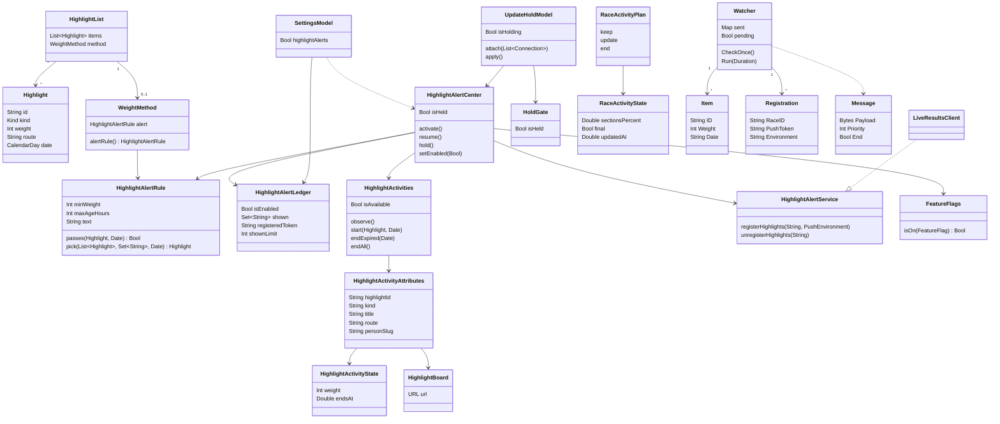

# Alertas: destaque do momento e resultado da disputa

## Requirements

O Fiscal avisa a pessoa só por Atividades ao Vivo, nunca por notificação comum: o fim de uma disputa que ela acompanha na Apuração e o destaque do momento de maior peso, o mesmo para todo mundo. O valor é saber do fato raro e importante na tela de bloqueio sem dar ao servidor nada além de um código anônimo da Apple. O escopo é a regra de elegibilidade do destaque (app e servidor), o início local e por push-to-start da Atividade do destaque, o registro e a remoção do token, a preferência em Ajustes, a flag remota `highlightAlerts`, a pausa durante a atualização obrigatória e o alerta "Resultado" do fim da disputa. Ficam de fora a tela da Apuração e o desenho dos cartões da disputa (capacidade da apuração ao vivo), o cálculo do peso (capacidade dos destaques) e qualquer `UNUserNotificationCenter`, pedido de permissão de notificações, canal de broadcast do APNs ou alerta por tema ou pessoa seguida.

Definição de pronto (os nomes de pessoas são fictícios, pela Constituição 14; os testes citados usam os das próprias fixtures):

- **Given** `highlights.json` com `h1` (peso 92) e `h2` (peso 90), ambos de `2026-10-26`, e nenhum registro de token **When** o vigia do servidor confere duas vezes às 15:00 de Brasília do mesmo dia **Then** nada é enviado e o log "waiting for registrations" aparece uma única vez; com o primeiro registro, a conferência seguinte envia o push-to-start de `h1` com `alert.title` "Destaque do momento" e grava `h1` em `highlight-alerts.json` (`TestEligibleHighlightWaitsForTheFirstRegistration` em `server/internal/highlightalert/highlightalert_test.go`).
- **Given** `h1` já enviado e `h2` elegível no mesmo arquivo **When** o vigia confere de novo sem o arquivo mudar **Then** nada sai; quando o arquivo publicado muda, a conferência seguinte envia `h2` (`TestEligibleHighlightWaitsForTheFirstRegistration` em `server/internal/highlightalert/highlightalert_test.go`).
- **Given** um destaque elegível pendente sem registros **When** o relógio avança 48 h e um token se registra **Then** o destaque nunca é enviado e deixa de estar pendente (`TestPendingHighlightExpiresWithoutRegistrations` em `server/internal/highlightalert/highlightalert_test.go`).
- **Given** o app liberado pela atualização obrigatória, a preferência ligada, a flag `highlightAlerts` ligada, as Atividades ao Vivo permitidas e um destaque de peso 85 ou mais, de até 24 h depois do fim do dia dele em Brasília, fora dos 60 ids em `fiscal.highlightAlerts.shown` **When** o app abre ou volta para o primeiro plano **Then** a Atividade do destaque começa localmente, com `endsAt` 8 h à frente, e o id entra em `fiscal.highlightAlerts.shown` (roteiro manual: no iPhone, abrir o app num dia com destaque de peso 85 ou mais e conferir a Atividade na tela de bloqueio).
- **Given** um destaque de peso 84, ou um de peso 90 de dois dias atrás **When** `HighlightAlertRule.standard.pick(from:shown:now:)` roda **Then** nenhum é escolhido e nada começa (roteiro manual: showcase com destaques abaixo da regra, nenhuma Atividade na tela de bloqueio).
- **Given** a linha "Notificações" em Ajustes › Geral, com o interruptor "Destaques de maior peso na tela de bloqueio" ligado e o texto "Só peso 85 ou mais, do último dia. O Fiscal envia só um código anônimo da Apple." **When** a pessoa desliga, desliga de novo e religa **Then** o observador recebe só `[false, true]`, a linha mostra "Ligado" e, ao desligar, o `HighlightAlertCenter` encerra a Atividade do destaque e apaga o token no servidor (`SettingsModelTests.tellsTheInjectedObserverWhenHighlightAlertsChange`; o fim da Atividade e a remoção do token: roteiro manual no iPhone).
- **Given** o app aberto e livre **When** chega uma política que exige atualização (`AppUpdateModel.isRequired`) e depois uma que libera **Then** o `UpdateHoldModel` chama `stop` em todas as conexões (o centro do destaque apaga o token, o `HoldGate` da disputa fecha) e, na liberação, `start` de novo, na ordem "start", "stop", "start" (`UpdateHoldModelTests.aBlockWhileOpenStopsAndTheReleaseStartsAgain`, `HoldGateTests.aBlockHoldsEveryConnectionAndTheReleaseOpensThem`).
- **Given** o `HoldGate` da disputa fechado **When** o app tenta registrar o token da disputa `br` **Then** o registro falha com `LiveResultsError.unavailable` e, depois de `release()`, passa (`UpdateBlockTests.raceRegistrationWaitsForTheHoldToRelease`).
- **Given** a Atividade de um destaque de ação, de votação ou de dinheiro **When** a pessoa toca nela **Then** abre `fiscal://person/{slug}` no Meu, `fiscal://vote/{id}` em Votações e `fiscal://today` em Hoje (`DeepLinkTests.opensTheRightPlace` para a leitura dos links; a escolha do link por tipo em `IntegrationLink.highlight`: roteiro manual, tocar nas três Atividades do showcase).
- **Given** a disputa de presidente seguida e o arquivo do TSE com `final` e a Pessoa A eleita **When** o servidor monta a mensagem **Then** o push tem `event` "end", `alert` com título "Resultado" e corpo "{nome} foi eleito(a)", com o nome da Pessoa A, `dismissal-date` 4 h depois e prioridade 10 (`TestBuildEndPayloadExact` em `server/internal/apns/apns_test.go`).
- **Given** uma Atividade da disputa em andamento **When** o app recebe a disputa já `final` **Then** o plano é `RaceActivityPlan.end` com `dismissAfter` 14.400 s; com números iguais é `RaceActivityPlan.keep` (`RaceActivityPlanTests.endsWhenTheRaceIsFinal`, `RaceActivityPlanTests.keepsWhenNothingChanged`).
- **Given** a Apuração com a disputa `presidente-br` **When** a pessoa toca em "Acompanhar … na tela de bloqueio" e depois em "Parar de acompanhar …" **Then** o token `abc123` é registrado em produção e, ao parar, removido do servidor (`LiveResultsModelTests.followingRegistersThePushToken`).
- **Given** as Atividades ao Vivo do Fiscal desligadas no sistema **When** a pessoa tenta acompanhar uma disputa **Then** aparece "As Atividades ao Vivo do Fiscal estão desligadas nos Ajustes." e a disputa não fica seguida (`LiveResultsModelTests.explainsWhenActivitiesAreOff`).
- **Given** o servidor fora do ar e depois recusando o token com 422 **When** o app tenta registrar a disputa seguida **Then** o token fica pendente enquanto o servidor está fora e, com a recusa, sai da fila e aparece "O servidor não aceitou esta Atividade ao Vivo. Tente acompanhar de novo." (`LiveResultsModelTests.keepsTheTokenWhenTheServerIsDownAndDropsItWhenRejected`); o registro do destaque com chave do App Attest desconhecida recebe 401 `attest_unknown_key` (`TestAttestedRegistrationPassesTheExactBody` em `server/internal/httpapi/attest_test.go`).

## Entities

- `Highlight`, `HighlightList` e `WeightMethod` moram em `FiscalKit/Sources/FiscalDomain/PublicData/ActionWeight.swift` e vêm de `highlights.json`; `WeightMethod.alert` é a regra publicada e `alertRule` devolve `HighlightAlertRule.standard` quando ela falta.
- `HighlightAlertRule` e `HighlightAlertLedger` moram em `FiscalKit/Sources/FiscalDomain/PublicData/HighlightAlertRule.swift`: a regra (85, 24 h, duração de 8 h em `lifetime`) e o registro local em `UserDefaults` da suíte `group.com.byescaleira` (`fiscal.highlightAlerts.enabled`, `fiscal.highlightAlerts.shown`, `fiscal.highlightAlerts.token`).
- `HighlightActivityState`, `HighlightActivityAttributes` e o protocolo `HighlightAlertService` moram em `FiscalKit/Sources/FiscalDomain/LiveResults/HighlightActivity.swift`; os atributos só existem com ActivityKit no iOS.
- `HighlightBoard` mora em `FiscalKit/Sources/FiscalDomain/Integrations/HighlightBoard.swift` e dá o `url` do toque pela `IntegrationLink.highlight` de `FiscalKit/Sources/FiscalDomain/Integrations/VoteBoard.swift`.
- `HighlightActivities` mora em `FiscalKit/Sources/FeatureLiveResults/HighlightActivities.swift`, atrás do protocolo `HighlightActivityTracking`, com uma versão vazia fora do iOS.
- `HighlightAlertCenter` mora em `FiscalKit/Sources/AppShell/Integrations/HighlightAlertCenter.swift`, singleton `@MainActor` que junta regra, registro local, Atividades, serviço, dados públicos e flag.
- `LiveResultsClient` mora em `FiscalKit/Sources/FiscalData/LiveResults/LiveResultsClient.swift` e implementa `HighlightAlertService` sob App Attest.
- `SettingsModel` mora em `FiscalKit/Sources/FeatureSettings/SettingsModel.swift`; `FeatureFlags` e `FeatureFlag.highlightAlerts` em `FiscalKit/Sources/FeatureCore/Flags/`; `UpdateHoldModel` e `HoldGate` em `FiscalKit/Sources/FeatureCore/Update/`.
- `RaceActivityState` e `RaceActivityPlan` moram em `FiscalKit/Sources/FiscalDomain/LiveResults/RaceActivity.swift`.
- `Watcher` e `Item` moram em `server/internal/highlightalert/highlightalert.go`; `Registration` em `server/internal/store/store.go`; `Message` em `server/internal/apns/payload.go`.
- Não há schema SwiftData envolvido: nada desta capacidade entra no `FiscalSchemaV1` nem no CloudKit. O que precisa ficar compatível com a versão publicada são as chaves `fiscal.highlightAlerts.*`, os nomes e campos de `HighlightActivityAttributes` e `HighlightActivityState` (o servidor monta o push-to-start com `attributes-type` "HighlightActivityAttributes"), o `content-state` da disputa e o bloco `method.alert` de `highlights.json`.

## Approach

1. **Estratégia da solução:** dois caminhos levam ao mesmo resultado para o destaque. No aparelho, o `HighlightAlertCenter` é ativado na abertura e a cada volta ao primeiro plano (`SystemIntegrations`), lê `highlights.json` pelo `PublicDataService`, aplica a regra publicada (ou a padrão) e inicia a Atividade localmente, uma por vez, nunca repetindo um id já mostrado. No servidor, o `Watcher` relê `PUBLIC_DIR/published/highlights.json` a cada minuto quando o arquivo muda, escolhe o primeiro item elegível ainda não enviado e manda o push-to-start para todos os tokens registrados, com 8 envios em paralelo. O token de push-to-start chega por `pushToStartTokenUpdates` e é registrado sob App Attest; desligar a preferência, a flag ou a atualização obrigatória o removem. O resultado da disputa vem do servidor da apuração: a Atividade da disputa seguida recebe atualizações por token e, no fim, o push `end` com o alerta "Resultado".
2. **Decisões:**
   - Só Atividades ao Vivo, sem notificação comum nem pedido de permissão — o alerta é raro e visual, e a pessoa não precisa conceder nada além das Atividades ao Vivo; descartado `UNUserNotificationCenter`. ADR: não precisa (registrado na mudança `docs/changes/archive/2026-10-29-app-1.0/weight.md`).
   - Regra fixa e pública, peso 85 ou mais e até 24 h depois do fim do dia em Brasília, a mesma para todos e publicada em `method.alert` — credibilidade e nada de escolha pela Lente; descartado alerta por tema ou por pessoa seguida. ADR: `docs/adr/0012-constitution-version-and-facts.md`.
   - Início duplo, local e por push-to-start — quem abre o app vê o destaque mesmo sem o servidor, e quem não abre recebe o push; descartado só o push, que dependeria do APNs para todos. ADR: não precisa.
   - Envio por token, guardado 30 dias sem IP, até 200.000 registros e 100 por origem — o broadcast do APNs ainda não foi adotado; descartado guardar IP ou qualquer dado da pessoa. ADR: `docs/adr/0017-app-store-privacy-label.md` (o rótulo declara o token) e `docs/adr/0002-static-first-server.md` (registro de token como única escrita pública).
   - Destaque ligado por padrão e desligável em Ajustes — o alerta é raro e igual para todos; descartado vir desligado, que não mudaria o rótulo da loja. ADR: `docs/adr/0017-app-store-privacy-label.md`.
   - Flag remota `highlightAlerts` (padrão ligada, gerida pelo admin) — desligar o envio de tokens sem nova versão; descartado só a preferência local. ADR: não precisa.
   - Pausa na atualização obrigatória por `UpdateHoldModel.Connection` — com o app bloqueado, nada de token novo nem push; descartado deixar cada feature checar a política sozinha. ADR: não precisa (mudança `docs/changes/archive/2026-10-29-align-workspace/`).
   - A Lente nunca entra no alerta nem no registro. ADR: `docs/adr/0004-lens-on-device-store.md`.
3. **Tratamento de erros:**
   - No aparelho, `consider`, `register` e `forget` do `HighlightAlertCenter` engolem o erro em silêncio: sem dados públicos, sem destaque elegível ou com falha no `Activity.request`, nada acontece e a próxima ativação tenta de novo; um token que não saiu do servidor continua em `fiscal.highlightAlerts.token` e a próxima ativação desligada tenta removê-lo.
   - Na disputa, Atividades desligadas mostram "As Atividades ao Vivo do Fiscal estão desligadas nos Ajustes."; outra falha ao iniciar mostra "Não foi possível iniciar a Atividade ao Vivo. Tente de novo."; servidor fora deixa o token pendente para a próxima tentativa; recusa (`LiveResultsError.rejected`) mostra "O servidor não aceitou esta Atividade ao Vivo. Tente acompanhar de novo.".
   - No servidor, as rotas do destaque respondem 422 `invalid_request` para token fora de 32 a 400 caracteres hexadecimais ou ambiente diferente de `development` e `production`, 409 `token_bound_to_other_environment`, 429 `too_many_registrations`, 507 `capacity_reached` e 404 `not_found` quando o vigia está desligado; o App Attest responde 401 antes disso.
   - O vigia registra no log a falha de leitura uma vez até o arquivo voltar, "waiting for registrations" uma vez por item, e cada envio com falha só com os 6 primeiros caracteres do token; token inválido no APNs é apagado do registro.
4. **Riscos:**
   - Destaque repetido no mesmo aparelho → ids mostrados no App Group (últimos 60), Atividade ativa contada como mostrada, `arrived` encerra a duplicada e o servidor guarda os enviados por 14 dias.
   - Duas Atividades do destaque ao mesmo tempo → `start` encerra as vivas antes de pedir a nova e `arrived` encerra as outras quando chega uma por push.
   - Destaque velho enviado tarde → o vigia reavalia a regra a cada conferência e descarta o pendente que passou da janela.
   - Payload acima do limite do APNs → o título encolhe em passos de 60 caracteres até caber em 4.000 bytes, ou o envio é abandonado com log.
   - O texto da preferência fixa "85" enquanto a regra pode vir outra do `method.alert` → hoje o servidor publica 85 e 24 h, iguais ao texto.
   - Atividade do destaque fica na tela durante a atualização obrigatória → `hold` só apaga o token; o sistema encerra a Atividade em 8 h pelo `stale-date`.

**Known divergences:**

- `Spec × código:` a spec põe o `HighlightAlertCenter` em `FeatureLiveResults`; o código o mantém em `FiscalKit/Sources/AppShell/Integrations/HighlightAlertCenter.swift`, junto da extensão `SettingsModel.fiscal()`.
- `Spec × código:` a spec põe o interruptor em Ajustes › Seus dados e privacidade; o código o mostra em Ajustes › Geral › "Notificações", só no iOS (`FiscalKit/Sources/FeatureSettings/SettingsScreen.swift`, linhas 118 a 124).
- `Spec × código:` a spec diz que tocar na Atividade da disputa abre `fiscal://home`, tratado como Hoje; o código usa `IntegrationLink.races` (`fiscal://races`), que abre a lista de disputas em Fiscalizar (`Fiscal/FiscalWidgets/RaceLiveActivity.swift`, linhas 13 e 54; `FiscalKit/Sources/AppShell/DeepLink.swift`, linha 30).
- `Spec × código:` a spec diz que o servidor escolhe no máximo um item por vez a cada minuto; o código envia no máximo um item por versão do arquivo publicado, e o próximo elegível espera o arquivo mudar (`server/internal/highlightalert/highlightalert.go`, `CheckOnce`, linhas 301 a 344).
- `Spec × código:` a spec diz que, com `HIGHLIGHT_ALERTS=0`, as rotas respondem 404; o código passa primeiro pelo limite e pelo App Attest, então uma chamada sem atestação recebe 401 antes do 404 (`server/internal/httpapi/server.go`, linhas 104, 105, 335 e 370).
- `Spec × código:` a spec fala do `method.alertRule` publicado; o campo publicado é `method.alert` e `alertRule` é a propriedade calculada do app (`FiscalKit/Sources/FiscalDomain/PublicData/ActionWeight.swift`, linha 342; `server/internal/publicdata/highlights.go`, linha 141).
- `Playbook:` a constituição 4 pede Swift Testing para toda lógica, e `HighlightAlertRule`, `HighlightAlertLedger`, `HighlightAlertCenter`, `HighlightActivities` e `IntegrationLink.highlight` não têm testes (`FiscalKit/Sources/FiscalDomain/PublicData/HighlightAlertRule.swift`, `FiscalKit/Sources/AppShell/Integrations/HighlightAlertCenter.swift`; já no `docs/backlog.md` como P1).
- `Playbook:` a constituição 5 pede título de destaque só na Bricolage, inclusive em Live Activity, e nada de heavy em tamanho fixo; a Atividade do destaque usa `.font(.headline)` e `.subheadline.weight(.semibold)` no título e `.caption2.weight(.heavy)` e `.caption.weight(.heavy)` no selo, no kicker e no peso compacto (`Fiscal/FiscalWidgets/HighlightLiveActivity.swift`, linhas 28, 45, 67 e 77; `Fiscal/FiscalWidgets/HighlightWidgetViews.swift`, linha 15).
- `Playbook:` o ADR 0002 decide migrar a Atividade para os canais de broadcast do APNs e manter o registro por token só no TestFlight; o envio do destaque e da disputa continua por token (`server/internal/highlightalert/highlightalert.go`, `dispatch`).
- `Sem teste:` o início local da Atividade do destaque com a regra, o registro do id mostrado e a recusa de destaques abaixo da regra no app (`FiscalKit/Sources/AppShell/Integrations/HighlightAlertCenter.swift`, `consider`).
- `Sem teste:` desligar a preferência encerra a Atividade e apaga o token no servidor (`HighlightAlertCenter.setEnabled`).
- `Sem teste:` a escolha do link do toque por tipo de destaque (`IntegrationLink.highlight` em `FiscalKit/Sources/FiscalDomain/Integrations/VoteBoard.swift`).
- `Sem teste:` validação e códigos de erro das rotas `POST` e `DELETE /api/v1/highlight-activities` (422, 409, 429, 507 e o 404 com o vigia desligado); só o 401 do App Attest tem teste (`server/internal/httpapi/server.go`, `registerHighlights` e `unregisterHighlights`).

## Structure

Targets e camadas tocados, com a regra de dependência: `FiscalDomain` não depende de nada do app; `FiscalData` depende só de `FiscalDomain`; `FeatureCore` traz flags e a pausa da atualização; `FeatureLiveResults` e `FeatureSettings` não se importam entre si e falam pelo `AppShell`, que é o único que junta as duas (o `HighlightAlertCenter` importa as duas features e injeta o callback no `SettingsModel`); navegação por `Route` e `DeepLink`; o app chama `FiscalServices.holdConnections()`; os widgets leem só `FiscalDomain` e o design system; o servidor Go é independente do pacote e fala com o app pelo contrato HTTP e pelo JSON do APNs.

- `FiscalKit/Sources/FiscalDomain/PublicData/HighlightAlertRule.swift`
- `FiscalKit/Sources/FiscalDomain/PublicData/ActionWeight.swift`
- `FiscalKit/Sources/FiscalDomain/LiveResults/HighlightActivity.swift`
- `FiscalKit/Sources/FiscalDomain/LiveResults/RaceActivity.swift`
- `FiscalKit/Sources/FiscalDomain/LiveResults/LiveResultsService.swift`
- `FiscalKit/Sources/FiscalDomain/Integrations/HighlightBoard.swift`
- `FiscalKit/Sources/FiscalDomain/Integrations/VoteBoard.swift`
- `FiscalKit/Sources/FiscalData/LiveResults/LiveResultsClient.swift`
- `FiscalKit/Sources/FiscalData/LiveResults/AppAttestor.swift`
- `FiscalKit/Sources/FeatureCore/Flags/FeatureFlag.swift`
- `FiscalKit/Sources/FeatureCore/Flags/FeatureFlags.swift`
- `FiscalKit/Sources/FeatureCore/Update/UpdateHoldModel.swift`
- `FiscalKit/Sources/FeatureCore/Update/HoldGate.swift`
- `FiscalKit/Sources/FeatureLiveResults/HighlightActivities.swift`
- `FiscalKit/Sources/FeatureLiveResults/RaceActivities.swift`
- `FiscalKit/Sources/FeatureLiveResults/LiveResultsModel.swift`
- `FiscalKit/Sources/FeatureSettings/SettingsModel.swift`
- `FiscalKit/Sources/FeatureSettings/SettingsModel+Rows.swift`
- `FiscalKit/Sources/FeatureSettings/SettingsScreen.swift`
- `FiscalKit/Sources/AppShell/Integrations/HighlightAlertCenter.swift`
- `FiscalKit/Sources/AppShell/Integrations/SystemIntegrations.swift`
- `FiscalKit/Sources/AppShell/Update/UpdateConnections.swift`
- `FiscalKit/Sources/AppShell/FiscalServices.swift`
- `FiscalKit/Sources/AppShell/DeepLink.swift`
- `Fiscal/Fiscal/FiscalApp.swift`
- `Fiscal/FiscalWidgets/HighlightLiveActivity.swift`
- `Fiscal/FiscalWidgets/HighlightWidgetViews.swift`
- `Fiscal/FiscalWidgets/RaceLiveActivity.swift`
- `server/internal/publicdata/highlights.go`
- `server/internal/highlightalert/highlightalert.go`
- `server/internal/apns/payload.go`
- `server/internal/store/store.go`
- `server/internal/httpapi/server.go`
- `server/cmd/server/main.go`
- `server/compose.yaml`
- Testes: `FiscalKit/Tests/FiscalDomainTests/RaceActivityPlanTests.swift`, `FiscalKit/Tests/FeatureLiveResultsTests/LiveResultsModelTests.swift`, `FiscalKit/Tests/FeatureSettingsTests/SettingsModelTests.swift`, `FiscalKit/Tests/FeatureCoreTests/UpdateHoldModelTests.swift`, `FiscalKit/Tests/FeatureCoreTests/HoldGateTests.swift`, `FiscalKit/Tests/FeatureCoreTests/FeatureFlagsTests.swift`, `FiscalKit/Tests/AppShellTests/UpdateBlockTests.swift`, `FiscalKit/Tests/AppShellTests/DeepLinkTests.swift`, `server/internal/highlightalert/highlightalert_test.go`, `server/internal/apns/apns_test.go`, `server/internal/store/store_test.go`, `server/internal/httpapi/attest_test.go`.

## Operations

1. [P] **Regra publicada** (`server/internal/publicdata/highlights.go`): as constantes `AlertMinWeight` 85 e `AlertMaxAgeHours` 24 entram no método do peso como `MethodAlert` (`minWeight`, `maxAgeHours`, `text`), publicado no campo `alert` do método, com o texto pt-BR "Na tela de bloqueio (Live Activity) só entra destaque com peso 85 ou mais…". Verificação: `cd server && go test ./internal/publicdata/...`.
2. **Elegibilidade e carga do push** (`server/internal/highlightalert/highlightalert.go`): `Eligible(it Item, now time.Time) bool` recusa peso abaixo de 85 ou id vazio, lê os 10 primeiros caracteres da data no fuso fixo de Brasília (UTC−3), recusa data futura e aceita até 24 h depois do fim do dia; `Pick(items, sent, now) (Item, bool)` devolve o primeiro elegível ainda não enviado; `BuildStart(it Item, now time.Time) ([]byte, error)` monta `aps` com `event` "start", `content-state` (`weight`, `endsAt` = agora + 8 h), `attributes-type` "HighlightActivityAttributes", atributos com título até 320, subtítulo até 160 e os campos de pessoa e cobertura, `alert` com título "Destaque do momento" e corpo até 140 caracteres, `stale-date` em 8 h e `relevance-score` 50, encolhendo o título em passos de 60 até caber em 4.000 bytes. Depende de: 1. Verificação: `cd server && go test ./internal/highlightalert/...`.
3. **Vigia** (`server/internal/highlightalert/highlightalert.go`): `New(Options) *Watcher` com 8 envios em paralelo por padrão; `Load() error` lê `highlight-alerts.json`; `CheckOnce(ctx)` relê o arquivo só quando muda data, tamanho ou SHA-256 (até 8 MiB), marca pendente, escolhe com `Pick`, espera registros com um único log, despacha para todos os registros do balde `highlights` com prioridade 10, apaga token inválido, grava o id enviado e descarta os enviados há mais de 14 dias; `Run(ctx, interval)` confere na hora e depois a cada intervalo. Depende de: 2. Cobre: as três primeiras linhas da definição de pronto.
4. [P] **Registros** (`server/internal/store/store.go`): `Open(dir, Options)` com `FileName` "highlight-registrations.json", `Max` 200.000, `PerSource` 100 e `TTL` de 30 dias; `Put` renova o prazo a cada registro e guarda só o hash da origem em memória, nunca no arquivo; `ForRace` ignora vencidos; `Flush` grava atômico e varre os vencidos. Verificação: `cd server && go test ./internal/store/...`.
5. **Rotas do destaque** (`server/internal/httpapi/server.go`): `POST /api/v1/highlight-activities` e `DELETE /api/v1/highlight-activities`, sob o limite `ClassWrite` e o App Attest, com corpo até 4 KiB; `registerHighlights` valida token (32 a 400 hexadecimais) e ambiente, grava em minúsculas no balde `highlights` e responde 204, 409, 429, 507 ou 500; `unregisterHighlights` valida o token e apaga; as duas respondem 404 quando não há registro configurado. Depende de: 4. Verificação: `cd server && go test ./internal/httpapi/...`.
6. **Ligação do servidor** (`server/cmd/server/main.go`, `server/compose.yaml`): `HIGHLIGHT_ALERTS` vazio ou "1" liga, "0" desliga e outro valor encerra com erro; ligado, abre os registros, cria o vigia em `PUBLIC_DIR/published/highlights.json` com o envio em `DATA_DIR/highlight-alerts.json`, roda o vigia a cada 1 min e grava os registros a cada 2 s. Depende de: 3, 5. Verificação: `cd server && go test ./...`.
7. [P] **Mensagem da disputa** (`server/internal/apns/payload.go`): `BuildMessage(r tse.Race, now time.Time) (Message, error)` manda `update` com prioridade 5 e `stale-date` em 10 min enquanto conta; com `final`, manda `end` com prioridade 10, `dismissal-date` em 4 h e `alert` "Resultado" com "<nome> foi eleito(a)" ou "Apuração encerrada". Verificação: `cd server && go test ./internal/apns/...`.
8. **Regra no app** (`FiscalKit/Sources/FiscalDomain/PublicData/HighlightAlertRule.swift`): `HighlightAlertRule.standard` (85, 24), `lifetime` 8 h, `summary` com o texto publicado ou o padrão do catálogo; `passes(_ highlight: Highlight, now: Date) -> Bool` com o calendário de `America/Sao_Paulo`; `pick(from:shown:now:) -> Highlight?` devolve o primeiro elegível fora de `shown`; `HighlightAlertLedger(suiteName:)` lê e grava `isEnabled` (padrão ligado), `shown` (últimos 60, sem repetir) e o token registrado. Verificação: `scripts/test.sh --affected`.
9. **Atributos, estado e link** (`FiscalKit/Sources/FiscalDomain/LiveResults/HighlightActivity.swift`, `FiscalKit/Sources/FiscalDomain/Integrations/HighlightBoard.swift`, `FiscalKit/Sources/FiscalDomain/Integrations/VoteBoard.swift`): `HighlightActivityState(highlight:now:)` com `endsAt` 8 h à frente; `HighlightActivityAttributes(highlight:)` com os mesmos campos que o servidor manda; `board(weight:) -> HighlightBoard`; `HighlightBoard.url` por `IntegrationLink.highlight(kind:route:)`: ação abre `fiscal://person/{route}`, votação `fiscal://vote/{route}`, dinheiro, indicador ou rota vazia `fiscal://today`. Depende de: 8. Cobre: a linha do toque na Atividade do destaque.
10. [P] **Plano da Atividade da disputa** (`FiscalKit/Sources/FiscalDomain/LiveResults/RaceActivity.swift`): `RaceActivityPlan.next(current:race:now:) -> RaceActivityPlan` devolve `keep` sem mudança ou com número mais velho, `update` enquanto conta e `end(state, dismissAfter: 14_400)` no fim; `staleAfter` 600 s; relevância 100 para presidente e 50 para o resto. Verificação: `scripts/test.sh --affected`.
11. **Cliente do registro** (`FiscalKit/Sources/FiscalData/LiveResults/LiveResultsClient.swift`): `registerHighlights(pushToken:environment:) async throws` e `unregisterHighlights(pushToken:) async throws` mandam o corpo com token, ambiente e desafio pelo `AppAttestor`, com timeout de 15 s. Depende de: 9. Verificação: `scripts/test.sh --affected`.
12. [P] **Flag e pausa** (`FiscalKit/Sources/FeatureCore/Flags/FeatureFlag.swift`, `FiscalKit/Sources/FeatureCore/Update/UpdateHoldModel.swift`, `FiscalKit/Sources/FeatureCore/Update/HoldGate.swift`): `FeatureFlag.highlightAlerts` com padrão ligado, título "Alertas do destaque"; `UpdateHoldModel.attach(_:)` liga as conexões uma vez e `apply()` chama `stop` de todas quando `AppUpdateModel.isRequired` e `start` quando libera, sem reentrar; `HoldGate` começa fechado e abre no `start`. Verificação: `scripts/test.sh --affected`.
13. **Atividades do destaque** (`FiscalKit/Sources/FeatureLiveResults/HighlightActivities.swift`): `isAvailable` pelas permissões do sistema; `observe()` assina `pushToStartTokenUpdates` (token em hexadecimal) e `activityUpdates`, encerrando a chegada duplicada ou as outras e avisando `onShown`; `start(_:now:) async throws` encerra as vivas e pede a nova sem push, com `staleDate` no fim e relevância 50; `endExpired(now:)` e `endAll()` encerram na hora. Depende de: 9. Cobre: a linha do início local.
14. **Acompanhar a disputa** (`FiscalKit/Sources/FeatureLiveResults/RaceActivities.swift`, `FiscalKit/Sources/FeatureLiveResults/LiveResultsModel.swift`): `RaceActivities.start(_:) throws` pede a Atividade com push por token e cai para sem push; `update(_:)` aplica o `RaceActivityPlan`; `end(raceID:) async -> [String]` devolve os tokens; `LiveResultsModel.toggle(_:)` segue ou para, `flushPending()` registra os tokens pendentes e trata `LiveResultsError.rejected`; `onFinish` remove o token quando a pessoa dispensa a Atividade. Depende de: 10, 11. Verificação: `scripts/test.sh --affected`.
15. **Preferência** (`FiscalKit/Sources/FeatureSettings/SettingsModel.swift`, `FiscalKit/Sources/FeatureSettings/SettingsModel+Rows.swift`, `FiscalKit/Sources/FeatureSettings/SettingsScreen.swift`): `highlightAlerts` lê o `HighlightAlertLedger` e, a cada mudança real, grava e chama `highlightAlertsChanged`; `highlightAlertsValue` dá "Ligado" ou "Desligado"; a página "Notificações" (só iOS) traz o interruptor "Destaques de maior peso na tela de bloqueio" com o detalhe "Só peso 85 ou mais, do último dia. O Fiscal envia só um código anônimo da Apple.". Depende de: 8. Verificação: `scripts/test.sh --affected`.
16. **Centro do destaque** (`FiscalKit/Sources/AppShell/Integrations/HighlightAlertCenter.swift`): começa retido; `activate()` guarda o pedido, liga a observação uma vez, encerra as vencidas e, se a preferência, a flag ou a liberação faltam, apaga o token; senão `consider()` pega `highlights()`, aplica `method?.alertRule ?? .standard` contra os ids mostrados e ativos e inicia; `resume()` solta e reativa; `hold()` retém e apaga o token; `setEnabled(_:)` desliga encerrando tudo e apagando o token, ou religa registrando o último token e considerando; o token novo troca o anterior no servidor; em DEBUG, a chave `FiscalHighlightAlert` força a vitrine; `SettingsModel.fiscal()` liga a preferência ao centro. Depende de: 11, 12, 13, 15. Cobre: as linhas do início local, da regra e do desligar.
17. **Conexões da pausa** (`FiscalKit/Sources/AppShell/Update/UpdateConnections.swift`, `FiscalKit/Sources/AppShell/FiscalServices.swift`): `holdConnections()` devolve o centro do destaque (`resume`/`hold`), o `HoldGate` da disputa e a atualização em segundo plano; `HeldLiveResultsService.follow` lança `LiveResultsError.unavailable` com o portão fechado; `highlightAlertService()` devolve o `LiveResultsClient` do pacote (nada no showcase); `isOn(.highlightAlerts)` lê a flag ou o padrão. Depende de: 12, 16. Verificação: `scripts/test.sh --affected`.
18. **Ativação e arranque** (`FiscalKit/Sources/AppShell/Integrations/SystemIntegrations.swift`, `Fiscal/Fiscal/FiscalApp.swift`): a cada nova sessão e a cada `scenePhase` ativo, `HighlightAlertCenter.shared.activate()`; o `FiscalBootstrap` cria `UpdateHoldModel`, liga `holdConnections()` depois de abrir o banco e reaplica quando `isRequired` muda. Depende de: 17. Cobre: a linha da pausa na atualização obrigatória.
19. [P] **Atividades nos widgets** (`Fiscal/FiscalWidgets/HighlightLiveActivity.swift`, `Fiscal/FiscalWidgets/HighlightWidgetViews.swift`, `Fiscal/FiscalWidgets/RaceLiveActivity.swift`): a do destaque mostra selo "DESTAQUE", kicker, faixa de peso, título, linha de incerteza e quem, com `widgetURL(board.url)` e opacidade menor quando vencida; a da disputa usa `widgetURL(IntegrationLink.races)`. Depende de: 9. Verificação: `scripts/build.sh Debug ios`.
20. **Links** (`FiscalKit/Sources/AppShell/DeepLink.swift`): `DeepLink(url:)` leva `person` ao Meu, `vote` a Votações, `races` à lista de disputas em Fiscalizar e qualquer link desconhecido a Hoje. Depende de: 19. Verificação: `scripts/test.sh --affected`.

## Norms

- Constituição 1 e 6, ADR `docs/adr/0003-portuguese-only.md`: o app é só pt-BR; chaves em inglês no catálogo com a tradução pt-BR, `String(appLocalized:)` nos models e `Text("Key")` nas telas; o texto do push do servidor ("Destaque do momento", "Resultado", "<nome> foi eleito(a)", "Apuração encerrada") já sai em pt-BR.
- Constituição 3: features não se importam; só o `AppShell` junta `FeatureLiveResults` e `FeatureSettings`; o `SettingsModel` recebe o efeito por um callback injetado; models `@MainActor @Observable`.
- Constituição 4: zero comentários, zero warnings, Swift Testing para toda lógica nova, tokens do `FiscalDesignSystem` (`.spaceS`, `.spaceXL`, `.opacityStrong`, `.widgetTextShrink`) em vez de números soltos.
- Constituição 5: na Live Activity, número com `.monospacedDigit()`, nada de anel nem progresso circular, Reduzir movimento respeitado e marcas de partido paradas (`partyMarksStill()`).
- Constituição 14 e ADR `docs/adr/0012-constitution-version-and-facts.md`: a regra do destaque é a mesma para todos os políticos, partidos e lados; a Atividade mostra a linha de incerteza do peso (`confidence`, `measured`, `missing`) e nunca qualifica o fato.
- ADR `docs/adr/0004-lens-on-device-store.md`: nada da Lente, do lugar ou dos seguidos entra no alerta, no registro ou no push; o destaque nunca é escolhido nem mudado pela Lente.
- ADR `docs/adr/0017-app-store-privacy-label.md`: toda saída nova de dado do aparelho muda o ADR, a política e o rótulo antes da loja; o token do destaque vale 30 dias, com 200.000 no total e 100 por origem.
- ADR `docs/adr/0002-static-first-server.md`: o registro de token é a única escrita pública, com limite de taxa e teto; a leitura de `highlights.json` é de arquivo estático.
- ADR `docs/adr/0015-background-fetch-offline-pack.md`: o modo `fetch` não dispara alerta; nada desta capacidade roda em segundo plano além do sistema.
- Atualização obrigatória: com o app bloqueado, nenhum token novo sai e o do destaque é apagado; o registro da disputa falha com `LiveResultsError.unavailable`.
- Servidor (playbook `backend`): configuração que falha fechada (`HIGHLIGHT_ALERTS` inválido encerra o processo), gravação atômica, log sem token inteiro nem IP, corpo limitado a 4 KiB, um `go test` por pacote.

## Safeguards

- **Funcional:** nunca existe `UNUserNotificationCenter`, pedido de permissão de notificações nem notificação comum; nunca duas Atividades do destaque ao mesmo tempo; nunca o mesmo destaque duas vezes no aparelho (60 ids lembrados) nem no servidor (14 dias); nunca destaque abaixo do peso 85 ou de mais de 24 h depois do fim do dia em Brasília; nunca alerta escolhido pela Lente, por tema ou por pessoa seguida; com a preferência, a flag ou a atualização obrigatória desligando, nenhum token novo é registrado.
- **Desempenho:** o vigia confere a cada 1 min e só relê o arquivo quando muda (até 8 MiB, com SHA-256); 8 envios em paralelo; payload do push-to-start até 4.000 bytes, corpo até 140 caracteres, título até 320 e subtítulo até 160; a Atividade do destaque dura 8 h; a da disputa fica velha em 600 s e some 14.400 s depois do fim; registros gravados a cada 2 s; requisição do app com timeout de 15 s; corpo HTTP até 4 KiB.
- **Privacidade:** só saem do aparelho o token de push-to-start, o ambiente e o desafio do App Attest, no corpo e nunca na URL; o servidor guarda token, ambiente e data, sem IP (a origem é hash com sal só em memória); o log do servidor mostra no máximo os 6 primeiros caracteres do token; nada da Lente, do lugar ou dos seguidos entra no registro, no push ou nos atributos.
- **Dados:** não há schema SwiftData nem CloudKit nesta capacidade; a preferência, os ids mostrados e o token ficam em `UserDefaults` da suíte `group.com.byescaleira`; o servidor grava `highlight-registrations.json` e `highlight-alerts.json` de forma atômica, com 30 e 14 dias de validade.
- **Compatibilidade da versão publicada:** não quebram o nome `HighlightActivityAttributes` e seus campos (`highlightId`, `kind`, `title`, `subtitle`, `date`, `route`, `personName`, `personSlug`, `party`, `confidence`, `measured`, `missing`), o `content-state` (`weight`, `endsAt` do destaque; `sectionsPercent`, `candidates`, `final`, `updatedAt` da disputa), as rotas `/api/v1/highlight-activities` e o corpo `{ pushToken, environment, challenge }`, o bloco `alert { minWeight, maxAgeHours, text }` do método, os links `fiscal://person/{slug}`, `fiscal://vote/{id}`, `fiscal://today` e `fiscal://races`, as chaves `fiscal.highlightAlerts.enabled`, `fiscal.highlightAlerts.shown` e `fiscal.highlightAlerts.token`, a flag `highlightAlerts` e as chaves de texto já no catálogo. Nenhuma **QUEBRA** registrada.
- **Fora do escopo:** sem nova mudança, uma geração nesta área não acrescenta notificação comum, pedido de permissão, canal de broadcast do APNs, alerta por tema, por pessoa seguida ou por lugar, limite diário, dado da pessoa no registro, segundo destaque simultâneo, nova tela ou dependência externa.
