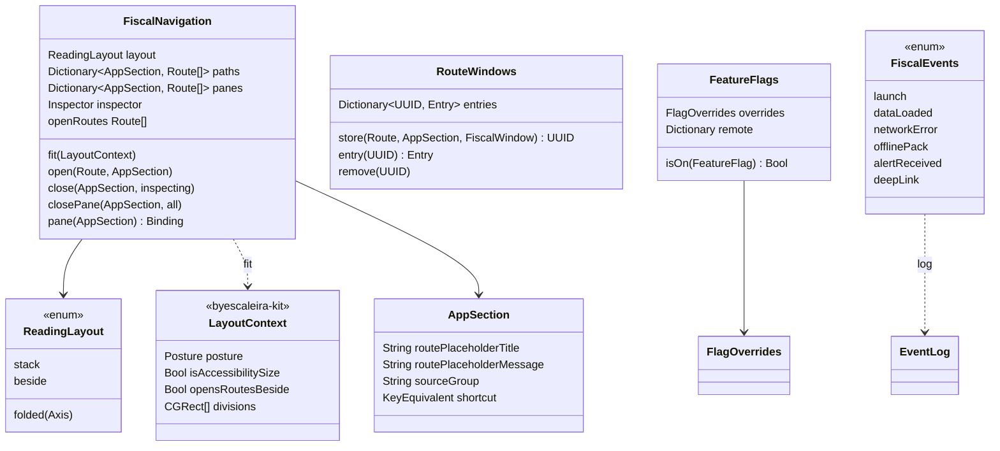

# Fiscal no padrão atual do workspace: dobrável, Mac, visionOS e Developer

## Requirements

O Fiscal está no byescaleira-kit 0.5.1 e não lê a postura do iPhone Duo: com a tela meio aberta, a aba e a rota aberta nela atravessam a dobra. O Mac usa a mesma `TabView` do iPad, e o visionOS abre as rotas em folha. Esta mudança leva o app ao padrão atual do byescaleira-workspace (`adaptive-layout.md` §7.2.2 e §7.4, `settings-structure.md` "Desenvolvedor", `verification.md` §6.1), sem mudar o que a pessoa vê no iPhone e no iPad de tela plana. Análise: [FSC-008](../analysis/FSC-008-202610311500-[Analysis]-platform-alignment.md); fase 1 do plano aprovado pelo usuário em 31/10/2026 ("Seguir para o canvas").

Definição de pronto:

- **Given** o Duo meio aberto em pé (dobra vertical) **When** a pessoa toca numa votação em Votações **Then** a lista de Votações fica no painel da esquerda e a votação no da direita, o fundo branco ou preto de cada painel cobre o vinco e nenhum texto, botão ou linha cruza a dobra (`FoldNavigationTests.foldedSideBySideOpensBesideInEverySection`, captura em `docs/evidence/FSC-008/`).
- **Given** o Duo meio aberto deitado (dobra horizontal) **When** a pessoa abre um perfil em Hoje **Then** o perfil fica no painel de cima e Hoje no de baixo (`FoldNavigationTests.foldedStackedPutsTheRouteOnTop`, captura).
- **Given** Hoje, Região, Votações, Dinheiro ou Fiscalizar com a tela dobrada **When** a pessoa abre qualquer `Route` (perfil, votação, gastos, Ajustes, compartilhar) **Then** ela abre no painel da rota dessa aba. A raiz continua no outro painel; em Fiscalizar, com o campo de busca.
- **Given** um painel da rota vazio **When** a aba está dobrada sem nada aberto **Then** ele mostra o estado vazio animado da aba (`AppSectionTests.routePlaceholderPerSection`):
  - Hoje: "Escolha um destaque";
  - Região: "Escolha um representante";
  - Votações: "Escolha uma votação";
  - Dinheiro: "Escolha um gasto";
  - Fiscalizar: "Escolha uma pessoa".
- **Given** um perfil e uma votação empilhados em Votações **When** a pessoa dobra a tela **Then** os dois passam para o painel da rota, na mesma ordem; ao desdobrar, voltam para a pilha de Votações sem perder nada (`FoldNavigationTests.foldingMovesStacksToTheRoutePaneAndBack`).
- **Given** a rota aberta ao lado (inspector, tela plana a partir de 960 pt) **When** a pessoa dobra a tela **Then** a rota do inspector vai para o painel da rota da aba dele e o inspector fecha (`FoldNavigationTests.foldingTakesTheInspectorRoute`).
- **Given** um tamanho de acessibilidade (AX1 em diante) **When** a tela está dobrada **Then** cada aba fica numa coluna só, como na pilha de hoje (`FoldNavigationTests.accessibilitySizeNeverFolds`).
- **Given** a tela plana (iPhone, iPad, Duo aberto ou fechado) **When** a largura muda **Then** nada muda: pilha abaixo de 960 pt e rota no inspector a partir de 960 pt (`NavigationTests` de hoje, com o `LayoutContext` plano).
- **Given** a tela do Lens setup com a arte de ponta a ponta **When** o Duo está fechado, com a barra vertical à direita **Then** a arte passa por baixo da barra (`.extendsUnderVerticalBar()`), e o texto fica na área segura.
- **Given** o Mac **When** o app abre **Then** a janela é um `NavigationSplitView`:
  - uma lista de origem com duas seções: "Acompanhar" (Hoje e Região) e "Congresso" (Votações, Dinheiro e Fiscalizar);
  - a raiz da seção no centro;
  - a rota ao lado no inspector a partir de 960 pt de janela; abaixo disso, na pilha da seção;
  - nada de abas.
- **Given** o Mac **When** a pessoa usa o menu Ir **Then** ⌘1 a ⌘5 abrem as seções na ordem de `AppSection.allCases`, e "Fechar" fecha a rota do inspector com Esc (`.keyboardShortcut(.cancelAction)`).
- **Given** o Mac em Gastos de um parlamentar **When** os recibos aparecem **Then** eles vêm numa `Table`:
  - colunas Data, Fornecedor, Tipo e Valor, ordenáveis;
  - células com `tableCell()`;
  - seleção múltipla;
  - menu de contexto com "Abrir recibo" e "Copiar";
  - o total no subtítulo da janela.
- **Given** o Mac numa votação **When** "Como cada um votou" aparece **Then** os votos vêm numa `Table`:
  - colunas Nome, Partido, UF e Voto, ordenáveis;
  - células com `tableCell()`;
  - menu de contexto com "Abrir perfil".
- **Given** o Mac na lista de representantes de um lugar **When** ela aparece **Then** ela vem numa `Table`:
  - colunas Nome, Cargo, Partido e UF;
  - duplo clique abre o perfil.
- **Given** o Mac nas telas de painel (Hoje e Dinheiro) **When** elas aparecem **Then** os cartões são `GroupBox` (`todayCard()` e `MoneyCard`), na ordem da lista de hoje; a grade de tamanhos diferentes (`CardGrid`) fica no backlog.
- **Given** o visionOS com a janela a partir de 960 pt **When** a pessoa abre uma rota **Then** ela abre numa janela vizinha (`openWindow`), e não numa folha; abaixo de 960 pt a rota empilha na seção, como no iPad. Fechar a janela é com o sistema.
- **Given** o visionOS **When** a barra inferior de uma tela tem ações **Then** ela usa o `platformBottomBar` do kit, que vira ornamento.
- **Given** um build Debug **When** a pessoa abre Ajustes › Developer **Then** a página traz (`DeveloperModelTests`):
  - flags com três estados (padrão, ligado e desligado), do `DeveloperFlagsSection` do kit;
  - o registro de eventos do `EventLog`, com filtro, copiar e apagar;
  - o diagnóstico do kit;
  - a seção "Layout", com tamanho, postura, divisões medidas e borda da barra vertical do `LayoutContext`.
- **Given** um evento do app (abertura, carga de dados pública, erro de rede, pacote offline, alerta recebido, deep link aberto) **When** ele acontece **Then** o `EventLog` grava a categoria e uma frase sem dado pessoal: nunca a Lente, quem a pessoa apoia ou segue, o texto da busca ou o lugar escolhido (`EventLogPrivacyTests`).
- **Given** um override antigo gravado em `fiscal.flags.overrides` **When** o app abre com o kit **Then** o override continua valendo, porque a chave e o formato `[String: Bool]` são os mesmos do `FlagOverrides(prefix: "fiscal")` (`FeatureFlagsTests.keepsTheOverridesSavedBefore`).
- **Given** a falha ao abrir o banco **When** a tela de erro aparece **Then** o texto do erro entra como texto do model no `EmptyStateView`, não como chave de tradução.
- **Given** `scripts/verify.sh --full` **When** o `server/` é verificado **Then** roda `go test -race ./...` e `govulncheck ./...`. Sem o `govulncheck` instalado, o passo falha com a instrução de instalar; o `--quick` não muda.
- **Given** o repositório **When** alguém procura o envio de capturas à loja **Then** `scripts/asc.py` e `scripts/store-media.py` do template estão lá, com o passo a passo em `docs/app-store/media/README.md`, ainda sem chave (ela fica com o usuário).
- **Given** o fim da fase **When** os roteiros manuais desta definição de pronto rodam (Duo nas cinco formas, Mac com lista de origem, menu e tabelas, visionOS com janela vizinha, Developer) **Then** cada um fica registrado em `docs/evidence/FSC-008/qa.md` como `passou`, `falhou` ou `não executável aqui`, antes da revisão.
- **Erro:** se o kit 0.7.2 não resolver (sem acesso ao repositório privado), o build falha no `scripts/kit-access.sh` com a mensagem de hoje, e nada desta mudança entra.

## Entities



- **`ReadingLayout`** (novo, `FeatureCore/Navigation`):
  - `.stack` é a pilha de hoje;
  - `.beside` é a rota no inspector a partir de 960 pt, também como hoje;
  - `.folded(Axis)` usa o eixo do `LayoutContext.posture`: `.horizontal` são painéis lado a lado (em pé) e `.vertical` são painéis empilhados (deitado).
- **`FiscalNavigation`** troca `opensBeside` por `layout` e `fit(_ context:)` decide a forma:
  - com AX, sempre `.stack`;
  - com a tela dobrada, `.folded`;
  - com `opensRoutesBeside`, `.beside`;
  - senão, `.stack`.

  Ele ganha `panes: [AppSection: [Route]]`, a pilha do painel da rota de cada aba na dobra, com `pane(for:)` para a `NavigationStack` do painel e `closePane(in:all:)` para voltar um passo ou fechar o painel. Ao entrar na dobra, `paths[section]` passa inteiro para `panes[section]`, e o inspector aberto passa para `panes[inspector.section]` e fecha. Ao sair, `panes[section]` volta para o fim de `paths[section]`. `open(_:in:)` abre no painel em `.folded`, no inspector em `.beside` e na pilha em `.stack`; `close(in:inspecting:)` continua só para a pilha e o inspector. `openRoutes` junta pilhas, painéis e inspector para o Spotlight e as integrações.
- **`AppSection`** ganha:
  - `routePlaceholderTitle`, `routePlaceholderMessage` e a animação do estado vazio;
  - `sourceGroup` ("Acompanhar" ou "Congresso") para a lista de origem do Mac;
  - `shortcut` (1 a 5), tirado da posição em `allCases`.
- **`RouteWindows`** (novo, `AppShell`, só visionOS): guarda, por um `UUID`, a rota, a aba e o `FiscalWindow` de cada janela (`Entry`), porque a `Route` não é `Codable` e a janela nova precisa dos mesmos models. A cena `WindowGroup(for: UUID.self)` pede a entrada pelo id; sem entrada, por exemplo depois de reiniciar, a janela fecha. O `RouteWindowOpener` troca o inspector por `openWindow`.
- **`FeatureFlags`** passa a gravar os overrides no `FlagOverrides(prefix: "fiscal")` do kit. A chave (`fiscal.flags.overrides`) e o formato continuam os mesmos, e `remote`, `bucket` e o `isOn` não mudam. Ganha `definitions`, um `FlagDefinition` por `FeatureFlag`, para o `DeveloperFlagsModel` do kit.
- **`FiscalEvents`** (novo, `FeatureCore`): a lista fechada de eventos que o app grava no `EventLog.shared`, cada um com categoria e frase fixa em inglês, sem parâmetro livre. Só valores sem dado pessoal: a contagem de arquivos, o código HTTP e a rota do deep link sem o slug.

## Approach

1. **Estratégia:**
   - O kit faz a parte difícil: o `FoldAwareArrangement(.split)` divide na dobra que o sistema informa, e o `LayoutContext` mede a postura, as divisões e a barra vertical.
   - O Fiscal só decide a forma no `FiscalNavigation` e o que vai em cada painel no `SectionStack`.
   - O Mac e o visionOS ganham raízes próprias no `AppShell`, com as mesmas telas e os mesmos models.
   - A página Developer troca o código local pelas peças do kit.
2. **Decisões:**
   - **Ordem dos painéis (§7.2.2):** em pé, a raiz à esquerda e a rota à direita; deitado, a rota em cima e a raiz embaixo. Vale em toda aba, Fiscalizar inclusive.
   - **Ajustes não usam `\.paneDestination`:** no Fiscal, Ajustes é uma `Route` aberta a partir de Hoje, e não uma aba. Com a tela dobrada, ele já abre no painel da rota, e as páginas dele empilham no mesmo painel, que é o lado certo. O `paneDestination` só existe para a lista que fica no painel da raiz (Tably, TBL-021). Por isso a linha marcada (`.isSelected`) não se aplica. No Mac, os Ajustes continuam na cena `Settings` (⌘,).
   - **Inspector e dobra têm uma fonte só:** o inspector continua global e fecha ao trocar de aba, como hoje (`closeInspectorOutsideSelection`). Na dobra, cada aba tem o próprio painel em `panes`, e trocar de aba não fecha nada. Assim, inspector e dobra nunca coexistem.
   - **Mac** (§7.4, decisão do usuário em 28/10/2026 no workspace):
     - `MacShell` com `NavigationSplitView`, lista de origem em seções e a raiz no `detail`, com a pilha da seção.
     - A rota ao lado continua no `.inspector`, no lado oposto.
     - A busca de Fiscalizar continua no `.searchable` da própria `SearchScreen`, que no Mac vai para a toolbar da janela.
     - O menu Ir (`FiscalCommands`) mora no `MacShell.swift`, junto com o `FocusedValues.fiscalNavigation` que ele lê; com a janela fora de foco, os itens ficam desativados.
     - Os registros viram `Table` só em `#if os(macOS)`, em três telas: recibos, votos de uma votação e representantes de um lugar. O resto segue em lista e cartão. Os cartões de Hoje e Dinheiro (`todayCard()` e `MoneyCard`) viram `GroupBox` no Mac.
   - **Menu do Mac:** `CommandMenu("Ir")` com as seções e ⌘1…⌘5 tirados de `AppSection.allCases`. A fase 2 vai trocar Região por Seguindo, e o menu acompanha sem mudança. "Fechar" fica no botão do inspector, com `.keyboardShortcut(.cancelAction)`.
   - **visionOS:** a rota abre numa janela vizinha (§7.4, de 28/10/2026). Ela substitui a folha do §8, mais antigo. O `RouteWindows` guarda a rota em memória porque a `Route` não é `Codable`. Tornar a `Route` `Codable` seria uma refatoração de todos os assuntos, sem pedido.
   - **Registro de eventos sem dado pessoal:** o `FiscalEvents` é um `enum` fechado, sem `String` livre vinda de fora. O teste percorre todos os casos e confere que nenhuma frase interpola slug, UF, código IBGE ou texto de busca (ADR 0017 e a promessa de privacidade de 29/10/2026).
   - **Arte sob a barra vertical:** só a arte de ponta a ponta do setup da Lente (`LensArt`) recebe `.extendsUnderVerticalBar()`. Os heróis de Hoje, do perfil e da disputa têm a arte dentro de cartões, que ficam na área segura.
   - **Itens S:**
     - `go test -race` e `govulncheck` só no `--full`;
     - `asc.py` e `store-media.py` copiados do template sem mudança de lógica;
     - a regra 5 da constituição com o texto do template.
   - **Versão do servidor e da ponte:** o servidor já recebe a versão SemVer pela tag ou pelo `MARKETING_VERSION` no deploy (`scripts/server-deploy.sh`, `-X main.version`), e a ponte usa o `version` do `package.json` no `/health`. Nada muda aqui; o levantamento contou isso como lacuna por engano.
   - **Rede no Mac (prompt-update de 31/10/2026, achado na QA):** o app do Mac roda no App Sandbox sem `com.apple.security.network.client`, então nenhuma tela carregava dados ("Disponível com conexão"). O alvo ganha `ENABLE_OUTGOING_NETWORK_CONNECTIONS = YES`, só saída; o iOS e o visionOS ignoram a chave. A verificação no Mac usa um build assinado (`xcodebuild -allowProvisioningUpdates`), porque o `scripts/build.sh` compila sem assinatura e, sem o entitlement do iCloud, o `CKContainer` derruba o app na abertura.
   - **Barra inferior no visionOS:** o Fiscal não tem barra inferior em nenhuma tela; o `platformBottomBar` fica para quando houver uma.
   - **Painéis do Mac (sync de 31/10/2026, revisão de spec):** `todayCard()` e `MoneyCard` viram `GroupBox` no Mac, na ordem de hoje. A grade de tamanhos diferentes do `CardGrid` mudaria a composição de Hoje e Dinheiro e fica no backlog.
   - **visionOS abaixo de 960 pt (sync):** a janela vizinha substitui o inspector, então só aparece quando a janela tem 960 pt ou mais; abaixo disso a rota empilha, como no iPad.
   - **Tabelas do Mac dentro de telas de lista:** uma `Table` não cabe numa `List`; em Gastos e na votação, o Mac usa um `VSplitView` com o painel de hoje em cima e a tabela embaixo, e a lista de representantes vira só a tabela.
   - **Portas (análise):** shell do Mac, tabelas, janela vizinha no visionOS e Ajustes na dobra são `veto`, listadas na parada do canvas; o resto é `reversível`; nenhuma é `pergunta`.
   - **ADR:** nenhum. As regras são do workspace, já aceitas lá, e as decisões são locais.
3. **Referências:**
   - [Preparing your app for iPhone Duo](https://developer.apple.com/documentation/technologyoverviews/preparing-your-app-for-iphone-duo);
   - `byescaleira-kit/docs/platforms.md` ("iPhone Duo", "Receita de tela por plataforma");
   - a pesquisa `byescaleira-kit/docs/research/2026-10-28-platform-design-references.md`: Tide Guide e Primary no Mac; Ajustes e Mail do iPad para o par lista e detalhe;
   - o Tably, TBL-021 (dobra em toda seção) e TBL-019 (Developer com as peças do kit).

## Structure

```text
FiscalKit/
  Package.swift                                                  byescaleira-kit from: "0.7.2"
  Package.resolved                                               byescaleira-kit 0.7.2
  Sources/FeatureCore/Navigation/ReadingLayout.swift             (novo)
  Sources/FeatureCore/Navigation/FiscalNavigation.swift          layout, panes, fit(_:), open, close
  Sources/FeatureCore/Navigation/AppSection.swift                textos do painel vazio, sourceGroup, shortcut
  Sources/FeatureCore/Flags/FeatureFlags.swift                   FlagOverrides do kit e definitions
  Sources/FeatureCore/Diagnostics/FiscalEvents.swift             (novo) eventos fechados para o EventLog
  Sources/AppShell/MainScreen.swift                              MacShell no macOS, RouteWindows no visionOS
  Sources/AppShell/SectionStack.swift                            SectionFold com FoldAwareArrangement(.split) e o painel vazio
  Sources/AppShell/RoutePane.swift                               (novo) pilha do painel da rota, Close e aviso ao VoiceOver
  Sources/AppShell/MacShell.swift                                (novo) NavigationSplitView, lista de origem e FiscalCommands (menu Ir com ⌘1…⌘5)
  Sources/AppShell/RouteWindows.swift                            (novo, visionOS) janela por UUID e RouteWindowOpener
  Sources/AppShell/FiscalWindow.swift                            currentWindow no ambiente
  Sources/AppShell/View+RouteInspector.swift                     visionOS abre janela em vez de folha
  Sources/AppShell/InspectorScreen.swift                         Close com .cancelAction
  Sources/AppShell/Integrations/*, DeepLink.swift, DeepLinks.swift, FiscalServices.swift, Offline/OfflineDataCenter.swift
                                                                 eventos no EventLog (abertura, deep link, alerta, pacote offline)
  Sources/FeatureCore/PublicData/PublicDataPhase.swift           eventos de carga e erro HTTP
  Sources/FiscalData/PublicData/Offline/OfflinePackUpdater.swift report: do coordenador do pacote offline
  Sources/FeatureMoney/ExpensesTable.swift                       (novo, macOS) recibos em Table
  Sources/FeatureMoney/ExpensesModel+Records.swift, ExpensesModel.swift, ExpensesScreen.swift
                                                                 registros e ordem dos recibos; VSplitView no Mac
  Sources/FeatureMoney/MoneyCard.swift                           GroupBox no Mac
  Sources/FeatureToday/TodayComponents.swift                     todayCard() em GroupBox no Mac
  Sources/FeatureVotes/VoteBallotsTable.swift                    (novo, macOS) votos em Table
  Sources/FeatureVotes/VoteDetailModel+Records.swift, VoteBallotsSection.swift, VoteDetailScreen.swift
                                                                 registros e ordem dos votos; peças reaproveitadas; VSplitView no Mac
  Sources/FeatureMine/MineRosterTable.swift                      (novo, macOS) representantes em Table
  Sources/FeatureMine/MineRegion.swift, MineRosterScreen.swift   ordem do roster; contagem e "ninguém é ranqueado" sob a tabela
  Sources/FeatureLens/LensArt.swift                              .extendsUnderVerticalBar()
  Sources/FeatureSettings/DeveloperScreen.swift                  seções do kit e a seção Layout
  Sources/FeatureSettings/DeveloperLayout.swift                  (novo) textos da seção Layout
  Sources/FeatureSettings/DeveloperModel.swift                   models do kit, sem o override próprio
  Tests/FeatureCoreTests/NavigationTests.swift                   LayoutContext plano
  Tests/FeatureCoreTests/FoldNavigationTests.swift               (novo) dobra, inspector, AX, volta para a pilha
  Tests/FeatureCoreTests/AppSectionTests.swift                   placeholder, grupo e atalho
  Tests/FeatureCoreTests/FeatureFlagsTests.swift                 override antigo continua valendo
  Tests/FeatureCoreTests/EventLogPrivacyTests.swift              (novo)
  Tests/FeatureSettingsTests/DeveloperModelTests.swift           flags em três estados, registro, diagnóstico
  Tests/AppShellTests/DeepLinkTests.swift, FiscalDataTests/OfflinePackTests.swift, FeatureSettingsTests/SettingsModelTests.swift
  Tests/FeatureMoneyTests/ExpensesRecordsTests.swift, FeatureVotesTests/VoteBallotRecordsTests.swift, FeatureMineTests/MineRosterTests.swift
docs/evidence/FSC-008/qa.md                                     (novo) resultado dos roteiros manuais
Fiscal/Fiscal.xcodeproj/project.pbxproj                          ENABLE_OUTGOING_NETWORK_CONNECTIONS no alvo do app
Fiscal/Fiscal/FiscalApp.swift                                    comandos no macOS, WindowGroup(for: UUID.self) no visionOS, EmptyStateView com texto do model
Fiscal/Fiscal/Localizable.xcstrings                              textos novos em pt-BR
Fiscal.xcworkspace/xcshareddata/swiftpm/Package.resolved         byescaleira-kit 0.7.2
scripts/verify.sh                                                go test -race e govulncheck no --full
scripts/asc.py, scripts/store-media.py                           (novos, do template)
docs/app-store/media/README.md                                   envio pela API
docs/constitution.md                                             regra 5 com o dobrável
docs/roadmap.md, docs/backlog.md, CHANGELOG.md, spdd/README.md   registro da mudança
docs/evidence/FSC-008/                                           capturas do Duo, do Mac e do visionOS
```

## Operations

1. **Kit 0.7.2.**
   - `from: "0.7.2"` no `Package.swift`, com os dois `Package.resolved` atualizados.
   - As chamadas que a 0.6.0 mudou são conferidas: `EmptyStateView` com texto do model e `GuideSheet(isDismissible:)`.
   - O `FiscalApp` passa o texto do erro de abertura como texto, sem `LocalizedStringKey`.
   - Verificação: `scripts/verify.sh --quick ios`.
2. **`ReadingLayout` e `FiscalNavigation.fit(_:)`.** Depende de: 1.
   - `layout` no lugar de `opensBeside` e `panes` por aba.
   - A troca de forma faz `moveStacksToPanes` e `movePanesToStacks`, e passa a rota do inspector para o painel ao dobrar.
   - `open(_:in:)` e `close(in:inspecting:)` passam a considerar o painel.
   - Verificação: `NavigationTests` (plano) e `FoldNavigationTests` (dobra em pé e deitado, inspector, AX, volta para a pilha).
3. **`AppSection`.** `[P]` com 2.
   - Título, texto e animação do painel vazio de cada aba.
   - `sourceGroup` e `shortcut`.
   - Verificação: `AppSectionTests`.
4. **`SectionFold` no `SectionStack` e `RoutePane`.** Depende de: 2 e 3.
   - Com `.folded`: o `FoldAwareArrangement(.split)`, a raiz e o painel da rota na ordem do eixo, e o estado vazio quando `panes[section]` está vazio.
   - O `RoutePane` tem a `NavigationStack` do painel, o "Fechar" e `AccessibilityNotification.ScreenChanged` quando a rota muda.
   - O `MainScreen` passa o `LayoutContext` inteiro ao `fit`.
   - Verificação: `scripts/verify.sh --quick ios`.
5. **Arte sob a barra vertical.** `[P]` com 4.
   - `.extendsUnderVerticalBar()` no `LensArt`.
   - Verificação: build iOS.
6. **Shell do Mac.** Depende de: 2 e 3.
   - `MacShell` com a lista de origem em seções, a raiz no `detail` e o inspector.
   - `FiscalCommands` com o menu Ir e "Fechar" com `.cancelAction` no `InspectorScreen`.
   - O `FiscalApp` liga `.commands` no macOS.
   - Verificação: `scripts/verify.sh --quick macos`.
7. **Tabelas do Mac.** Depende de: 6. `[P]` entre si.
   - `ExpensesTable`, `VoteBallotsTable` e `MineRosterTable`, em `#if os(macOS)`, com:
     - colunas ordenáveis;
     - células com `tableCell()`;
     - seleção múltipla nos recibos;
     - menu de contexto;
     - o total no subtítulo dos recibos.
   - As listas de hoje continuam no iOS e no visionOS.
   - Verificação: `scripts/verify.sh --quick macos` e testes das ordenações nos models.
8. **visionOS.** Depende de: 2.
   - `RouteWindows` e a cena `WindowGroup(for: UUID.self)` no `FiscalApp`.
   - O `routeInspector` vira `openWindow`.
   - `platformBottomBar` onde há barra inferior.
   - Verificação: `scripts/verify.sh --quick visionos`.
9. **Flags no kit.** `[P]` com 2.
   - `FeatureFlags` sobre o `FlagOverrides(prefix: "fiscal")` e `definitions`.
   - Verificação: `FeatureFlagsTests`, inclusive o override antigo.
10. **Registro de eventos.** `[P]` com 2.
    - `FiscalEvents` e as chamadas na abertura, na carga pública, no erro de rede, no pacote offline, no alerta recebido e no deep link.
    - Verificação: `EventLogPrivacyTests`.
11. **Developer.** Depende de: 9 e 10.
    - A página usa o `DeveloperFlagsSection`, o `DeveloperLogScreen` e o `DeveloperDiagnosticsSection` do kit, mais a seção "Layout" do Fiscal com o `LayoutContext`.
    - Sai o override próprio.
    - Verificação: `DeveloperModelTests`.
12. **Textos.** Depende de: 3, 6 e 11.
    - As chaves novas em pt-BR (painel vazio, grupos da lista de origem, menu Ir, colunas das tabelas, seção Layout).
    - Verificação: `scripts/strings.sh` sem chave pendente.
13. **Ferramentas e docs.** `[P]` com tudo.
    - `go test -race` e `govulncheck` no `--full`.
    - `asc.py` e `store-media.py` da `main` atual do workspace (com a renovação do token e a nova tentativa em erro do servidor).
    - `docs/app-store/media/README.md`.
    - A regra 5 da constituição.
    - Verificação: `bash -n scripts/verify.sh`, `python3 -I scripts/store-media.py --help`.
14. **Rodar e QA.** Depende de: 1 a 13.
    - `scripts/verify.sh --full`.
    - Os roteiros manuais da definição de pronto, com capturas em `docs/evidence/FSC-008/` e o resultado de cada um em `docs/evidence/FSC-008/qa.md` (`passou`, `falhou` ou `não executável aqui`):
      - o Duo nas cinco formas (fechado, aberto, meio aberto em pé e deitado, e AX), com a postura trocada pelo usuário no Device Hub;
      - o Mac com a lista de origem, o menu Ir e as três tabelas;
      - o visionOS com uma janela vizinha;
      - a página Developer.
15. **Revisão e PR.** Depende de: 14.
    - Uma rodada só: `/byescaleira-workspace:review` (`review-panel` com `ui` e `code`, sem `spec`) e `/byescaleira-workspace:spdd-code-review` deste canvas na mesma mensagem; nenhum revisor aberto à mão.
    - Correções num commit só e re-revisão só das dimensões com bloqueador.
    - Roadmap, backlog, `CHANGELOG.md` e `spdd/README.md` (`FSC-008` entregue, próxima `FSC-009`).
    - PR para a `development` com a seção Canvas, a QA e as evidências.

## Norms

- **Regra 3 (arquitetura):** a forma, o painel e a ordem ficam no `FiscalNavigation` e no `AppSection`; o shell só monta; as ações da Developer ficam no `DeveloperModel`.
- **Regra 4 (código):**
  - zero comentários e zero avisos;
  - Swift Testing para `ReadingLayout`, a troca de forma, o `AppSection`, as flags e o registro de eventos;
  - toda suíte que espera (`await` em tarefa, `Task.sleep`, `confirmation`) leva `.timeLimit`, sem laço de espera sem limite;
  - tokens do design system em vez de números soltos (`.listColumn`, `.inspectorMin` e os tamanhos de `tableCell()`).
- **Regra 5 (design):**
  - nada sobre a dobra;
  - o fundo de cada painel é branco ou preto (`GroupedSurface.plain`);
  - as barras ficam com o sistema;
  - todo item de aba tem ícone e título;
  - o estado vazio é o animado do kit;
  - Bricolage só nos números e títulos de destaque.
- **Regra 6 (textos):** só pt-BR (ADR 0003), com frases curtas no padrão "Escolha um…".
- **Regra 7 (verificação):** a verificação visual é no simulador do Duo, porque não há Duo físico, e a postura é trocada pelo usuário. O iPhone físico entra quando estiver conectado.
- **ADR 0010:** peça genérica nova vai para o kit. Esta mudança só usa peças do kit; se faltar alguma, ela vira um PR no kit antes.
- **ADR 0017:** o registro de eventos não leva dado pessoal e não sai do aparelho.

## Safeguards

- **Funcional:**
  - A tela plana fica igual: pilha abaixo de 960 pt e inspector a partir de 960 pt, em iPhone, iPad e Duo aberto ou fechado.
  - Fora do iOS 27.1 (iOS 26, iPadOS, macOS e visionOS) não há divisão: `posture == .flat` e nada muda.
  - Deep links, o `open` do ambiente, os App Intents e o Spotlight passam pelo `open(_:in:)` e caem no painel certo em cada forma.
  - Dobrar e desdobrar nunca perde uma rota aberta, nem as do inspector.
  - O VoiceOver avisa a troca no painel da rota (`AccessibilityNotification.ScreenChanged`).
- **Limitação aceita:**
  - A rolagem da raiz volta ao topo ao trocar de forma.
  - No visionOS, a janela vizinha não volta depois de reiniciar o app.
- **Desempenho:** a forma só muda quando o `LayoutContext` muda, sem medida por quadro; as tabelas do Mac usam os mesmos models, sem carga a mais.
- **Privacidade e segurança:**
  - O `EventLog` fica em memória e no `os.Logger` do aparelho, só com os casos de `FiscalEvents`.
  - Nenhuma Lente, apoio, seguido, busca ou lugar.
  - Nada vai à rede.
  - A página Developer só existe em `#if DEBUG`.
  - O sandbox do Mac ganha só a rede de saída (`network.client`), sem servidor nem outra permissão.
- **Integração e compatibilidade:**
  - Nenhuma `Route`, chave salva, schema do SwiftData, container do CloudKit ou link muda.
  - `fiscal.flags.overrides` mantém a chave e o formato.
  - O kit 0.6.0 a 0.7.2 só acrescenta, fora as duas chamadas da Operação 1.
- **QUEBRA:** nenhuma para quem usa o app. Em Debug, a página Developer muda de forma (flags em três estados no lugar do `Toggle`).
- **Fora do escopo:**
  - a aba Seguindo (fase 2);
  - o fluxo de compartilhar (fase 3);
  - a web (fases 4 e 5);
  - Ajustes em duas colunas no iPad plano;
  - `Route` `Codable`;
  - Apple TV e Apple Watch;
  - envio do Mac ou do visionOS à loja;
  - usar o `asc.py` com a chave da loja.
