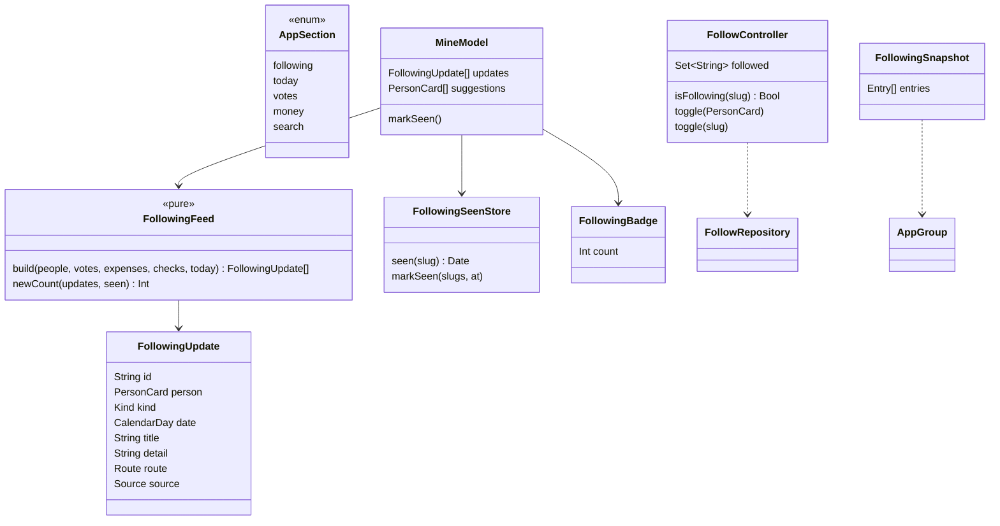

# Seguir no centro do Fiscal: aba Seguindo e seguir em todo lugar

## Requirements

Hoje só se segue alguém pelo herói do perfil, e quem a pessoa segue aparece no fim da aba Região e em até 4 linhas de Hoje, sem dizer o que fizeram. Esta mudança põe seguir no centro do app, como pediu o usuário em 31/10/2026 ("precisamos deixar mais claro a função de seguir um políticos no app (como se fosse o core do app, mais evidência)"). Análise: [FSC-009](../analysis/FSC-009-202610312136-[Analysis]-following-core.md).

Decisões do usuário:
- Seguindo é a primeira aba e absorve a Região.
- As novidades de quem a pessoa segue ficam no topo.
- Os representantes do lugar aparecem como sugestão.
- Sem notificação: só selo na aba ("Só selo na aba, sem notificação").

Definição de pronto:

- **Given** o app aberto **When** a barra de abas aparece **Then** as abas são, nesta ordem, Seguindo · Hoje · Votações · Dinheiro · Fiscalizar, e Seguindo abre primeiro (`AppSectionTests.followingIsTheFirstSection`). No Mac, Seguindo é o primeiro item de "Acompanhar" e ⌘1.
- **Given** um link `fiscal://mine` (atalho, widget antigo, link publicado) **When** ele é aberto **Then** a aba Seguindo abre (`DeepLinkTests.mineOpensFollowing`). `fiscal://following` também abre.
- **Given** a pessoa segue Fulana e Beltrano, Fulana votou "Sim" no PL 1/2026 em 30/10 e Beltrano teve R$ 12.345,67 de gastos publicados em outubro **When** abre a aba Seguindo **Then** o topo "Novidades" lista as duas, da mais nova para a mais antiga, cada uma com nome, o que aconteceu, data e fonte, e o toque abre a votação ou os gastos (`FollowingFeedTests.ordersNewestFirstAcrossPeople`).
- **Given** a primeira visita **When** as novidades são montadas **Then** entram só itens dos últimos 30 dias, no máximo 50 (`FollowingFeedTests.keepsThirtyDaysAndFiftyItems`).
- **Given** a última visita em 28/10 **When** a pessoa volta em 31/10 **Then** os itens depois de 28/10 têm o selo "Novo", e a aba mostra o número deles (`.badge`). Ao sair da aba, a marca de cada seguido passa para agora e o número zera (`FollowingSeenStoreTests`, `FollowingFeedTests.countsOnlyWhatIsNewSinceTheLastVisit`).
- **Given** ninguém seguido e o estado SP escolhido **When** a aba abre **Then** aparece o convite "Siga quem representa você" com os representantes de SP e quem a pessoa apoia na Lente, cada um com o botão Seguir na linha. Sem lugar e sem Lente, o convite pede o lugar (`MineModelTests.suggestsRepresentativesAndSupportedNotFollowed`).
- **Given** a aba Seguindo **When** a pessoa rola abaixo das novidades **Then** vê, nesta ordem:
  - "Quem você segue", em ordem alfabética;
  - "Sugestões";
  - "Sua região", com o herói do lugar, o governo, as bancadas, o Senado, o agora da região e a fonte, como a Região mostra hoje.
- **Given** qualquer uma destas linhas de pessoa **When** a pessoa toca no botão Seguir da linha ou usa "Seguir"/"Deixar de seguir" no menu de contexto **Then** o estado muda sem abrir o perfil (`FollowControllerTests.togglesFromAnyRow`). As linhas são:
  - resultado da busca;
  - representante e senador da região;
  - quem votou numa votação;
  - gastadores de Dinheiro;
  - quem aguarda julgamento;
  - autor do destaque em Hoje.

  No Mac, as tabelas ganham as mesmas ações no menu de contexto.
- **Given** um toque em Seguir **When** o estado muda **Then** há háptico (`sensoryFeedback`) e o símbolo troca com `quietBounce`, sem animação com Reduzir movimento. O VoiceOver anuncia "Seguindo Fulana" ou "Deixou de seguir Fulana".
- **Given** a Siri ou Atalhos **When** a pessoa diz "Seguir Fulana no Fiscal" ou roda o atalho **Then** Fulana passa a ser seguida sem abrir o app. "Deixar de seguir" desfaz, e "Quem eu sigo no Fiscal" abre a aba Seguindo. Com atualização obrigatória pendente, os três falham com `UpdateRequiredError` (`FollowIntentTests`).
- **Given** o widget de representantes **When** a pessoa escolhe "Quem eu sigo" na configuração **Then** ele mostra até 4 seguidos com a novidade mais recente de cada um; "Meu estado" continua como hoje (`FollowingSnapshotTests`).
- **Given** a aba Seguindo e os Ajustes **When** os textos aparecem **Then**:
  - não existe mais "fica só neste aparelho";
  - o rodapé diz "Quem você segue fica no seu iCloud, se a sincronização estiver ligada.";
  - Hoje não manda escolher o estado para seguir.
- **Given** Hoje **When** a pessoa segue alguém **Then** o cartão de seguidos dá lugar a uma linha "N novidades de quem você segue", ou "Siga quem representa você" com zero seguidos, que abre a aba Seguindo.
- **Erro:** se a leitura de uma pessoa falha (sem rede e fora do pacote offline), as outras novidades aparecem e a linha da pessoa diz "Sem dados agora" com "Tentar de novo". Nenhuma falha esconde a aba.

## Entities



- **`AppSection.following`** substitui `mine`:
  - `rawValue` "following", título "Following" (Seguindo) e símbolo `person.2`;
  - `DeepLink` mapeia o host `mine` para `.following`;
  - `SourceGroup.followAlong` passa a ser `[.following, .today]`.
- **`FollowingUpdate`** (novo, `FiscalDomain`):
  - `Kind` é `.vote(choice)`, `.expenses(cents)` ou `.check(verdict)`;
  - `id` é o slug mais o tipo e o id de origem;
  - `route` é `.vote(id:)`, `.expenses(slug:year:)` ou o link da checagem;
  - presença fica de fora, porque só existe somada por ano, sem data.
- **`FollowingFeed`** (novo, `FiscalDomain`, funções puras): junta as listas de cada seguido, corta em 30 dias e 50 itens, ordena por data (desempate por nome) e conta os itens mais novos que a marca de cada pessoa.
- **`FollowingSeenStore`** (novo, `FeatureCore`): `UserDefaults` local, chave `fiscal.following.seen` (`[slug: Date]`). Fica fora do iCloud e do SwiftData, e entra no "Apagar preferências" do Developer.
- **`FollowController`** (novo, `FeatureCore`, `@MainActor @Observable`, um por janela, injetado como o `SessionModel`):
  - guarda os slugs seguidos, recarregados a cada `session.generation`;
  - `toggle(_ card:)` segue ou deixa de seguir pelo `FollowRepository`;
  - `toggle(slug:)` acha o `PersonCard` no índice de pessoas (`service.people()`) para as linhas que só têm slug, como a de quem votou.
- **`FollowingBadge`** (novo, `FeatureCore`, `@Observable`, por janela): o número de novidades que a `TabView` e a lista de origem do Mac mostram. O `MineModel` atualiza.
- **`FollowingSnapshot`** (novo, `FiscalDomain/Integrations`): até 6 entradas (`PersonCard` mais a novidade mais recente), gravadas pelo app em `fiscal/following.json` no App Group e lidas pelo widget.
- **`MineModel`** ganha:
  - `updates`, `updatesPhase`, `suggestions`, `newCount` e `markSeen()`;
  - um `PublicDataService` para `votes(slug:year:)`, `expenses(slug:year:)` e `checks(slug:)` de cada seguido, com no máximo 6 leituras ao mesmo tempo e o `settle` da FSC-002.

## Approach

1. **Estratégia:**
   - A aba Seguindo é a `FeatureMine` reordenada, sem módulo novo.
   - As novidades nascem no aparelho, das mesmas chamadas públicas do perfil, que já leem do pacote offline quando não há rede. A lista de quem a pessoa segue nunca sai do aparelho.
   - Seguir vira uma peça única (`FollowController` e `FollowButton`/`.followActions(...)`) usada por todas as linhas de pessoa.
2. **Decisões** (portas da análise; nenhuma nova de porta `pergunta`):
   - **Sem notificação** (pergunta respondida pelo usuário): só o selo na aba e as novidades no widget. As notificações seguem iguais para todos (25/10/2026).
   - **Marca de última visita local:** a marca é atualizada ao sair da aba (`onDisappear`) ou quando o app vai para o fundo com a aba aberta, para o selo "Novo" ficar visível durante a visita.
   - **Região dentro de Seguindo:** "Sua região" reaproveita `MineHeroSection`, `MineRegionContent` e `MineInviteSection` sem mudar o desenho. O título da aba passa a ser "Seguindo".
   - **Hoje:**
     - sai o `TodayRepresentativesSection`, junto com o carregamento de seguidos e de votos do `TodayModel`;
     - entra a `TodayFollowingLink`, que lê o `FollowingBadge` e muda `selectedSection` para `.following`.
   - **Botão Seguir na linha:**
     - `FollowButton` compacto com `person.badge.plus` e `person.fill.checkmark`, alvo de 44 pt, rótulo de acessibilidade com o nome, `quietBounce` e `sensoryFeedback(.success)`;
     - fica no fim da linha, fora do `RouteLink`, para não abrir o perfil;
     - nas linhas sem espaço (autor do destaque, tabelas do Mac), só o menu de contexto.
   - **Fora da lista de seguir:** os candidatos da apuração (`RaceStandingRow`) usam o slug do retrato, e não o da pessoa, e a Memória mostra nomes do passado. Os dois ficam sem botão.
   - **Perfil:** o herói passa a usar o `FollowController`, para o estado bater com as listas. O háptico e o anúncio ao VoiceOver são os mesmos do botão da linha.
   - **Intents:**
     - `FollowPersonIntent` e `UnfollowPersonIntent` (`AppIntent`, `openAppWhenRun = false`, `PersonEntity`) gravam pelo `FollowRepository` do banco aberto por `FiscalServices.shared.database(cloudSync:)`, como o `OfflineDataCenter`;
     - `OpenFollowingIntent` (`OpenIntent`) usa `pendingURL = IntegrationLink.following`;
     - os três checam `IntentWorkspace.ensureOpen()`.
   - **Widget:**
     - o `RepresentativesWidget` passa para `AppIntentConfiguration`, com o parâmetro "Mostrar": "Meu estado", o padrão de hoje, ou "Quem eu sigo";
     - "Quem eu sigo" lê o `FollowingSnapshot` do App Group, que o app grava ao montar as novidades;
     - o widget não faz rede nova.
   - **Textos:** o rodapé e o vazio de "Quem você segue" falam do iCloud ("fica no seu iCloud, se a sincronização estiver ligada"), e somem as frases "neste aparelho".
   - **ADR:** nenhum. Seguir já é capacidade do app (ADR 0017 cobre o que sai do aparelho; nada novo sai).
3. **Referências:**
   - **Apps de seguir com novidades no topo:** Apple Sports ("Minhas equipes"), Apple News ("Seguindo") e GitHub ("Following").
   - **Pesquisa e HIG:** a pesquisa de plataformas de 28/10/2026 e a HIG de *Tab bars* (primeira aba é a mais usada).

## Structure

```text
FiscalKit/
  Sources/FiscalDomain/PublicData/FollowingUpdate.swift          (novo) FollowingUpdate e FollowingFeed
  Sources/FiscalDomain/Integrations/FollowingSnapshot.swift      (novo) snapshot do widget no App Group
  Sources/FiscalDomain/Integrations/VoteBoard.swift              IntegrationLink.following
  Sources/FeatureCore/Navigation/AppSection.swift                following no lugar de mine, grupo e atalho
  Sources/FeatureCore/Following/FollowController.swift           (novo) estado e toggle de seguir por janela
  Sources/FeatureCore/Following/FollowingBadge.swift             (novo) número de novidades
  Sources/FeatureCore/Following/FollowingSeenStore.swift         (novo) marca local de última visita
  Sources/FeatureCore/Following/FollowButton.swift               (novo) botão da linha e .followActions(...)
  Sources/FeatureMine/MineModel.swift, MineModel+Following.swift updates, suggestions, newCount, markSeen
  Sources/FeatureMine/MineScreen.swift                           ordem: novidades, quem você segue, sugestões, sua região
  Sources/FeatureMine/MineFollowing.swift                        (novo) seções de novidades, seguidos e sugestões
  Sources/FeatureMine/MineSections.swift                         sai MineFollowingSection; textos do iCloud
  Sources/FeatureToday/TodayRepresentativesSection.swift         vira TodayFollowingLink
  Sources/FeatureToday/TodayModel.swift, TodayScreen.swift       sem seguidos nem votos dos seguidos
  Sources/FeatureSearch/SearchResultsList.swift                  FollowButton na linha
  Sources/FeatureVotes/VoteBallotsSection.swift, VoteBallotsTable.swift  seguir por slug
  Sources/FeatureMine/MineSections.swift, MineBenches.swift, MineGovernment.swift, MineRosterTable.swift
  Sources/FeatureMoney/SpendingSections.swift                    seguir nos gastadores
  Sources/FeatureMemory/ElectionScheduleSection.swift            seguir em quem aguarda
  Sources/FeatureToday/TodayHighlightHero.swift                  menu de contexto do autor
  Sources/FeatureProfile/ProfileHero.swift, ProfileModel.swift   herói pelo FollowController
  Sources/AppShell/MainScreen.swift, MacShell.swift, FiscalWindow.swift  badge e injeção do FollowController
  Sources/AppShell/DeepLink.swift                                mine e following abrem a aba
  Sources/AppShell/Integrations/FiscalIntents.swift              FollowPersonIntent, UnfollowPersonIntent, OpenFollowingIntent
  Sources/FeatureSettings/DeveloperModel.swift                   fiscal.following.seen nas preferências
  Tests/FiscalDomainTests/FollowingFeedTests.swift               (novo)
  Tests/FiscalDomainTests/FollowingSnapshotTests.swift           (novo)
  Tests/FeatureCoreTests/FollowControllerTests.swift             (novo)
  Tests/FeatureCoreTests/FollowingSeenStoreTests.swift           (novo)
  Tests/FeatureCoreTests/AppSectionTests.swift                   following primeiro
  Tests/AppShellTests/DeepLinkTests.swift                        mine abre following
  Tests/AppShellTests/FollowIntentTests.swift                    (novo)
  Tests/FeatureMineTests/MineModelTests.swift                    sugestões, novidades, markSeen
  Tests/FeatureTodayTests/*                                      sem seguidos em Hoje
Fiscal/Fiscal/FiscalShortcuts.swift                              frases de seguir, deixar de seguir e quem eu sigo
Fiscal/FiscalWidgets/RepresentativesWidget.swift                 AppIntentConfiguration com "Mostrar"
Fiscal/Fiscal/Localizable.xcstrings, Fiscal/FiscalWidgets/Localizable.xcstrings  textos em pt-BR
docs/evidence/FSC-009/                                           capturas e qa.md
CHANGELOG.md, docs/roadmap.md, spdd/README.md                    registro da mudança
```

## Operations

1. **Domínio das novidades.**
   - `FollowingUpdate`, `FollowingFeed.build` (30 dias, 50 itens, mais novo primeiro, desempate por nome) e `newCount`.
   - `FollowingSnapshot`, com até 6 entradas e codificação estável.
   - Verificação: `FollowingFeedTests`, `FollowingSnapshotTests`.
2. **Peças de seguir.** Depende de: 1.
   - `FollowingSeenStore`, `FollowingBadge`, `FollowController` (com o índice de pessoas para `toggle(slug:)`), `FollowButton` e `.followActions(...)`.
   - Injeção por janela no `FiscalWindow`.
   - Verificação: `FollowingSeenStoreTests`, `FollowControllerTests`.
3. **Aba Seguindo.** Depende de: 2.
   - `AppSection.following`, `DeepLink` (`mine` e `following`), `IntegrationLink.following`, `.badge` na `TabView` e na lista de origem do Mac.
   - `MineModel` com novidades, sugestões e `markSeen`.
   - `MineScreen` na ordem nova, com as seções de `MineFollowing.swift` e "Sua região".
   - Textos do iCloud.
   - Verificação: `AppSectionTests`, `DeepLinkTests`, `MineModelTests`, `scripts/verify.sh --quick ios`.
4. **Seguir em todo lugar.** Depende de: 2. `[P]` com 3.
   - `FollowButton` e `.followActions` nas linhas de busca, região (roster, senadores, governo), votação (por slug), gastadores, quem aguarda, autor do destaque e tabelas do Mac.
   - O herói do perfil passa a usar o `FollowController`.
   - Verificação: `FollowControllerTests`, build iOS e macOS.
5. **Hoje.** Depende de: 3.
   - `TodayFollowingLink` no lugar do `TodayRepresentativesSection`.
   - `TodayModel` sem seguidos.
   - Verificação: `FeatureTodayTests`.
6. **Siri, Atalhos e widget.** Depende de: 2 e 3.
   - Os três intents e as frases no `FiscalShortcuts`.
   - O app grava o `FollowingSnapshot` ao montar as novidades.
   - O widget com `AppIntentConfiguration` e "Mostrar".
   - Verificação: `FollowIntentTests`, build do alvo de widgets.
7. **Textos.** Depende de: 3 a 6.
   - Chaves novas em pt-BR no app e nos widgets: aba, seções, botão, anúncios, intents, widget, Hoje.
   - Verificação: `scripts/strings.sh`.
8. **Rodar e QA.** Depende de: 1 a 7.
   - `scripts/verify.sh --full`.
   - Build no iPhone do usuário (memória "Install on his iPhone first").
   - Roteiros em `docs/evidence/FSC-009/qa.md`:
     - aba com e sem seguidos;
     - selo "Novo" e número na aba;
     - seguir pela busca, pela votação e pelo menu de contexto;
     - Hoje;
     - Siri ou Atalhos;
     - widget "Quem eu sigo";
     - Mac com a lista de origem.
9. **Revisão e PR.** Depende de: 8.
   - `/byescaleira-workspace:review` (`ui`, `code`, `security`, porque há App Group e intents) e `/byescaleira-workspace:spdd-code-review` na mesma mensagem.
   - Correções num commit só.
   - `CHANGELOG.md`, roadmap e `spdd/README.md`.
   - PR para a `development`, com o merge pedido ao usuário.

## Norms

- **Regra 3 (arquitetura):**
  - regras e cálculo das novidades no `FiscalDomain`, como funções puras;
  - estado nos models `@Observable` injetados pelo ambiente;
  - nenhuma view chama repositório.
- **Regra 4 (código):**
  - zero comentários e zero avisos;
  - Swift Testing para o feed, a marca, o controller, os intents e o snapshot;
  - `.timeLimit` em toda suíte que espera;
  - tokens do design system.
- **Regra 5 (design):**
  - fundo branco ou preto;
  - Bricolage só nos títulos de destaque;
  - selo "Novo" em chip;
  - animação discreta com Reduzir movimento e o modo econômico;
  - a dobra e o Mac seguem a FSC-008.
- **Regra 6 (textos):** só pt-BR, frases curtas, sem adjetivo sobre a pessoa.
- **Fatos só (memória "Fiscal: facts only"):** cada novidade tem fonte e data. Nenhuma ordem por "mais ativo", nota ou ranking.
- **ADR 0017:** a lista de seguidos fica no iCloud privado da pessoa e no App Group do próprio app. Nunca vai ao servidor, ao `EventLog` ou à rede.

## Safeguards

- **Funcional:**
  - `fiscal://mine`, os atalhos antigos e o widget antigo continuam abrindo a aba.
  - Seguir de qualquer linha nunca abre o perfil por engano: o botão fica fora do `RouteLink`.
  - O estado de seguir é o mesmo em todas as telas, porque há um `FollowController` por janela, recarregado pelo `session.generation`.
  - A falha de uma pessoa não esconde as outras novidades.
- **Desempenho:**
  - no máximo 6 leituras de pessoa ao mesmo tempo e 50 itens na lista;
  - o selo é calculado sem nova leitura;
  - o snapshot do widget tem no máximo 6 entradas.
- **Privacidade:**
  - a marca de última visita fica só no `UserDefaults` local;
  - o snapshot no App Group só tem dado público (cartão e novidade);
  - nenhum evento novo no `EventLog` leva slug;
  - nada novo vai à rede além das leituras públicas por pessoa, que já existem no perfil e no pacote offline.
- **Integração e compatibilidade:**
  - nenhum schema do SwiftData nem do CloudKit muda;
  - `FollowEntity` intacto.
- **QUEBRA:**
  - a primeira aba muda de Hoje para Seguindo;
  - a Região deixa de ser aba;
  - os textos "Region"/"Região" e os de seguir mudam;
  - a configuração do widget de representantes muda de estática para configurável, e o widget já posto mantém "Meu estado".
- **Fora do escopo:**
  - notificação de qualquer tipo;
  - fluxo de compartilhar (fase 3);
  - web (fases 4 e 5);
  - presença como novidade;
  - seguir candidatos da apuração e nomes da Memória;
  - seguir partido ou tema;
  - mudar o pacote offline.
