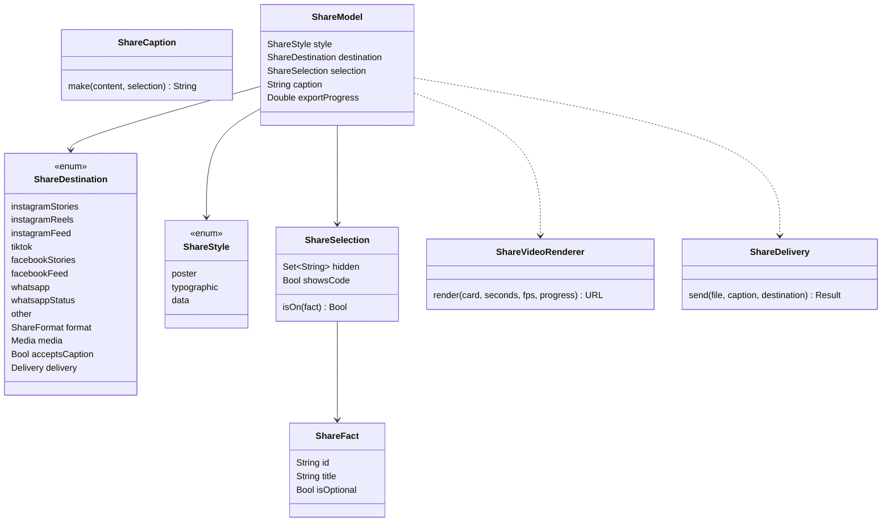

# Compartilhar como fluxo completo, por rede social

## Requirements

Hoje o compartilhar escolhe só o formato e a arte, exporta só um PNG, sem texto nem link, e tem um estilo só. O usuário pediu, em 31/10/2026, um fluxo completo em que a pessoa escolha de forma objetiva o que compartilha, com foco em Instagram, TikTok, Facebook e WhatsApp, estilos diferentes, vídeo, e "o importante é ser bonito e estilizado". Análise: [FSC-010](../analysis/FSC-010-202610312330-[Analysis]-share-flow.md). Pesquisa: [2026-10-31-social-sharing](../../docs/research/2026-10-31-social-sharing.md).

Decisões do usuário em 31/10/2026:
- **Meta:** criar o App ID da Meta e usar o envio direto aos Stories.
- **TikTok:** salvar no Fotos e abrir o TikTok, sem SDK nesta fase.
- **Animação:** MP4 animado agora.

Definição de pronto:

- **Given** a pessoa abre Compartilhar num perfil **When** a tela aparece **Then** ela vê, sem rolar, num iPhone de tela comum:
  - o carrossel dos estilos, com o cartão escolhido no centro e os vizinhos aparecendo nas bordas;
  - "Onde postar", com as redes e, abaixo, os lugares da rede escolhida;
  - "O que entra", com um chip marcado por fato;
  - no Pôster, um trilho "Arte" com as miniaturas das obras, em que um toque troca a arte do cartão;
  - só as ferramentas que valem para a escolha: "Vídeo animado" em destino de vídeo ou imagem e "Legenda" em destino com texto, esta numa folha;
  - embaixo, um botão com o nome do destino escolhido (por exemplo, "Postar no Instagram Stories").
  - Em tela larga (iPad, Mac, Duo aberto), o cartão fica à esquerda e os controles à direita. Com fonte de acessibilidade, a tela inteira rola em vez de cortar.
  - Prova: capturas em `docs/evidence/FSC-010/`.
- **Given** "O que entra" num perfil de deputada com 4 métricas **When** a pessoa desliga "Presença" e o QR **Then** a prévia e o arquivo saem sem a presença e sem o QR. A fonte, a data, "Fiscal" e o crédito da obra continuam e não podem ser desligados (`ShareSelectionTests.hidesOnlyOptionalFacts`).
- **Given** os estilos **When** a pessoa escolhe entre eles **Then** a prévia troca para:
  - **Pôster:** a arte inteira, sem nada por cima, e o texto num bloco sólido de ponta a ponta, com o crédito, como um cartão colecionável;
  - **Tipográfico (Folha de apuração):** um mosaico de blocos sólidos: quem é o assunto no topo, o número ou a frase principal em Bricolage grande sobre papel branco, um bloco por fato, a fonte e a marca dentro da zona segura, e as faixas de identidade embaixo;
  - **Dados:** um mosaico em que os blocos são os próprios dados, com o número principal no maior. Em Comparação e na Disputa de dois nomes, o Duelo: duas colunas de mesmo tamanho e peso, com o critério escrito.

  Os 8 assuntos desenham nos três estilos e nos três formatos sem cortar texto (`ShareStyleTests.everySubjectFitsEveryStyleAndFormat`).
- **Given** a pessoa abre Compartilhar **When** a tela aparece **Then** o estilo já escolhido é o Tipográfico, ou Dados em Comparação e Disputa, ou o Pôster nos assuntos que têm pôster próprio (vitória e investigação). O Pôster continua como opção, e a troca não perde a seleção (`ShareFlowModelTests.defaultStyleFollowsTheSubject`).
- **Given** "Onde postar" **When** a pessoa escolhe o destino **Then** o formato e a mídia seguem a tabela (`ShareDestinationTests.mapsEachDestination`):

  | Destino | Formato | Mídia | Texto |
  | --- | --- | --- | --- |
  | Instagram Stories | 9:16 | vídeo ou imagem | não |
  | Instagram Reels | 9:16 | vídeo | não |
  | Instagram Feed | 4:5 | imagem | sim |
  | TikTok | 9:16 | vídeo ou imagem | não |
  | Facebook Stories | 9:16 | vídeo ou imagem | não |
  | Facebook Feed | 4:5 | imagem | sim |
  | WhatsApp, conversa | 1:1 | imagem | sim |
  | WhatsApp Status | 9:16 | vídeo ou imagem | não |
  | Outros | 4:5 | imagem | sim |
- **Given** um cartão de um assunto com pessoa (usuário em 01/11/2026: "falta um refino no design, mas a cara do byescaleira, do projeto") **When** eles aparecem **Then** trazem a identidade do Fiscal, igual à do herói do perfil: o retrato desenhado, a marca do partido e o gradiente do partido. Na Comparação, cada lado tem a cor do próprio partido. Assunto sem pessoa fica no fundo escuro do placar e, na Folha, com a cor do tipo de assunto. A cor do partido é a mesma para todo mundo e nunca vem da Lente (`ShareFlowModelTests.theCardTakesThePartiesOfTheSubject`).
- **Given** um perfil com classificação entre colegas **When** o cartão ou a legenda são montados **Then** nenhum texto diz "Melhor que a média", "Pior que a média", "Mais ativo" ou "Menos ativo". No lugar vai o dado, como "Presença · Mediana da Câmara: 90%" (`ShareModelTests.theCardShowsTheMedianInsteadOfAVerdict`). A tela do perfil continua como está.
- **Given** um formato 9:16 **When** o cartaz é desenhado **Then** nenhum texto, número ou QR fica nos 14% de cima (90 de 640 pt), nos 35% de baixo (224 pt) nem nos 6% de cada lado (22 pt). Fundo e arte podem passar, e contam como arte as faixas de partido e os blocos proporcionais, que não trazem texto nem dado que não esteja também dentro da zona. Um número cortado nunca entra no cartão, porque pode ser lido como outro valor (`ShareSafeAreaTests.ninebysixteenKeepsTheSafeZone`).
- **Given** um destino de "vídeo ou imagem" **When** a pessoa vê "Onde postar" **Then** um interruptor "Vídeo animado", ligado por padrão, escolhe a mídia. Reels é sempre vídeo, e os destinos só de imagem não mostram o interruptor (`ShareFlowModelTests.theImageChoiceSkipsTheVideo`).
- **Given** um destino de vídeo e os estilos Tipográfico ou Dados **When** a pessoa toca em postar **Then**:
  - o app gera um MP4 H.264 de 4 s, 30 fps, 1080×1920, com menos de 50 MB;
  - todo texto e todo número aparecem certos desde o primeiro quadro, porque qualquer quadro pode virar capa ou ser pausado (`ShareStyleTests.everyFrameShowsTheRealNumbers`). O que se move são as barras e os blocos proporcionais enchendo;
  - aparece uma barra de progresso ("Preparando o vídeo"), e a geração pode ser cancelada.

  Prova: `ShareVideoTests.writesAFourSecondLoop`. No estilo Pôster, o que se move é uma aproximação lenta da arte.
- **Given** Reduzir movimento ligado **When** a prévia aparece **Then** ela fica parada no quadro final. O vídeo exportado continua animado, porque é para outra pessoa ver.
- **Given** o App ID da Meta no `Info.plist` (`FiscalMetaAppID`) e o Instagram instalado **When** a pessoa posta no Instagram Stories **Then** o app abre o Stories com o cartaz:
  - o cartaz vai como `backgroundImage` ou `backgroundVideo`, com as cores de topo e base tiradas do fundo do estilo (`ShareFlowModelTests.storyColorsFollowTheStyle`);
  - a pasteboard é escrita com expiração de 5 min.

  O Facebook Stories funciona igual, com as chaves `com.facebook.sharedSticker.*` e o `appID`. Prova: `ShareDeliveryTests.storiesWriteThePasteboardItems`, mais o roteiro no iPhone.
- **Given** o App ID vazio ou o app da rede não instalado **When** a pessoa posta nos Stories **Then** a folha do sistema abre com o arquivo, sem erro (`ShareDeliveryTests.fallsBackToTheShareSheet`).
- **Given** TikTok **When** a pessoa toca em postar **Then** o app pede o acesso de só adicionar ao Fotos, salva o arquivo, mostra "Salvo no Fotos. Abra o TikTok e escolha o vídeo." e abre o TikTok se ele estiver instalado. Sem permissão, o texto explica como liberar nos Ajustes. Prova: roteiro no iPhone.
- **Given** Instagram Feed, Facebook Feed, WhatsApp ou Outros **When** a pessoa posta **Then** a folha do sistema recebe o arquivo e a legenda.
- **Given** a legenda **When** a pessoa a vê e edita **Then** ela começa com o fato e traz a fonte, a data e o link `https://fiscal.byescaleira.com/?person=<slug>`, com no máximo 280 caracteres (`ShareCaptionTests.carriesFactSourceAndLink`). Ela nunca leva a Lente, apoio ou adjetivo.
- **Given** um link `https://fiscal.byescaleira.com/?person=<slug>` (e `vote`, `expenses`, `compare`, `place`, `race`, `highlight`) **When** ele é aberto num iPhone com o Fiscal **Then** o app abre no conteúdo, pelo Associated Domains com a AASA, que passa a aceitar esses parâmetros na raiz (`DeepLinkTests.siteLinksOpenTheContent`). `?place=` e `?highlight=` abrem a tela de compartilhar desse assunto, e `/link` abre o app em Hoje. Sem o app, o site abre. A AASA nova só passa a valer com o site publicado, o que espera o ok do usuário.
- **Given** a pessoa segue alguém pela primeira vez **When** volta à aba Seguindo **Then** aparece uma linha dispensável "Compartilhe quem você acompanha". Ela abre o assunto novo "Quem eu sigo", que mostra até 6 pessoas com nome, partido e cargo, em ordem alfabética. Nunca há contagem nem ranking (`ShareModelTests.followingCardListsUpToSixAlphabetically`).
- **Given** qualquer assunto e qualquer Lente **When** o cartaz e a legenda são montados **Then** nenhum texto traz a Lente ou quem a pessoa apoia, o "—" segue no lugar de dado ausente, e o arquivo se chama "Fiscal - <assunto>.png" ou ".mp4" (`ShareModelTests.theCardNeverCarriesWhoTheUserSupports`, já existente e ampliado aos estilos).
- **Given** o fluxo pronto **When** as imagens são redesenhadas (pedido do usuário em 01/11/2026: "vale revisitar as imagens para compartilhar também, esse processo de compartilhamento ele deve ser repensado com um todo") **Then** cada tipo de assunto (pessoa, votação, gastos, disputa, comparação, seguindo) tem composição própria com uma frase-gancho factual, saída de uma crítica honesta das imagens atuais e de um quadro de referências reais; 2 ou 3 direções visuais vão ao iPhone do usuário e a escolhida é a que ele aprovar (roteiro: capturas de cada direção em `docs/evidence/FSC-010/directions/`). Em 01/11/2026, as três direções (A Folha de apuração, B Faixas e blocos, C Duelo) foram ao iPhone, o usuário respondeu "ta ficando bom até" e a recomendação é A como padrão e C em Comparação e Disputa; a direção só vale como aprovada com o ok dele sobre os cartões prontos.
- **Erro:** falha ao gerar o vídeo cai na imagem, com o aviso "Não deu para gerar o vídeo; vai a imagem." Falha ao salvar no Fotos mostra o motivo. Nenhuma falha perde a seleção feita.

## Entities



- **`ShareDestination`** (novo, `FeatureShare`): o formato vem do `ShareFormat` do kit (`.stories` 9:16, `.feed` 4:5, `.message` 1:1). Tem também a mídia (`.image`, `.video`, `.either`), se aceita legenda e a entrega:
  - `.instagramStories` e `.facebookStories`: pasteboard;
  - `.photosThenOpen(URL)`: salvar no Fotos e abrir o app;
  - `.shareSheet`: folha do sistema.
- **`ShareStyle`** (novo): o `ShareCardView` desenha o pôster de hoje, e dois views novos desenham `ShareTypographicView` e `ShareDataView` a partir do mesmo `ShareCardContent`.
  - O conteúdo diz o estilo padrão do assunto, a frase-gancho e a cor do tipo de assunto, em funções puras.
  - O estilo diz as cores de fundo que vão aos Stories.
- **`ShareFact`** e **`ShareSelection`** (novos):
  - o `ShareCardContent` expõe os fatos opcionais de cada assunto: métricas do perfil, linhas de comparação, maior categoria de gastos, peso do destaque e QR;
  - a seleção guarda os ids desligados;
  - a fonte, a data, "Fiscal" e o crédito não são `ShareFact`, e por isso não desligam.
- **`ShareCaption`** (novo, função pura): monta a legenda com no máximo 280 caracteres.
- **`ShareVideoRenderer`** (novo):
  - desenha os quadros com o `ImageRenderer` sobre o mesmo view, com `\.shareProgress` de 0 a 1;
  - grava com `AVAssetWriter` (H.264, 30 fps, 4 s, 1080×1920, até 8 Mbps), usando o pool do `AVAssetWriterInputPixelBufferAdaptor`;
  - escreve num arquivo temporário e só entrega depois do `finishWriting`.
- **`ShareDelivery`** (novo, iOS):
  - escreve a pasteboard dos Stories com `UIPasteboard.setItems(_:options:)` e expiração de 300 s, e abre `instagram-stories://share?source_application=<id>` ou `facebook-stories://share`;
  - salva no Fotos com `PHPhotoLibrary`, só adição;
  - devolve o que fez, para a tela dizer.
- **`ShareSubject.following`** (novo caso): a lista de até 6 pessoas seguidas vem do `FollowController`.

## Approach

1. **Estratégia:**
   - A `ShareScreen` vira um estúdio: o cartão é o centro da tela, os controles ficam abaixo sem rolagem e o botão de postar fica fixo embaixo.
   - Todo estilo desenha o mesmo `ShareCardContent` filtrado pela `ShareSelection`.
   - O destino decide formato, mídia e entrega.
   - O vídeo nasce dos mesmos views, animados por um progresso.
2. **Decisões:**
   - **Estúdio em vez de formulário** (crítica da primeira versão, usuário em 01/11/2026: "a layout e design para configurar o compartilhamento ainda não está muito legal"):
     - a lista de interruptores parecia Ajustes, e não um editor;
     - a prévia ocupava metade da tela, e chegar a "Onde postar" levava quatro rolagens, embora o destino decida o formato;
     - as miniaturas de estilo repetiam a prévia;
     - agora o próprio cartão escolhe o estilo, num carrossel. Destino e fatos viram trilhos de toque único, e Arte e Legenda só aparecem quando valem, numa folha. Referência: o cartão de letras do Spotify, com a prévia, a troca de visual tocando nela e os apps de destino na mesma tela ([quadro](../../docs/research/2026-11-01-share-card-references.md)).
     - A pessoa vê tudo e muda em qualquer ordem, sem assistente de páginas e sem `Picker` segmentado.
   - **Destinos agrupados por rede:** Instagram (Stories, Reels, Feed), TikTok, Facebook (Stories, Feed), WhatsApp (conversa, Status) e Outros.
     - O ícone de cada rede é um símbolo SF genérico (câmera, play, pessoas, balão), sem logo de terceiros.
     - O nome da rede vai escrito.
     - Logo de marca exige licença, e por isso não entra.
   - **Meta:**
     - o App ID entra pelo `Info.plist` (`FiscalMetaAppID`, vazio no repositório até o usuário criar o app);
     - `instagram-stories` e `facebook-stories` entram em `LSApplicationQueriesSchemes`;
     - sem App ID, a entrega é a folha do sistema;
     - nada do SDK da Meta entra no app.
   - **TikTok sem SDK:** a mídia é salva no Fotos (`NSPhotoLibraryAddUsageDescription`: "O Fiscal salva no Fotos o cartão que você quer postar."), e o app abre o TikTok pelo esquema registrado. A existência do esquema é conferida com `canOpenURL` na QA; sem ele, só o aviso.
   - **Vídeo:**
     - 4 s, para ficar dentro dos 3 a 6 s da pesquisa e do mínimo de 3 s do Reels;
     - os números não contam: um quadro parado no meio mostraria um valor falso (a miniatura do sistema mostrou 75,3% num valor de 85,7%), e por isso só barras, fio e arte se movem, com a curva do `MotionBudget`;
     - os quadros saem do `ImageRenderer` (só views do SwiftUI, sem retrato Lottie em movimento, com `portraitsStill`);
     - a geração roda fora da main thread, mas o `ImageRenderer` exige a main, então os quadros saem em lotes com `Task.yield`.
   - **Links:**
     - o app ganha o entitlement `com.apple.developer.associated-domains` com `applinks:fiscal.byescaleira.com`;
     - `site/.well-known/apple-app-site-association` passa a ter `components` para `/` com `?person=*` e os outros parâmetros, além de `/link`;
     - o `DeepLink` passa a aceitar `https://fiscal.byescaleira.com/?…` e cair no mesmo destino que `fiscal://`;
     - a página por pessoa com imagem própria fica na fase 5;
     - publicar a AASA espera o ok do usuário.
   - **Incentivo:**
     - uma linha dispensável na aba Seguindo depois do primeiro seguir, guardada em `fiscal.share.followingInviteDismissed`;
     - sem push, sem contagem e sem pedido repetido.
   - **Direção visual (A + C, recomendada):**
     - Folha é o padrão porque lê em 1 segundo e não sugere juízo; Duelo fica em Comparação e Disputa porque só ali há dois lados de verdade;
     - da direção B fica só a ideia das faixas proporcionais, no movimento das barras do vídeo;
     - a cor do tipo de assunto identifica o assunto e nunca diz bom ou ruim. A cor de partido só entra como identidade da pessoa, como no resto do app;
     - a faixa inferior da Folha e o × do Duelo ocupam a zona dos botões, para ela não ficar vazia.
   - **Identidade (refino de 01/11/2026):**
     - crítica: os cartões e o estúdio estavam corretos, mas genéricos, sem o retrato, a marca e o gradiente que identificam o Fiscal; as redes eram blocos cinzas iguais, os títulos das seções sumiam, e a barra de postar era uma faixa cinza;
     - o carrossel fica direto sobre o fundo da tela, com o cartão escolhido maior. Alternativa descartada: um palco com o gradiente do partido atrás do carrossel, como no Apple Invites (usuário em 01/11/2026: "esse background atrás do carrossel ficou ruim");
     - a arte do Pôster fica à vista num trilho de miniaturas. Alternativa descartada: o botão "Arte" abrindo uma folha, que ficava escondido no fim do trilho (usuário: "precisa se apresentar de uma forma mais clara");
     - as redes viram círculos com o `SymbolBadge`, como a fileira da folha do sistema, e os lugares e fatos usam a cápsula `.bordered` do kit (a mesma do `ChoicePills`);
     - os títulos das seções passam à Bricolage, e o botão de postar fica numa barra de vidro (`safeAreaBar`);
     - o Dados de uma pessoa é um placar sobre o gradiente do partido, e o Duelo coloca os dois retratos sobre as duas cores;
     - a frase "A e B" sai do Duelo de Comparação, porque os nomes já estão nos lados.
   - **Distribuição (usuário em 01/11/2026: "ficam uns espaços vazios feios"):**
     - o cartão inteiro é um mosaico de blocos sólidos, de ponta a ponta, com um dado por bloco, a partir de referências vistas em imagem: o Strava Year in Sport (Manual) e os cartões do Spotify Wrapped 2025;
     - a área livre da zona segura leva as faixas do partido (a marca da casa), ou os blocos proporcionais da votação e da disputa, ou a cor do assunto;
     - Pôster: a arte fica inteira e sem véu, e o texto vai para um bloco sólido, como o cartão colecionável do Wrapped;
     - alternativas descartadas ("parece que piorou"): o número-herói gigante e cortado na faixa ("pode passar alguma informação errada"); o retrato gigante na faixa; os blocos translúcidos em Dados; o painel escuro flutuante no Pôster.
   - **Classificação no cartão:** a faixa "Melhor" ou "Pior que a média" fica só no perfil, onde vem com o critério. O cartão sai do contexto do app, então leva a mediana (`medianText`).
   - **Mídia:** "Vídeo animado" é uma ferramenta de ligar e desligar, separada dos lugares, porque não troca o destino.
   - **Nome do arquivo:** "Fiscal - <assunto>", com o nome da pessoa, o número da votação ou o título, sem barras.
   - **ADR:**
     - [ADR 0020](../../docs/adr/0020-share-to-social-networks.md) (Proposto) registra a integração com Meta e TikTok sem SDK, o App ID no `Info.plist` e a regra de não usar logos de terceiros;
     - ela vira Aceito com o ok deste canvas.
3. **Referências:**
   - a pesquisa de 31/10/2026, com as Meta Sharing to Stories e Reels, o TikTok Share Kit e o WhatsApp Link Previews;
   - Spotify Wrapped (cartões 9:16 por slide), Strava (sticker de dados) e Apple Music (escolher o trecho antes);
   - o canvas [FSC-005](FSC-005-202610291700-[Codify]-share-cards-and-art.md) para o pôster, a arte e os créditos;
   - Apple Invites, capturas da App Store: o carrossel de cartões com o escolhido maior, e os rostos em círculo.

## Structure

```text
FiscalKit/
  Sources/FeatureCore/Navigation/ShareSubject.swift            caso .following
  Sources/FeatureShare/ShareDestination.swift                  (novo) destinos, formato, mídia, entrega
  Sources/FeatureShare/ShareStyle.swift                        (novo) estilos
  Sources/FeatureShare/ShareSelection.swift                    (novo) fatos opcionais e seleção
  Sources/FeatureShare/ShareCaption.swift                      (novo) legenda
  Sources/FeatureShare/ShareTypographicView.swift              (novo) estilo Tipográfico
  Sources/FeatureShare/ShareDataView.swift                     (novo) estilo Dados
  Sources/FeatureShare/ShareMotion.swift                       (novo) \.shareProgress e contagem
  Sources/FeatureShare/ShareVideoRenderer.swift                (novo) MP4 com AVAssetWriter
  Sources/FeatureShare/ShareDelivery.swift                     (novo, iOS) pasteboard, Fotos, folha
  Sources/FeatureShare/ShareCardContent.swift, ShareCardBuilder*.swift   fatos opcionais, assunto seguindo
  Sources/FeatureShare/ShareCardView.swift, SharePoster*.swift zona segura 9:16 e seleção
  Sources/FeatureShare/ShareModel.swift                        estilo, destino, seleção, legenda, exportação
  Sources/FeatureShare/ShareScreen.swift                       estúdio: carrossel, controles e botão de postar
  Sources/FeatureShare/ShareScreenSections.swift               trilhos de destino e fatos, ferramentas e folhas
  Sources/FeatureShare/ShareRenderer.swift                     nome do arquivo por assunto
  Sources/FeatureMine/MineFollowing.swift                      convite "Compartilhe quem você acompanha"
  Sources/AppShell/DeepLink.swift                              links https do site
  Tests/FeatureShareTests/ShareDestinationTests.swift          (novo)
  Tests/FeatureShareTests/ShareSelectionTests.swift            (novo)
  Tests/FeatureShareTests/ShareStyleTests.swift                (novo) matriz assunto × estilo × formato
  Tests/FeatureShareTests/ShareSafeAreaTests.swift             (novo)
  Tests/FeatureShareTests/ShareCaptionTests.swift              (novo)
  Tests/FeatureShareTests/ShareVideoTests.swift                (novo)
  Tests/FeatureShareTests/ShareDeliveryTests.swift             (novo)
  Tests/FeatureShareTests/ShareModelTests.swift                estilos, seguindo, nome do arquivo
  Tests/AppShellTests/DeepLinkTests.swift                      links https
Fiscal/Fiscal/Info.plist                                       FiscalMetaAppID, LSApplicationQueriesSchemes, NSPhotoLibraryAddUsageDescription
Fiscal/Fiscal/Fiscal.entitlements                              applinks:fiscal.byescaleira.com
site/.well-known/apple-app-site-association                    components com os parâmetros
docs/adr/0020-share-to-social-networks.md                      (novo, Proposto)
Fiscal/Fiscal/Localizable.xcstrings                            textos em pt-BR
docs/evidence/FSC-010/, CHANGELOG.md, docs/roadmap.md, spdd/README.md
```

## Operations

1. **Conteúdo e seleção:**
   - `ShareFact`, `ShareSelection` e os fatos opcionais por assunto;
   - o assunto `.following`;
   - o nome do arquivo por assunto.
   - Verificação: `ShareSelectionTests` e `ShareModelTests`.
2. **Destinos e legenda.** `[P]` com 1.
   - `ShareDestination` com a tabela da definição de pronto.
   - `ShareCaption`.
   - Verificação: `ShareDestinationTests` e `ShareCaptionTests`.
3. **Estilos e zona segura.** Depende de: 1.
   - `ShareStyle`, `ShareTypographicView` e `ShareDataView`.
   - A zona segura no 9:16 dos três estilos.
   - O `ShareCardView` respeitando a seleção.
   - Verificação: `ShareStyleTests` e `ShareSafeAreaTests`.
4. **Movimento e vídeo.** Depende de: 3.
   - `\.shareProgress`, a contagem e as barras.
   - `ShareVideoRenderer`, com progresso e cancelamento.
   - Verificação: `ShareVideoTests` (arquivo de 4 s, 120 quadros, H.264, menos de 50 MB).
5. **Entrega.** Depende de: 2.
   - `ShareDelivery`: pasteboard dos Stories, Fotos e TikTok, e a folha do sistema como alternativa.
   - `Info.plist` e esquemas.
   - Verificação: `ShareDeliveryTests`, com a pasteboard e o abridor injetados.
6. **Tela.** Depende de: 1 a 5.
   - `ShareScreen` com a prévia, os controles, a legenda editável e o botão de postar com progresso.
   - O `ShareModel` amarra tudo.
   - Verificação: `scripts/verify.sh --quick ios`.
7. **Links e incentivo.** `[P]` com 6.
   - Associated Domains, a AASA e o `DeepLink` com https.
   - O convite na aba Seguindo.
   - O ADR 0020.
   - Verificação: `DeepLinkTests` e build.
8. **Textos.** Depende de: 6 e 7.
   - Chaves em pt-BR.
   - Verificação: `scripts/strings.sh`.
8.1. **Redesenho das imagens** (prompt-update de 01/11/2026). Depende de: 3 e 6.
    - Crítica das imagens atuais e quadro de referências (Spotify Wrapped, resumos do Apple Fitness, Strava, The Pudding, NYT Upshot) em `docs/research/`.
    - Composição por tipo de assunto, com frase-gancho factual no topo, menos elementos por cartaz e a arte a serviço do dado.
    - 2 ou 3 direções no iPhone do usuário; iterar até o ok; a direção aprovada substitui o desenho dos estilos.
    - Direção A + C: `ShareTypographicView` vira a Folha, `ShareDataView` ganha o Duelo em Comparação e Disputa, e o `ShareModel` abre no estilo padrão do assunto.
    - As cores dos Stories passam a sair do fundo do estilo.
    - O `ShareSafeAreaTests` passa a medir cada linha contra o próprio fundo, por causa da faixa, e desliga a arte para achar texto fora da zona.
    - Verificação: `ShareStyleTests` (matriz), `ShareSafeAreaTests`, `ShareFlowModelTests.defaultStyleFollowsTheSubject`, `ShareFlowModelTests.storyColorsFollowTheStyle` e capturas por direção.
8.2. **Estúdio de compartilhar** (prompt-update de 01/11/2026). Depende de: 6 e 8.1.
    - O carrossel dos estilos com os cartões de verdade.
    - Os trilhos "Onde postar" e "O que entra", o trilho de Arte no Pôster, as ferramentas por contexto, a folha de Legenda e o layout de tela larga.
    - Os números parados em todo quadro do vídeo e a mediana no lugar da classificação.
    - A identidade do Fiscal nos cartões: retrato, marca e gradiente do partido.
    - Verificação: `ShareStyleTests.everyFrameShowsTheRealNumbers`, `ShareModelTests.theCardShowsTheMedianInsteadOfAVerdict`, capturas no simulador e no iPhone, iterando até o ok do usuário.
9. **Rodar e QA.** Depende de: 1 a 8.2.
   - `scripts/verify.sh --full`.
   - Build no iPhone do usuário.
   - Roteiros em `docs/evidence/FSC-010/qa.md`:
     - o estúdio;
     - desligar fatos;
     - os três estilos;
     - o 9:16 com a zona segura;
     - gerar o vídeo;
     - Stories direto (com o App ID do usuário);
     - TikTok pelo Fotos;
     - WhatsApp com a legenda;
     - o link do site abrindo o app (depois da AASA publicada);
     - o convite.
10. **Revisão e PR.** Depende de: 9.
    - Revisores de spec, design, acessibilidade, código e segurança (pasteboard, Fotos, entitlements).
    - Correções num commit.
    - CHANGELOG, roadmap e `spdd/README.md`.
    - PR para a `development`, com o merge pedido ao usuário.

## Norms

- **Regra 3:** formato, mídia, seleção e legenda são decididos no model e em tipos puros; a view só desenha.
- **Regra 4:**
  - zero comentários e zero avisos;
  - Swift Testing nos tipos novos;
  - `.timeLimit` no teste do vídeo;
  - tokens para medidas (zona segura como tokens novos `.shareSafeTop`, `.shareSafeBottom`, `.shareSafeSide`).
- **Regra 5:**
  - Bricolage só no número e no título de destaque;
  - o carrossel dos cartões para o estilo e trilhos de toque único para destino e fatos;
  - nada de `Picker` segmentado;
  - cápsulas de texto curto com `lineLimit(1).fixedSize()` (memória "no-mid-word-wrap");
  - Reduzir movimento respeitado na prévia.
- **Regra 6:** pt-BR; a legenda curta, só com fatos.
- **Fatos só:** o cartaz e a legenda trazem fonte e data; nada de adjetivo, opinião ou ranking.
- **ADR 0017:** a lista de seguidos só sai do aparelho quando a própria pessoa compartilha o cartaz "Quem eu sigo".
- **ADR 0003:** só pt-BR.

## Safeguards

- **Funcional:**
  - fonte, data, "Fiscal" e crédito da obra presentes em todo estilo, formato e mídia;
  - "—" no lugar de dado ausente;
  - Lente e apoio nunca no cartaz nem na legenda;
  - as falhas de vídeo e de Fotos não perdem a seleção;
  - a cor nunca indica juízo, a cor de partido é só identidade da pessoa e não muda com a Lente, e os dois lados do Duelo têm o mesmo tamanho e peso.
- **Desempenho:**
  - vídeo de 4 s, 120 quadros em 1080×1920, até 8 Mbps e menos de 50 MB;
  - geração cancelável, com progresso;
  - a prévia não gera vídeo.
- **Privacidade e segurança:**
  - a pasteboard dos Stories expira em 300 s e só leva o cartaz e as cores;
  - o Fotos é pedido com permissão de só adicionar;
  - nenhum SDK de terceiros;
  - o App ID da Meta é público (não é segredo) e fica no `Info.plist`;
  - nenhum rastreio de compartilhamento.
- **Compatibilidade:**
  - os links impressos (`?person=` e os outros) não mudam;
  - `fiscal://` continua;
  - os ids de coleção de arte e os nomes de imageset não mudam.
- **QUEBRA:**
  - o nome do arquivo deixa de ser "Fiscal.png" e passa a ser "Fiscal - <assunto>";
  - os seletores "Stories / Feed / Mensagem" viram destinos;
  - o cartão deixa de trazer a classificação entre colegas, que passa a ser a mediana;
  - entram o Associated Domains, a permissão de adicionar ao Fotos e os esquemas de outros apps.
- **Fora do escopo:**
  - SDK da Meta e do TikTok;
  - página por pessoa com imagem própria e cartão do WhatsApp por pessoa (fase 5);
  - GIF;
  - Live Photos;
  - logos de terceiros;
  - contagem de compartilhamentos;
  - publicar o site (espera o ok);
  - novas obras de arte.
