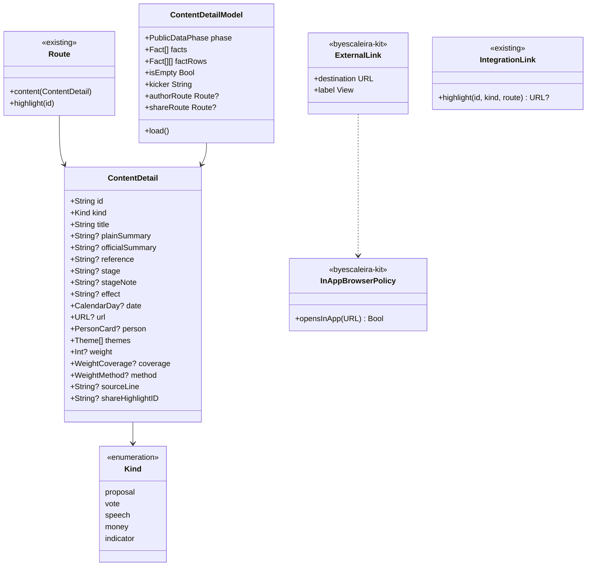

# Refinos: conteúdo com tela própria, links dentro do app, Quem governa e gráficos

Primeira das quatro fases da [análise FSC-011](../analysis/FSC-011-202611011850-[Analysis]-feed-profile-and-end-of-lens.md). As outras três (fim da Lente, Feed e página do político) têm canvas próprio.

## Requirements

**Problema.** Tocar num conteúdo leva à pessoa em vez de levar ao conteúdo. Links saem do app sem aviso. Um cartão e dois gráficos têm defeitos visuais.

**Definição de pronto:**

**Link dentro do app**

1. Dado um iPhone com o Fiscal aberto, quando a pessoa toca em "Abrir a página oficial" numa URL `https://www.camara.leg.br/...`, então a página abre em `SFSafariViewController` sobre o app, e fechar volta à mesma tela.
2. Dada uma folha aberta, como Ajustes em sheet, quando a pessoa toca num link externo, então o navegador abre por cima da folha, sem erro de apresentação.
3. Dado um link `https://apps.apple.com/...`, quando a pessoa toca nele, então abre a App Store.
4. Dado um link `mailto:` ou de outro esquema que não seja `http` ou `https`, quando a pessoa toca nele, então o sistema trata e o app não cai.
5. Dado o Mac, quando a pessoa toca num link externo, então abre o navegador do sistema.
6. Dado qualquer link externo do app, quando a pessoa o vê, então ele mostra o ícone `arrow.up.right` depois do rótulo.
7. Dado um `Link(destination:` escrito numa feature, quando o lint roda, então ele falha e aponta o `ExternalLink`.
8. Dado o VoiceOver num link externo, quando o foco chega nele, então lê o rótulo, o traço de link e a dica "Abre no navegador"; a seta não é lida.

**Conteúdo com tela própria**

9. Dado um destaque do tipo proposta em "Destaque do momento", quando a pessoa toca no cartão, então abre a tela de conteúdo com o texto simples como manchete, o texto oficial recolhível, etapa, data e fonte; tocar no autor abre o perfil.
10. Dado um item de proposta em "Na sua região agora", quando a pessoa toca no cartão, então abre a mesma tela de conteúdo.
11. Dada uma proposta no perfil, quando a pessoa toca na linha, então abre a tela de conteúdo com o resumo simples, o resumo oficial e o botão da fonte, sem mostrar de novo o botão do autor.
12. Dada uma ação do perfil que não é voto, quando a pessoa toca nela, então abre a tela de conteúdo em vez de sair para o navegador.
13. Dado um destaque do tipo voto, quando a pessoa toca nele, então abre a votação, como hoje.
14. Dado um destaque de dinheiro ou indicador, hoje sem destino, quando a pessoa toca nele, então abre a tela de conteúdo.
15. Dado um conteúdo sem etapa, sem data, sem resumo simples ou sem URL, quando a tela abre, então a linha que falta não aparece, sem traço nem espaço vazio.
16. Dado um conteúdo de "Destaque do momento", quando a tela abre, então a barra tem Compartilhar, que abre o estúdio do destaque; um conteúdo vindo da região ou do perfil não tem esse botão nesta fase.
17. Dado o widget de destaque com uma proposta, quando a pessoa toca nele, então abre `fiscal://highlight/<id>` e a tela de conteúdo, carregada de `highlights.json`.
18. Dado um `<id>` que saiu de `highlights.json`, quando o link abre, então a tela explica que esse destaque saiu da lista, sem erro técnico; sem rede, mostra o erro de rede padrão com "Tentar de novo".

**Quem governa**

19. Dado um cartão de "Quem governa" sem vice e sem eleitos abaixo, quando ele aparece no carrossel ao lado de um cartão mais alto, então retrato, nome e cargo ficam centrados na vertical abaixo do chip, com sobra igual em cima e embaixo.
20. Dado um cartão com vice, quando ele aparece, então fica como hoje.

**Gráficos**

21. Dado "Quanto custa um mandato", quando o gráfico aparece, então o nome do cargo fica nitidamente afastado da barra de cima, sem encostar nela; a distância entre a última barra e a legenda é de um `.spaceS` mais a folga natural da linha da barra; e a legenda quebra em várias linhas sem cortar texto.
22. Dado "Teto da cota por estado", quando o gráfico aparece, então não há siglas no eixo horizontal; tocar numa barra mostra o estado e o valor, e o VoiceOver lê cada estado.

## Entities

`ContentDetail` vem de um `Highlight`, de um `ActionItem` ou de uma `Proposal`, sem novo campo no servidor. Nada muda em `Highlight`, `ActionItem`, `Proposal`, `WeightMethod` ou nos arquivos publicados.

## Approach

- **Duas peças no kit.** O `AGENTS.md` manda peça genérica para o `byescaleira-kit`. Entram lá o `ExternalLink`, a política `InAppBrowserPolicy` e o modificador `.inAppBrowser()`, numa versão `0.8.0`.
- **Interceptar no ambiente.** `.inAppBrowser()` troca o `\.openURL` na raiz de cada cena. Assim todo `Link` e todo `openURL` passam pela política, inclusive o `GuideLink` do kit e as telas de atualização. O `ExternalLink` cuida do ícone, e o lint impede um `Link` solto.
- **Apresentar pelo topo.** O modificador guarda uma âncora invisível da janela e apresenta sobre o controlador mais alto dessa janela, o que resolve as folhas abertas sem um `.sheet` por tela.
- **Política.** Só `http` e `https` abrem dentro do app, porque `SFSafariViewController` recusa outro esquema. `apps.apple.com` e `itunes.apple.com` vão à loja. O Mac não tem esse controlador, então o modificador não faz nada lá.
- **visionOS.** O SDK declara `SFSafariViewController`, e a análise foi corrigida nesse ponto. O build do visionOS comprova.
- **Fora da interceptação.** O `ShareDelivery` usa `UIApplication.shared.open` para abrir Instagram e TikTok, o que continua. Os `Link` dos widgets levam a `fiscal://` e também continuam.
- **Rota com o conteúdo dentro.** `Route.content(ContentDetail)` carrega o dado, como `.roster` já faz, porque não existe `proposals/{id}.json` e os destaques regionais não estão em `highlights.json`. O dado já carregado evita um pedido a mais.
- **`Route.highlight(id:)`.** Serve só ao link do widget, que não pode carregar o conteúdo. Consulta `highlights.json` e trata o id que expirou.
- **Regra única do destino.** `route(for:)` existe igual em `TodayModel` e `MineModel`. Vira um só `Route.destination(for:method:sourceLine:isShareable:)` no `FeatureCore`: voto vai à votação, todo o resto vai ao conteúdo. O campo `route` do servidor segue como está, e o cliente deixa de ler `route` como slug. Sem deploy.
- **Sem autor repetido.** Vindo do perfil, `person` fica vazio, porque voltar já leva ao perfil. Vindo de Hoje, da região ou do widget, o autor é um botão à parte.
- **Compartilhar só onde já funciona.** `.highlight(id:)` só acha o que está em `highlights.json`, então só Hoje preenche `shareHighlightID`. Compartilhar uma proposta específica entra na `FSC-014`.
- **Sem tramitação.** A etapa vem de `method.stages`, com rótulo e nota. Não existe histórico, e a tela não finge um.
- **Manchete simples.** Nos dados reais, `Highlight.title` é o texto oficial, às vezes enorme, e o cartão de Hoje já mostra `plainSummary`. A manchete da tela é `plainSummary ?? title`; o oficial fica recolhível quando difere. Dinheiro e indicador usam `subtitle` como resumo. Campo igual ao título ou vazio vira ausente.
- **Efeito da proposta.** A proposta do perfil não tem etapa publicada; tem `canBecomeLaw`. "Pode virar lei" vai para um bloco próprio, "Efeito", e nunca para "Estágio".
- **Blocos de fatos.** Etapa, efeito, referência, peso e data, em pares; um bloco sozinho ocupa a linha inteira, para não deixar buraco. O tipo aparece em cima da manchete, e a barra não repete o título no iPhone.
- **Target novo.** `FeatureContent` com modelo e tela, seguindo "um target por feature".
- **Legenda própria no gráfico do mandato.** A legenda do Swift Charts divide a mesma altura fixa da área do gráfico, e a altura atual soma uma linha inteira a mais, a causa provável do espaço estranho. A legenda sai do Chart e vira uma linha abaixo, em `FlowLayout`, com distância em token; a altura do gráfico passa a contar só as barras. A captura confirma a causa.
- **Cartão sem companhia.** Com `vice` vazio e `elected` vazio, o cartão ganha um `Spacer` acima do titular, além do que já existe abaixo.
- **Design da tela nova.** Regra do projeto: antes de desenhar, ver 2 ou 3 referências reais de leitura de notícia e de app cívico em imagens do App Store, e iterar no iPhone até o ok explícito. Os outros itens seguem o visual atual.
- **Primeira aba, Lente e perfil.** Não mudam aqui. A ordem por Lente em `orderedHighlights` fica até a `FSC-012`.
- **ADR.** Nenhum: sem decisão nova de arquitetura, dados ou plataforma.

## Structure

**`byescaleira-kit`, branch `feature/external-link`:**
- `Sources/ByescaleiraUI/Links/ExternalLink.swift`, novo.
- `Sources/ByescaleiraUI/Links/InAppBrowser.swift`, novo, com a política, o modificador e a âncora.
- `Sources/ByescaleiraUI/Guide/GuideSteps.swift`: `GuideLink` com o ícone.
- `Sources/ByescaleiraFoundation/Resources/Localizable.xcstrings`: a dica.
- `Tests/`: testes da política.
- `CHANGELOG.md`: `0.8.0`.

**Fiscal:**
- `FiscalKit/Package.swift`: kit `from: "0.8.0"` e target `FeatureContent`.
- `Fiscal/Fiscal/FiscalApp.swift`: `.inAppBrowser()` nas duas cenas com conteúdo.
- `.swiftlint.yml`: regra `external_link_component`.
- `ExternalLink` em:
  - `ArtistsScreen`, `MandateSections`, `ExpenseRows`, `PeriodScreen`, `ProfileActivitySections` e `ProfileExpenses`;
  - `VotesAgendaSection`, `InvestigationVisuals`, `InvestigationConclusion`, `MineFollowing`;
  - `SettingsScreen`, `AboutSections`, `SourcesScreen`.
- `FeatureSettings/SettingsRow.swift`: sai `SettingsExternalLabel`, porque o ícone agora vem do `ExternalLink`.
- `FiscalDomain/PublicData/ContentDetail.swift`, novo, com os inicializadores por `Highlight`, `ActionItem` e `Proposal`.
- `FiscalDomain/Integrations/VoteBoard.swift`, `HighlightBoard.swift`: `IntegrationLink.highlight(id:kind:route:)`.
- `FeatureCore/Navigation/Route.swift`: `.content`, `.highlight` e o destino único.
- `FeatureContent/ContentDetailModel.swift` e `ContentDetailScreen.swift`, novos, sem token próprio.
- `Fiscal.xcworkspace/.../FiscalKitTests.xcscheme`: `FeatureContentTests`; `Package.resolved` do pacote e do workspace com o kit `0.8.0`.
- `AppShell/RouteScreen.swift`, `AppShell/DeepLink.swift`.
- `FeatureToday/TodayModel+Highlights.swift`, `TodayHighlightHero.swift`, `TodayHighlightSection.swift`.
- `FeatureMine/MineModel+Region.swift`, `MineNow.swift`, `MineGovernment.swift`, `MineRegion.swift` (`standsAlone`).
- `FeatureProfile/ProfileActionsSection.swift`, `ProfileModel+Actions.swift`, `ProfileModel+Activity.swift`, `ProfileActivitySections.swift`.
- `FeatureMoney/MandateCharts.swift`, com a legenda nova e `MandateText.kindColor`; `FiscalDesignSystem/Tokens/MoneyChartTokens.swift`, com `mandateRowHeight`.
- `Fiscal/FiscalUITests/LinkAccessibilityTests.swift`, novo, e `XCUIApplication+Fiscal.swift`, sem o setup da Lente.
- `Localizable.xcstrings`, `CHANGELOG.md`, `docs/backlog.md`, `docs/roadmap.md`, `spdd/README.md`, `docs/evidence/FSC-011/qa.md`.
- Testes: `ContentDetailTests`, `ContentDetailModelTests` (com o destino único), `DeepLinkTests`, `MineFollowingTests`, `TodayModelTests` e `ProfileModelTests`.

## Operations

1. **Peças no kit.**
   - `InAppBrowserPolicy.opensInApp(_:)`: verdadeiro só para `http` e `https` fora dos hosts da loja.
   - `.inAppBrowser()`: troca o `\.openURL`, devolve `.handled` ao apresentar e `.systemAction` no resto; no Mac não faz nada.
   - `ExternalLink(destination:label:)` e `ExternalLink(_:destination:)`: rótulo, seta decorativa e dica.
   - `GuideLink` com a seta.
   - Abrir o PR no kit, com o `CHANGELOG`; o merge e a tag `v0.8.0` esperam o ok.
   - Cobre: 1 a 6, 8. Verificação: testes da política e `swift build` do kit.
2. **Adotar no Fiscal.** Depende de: 1.
   - Subir o kit para `0.8.0` e aplicar `.inAppBrowser()`.
   - Trocar os `Link(destination:` da lista de Structure, e tirar `SettingsExternalLabel` e os ícones `arrow.up.right.square`.
   - Acrescentar a regra do lint.
   - Cobre: 1 a 8. Verificação: `scripts/lint.sh`, `scripts/verify.sh --quick ios`, roteiro no simulador.
3. **Quem governa.** `[P]` com 2.
   - `MineSeat.standsAlone` e `Spacer` acima do titular nesse caso.
   - Cobre: 19, 20. Verificação: `MineFollowingTests`, captura com e sem vice.
4. **Gráficos.** `[P]` com 2.
   - `MandateStackChart`: `.chartLegend(.hidden)`, linha mais alta com o token `mandateRowHeight`, altura só das barras e legenda em `FlowLayout`, oculta do VoiceOver, porque cada barra já diz o item.
   - `QuotaStatesChart`: `.chartXAxis(.hidden)`, sem o caso de fonte grande.
   - Cobre: 21, 22. Verificação: captura no simulador; `FeatureMoneyTests`.
5. **`ContentDetail`.**
   - O tipo, os três inicializadores, a etapa resolvida por `method.stages` e a URL guardada só com `http` ou `https` e host.
   - `Kind` a partir de `Highlight.Kind` e `ActionItem.Kind`.
   - Cobre: 15. Verificação: `ContentDetailTests`, inclusive campos ausentes.
6. **Rotas.** Depende de: 5.
   - `Route.content`, `Route.highlight`, `Route.destination(for:method:sourceLine:isShareable:)`.
   - `IntegrationLink.highlight(id:kind:route:)` e `DeepLink` com o host `highlight`.
   - Cobre: 13, 14, 17. Verificação: `ContentDetailModelTests`, `ContentDetailTests`, `DeepLinkTests`.
7. **Tela de conteúdo.** Depende de: 2, 6.
   - Olhar as referências reais antes de desenhar.
   - `ContentDetailModel` com `PublicDataPhase`: carregado sem conteúdo é o destaque que saiu da lista; `authorRoute` e `shareRoute`.
   - `ContentDetailScreen`, em largura de leitura, com tipo e data, título, resumo simples, resumo oficial recolhível, etapa, temas, relevância com `WeightMethodButton`, autor, `ExternalLink` da fonte e rodapé da fonte.
   - Ligar em `RouteScreen`.
   - Cobre: 9, 15, 16, 18. Verificação: `ContentDetailModelTests`, captura, iPhone.
8. **Ligar os toques.** Depende de: 6, 7.
   - Today e Mine usam o destino único e perdem o `.disabled`.
   - `ProfileProposalRow` vira `RouteLink`, sem `DisclosureGroup` nem link; `ProfileActionLink` usa o conteúdo no lugar do `Link`.
   - Cobre: 9 a 14. Verificação: `TodayModelTests`, testes afetados de `FeatureMineTests` e `FeatureProfileTests`, roteiro.
9. **Fechamento.** Depende de: todas.
   - `scripts/strings.sh`, `CHANGELOG`, backlog, roadmap e índice.
   - QA em `docs/evidence/FSC-011/qa.md`, com captura de cada cenário visual.
   - `scripts/verify.sh --full`, revisão em uma rodada (`spec-reviewer`, interface, código e segurança, porque o diff mexe em rede e navegação), PR para a `development` e build no iPhone.
   - Verificação: tudo verde, ou a falha relatada como está.

## Norms

- Zero comentários, zero warnings, Swift Testing e tokens do design system em tudo que é número, cor e fonte.
- Textos com chave em inglês e tradução em pt-BR no catálogo; só fatos, sem opinião.
- Rótulos curtos nunca quebram no meio da palavra: `lineLimit(1)` com `fixedSize` nos chips.
- Dynamic Type até os tamanhos de acessibilidade, Reduzir movimento e VoiceOver em toda tela nova; alvo de toque de 44 pt.
- Layout adaptativo no iPhone, no iPad, no dobrável, no Mac e no visionOS.
- Toda tela testada no simulador antes de ir ao iPhone físico, e entrega com instalação no aparelho, dizendo o que foi entregue.
- Todo commit traz `Canvas: spdd/prompt/FSC-011-202611011855-[Feat]-navigation-links-charts-refinements.md`.
- A análise e o canvas entram no primeiro commit de código, junto com o estado `entregue` da `FSC-010`.
- Quando um comportamento mudar durante a geração, o canvas muda antes pelo `spdd-prompt-update`.

## Safeguards

- **Esquemas:** só `http` e `https` entram em `SFSafariViewController`. Outro esquema ali derruba o app, e há teste para isso.
- **Hosts da loja:** `apps.apple.com` e `itunes.apple.com` sempre abrem fora.
- **URL dos dados públicos:** na tela de conteúdo, a fonte só existe com `http` ou `https` e host; outro esquema vindo de uma fonte faz o botão sumir, sem abrir outro app.
- **Privacidade:** o navegador não passa dado ao app, sem `SFSafariViewControllerDelegate` que leia URL, sem parâmetro acrescentado à URL e sem rastreio.
- **Sem dado inventado:** campo ausente some da tela. Nada de traço, de "0" ou de etapa deduzida. Sem histórico de tramitação.
- **Sem servidor:** nenhuma mudança em `server/`, em `highlights.go` ou nos arquivos publicados; nenhum deploy.
- **Sem site:** nenhuma publicação.
- **Fora de escopo, QUEBRA se entrar:** primeira aba e Feed, remoção da Lente, nova página do político, novos casos de `ShareSubject`, web.
- **Kit:** merge na `main` do kit e tag `v0.8.0` só com o ok do usuário; o Fiscal não aponta para branch nem caminho local em commit.
- **Compatibilidade:** `fiscal://person/...` e `fiscal://vote/...` continuam funcionando, e o `?highlight=` do site continua abrindo o estúdio.
- **Lint:** a regra nova só alcança `Sources/Feature*` e `Sources/AppShell`; os widgets ficam fora, porque usam `Link` para `fiscal://`.
- **Mac:** a abertura de vários recibos em `ExpensesTable` continua com `openURL`, no navegador do sistema.
- **Merge:** na `development` só com o ok do usuário, com o PR e a revisão prontos.
