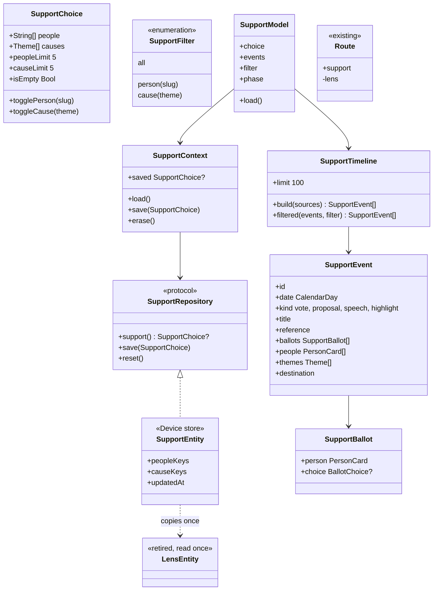

# Fim da Lente e a página "Meu apoio"

## Requirements

**Problema.** A Lente mistura escolha política, ordem das telas e visual, e abre um setup na primeira vez. O usuário quer acabar com ela e transformar o apoio numa página própria, privada e só com fatos.

**Definição de pronto:**

**Fim da Lente**

1. Dada uma instalação nova, quando o app abre, então cai direto na primeira aba, sem setup e sem pedir escolha política.
2. Dada uma pessoa que apoia a Pessoa A com a causa Saúde, e outra sem apoio nenhum, quando abrem Hoje, Votações, Dinheiro, Compare e Busca com os mesmos dados, então a ordem e os itens são iguais.
3. Dado qualquer idioma ou tela do app, quando se procura "lente", "Lente" ou "Por quem você apoia" no catálogo de textos e nas telas, então nada aparece.
4. Dada a tela de Aparência, quando a pessoa escolhe a cor de destaque, então vale essa cor em todo o app, porque nenhuma paleta passa por cima.
5. Dado o estúdio de compartilhar no Pôster, quando abre, então a galeria vem na ordem padrão, sem sugestão ligada a apoio.
6. Dado um link antigo `fiscal://lens`, quando abre, então cai em "Meu apoio".

**Meu apoio**

7. Dado o coração na barra de Hoje ou de Votações, ou a linha "Meu apoio" em Ajustes, quando a pessoa toca, então abre a página.
8. Dada a página sem escolha, quando abre, então explica em uma frase o que ela faz, diz que fica só neste aparelho e oferece "Escolher pessoas e causas".
9. Dado o editor, quando a pessoa busca e marca até 5 pessoas e até 5 causas, então a sexta opção fica desabilitada com o contador "5 de 5", sem mínimo, e cada pessoa marcada passa a ser seguida.
10. Dada a Pessoa A desmarcada no editor, quando salva, então ela sai do apoio e continua seguida.
11. Dadas as pessoas A e B e a causa Saúde, quando a página carrega, então a linha do tempo mostra, da data mais nova para a mais antiga, as ações, as propostas e os votos delas e as votações e os destaques marcados com Saúde.
12. Dada uma votação em que A votou Sim e B votou Não, quando aparece, então é uma linha só, com a votação e o voto de cada uma, sem dizer quem está certa, sem percentual e sem comparar as duas.
13. Dado o filtro da Pessoa A ou da causa Saúde, quando a pessoa toca nele, então a linha do tempo mostra só o que tem essa pessoa ou esse tema; sem resultado, explica o motivo em linguagem simples.
14. Dada uma pessoa apoiada cujo cargo não tem votos publicados, como governador, quando o filtro dela está ativo, então aparece o que existe e uma frase diz que a fonte não publica votos desse cargo.
15. Dada uma linha de voto, quando a pessoa toca, então abre a votação; numa linha de proposta, discurso ou destaque, abre a tela de conteúdo da `FSC-011`.
16. Dada mais atividade que o limite, quando a lista chega a 100 linhas, então termina e diz que mostra as 100 mais recentes.
17. Dada uma falha de rede, quando a página carrega, então mostra o que já tem, avisa o que faltou e oferece "Tentar de novo"; sem nada, usa o erro de rede padrão.
18. Dado "Apagar meu apoio", quando a pessoa confirma, então pessoas e causas somem e os seguidos ficam, como a confirmação avisa; cancelar não muda nada.
19. Dado o Dynamic Type nos tamanhos de acessibilidade, o VoiceOver e o Reduzir movimento, quando a página abre, então nada corta, cada linha lê data, tipo, fato e votos, e o bonequinho fica parado com o Reduzir movimento.

**Privacidade e dados**

20. Dado o banco em disco, quando se escolhe apoio, então ele fica em `Device.store`, fora do iCloud e do backup.
21. Dadas pessoas e causas escolhidas, quando se gera cartaz, Spotlight, widget, notificação ou resposta da Siri, então nada do apoio aparece.
22. Dado um arquivo de exportação pedido pela pessoa, quando ela exporta, então o apoio aparece com as pessoas e as causas, sem chave `lens`.
23. Dado quem já tinha uma Lente com apoiados e temas, quando o app atualiza, então pessoas e causas aparecem na página, a linha antiga é apagada, e a arte, a paleta e "Prefiro não dizer" somem; um banco que falha na leitura não apaga nada.

## Entities

Saem `Lens`, `LensRepository`, `LensContext`, `LensBadge`, `LensFaces`, `LensPaletteSwatch`, `LensScenario`, `Route.lens` e o target `FeatureLens`. `Theme`, `FollowedPerson` e os arquivos públicos não mudam de formato.

## Approach

- **Vocabulário.** "Lente" some do app, dos textos e dos tipos. Fica só `LensEntity`, como dado antigo a ler uma vez. Em tela: "Meu apoio", "pessoas" e "causas".
- **Apoio não ordena nada.** Com a Lente sai toda ordem por tema ou por apoiado, e cada tela volta à ordem padrão. A única tela de voto que usa o apoio é "Como quem você apoia votou", que mostra fato e não muda a ordem de nada ([ADR 0021](../../docs/adr/0021-end-of-lens-support-on-device.md)).
- **Causa é assunto.** O app só diz "marcado com Saúde". Nunca "a favor de", "contra", percentual, alinhamento ou comparação. Esse é o limite que mantém a página nos fatos.
- **Linha do tempo no domínio.** `SupportTimeline` é uma função pura, testável, que recebe o que veio da rede. Ordena por data, e no empate pelo id, para o resultado ser sempre o mesmo. Duas fontes da mesma votação viram uma linha: o id da votação é `ActionItem.ref`, `PersonVote.voteId`, `VoteSummary.id` ou `Highlight.route`.
- **Fontes, sem servidor novo.** Para cada pessoa, `actions.json` e os votos do ano corrente. Para cada causa, `votes/recent.json` e `highlights.json`, filtrados por `themes`. Até 5 pessoas e o cache atual limitam os pedidos.
- **Limite honesto.** A página mostra o que há nessas fontes, até 100 linhas. Não é o histórico completo de um tema, porque não existe arquivo por tema; o rodapé diz isso.
- **Destino.** Voto abre `Route.vote`; o resto abre `Route.content`, da `FSC-011`, com a pessoa e sem compartilhar, porque o apoio nunca vai para cartaz.
- **Banco sem etapa de cópia na migração.** Uma etapa personalizada no `ModelContainer` com CloudKit traz risco para quem segue pessoas. A `FiscalSchemaV4` é leve: acrescenta `SupportEntity` e mantém `LensEntity`. Na primeira leitura sem `SupportEntity`, `FiscalStore` copia apoiados e temas e apaga a linha antiga, na mesma gravação. Desvio da análise, que previa uma etapa com cópia.
- **Paleta.** A análise previa levar a paleta para a cor de destaque. As 8 paletas não têm par exato nas cores do kit, e a 1.0 não saiu na loja. A paleta some, e vale a cor de destaque já escolhida.
- **Comparar e sugestões.** `SearchModel.comparesFirst`, os temas de Fiscalizar e a pergunta sugerida por apoiado saem. As sugestões de quem seguir usam só quem representa o lugar da pessoa.
- **Seguir.** Apoiar segue, em sentido único, como hoje.
- **Design.** Antes de desenhar a página, ver 2 ou 3 referências reais de linha do tempo e de acompanhamento em imagens do App Store, e iterar no iPhone até o ok. **O trabalho para na operação 5 para esse ok.**
- **Documentos.** O [ADR 0021](../../docs/adr/0021-end-of-lens-support-on-device.md), em Proposto, substitui o 0004 na parte da Lente e o trecho do 0014 sobre ela. O `FSC-003` passa a "substituído" no índice, sem edição no canvas.
- **Fora daqui.** A primeira aba não muda; o coração continua em Hoje e Votações até a `FSC-013`.

## Structure

- `FiscalKit/Package.swift` e o `FiscalKitTests.xcscheme`: `FeatureSupport` e `FeatureSupportTests` no lugar de `FeatureLens` e `FeatureLensTests`.

**Domínio e banco**
- `FiscalDomain/PublicData/`: `SupportChoice.swift`, `SupportTimeline.swift`, novos; `Lens.swift` sai, com `Theme` e `FollowedPerson` em arquivos próprios; `SupportThemes.swift` sai.
- `FiscalDomain/Repositories/`: `SupportRepository.swift` no lugar de `LensRepository.swift`; `Repositories.swift`.
- `FiscalData/Store/`: `Entities/SupportEntity.swift`, novo; `LensEntity.swift` fica como dado antigo; `Schema/FiscalSchema.swift` com a V4; `Schema/FiscalSchemaV3.swift`, novo, congelado; `FiscalStore.swift`, `FiscalDatabase.swift`, `SwiftDataRepositories.swift`.
- `FiscalData/PublicData/Showcase/`: `ShowcaseSupport.swift` no lugar de `ShowcaseLens.swift`.

**Página**
- `FeatureCore/Identity/`: `SupportContext.swift` no lugar de `LensContext.swift`; `SupportedPeople.swift` fica; saem `LensBadge.swift` e `LensFaces.swift`.
- `FeatureCore/Navigation/`: `Route.swift`, `FiscalNavigation.swift`; `FeatureCore/Export/DataArchive.swift`, `DataExportModel.swift`.
- `FeatureSupport/`, novo: `SupportModel.swift`, `SupportScreen.swift`, `SupportTimelineRows.swift`, `SupportEditor.swift`, `SupportEditorModel.swift`, `SupportEraseGuide.swift`.
- `AppShell/`: `RouteScreen.swift`, `DeepLink.swift`, `MainScreen.swift`, `FiscalWindow.swift`, `Update/UpdateRecommendation.swift`, `LensExperience` e `LensSetupCover` saem.

**Retirada**
- `FeatureToday/`: `TodayBriefing.swift`, `TodayBriefingSection.swift`, `TodayComponents.swift`, `TodayCongressSection.swift`, `TodayModel.swift`, `TodayModel+Highlights.swift`, `TodayModel+Text.swift`, `TodayScreen.swift`.
- `FeatureVotes/`: `VotesModel.swift`, `VotesScreen.swift`, `VotesToolbar.swift`, `VoteDetailModel.swift`, `VoteDetailScreen.swift`, `VoteBallotsSection.swift`, `VoteScoreRow.swift`.
- `FeatureMoney/`: `MoneyModel.swift`, `MoneyScreen.swift`.
- `FeatureProfile/`: `ProfileModel.swift`, `ProfileScreen.swift`; `ProfileModel+Lens.swift` vira `ProfileModel+Themes.swift`.
- `FeatureSearch/`: `SearchModel.swift`, `ThemesSection.swift`, `InvestigationSuggestion.swift`, `InvestigationModel.swift`, `CompareModel.swift`, `CompareScreen.swift`, `CompareTable.swift`.
- `FeatureMine/`: `MineScreen.swift`, `MineModel+Following.swift`, `MineFollowing.swift`.
- `FeatureShare/`: `ShareModel.swift`, `ShareModel+Art.swift`, `ShareArtRail.swift`, `ArtistsModel.swift`, `ArtistsScreen.swift`.
- `FeatureSettings/`: `SettingsScreen.swift`, `AppIconSection.swift`; saem `SettingsLensCard.swift`, `LensSummary.swift` e `SettingsLensModel.swift`.
- `FiscalDesignSystem/`: saem `LensPaletteSwatch.swift` e `Tokens/LensLookTokens.swift`; `SettingsTokens.swift`.
- `Fiscal/FiscalUITests/`: `XCUIApplication+Fiscal.swift`.
- `Fiscal/Fiscal/Localizable.xcstrings`.

**Testes**
- Novos: `SupportChoiceTests`, `SupportTimelineTests`, `SupportModelTests`, `SupportEditorModelTests`, `SupportContextTests`, `SupportPrivacyTests`.
- Saem: `FeatureLensTests`, `LensTests`, `LensContextTests`, `LensPaletteSwatchTests`, `SettingsLensModelTests`, `LensPrivacyTests`.
- Mudam: `DeviceStoreTests`, `SchemaMigrationTests`, `DataExportModelTests`, `DeepLinkTests`, `IntegrationCenterTests`, `TodayModelTests`, `TodayBriefingTests`, `TodayModelTextTests`, `VotesModelTests`, `VoteDetailModelTests`, `MoneyModelTests`, `ProfileModelTests`, `SearchModelTests`, `CompareModelTests`, `ShareModelTests`, `ShareStyleTests`, `ArtistsModelTests`.

**Documentos e site**
- `docs/adr/0021-end-of-lens-support-on-device.md`, `docs/adr/README.md`, `docs/brief.md`, `docs/architecture.md`, `docs/design-system.md`, `docs/validation.md`, `docs/roadmap.md`, `docs/backlog.md`, `docs/app-store/README.md`, `docs/app-store/metadata.json`, `README.md`, `CHANGELOG.md`, `spdd/README.md`, `docs/evidence/FSC-012/qa.md`.
- `site/index.html`, `site/support.html`, `site/privacy.html`, `site/llms.txt`, sem publicar.

## Operations

1. **Domínio do apoio.**
   - `SupportChoice`: `people`, `causes`, limites de 5 e 5, sem repetição, `togglePerson`, `toggleCause`, `isEmpty`, `Codable`.
   - `SupportRepository`: `support() async throws -> SupportChoice?`, `save(_:)`, `reset()`.
   - `Theme` e `FollowedPerson` em arquivos próprios; `Theme.causeChoices` no lugar de `setupChoices`.
   - Cobre: 9. Verificação: `SupportChoiceTests`.
2. **Banco.** Depende de: 1.
   - Congelar a V3 em `FiscalSchemaV3.swift`; a `FiscalSchemaV4` acrescenta `SupportEntity` a `deviceModels` e mantém `LensEntity`, numa etapa leve.
   - `FiscalStore.support()`: sem `SupportEntity` e com `LensEntity`, copia apoiados e temas, apaga a linha antiga e grava tudo de uma vez; erro na leitura não apaga nada.
   - Cobre: 20, 23. Verificação: `SchemaMigrationTests`, `DeviceStoreTests`, `SupportPrivacyTests`.
3. **Linha do tempo.** Depende de: 1. `[P]` com 2.
   - `SupportTimeline.build(choice:cards:actions:votes:recent:highlights:)`: junta por id da votação, marca as causas por interseção de `themes`, ordena por data e id, corta em 100.
   - `filtered(_:by:)` e o motivo de lista vazia.
   - `SupportEvent.destination`: voto para `.vote`; o resto para `.content`, sem `shareHighlightID`.
   - Cobre: 11 a 16. Verificação: `SupportTimelineTests`, inclusive voto dividido, data igual, sem voto no cargo e o limite.
4. **Contexto e exportação.** Depende de: 2.
   - `SupportContext` com `load`, `save` e `erase`; `save` segue quem foi marcado, por `SupportedPeople.follow`.
   - `DataArchive.support` no lugar de `lens`.
   - Cobre: 9, 10, 18, 22. Verificação: `SupportContextTests`, `DataExportModelTests`.
5. **Página e editor.** Depende de: 3, 4.
   - Olhar as referências reais antes de desenhar.
   - `Route.support`, `fiscal://support`, e `fiscal://lens` para o mesmo lugar.
   - `SupportScreen`: estado vazio, filtros em `FlowLayout`, lista por data, rodapé e "Apagar meu apoio".
   - `SupportEditor` em folha: busca de pessoas e grade de causas, com o contador.
   - Coração em Hoje e Votações aponta para `.support`.
   - **Parar e mostrar no iPhone, com dados reais, antes da operação 6.**
   - Cobre: 6, 7, 8, 9, 13, 14, 15, 16, 17, 18, 19. Verificação: `SupportModelTests`, `SupportEditorModelTests`, `DeepLinkTests`, captura, iPhone.
6. **Retirar de Hoje e Votações.** Depende de: 5.
   - `TodayBriefing` e `TodayModel`: ordem padrão e sem marca; `orderedHighlights` vira `highlights.items`.
   - `VotesModel`: ordem padrão; `VoteDetailModel` sem `showsLensBadge`, com `supportedBallots` lendo `SupportContext`.
   - Cobre: 2, 3. Verificação: `TodayModelTests`, `TodayBriefingTests`, `TodayModelTextTests`, `VotesModelTests`, `VoteDetailModelTests`.
7. **Retirar de Dinheiro, Perfil, Fiscalizar e Seguindo.** Depende de: 5. `[P]` com 6.
   - `MoneyModel`: ordem padrão e sem o aviso de Lente.
   - `ProfileModel+Themes`: temas por quantidade de ações, sem coração nem nota de Lente.
   - `SearchModel`, `CompareTable`, `InvestigationSuggestion`: padrão; a pergunta sugerida usa só quem é seguido.
   - `MineModel`: sugestões só de representantes.
   - Cobre: 2, 3. Verificação: `MoneyModelTests`, `ProfileModelTests`, `SearchModelTests`, `CompareModelTests`, `FeatureMineTests`.
8. **Retirar de Compartilhar e Aparência.** Depende de: 5. `[P]` com 6.
   - `ShareModel`, `ArtistsModel`: galeria na ordem padrão, arte inicial `brasil-agora`, sem selo.
   - `.appTint` volta à cor de destaque de Ajustes; `AppIconSection` sem citar paleta.
   - `SettingsScreen`: linha "Meu apoio" no lugar do cartão.
   - Cobre: 3, 4, 5, 7. Verificação: `ShareModelTests`, `ShareStyleTests`, `ArtistsModelTests`, `FeatureSettingsTests`.
9. **Remover o que sobrou.** Depende de: 6, 7, 8.
   - Target `FeatureLens`, `LensContext`, `Lens`, paletas, setup, `LensExperience`, `LensSetupCover` e `ShowcaseLens`.
   - `FiscalUITests`: sem o argumento da Lente; teste de que a instalação nova abre direto.
   - Catálogo sem "lente", com `scripts/strings.sh` e os textos novos.
   - Cobre: 1, 3, 21. Verificação: `scripts/lint.sh`, busca por `Lens` e "lente" (só `LensEntity` e os testes de migração podem sobrar), `SupportPrivacyTests`, `IntegrationCenterTests`, `scripts/ui-test.sh`.
10. **Documentos e site.** Depende de: 9. `[P]`.
    - ADR 0021, brief, arquitetura, design, validação, App Store, `README`.
    - `site/*`: fora a seção da Lente, entra "Meu apoio", com a promessa de apagar agora verdadeira; `python3 -I scripts/site-i18n.py extract` e `check`.
    - Cobre: promessa do site e Safeguard de documentos. Verificação: `scripts/verify.sh --quick ios`.
11. **Fechamento.** Depende de: todas.
    - `CHANGELOG`, backlog, roadmap e índice, com o `FSC-003` substituído.
    - QA em `docs/evidence/FSC-012/qa.md`, com captura de cada cenário visual.
    - `scripts/verify.sh --full`, revisão em uma rodada (`spec-reviewer`, interface, código e segurança, porque o diff mexe em dado sensível), PR para a `development` e build no iPhone.
    - Verificação: tudo verde, ou a falha relatada como está.

## Norms

- Zero comentários, zero warnings, Swift Testing e tokens do design system em tudo que é número, cor e fonte.
- Textos com chave em inglês e tradução em pt-BR no catálogo; linguagem simples; só fatos, sem opinião.
- Rótulos curtos nunca quebram no meio da palavra, com `lineLimit(1)` e `fixedSize` nos chips e filtros.
- Dynamic Type até os tamanhos de acessibilidade, Reduzir movimento e VoiceOver em toda tela nova; alvo de toque de 44 pt.
- Layout adaptativo no iPhone, no iPad, no dobrável, no Mac e no visionOS.
- Link externo só por `ExternalLink`.
- Toda tela testada no simulador antes de ir ao iPhone físico, e entrega com instalação no aparelho, dizendo o que foi entregue.
- Pessoas nos testes e nas capturas de exemplo com nomes fictícios, pela constituição.
- Todo commit traz `Canvas: spdd/prompt/FSC-012-202611012040-[Feat]-end-of-lens-my-support.md`.
- A análise e o canvas entram no primeiro commit de código, com o estado `entregue` da `FSC-011`.
- Quando um comportamento mudar durante a geração, o canvas muda antes pelo `spdd-prompt-update`.

## Safeguards

- **Só fatos:** nada de "a favor", "contra", "alinhado", percentual, nota, ranking, cor de bom ou ruim, ou comparação entre apoiados. A expressão do bonequinho nunca depende de dado.
- **Neutralidade:** o apoio não muda ordem, filtro ou destaque fora da página. Com os mesmos dados, as telas ficam iguais com e sem apoio, e há teste para isso. **QUEBRA** se o Feed futuro usar o apoio.
- **Privacidade:** apoio e causas ficam só em `Device.store`, com `cloudKitDatabase: .none` e fora do backup. Nunca vão para servidor, iCloud, telemetria, notificação, Spotlight, widget, Siri, atalho ou cartaz. O único caminho de saída é a exportação pedida pela pessoa.
- **Apagar:** "Apagar meu apoio" apaga de verdade e não mexe em quem a pessoa segue. Sem confirmação, nada some.
- **Abertura:** nenhuma tela obrigatória nem pergunta política ao abrir.
- **Limites:** até 5 pessoas, até 5 causas, até 100 linhas na página.
- **Banco:** sem etapa personalizada no `ModelContainer`. `LensEntity` só é lida e apagada, nunca gravada. Uma falha de leitura não apaga dado. Sem mudar `cloudModels`.
- **Sem dado inventado:** o que falta some ou é explicado, sem traço nem zero.
- **Sem servidor:** nenhuma mudança em `server/`, nem deploy.
- **Sem publicar:** o site muda no repositório, e a publicação espera o ok do usuário, pedido na hora.
- **Fora de escopo, QUEBRA se entrar:** aba Feed, reorganização das abas, nova página do político, novos casos de `ShareSubject` e web.
- **Merge:** na `development` só com o ok do usuário, com o PR e a revisão prontos.
