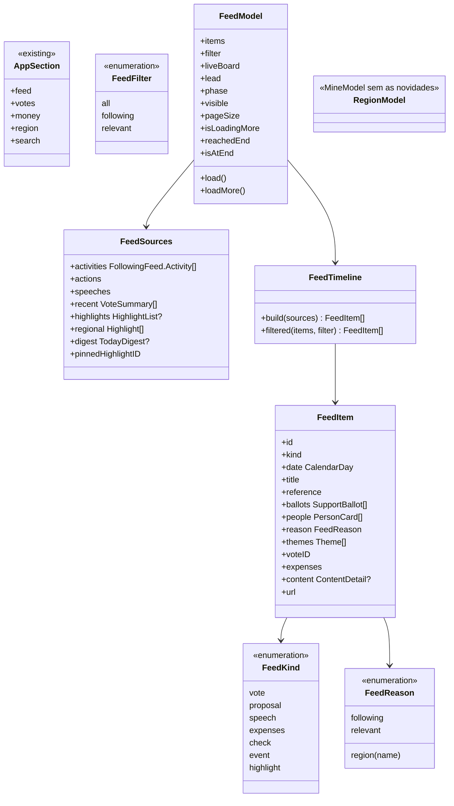

# Feed como primeira aba e a aba Região

## Requirements

**Problema.** A primeira aba é uma lista de pessoas e de região, e o que acontece está dividido entre Hoje e Seguindo. O usuário quer um feed: foco em quem segue e no que é relevante, bonito e que continue ao rolar.

**Definição de pronto:**

**Abas**

1. Dada uma abertura do app, quando carrega, então a primeira aba é o Feed, e a ordem é Feed, Votações, Dinheiro, Região e Fiscalizar, também na lista de origem do Mac e nos atalhos ⌘1 a ⌘5.
2. Dado `fiscal://today` ou `fiscal://feed`, quando abre, então cai no Feed; `fiscal://following`, `fiscal://mine` ou `fiscal://region`, então cai em Região.
3. Dado o widget "Quem eu sigo" ou a Siri, quando abre, então cai em Região, e o widget continua atualizando.
4. Dada a aba Região, quando abre, então mostra quem a pessoa segue, as sugestões, Sua região, Quem governa, as bancadas e "Na sua região agora", sem a lista de novidades.
5. Dada a barra do Feed, quando aparece, então tem o coração de "Meu apoio" e Ajustes.

**Topo**

6. Dada uma apuração ao vivo, quando o Feed abre, então o cartão dela vem primeiro; sem apuração, ele não aparece e não deixa espaço.
7. Dado um destaque do momento, quando o Feed abre, então o cartão grande vem em seguida, e esse destaque não se repete na lista.

**Lista**

8. Dadas duas pessoas seguidas e dados recentes, quando o Feed carrega, então a lista traz, da data mais nova para a mais antiga, votos, propostas, discursos, gastos do mês e checagens delas, mais votações recentes, destaques e eventos do dia.
9. Dada qualquer linha, quando aparece, então diz o tipo, a data, o fato e o motivo: o nome de quem a pessoa segue, o lugar escolhido ou "Relevante".
10. Dada uma votação em que duas pessoas seguidas votaram diferente, quando aparece, então é uma linha só, com o voto de cada uma, sem dizer quem está certa.
11. Dado o filtro Seguindo ou Relevante, quando a pessoa toca, então só ficam as linhas daquele motivo; sem resultado, explica o motivo em uma frase.
12. Dada uma linha de voto, quando a pessoa toca, então abre a votação; de gastos, abre os gastos daquele ano; de proposta, discurso, destaque ou evento com conteúdo, abre a tela de conteúdo; de checagem, abre a fonte com `ExternalLink`.
13. Dado um evento do dia já mostrado como votação ou apuração, quando a lista monta, então ele não se repete.

**Continuar ao rolar**

14. Dadas pessoas seguidas e tudo o que já foi lido na tela, quando a lista chega ao fim, então carrega o ano anterior, em lotes de 6 pessoas, sem repetir linha e sem mudar a posição do que já estava na tela.
15. Dado o ano de 2023 já carregado, quando a lista chega ao fim, então aparece a mensagem de que os dados vão até 2023.
16. Dado quem não segue ninguém, quando abre, então vê os relevantes e um cartão convidando a seguir; ao chegar ao fim, a mensagem diz que seguir pessoas traz mais fatos.
17. Dada uma falha em algumas pessoas ou fontes, quando carrega, então o resto aparece e um aviso oferece tentar de novo; sem nada, o erro de rede padrão.
18. Dada a lista aberta, quando novos dados chegam, então ela só muda ao abrir de novo ou ao puxar a tela.
23. Dadas 50 linhas já lidas, quando o Feed abre, então a lista mostra 20; ao chegar ao fim, mostra mais 20, sem nova leitura da rede; trocar de filtro volta às 20 primeiras daquele filtro.
24. Dado o filtro Relevante, quando a lista chega ao fim, então nenhum ano é lido, porque os anos antigos só trazem fatos de quem a pessoa segue, e uma mensagem diz que esses são os relevantes mais recentes.

**Selo e acessibilidade**

19. Dadas novidades de quem a pessoa segue, quando existem, então o número aparece na aba Feed e zera ao sair dela, como hoje em Seguindo.
20. Dado o maior tamanho de texto e o VoiceOver, quando o Feed abre, então nada corta, nenhuma referência quebra no meio, e cada linha lê data, tipo, fato, votos e motivo, com o traço de botão quando abre algo.
21. Dado o Reduzir movimento, quando o Feed abre, então nada anima além do que o sistema mostra.
22. Dado o Duo aberto, o iPad e o Mac, quando o Feed abre, então o conteúdo fica em coluna legível, e o que se abre vai ao outro lado, como nas outras abas.

## Entities

`FollowingUpdate`, `FollowingFeed`, `FollowingSnapshot`, `FollowingSeenStore`, `FollowController`, os arquivos públicos e o banco não mudam de formato.

## Approach

- **Estrutura registrada.** O [ADR 0022](../../docs/adr/0022-feed-first-tab-and-region.md), em Proposto, registra as abas e corrige o [ADR 0014](../../docs/adr/0014-settings-in-today-toolbar.md) sobre Hoje como primeira aba.
- **Lista por data.** Ordem só por data, e no empate pelo id, para o resultado ser sempre o mesmo e a ordem ser explicável. Decisão do usuário, com os filtros Tudo, Seguindo e Relevante. O peso não ordena a lista; ele só escolhe o destaque do topo, como já faz.
- **Topo.** Apuração e destaque do momento saem da lista e ficam em cartões grandes, reaproveitando `TodayRaceHero` e `TodayHighlightHero`.
- **Eventos do dia.** Decisão do usuário: a pauta fica só em Votações, e os eventos do resumo viram linhas relevantes, com a data do resumo. Voto e apuração já mostrados não se repetem.
- **Domínio puro.** `FeedTimeline` recebe o que veio da rede e devolve as linhas, como `SupportTimeline`. A junção por votação usa os mesmos ids. `FollowingFeed` continua para o selo e o widget, com seus 30 dias e 50 itens.
- **Propostas têm limite.** `Proposal` tem só o ano, sem data. Na lista entram as propostas de `actions.json`, que têm data, até 40 por pessoa. Os arquivos por ano entram para votos, discursos e gastos. Inventar uma data seria dado falso.
- **Continuar ao rolar.** O primeiro carregamento lê `actions.json`, as checagens e o ano corrente de cada pessoa. Pedido do usuário ao ver no iPhone: o scroll não precisa ser longo e carrega conforme a demanda. Por isso a lista mostra 20 linhas (`FeedModel.pageSize`) e acrescenta mais 20 a cada chegada ao fim. Só quando o que foi lido acaba é que lê um ano a mais, até 2023 (`FeedModel.firstYear`), em lotes de 6. O filtro Relevante não lê anos, porque eles só trazem linhas de quem a pessoa segue. Os anos mais antigos só acrescentam linhas mais antigas, então nada muda de lugar. As 100 linhas por rodada não são um limite: a lista cresce conforme os anos.
- **Quem manda no quê.** `FeedModel` fica com o que era de `TodayModel` (apuração, destaques, resumo) e com as novidades de `MineModel` (leitura por pessoa, selo, retrato do widget). `RegionModel` é o resto de `MineModel`. Sem estado duplicado entre as abas.
- **Pauta e votações recentes.** Saem de Hoje. A pauta já está em Votações. As votações recentes viram linhas do Feed.
- **Renomear.** `FeatureToday` vira `FeatureFeed` e `FeatureMine` vira `FeatureRegion`, para o nome dizer o que é. Acontece na operação 5, depois da tela aprovada, para o diff da tela ficar legível.
- **Design.** Antes de desenhar, ver referências reais de feed em imagens do App Store e iterar no iPhone até o ok. **O trabalho para na operação 3 para esse ok.** O bonequinho aparece pequeno nas linhas, sem expressão ligada a dado.
- **Sem apoio.** O Feed não lê o apoio. `support_stays_private` barra, e a regra já cobre os alvos do app.
- **Fora daqui.** A nova página do político e compartilhar um item são da `FSC-014`.

## Structure

- `FiscalKit/Package.swift`, `FiscalKitTests.xcscheme`: `FeatureFeed` e `FeatureRegion` no lugar de `FeatureToday` e `FeatureMine`, com os testes.
- `FiscalDomain/PublicData/`: `FeedItem.swift` e `FeedTimeline.swift`, novos; `FollowingUpdate.swift` fica.
- `FiscalDomain/Integrations/VoteBoard.swift`: `IntegrationLink.feed`, `IntegrationLink.region`.
- `FeatureCore/Navigation/`: `AppSection.swift`, `FiscalNavigation.swift`, `Route.swift` (destino de `FeedItem`).
- `FeatureFeed/`: `FeedModel.swift`, `FeedModel+Following.swift`, `FeedScreen.swift`, `FeedRows.swift`, `FeedFilterBar.swift`, `FeedEndNote.swift`, novos; `TodayRaceBoard.swift`, `TodayRaceHero.swift`, `TodayHighlightHero.swift` e `TodayModel+Highlights.swift` passam a `Feed*`.
- Saem: `TodayScreen.swift`, `TodayModel.swift`, `TodayModel+Text.swift`, `TodayBriefing.swift`, `TodayBriefingSection.swift`, `TodayCongressSection.swift`, `TodayRecentVotesSection.swift`, `TodayFollowingLink.swift`, `TodayComponents.swift`, `TodayHighlightSection.swift`; o que sobrevive vai para `Feed*`.
- `FeatureRegion/`: os arquivos de `FeatureMine`, com `RegionModel` e `RegionScreen`; `MineFollowing.swift` fica só com quem segue e as sugestões; a leitura de novidades vai para `FeatureFeed`.
- `FeatureVotes/`: `VotesAgendaSection.swift` segue como lugar único da pauta.
- `AppShell/`: `SectionScreen.swift`, `MainScreen.swift`, `MacShell.swift`, `DeepLink.swift`, `RouteScreen.swift`, `Integrations/FiscalIntents.swift`.
- `Fiscal/FiscalUITests/`: `LaunchTests.swift`, `XCUIApplication+Fiscal.swift`, `LinkAccessibilityTests.swift`.
- `Fiscal/Fiscal/Localizable.xcstrings`.
- Testes: `FeedTimelineTests` e `FeedModelTests`, novos; `TodayModelTests`, `TodayBriefingTests` e `TodayModelTextTests` migram ou saem com o código; `MineModelTests` e `MineFollowingTests` migram; `AppSectionTests`, `DeepLinkTests`, `FollowIntentTests`, `IntegrationCenterTests`, `FollowingSnapshotTests`.
- Documentos: `docs/adr/0022-feed-first-tab-and-region.md`, `docs/adr/README.md`, `docs/brief.md`, `docs/architecture.md`, `docs/validation.md`, `docs/roadmap.md`, `docs/backlog.md`, `docs/app-store/metadata.json`, `README.md`, `CHANGELOG.md`, `spdd/README.md`, `docs/evidence/FSC-013/qa.md`; `site/index.html`, `site/support.html`, `site/llms.txt`, sem publicar.

## Operations

1. **Domínio do Feed.**
   - `FeedItem`, `FeedKind`, `FeedReason`, `FeedFilter`, `FeedSources`.
   - `FeedTimeline.build(_ sources: FeedSources) -> [FeedItem]`: junta por id, marca o motivo (seguido vence região, e região vence relevante), tira o destaque do topo, ordena por data e id.
   - Eventos do resumo só entram quando não apontam para votação ou apuração já presentes.
   - `filtered(_:by:)`.
   - Cobre: 8, 9, 10, 11, 13. Verificação: `FeedTimelineTests`, inclusive voto dividido, empate de data e proposta sem data fora da lista.
2. **Modelo do Feed.** Depende de: 1.
   - `FeedModel.load()`: seguidos, apuração, destaques, resumo, votações recentes e destaques da região; depois `actions`, checagens e o ano corrente, em lotes de 6.
   - `visible`: as primeiras `shownCount` linhas do filtro, com `pageSize = 20`; `filter` e `load()` voltam à primeira página.
   - `loadMore()`: mostra mais uma página do que já foi lido; sem nada escondido, um ano por vez até `firstYear = 2023`, até o filtro ganhar linhas; `reachedEnd`, sem repetir; no filtro Relevante, nenhum ano.
   - `isAtEnd`: fim dos dados e nada escondido, e é quem libera a mensagem de fim.
   - Falha parcial em `missing`, com tentar de novo.
   - `newCount`, `markSeen` e o retrato do widget, como em `MineModel`.
   - Cobre: 14 a 19, 23, 24. Verificação: `FeedModelTests`, com o cenário indisponível, sem seguidos, o fim e as páginas.
3. **Abas e tela.** Depende de: 2.
   - Olhar as referências reais antes de desenhar.
   - `AppSection` com `.feed` e `.region`, `DeepLink` com os novos hosts e os antigos, `IntegrationLink`, selo em `MainScreen` e `MacShell`.
   - `FeedScreen`: topo, filtros, lista preguiçosa com um cartão por tipo, convite, aviso e fim.
   - Barra com o coração e Ajustes.
   - `Route.destination(for: FeedItem)`.
   - **Parar e mostrar no iPhone, com dados reais, antes da operação 4.**
   - Cobre: 1, 2, 3, 5, 6, 7, 9, 11, 12, 16, 19, 22. Verificação: `AppSectionTests`, `DeepLinkTests`, captura, iPhone.
4. **Região.** Depende de: 3.
   - `MineScreen` sem as novidades, com o título "Região" e ícone de mapa.
   - `MineModel` sem `updates`, `missing`, `markSeen` e o retrato.
   - Cobre: 3, 4. Verificação: `FeatureMineTests`, `FollowIntentTests`, `IntegrationCenterTests`, captura.
5. **Retirar Hoje e renomear.** Depende de: 3, 4.
   - Remover `TodayModel` e as seções que saíram, levando os testes do que sobrevive.
   - Renomear os targets para `FeatureFeed` e `FeatureRegion`.
   - Cobre: 1, 7. Verificação: `scripts/lint.sh`, `scripts/build.sh Debug`, `scripts/test.sh`.
6. **Acessibilidade e testes de interface.** Depende de: 5.
   - Reescrever `LaunchTests` para o Feed, inclusive o teste da apuração que já falhava.
   - Teste no maior tamanho de texto: linhas com traço de botão e fim alcançável.
   - Cobre: 1, 20, 21. Verificação: `scripts/ui-test.sh`, captura.
7. **Documentos e site.** Depende de: 5. `[P]` com 6.
   - ADR 0022, brief, arquitetura, validação, App Store e `README`.
   - `site/*` sem "Hoje" como aba, com `python3 -I scripts/site-i18n.py extract` e `check`.
   - Cobre: Safeguard de documentos. Verificação: `check` do site.
8. **Fechamento.** Depende de: todas.
   - `scripts/strings.sh`, `CHANGELOG`, backlog, roadmap e índice.
   - QA em `docs/evidence/FSC-013/qa.md`.
   - `scripts/verify.sh --full`, revisão em uma rodada (`spec-reviewer`, interface e código), PR para a `development` e build no iPhone.
   - Verificação: tudo verde, ou a falha relatada como está.

## Norms

- Zero comentários, zero warnings, Swift Testing e tokens do design system em tudo que é número, cor e fonte.
- Textos com chave em inglês e tradução em pt-BR no catálogo; linguagem simples; só fatos, sem opinião.
- Rótulos curtos nunca quebram no meio da palavra, com `lineLimit(1)` e `fixedSize` nos chips e filtros.
- Dynamic Type até os tamanhos de acessibilidade, Reduzir movimento e VoiceOver; alvo de toque de 44 pt.
- Layout adaptativo no iPhone, no iPad, no dobrável, no Mac e no visionOS.
- Link externo só por `ExternalLink`.
- Toda tela testada no simulador antes de ir ao iPhone físico, e entrega com instalação no aparelho, dizendo o que foi entregue.
- Pessoas nos testes com nomes fictícios, e nenhuma captura versionada com a escolha de apoio de alguém.
- Todo commit traz `Canvas: spdd/prompt/FSC-013-202611012300-[Feat]-feed-first-tab-and-region.md`.
- A análise e o canvas entram no primeiro commit de código, com o estado `entregue` da `FSC-012`.
- Quando um comportamento mudar durante a geração, o canvas muda antes pelo `spdd-prompt-update`.

## Safeguards

- **Só fatos:** sem contagem de curtida, sem "em alta", sem linguagem de engajamento, e sem dizer que algo é bom ou ruim. O motivo de cada linha fica visível.
- **Ordem explicável:** a lista é só por data. Nenhum peso, algoritmo ou dado da pessoa reordena. **QUEBRA** se a ordem deixar de ser explicável em uma frase.
- **Neutralidade:** o Feed não lê o apoio, e `support_stays_private` barra.
- **Sem dado inventado:** o que não tem data não entra na lista. Nada de traço, zero ou linha vazia.
- **Fim honesto:** nunca fingir que há mais. O fim diz até onde vão os dados.
- **Limites:** 20 linhas por página, lotes de 6 pessoas, um ano por vez, até 2023. Sem carregar anos antigos antes de a pessoa chegar ao fim do que já foi lido.
- **Sem servidor:** nenhuma mudança em `server/`, nem deploy.
- **Sem banco novo:** nenhuma mudança de esquema.
- **Compatibilidade:** `fiscal://today`, `following`, `mine`, `person`, `vote`, `highlight`, `support` e os links do site continuam abrindo. O widget continua atualizando.
- **Privacidade:** nada novo sai do aparelho. Os pedidos são os mesmos arquivos públicos, sem identificar a pessoa.
- **Sem publicar:** o site muda no repositório, e a publicação espera o ok do usuário, pedido na hora.
- **Fora de escopo, QUEBRA se entrar:** nova página do político, novos casos de `ShareSubject` e web.
- **Merge:** na `development` só com o ok do usuário, com o PR e a revisão prontos.
