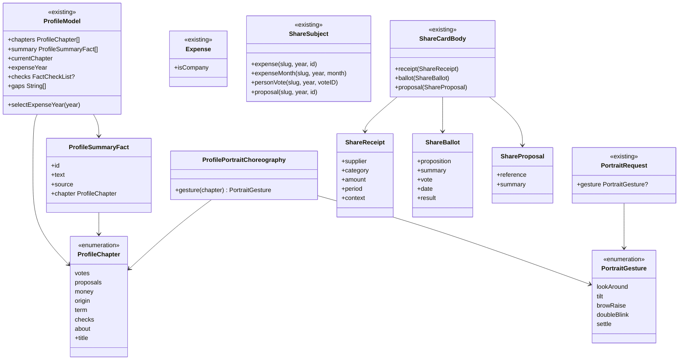

# Nova página do político e compartilhar um item

## Requirements

**Problema.** A página do político é um arquivo de 16 seções, com traços onde falta dado, o bonequinho só no topo e as notas escondidas. O usuário quer uma página didática e interessante, que varie conforme a pessoa, com o bonequinho presente ao rolar, as notas à vista e a chance de compartilhar um item específico.

**Definição de pronto:**

**Capítulos e o que existe**

1. Dada uma deputada federal com todos os dados, quando a página abre, então os capítulos são, nessa ordem, Como vota, O que propõe, Quanto gasta, De onde vem, Durante o mandato, O que circulou e Quem é, e nenhum traço aparece.
2. Dado um governador sem votos, propostas nem cota nas fontes, quando a página abre, então os capítulos são De onde vem, Durante o mandato, O que circulou (se houver) e Quem é, e a pessoa vem antes do contexto econômico.
3. Dadas duas pessoas do mesmo cargo com valores diferentes, quando as páginas abrem, então a ordem dos capítulos é a mesma, porque depende só do cargo e de existir dado.
4. Dado um capítulo sem nenhum dado, quando a página monta, então ele e o atalho dele não existem.
5. Dado o resumo do topo, quando a página abre, então mostra até 4 fatos que existem, cada um numa frase simples com a fonte, e tocar em um leva ao capítulo dele; sem fatos, o resumo não aparece.
6. Dado um dado que a fonte não publica para aquele cargo, quando a pessoa chega ao fim da página, então uma frase diz o que não há e por quê; a página não mostra traço, nem a nota explicando o traço.
7. Dada uma falha ao ler uma fonte, quando a página abre, então o resto aparece e um aviso oferece tentar de novo; sem o perfil, o erro de rede padrão, como hoje.

**Bonequinho**

8. Dada a página aberta, quando o topo sai da tela, então um cabeçalho fixo mostra o retrato pequeno, o nome, partido e cargo, e os atalhos dos capítulos.
9. Dado o cabeçalho fixo, quando a pessoa rola e entra num capítulo novo, então o retrato faz um gesto neutro e o atalho daquele capítulo fica marcado.
10. Dado o gesto de um capítulo, quando a página calcula, então ele depende só do capítulo: o mesmo para qualquer pessoa, com qualquer valor.
11. Dado o Reduzir movimento ou o modo de pouca energia, quando a pessoa rola, então o retrato fica parado na pose neutra.
12. Dada a página, quando o retrato aparece, então nenhuma das expressões `sad`, `thumbsUp`, `shakeNo` ou `celebrate` é usada; ao seguir, o aceno continua.
13. Dado o retrato grande do topo, quando aparece, então "Ilustração do Fiscal" fica visível junto dele e o VoiceOver lê "Ilustração de <nome>".

**Notas**

14. Dada uma pessoa com cota em 2026, quando o capítulo Quanto gasta aparece, então mostra o total do ano, as categorias, a troca de ano e "Ver todas as notas", que abre as notas daquele ano.
15. Dada uma pessoa com gastos só em 2025, quando a página abre, então o capítulo aparece com 2025 selecionado, em vez de sumir.
16. Dado o fato de cota no resumo, quando a pessoa toca, então a página rola até Quanto gasta.

**Compartilhar um item**

17. Dada uma nota de CNPJ de R$ 1.234,00 entre 87 notas de 2026 que somam R$ 300.000,00, quando a pessoa toca em compartilhar nela, então o cartão mostra fornecedor, categoria, valor, mês, "Uma de 87 notas de 2026, total R$ 300.000,00", fonte e link.
18. Dada uma nota sem CNPJ, quando aparece, então não há botão de compartilhar nela, e a nota continua na lista.
19. Dado um mês com gastos, quando a pessoa toca em compartilhar no cabeçalho do mês, então o cartão mostra o total do mês, as categorias, fonte e link.
20. Dado um voto da pessoa, quando ela toca em compartilhar nele, então o cartão mostra a pessoa, a proposta, o voto, a data, o resultado quando existir, fonte e link, sem dizer se o voto foi bom ou ruim.
21. Dada uma proposta, quando a pessoa toca em compartilhar nela, então o cartão mostra a pessoa, tipo, número, ano e resumo, fonte e link, sem data inventada.
22. Dado um campo que não existe, quando o cartão monta, então ele não aparece; sem o fato principal ou sem fonte, não há cartão.
23. Dado qualquer cartão novo, quando é gerado, então não tem o bonequinho, nem apoio, e passa pelos fluxos de compartilhar da `FSC-010`.
24. Dado o link de um cartão novo, quando abre, então cai numa chave que já existe: `?expenses=` para nota e mês, `?vote=` para voto e `?person=` para proposta.

**O que circulou**

25. Dada uma pessoa com checagens, quando o capítulo aparece, então o título é "O que circulou sobre <nome>", com o aviso de que a lista mostra só o que a agência escolheu checar e que o veredito vale para o conteúdo, o título como a agência escreveu, o selo, a data, "Ver a fonte" e o crédito com a licença.
26. Dada uma pessoa sem checagens, quando a página abre, então o capítulo não existe, sem frase de que "não há checagens", porque a ausência não diz nada sobre a pessoa.

**Acabamento e acessibilidade**

27. Dado o gráfico de contexto, quando aparece, então "Posse" não fica em cima dos rótulos dos anos.
28. Dado o maior tamanho de texto e o VoiceOver, quando a página abre, então nada corta nem quebra no meio da palavra, os títulos de capítulo são cabeçalhos, os atalhos são botões com o traço de selecionado, e compartilhar diz o que compartilha.
29. Dado o Duo aberto, o iPad e o Mac, quando a página abre, então fica em coluna legível, e o que se abre vai ao outro lado, como nas outras abas.

## Entities

`Profile`, `PersonVote`, `Proposal`, `ExpenseList`, `FactCheckList` e os arquivos públicos não mudam de formato. `Expense` ganha só uma leitura derivada do `document`, que o servidor publica apenas para CNPJ.

## Approach

- **Decisões registradas.** O [ADR 0023](../../docs/adr/0023-politician-page-chapters-and-item-cards.md), registra os capítulos, a regra do gesto e os cartões de um item.
- **Rolagem com capítulos.** Decisão do usuário. Uma rolagem só, em `LazyVStack` com cabeçalho fixo, no lugar de `AdaptiveList`. Os títulos são perguntas ou frases simples, em vez de nomes de base de dados.
- **Ordem fixa por cargo.** Legislativo: Como vota, O que propõe, Quanto gasta, De onde vem, Durante o mandato, O que circulou, Quem é. Executivo: De onde vem, Durante o mandato, O que circulou, Quem é. Nunca por valor, e só com o que existe.
- **O que entra em cada capítulo.** Como vota: votos e temas. O que propõe: ações, propostas, discursos e comissões. Quanto gasta: cota, salário e notas. De onde vem: eleição, patrimônio, campanhas e trajetória. Durante o mandato: o contexto de hoje, com o aviso "Contexto, não causa". O que circulou: checagens. Quem é: dados pessoais, contato, cobertura e o que falta.
- **Bonequinho.** O topo mantém o retrato grande, sem expressão ligada a dado. Ao rolar, `ProfilePortraitChoreography` dá um gesto neutro do molde para cada capítulo, numa tabela que recebe só o capítulo. Assim, o tipo impede o gesto de depender do dado. Só um retrato anima por vez, e o cabeçalho usa o que `PortraitArtView` já faz para pausar fora da tela. Os gestos e a tabela são iterados no iPhone.
- **Referências antes de desenhar.** Ver perfis reais em imagens do App Store (como Strava, Apple Sports e Threads) e iterar até o ok. **O trabalho para na operação 3 para esse ok.**
- **Só o que existe.** `facts` deixa de mostrar valor ausente. O resumo escolhe até 4 fatos numa ordem fixa por cargo. A frase do fim usa `coverage` e o cargo, e some a nota sobre o traço.
- **Notas.** O ano inicial é o mais recente com gasto. "Ver todas as notas" passa a usar `Route.expenses`, a tela completa com filtros que as outras abas usam, e `ProfileExpensesScreen` sai.
- **Pessoa física.** Decisão do usuário: nota sem CNPJ não vira cartão. `document` só existe para CNPJ, porque o servidor nunca publica CPF, e isso já é testado em `server/internal/ingest`.
- **Contexto no cartão.** Decisão do usuário: a nota diz de quanto faz parte, com "Uma de N notas de <ano>, total R$ X". O voto traz a proposta e o resultado. Nada de adjetivo.
- **Cartões novos.** `ShareSubject` ganha quatro casos, e `ShareCardContent.Body` ganha três; o mês reaproveita `.expenses`. Cada estilo de cartão da `FSC-010` aprende os três corpos novos, com a Folha como padrão e sem Duelo. Os links reaproveitam chaves do site, e por isso nem o servidor nem a AASA mudam.
- **Compartilhar de dentro.** Um botão de ícone no fim da linha e o menu de contexto, nas votações e propostas do perfil e nas notas de `ExpensesScreen`. O topo continua compartilhando a pessoa.
- **Checagens.** Decisão do usuário: ligar, com o texto do brief e do [canvas FSC-006](FSC-006-202610291700-[Codify]-fact-checks.md). Sai `showsFactChecks`. Sem contagem e sem ordem por veredito: só por data.
- **Sem apoio.** A página e os cartões não leem o apoio. `support_stays_private` barra.
- **Fora daqui.** A regra dos cartões de candidato em 72 horas segue no backlog, porque os cartões não têm retrato.

## Structure

- `FiscalDomain/PublicData/PersonActivity.swift`: `Expense.isCompany`.
- `FiscalDesignSystem/Components/PortraitArtwork.swift`, `PersonPortrait.swift`: `PortraitGesture` público e `PortraitRequest.gesture`.
- `FeatureCore/Portraits/PortraitArtView.swift`: toca o gesto pedido.
- `FeatureCore/Navigation/ShareSubject.swift`: os quatro casos novos.
- `FeatureProfile/`:
  - novos: `ProfileChapter.swift`, `ProfileModel+Chapters.swift`, `ProfileModel+Summary.swift`, `ProfilePortraitChoreography.swift`, `ProfileStickyHeader.swift`, `ProfileChapterViews.swift`, `ProfileMoneyChapter.swift`, `ProfileChecksChapter.swift`;
  - mudam: `ProfileScreen.swift`, `ProfileHero.swift`, `ProfileModel.swift`, `ProfileModel+Numbers.swift`, `ProfileModel+Activity.swift`, `ProfileModel+History.swift`, `ProfileActivitySections.swift`, `ProfileActionsSection.swift`, `ProfileHistorySections.swift`, `ProfileContextSection.swift`;
  - saem: `ProfileExpenses.swift`, `ProfileNumbersExplainer.swift`, e o que sobrar delas vai para os capítulos.
- `FeatureMoney/`: `ExpenseRows.swift`, `ExpensesModel.swift`, com compartilhar por nota e por mês.
- `FeatureShare/`: `ShareModel.swift`, `ShareCardContent.swift`, `ShareCardBuilder+Items.swift` (novo), `ShareContentRules.swift`, `ShareCaption.swift`, `ShareStyle.swift`, `ShareFormat.swift`, `ShareTypographicView.swift`, `ShareDataView.swift`, `SharePoster.swift`, `ShareMotion.swift`.
- `AppShell/RouteScreen.swift`: se precisar passar um serviço novo ao modelo.
- `Fiscal/FiscalUITests/`: `ProfileChaptersTests.swift`, novo.
- `Fiscal/Fiscal/Localizable.xcstrings`.
- Testes: `ProfileModelTests` migra; `ProfileChaptersTests`, `ProfilePortraitChoreographyTests` e `ShareItemCardsTests`, novos; `ShareCardBuilderTests`, `ShareContentRulesTests`, `ShareCardSnapshotTests`, `ExpensesModelTests`.
- Documentos: `docs/adr/0023-politician-page-chapters-and-item-cards.md`, `docs/adr/README.md`, `docs/brief.md`, `docs/architecture.md`, `docs/validation.md`, `docs/roadmap.md`, `docs/backlog.md`, `README.md`, `CHANGELOG.md`, `spdd/README.md`, `docs/evidence/FSC-014/qa.md`; `site/index.html`, `site/support.html`, `site/llms.txt`, sem publicar.

## Operations

1. **Capítulos e resumo, no modelo.**
   - `ProfileChapter` com `title`, e a ordem por cargo.
   - `ProfileModel.chapters`: a ordem do cargo, filtrada por haver dado.
   - `ProfileModel.summary`: até 4 fatos publicados, numa ordem fixa por cargo.
   - `ProfileModel.gaps`: o que a fonte não cobre, a partir de `coverage` e do cargo.
   - `facts` sem valor ausente.
   - `expenseYear`: o ano mais recente com gasto; `selectExpenseYear(_:)` lê outro ano.
   - Cobre: 1 a 7, 15. Verificação: `ProfileChaptersTests`, com deputada, senador, governador, prefeito, vereador e quem deixou o cargo.
2. **Gesto do retrato.** `[P]` com 1.
   - `PortraitGesture` público, com `lookAround`, `tilt`, `browRaise`, `doubleBlink` e `settle`.
   - `PortraitRequest.gesture`, e `PersonPortrait(... gesture:)`.
   - `ProfilePortraitChoreography.gesture(for: ProfileChapter) -> PortraitGesture`: recebe só o capítulo.
   - Com Reduzir movimento, pouca energia ou retrato parado, o pedido é ignorado.
   - Cobre: 10, 11, 12. Verificação: `ProfilePortraitChoreographyTests`, e o `ReducesMotion` já existente.
3. **Tela, cabeçalho e bonequinho.** Depende de: 1, 2.
   - Ver as referências reais antes de desenhar.
   - `ProfileScreen`: rolagem com o topo, o resumo e os capítulos, com `ScrollViewReader` para os atalhos.
   - `ProfileStickyHeader`: retrato pequeno, nome, partido, cargo e atalhos em rolagem lateral, com o capítulo atual marcado.
   - Capítulo atual: o último cujo topo passou do cabeçalho, publicado em `currentChapter`.
   - Por ora, os capítulos usam as seções de hoje, adaptadas para fora de `List`.
   - **Parar e mostrar no iPhone, com dados reais, antes da operação 4.**
   - Cobre: 5, 8, 9, 16. Verificação: captura com deputada e governador, iPhone.
4. **Quanto gasta.** Depende de: 3.
   - `ProfileMoneyChapter`: total do ano, categorias, troca de ano e "Ver todas as notas" com `Route.expenses`.
   - Sai `ProfileExpensesScreen`.
   - Cobre: 14, 15, 16. Verificação: teste de modelo e de rota, com gasto só em 2025.
5. **Só o que existe e acabamento.** Depende de: 3.
   - Capítulos com frases simples, sem traço e sem a nota do traço.
   - A frase do fim, com `gaps`.
   - Legenda do gráfico de contexto sem sobrepor os anos.
   - Cobre: 1 a 4, 6, 7, 27. Verificação: `ProfileChaptersTests`, captura com governador e prefeito.
6. **Checagens e marca do retrato.** Depende de: 3.
   - `checks` carregadas em `load()`, com falha sem derrubar a página.
   - `ProfileChecksChapter`, com título, aviso, selo como veio, data, `ExternalLink` e crédito.
   - "Ilustração do Fiscal" junto do retrato grande, e o rótulo do VoiceOver.
   - Sai `showsFactChecks`.
   - Cobre: 13, 25, 26. Verificação: teste de modelo e `ProfileChaptersTests` de interface.
7. **Cartões de um item.** Depende de: 3. `[P]` com 4 a 6.
   - `Expense.isCompany`.
   - `ShareSubject`: `expense`, `expenseMonth`, `personVote`, `proposal`, sem mudar os casos atuais.
   - `ShareCardBuilder+Items`: nota com "Uma de N notas de <ano>, total R$ X", mês, voto e proposta.
   - `ShareContentRules`: sem o fato principal ou sem fonte, não há cartão.
   - Os três corpos novos em Folha, Dados, Pôster, legenda, vídeo e formatos; Duelo não se aplica.
   - Botões e menu de contexto no perfil e em `ExpensesScreen`; nota sem CNPJ não tem botão.
   - **Mostrar os cartões no iPhone ao terminar.**
   - Cobre: 17 a 24. Verificação: `ShareItemCardsTests`, `ShareContentRulesTests`, `ShareCardSnapshotTests`, iPhone.
8. **Acessibilidade e testes de interface.** Depende de: 3 a 7.
   - `ProfileChaptersTests`: atalhos como botões, capítulos como cabeçalhos, "Ilustração do Fiscal", maior tamanho de texto com o fim alcançável.
   - Roteiro com Reduzir movimento e leitura com VoiceOver, sempre que for possível nesta máquina.
   - Cobre: 11, 13, 28, 29. Verificação: `scripts/ui-test.sh`, captura.
9. **Documentos e site.** Depende de: 7. `[P]` com 8.
   - ADR 0023, brief, arquitetura, validação, `README`, backlog (checagens no perfil e marca do retrato).
   - `site/*` com o que passou a existir, e `python3 -I scripts/site-i18n.py extract` e `check`.
   - Cobre: Safeguard de documentos. Verificação: `check` do site.
10. **Fechamento.** Depende de: todas.
    - `scripts/strings.sh`, `CHANGELOG`, roadmap e índice.
    - QA em `docs/evidence/FSC-014/qa.md`, dizendo o que não foi visto.
    - `scripts/verify.sh --full`, revisão em uma rodada (`spec-reviewer`, interface e código), PR para a `development` e build no iPhone.
    - Verificação: tudo verde, ou a falha relatada como está.

## Norms

- Zero comentários, zero warnings, Swift Testing e tokens do design system em tudo que é número, cor e fonte; arquivo até 400 linhas e tipo até 250, pela regra do lint, dividindo em vez de abrir exceção.
- Textos com chave em inglês e tradução em pt-BR no catálogo; linguagem simples; só fatos, sem opinião; títulos de capítulo sem jargão.
- Rótulos curtos nunca quebram no meio da palavra, com `lineLimit(1)` e `fixedSize` nos atalhos, e rolagem lateral quando não couberem.
- Dynamic Type até os tamanhos de acessibilidade, Reduzir movimento, modo de pouca energia e VoiceOver; alvo de toque de 44 pt.
- Layout adaptativo no iPhone, no iPad, no dobrável, no Mac e no visionOS.
- Link externo só por `ExternalLink`.
- Toda tela testada no simulador antes de ir ao iPhone físico, e entrega com instalação no aparelho, dizendo o que foi entregue.
- Testes com nomes fictícios e dados de teste; capturas versionadas sem a escolha de apoio de alguém nem quem o simulador segue.
- Todo commit traz `Canvas: spdd/prompt/FSC-014-202611020300-[Feat]-politician-page-and-share-an-item.md`.
- A análise e o canvas entram no primeiro commit de código, com o estado `entregue` da `FSC-013`.
- Quando um comportamento mudar durante a geração, o canvas muda antes pelo `spdd-prompt-update`.
- Nunca dizer que verificou o que não verificou: Mac, iPad e Duo aberto seguem declarados no PR enquanto não forem vistos.

## Safeguards

- **Só fatos:** nenhuma frase, cor, ícone ou ordem diz se um número é bom ou ruim. Comparação com colegas só com a regra e o método já publicados. **QUEBRA** se a página sugerir um juízo sobre a pessoa.
- **Bonequinho sem juízo:** o gesto depende só do capítulo, e a expressão nunca do dado. `sad`, `thumbsUp`, `shakeNo` e `celebrate` não aparecem nesta página. Mesmos gestos para todo mundo, sem balão de fala. **QUEBRA** se um valor mudar o rosto.
- **Reduzir movimento e pouca energia:** retrato parado, sem gesto.
- **Sem dado inventado:** sem traço, zero inventado, capítulo vazio ou data que a fonte não tem. A proposta mostra só o ano.
- **Ordem explicável:** capítulos por cargo; listas como já são, por data. Nenhum valor reordena nada. Checagens só por data, sem contagem e sem ranking.
- **Ausência de checagem não diz nada:** sem capítulo e sem frase quando não há checagem.
- **Pessoa comum:** nota sem CNPJ nunca vira cartão. **QUEBRA** se o nome de uma pessoa física sair num cartão.
- **Contexto no cartão:** nota sempre com "Uma de N" e o total do ano; voto sempre com a proposta. Sem fonte, sem cartão.
- **Cartões:** sem o bonequinho, sem apoio e sem dado ausente, com uma ação por cartão.
- **Neutralidade:** a página e os cartões não leem o apoio, e `support_stays_private` barra.
- **Sem servidor:** nenhuma mudança em `server/`, nem deploy, chave nova do site ou AASA.
- **Sem banco novo:** nenhuma mudança de esquema.
- **Compatibilidade:** `fiscal://person/<slug>`, `?person=`, `?expenses=`, `?vote=` e os assuntos de compartilhar de hoje continuam abrindo. Quem abre o perfil por outra aba não percebe mudança de rota.
- **Privacidade:** nada novo sai do aparelho.
- **Limites:** até 4 fatos no resumo; um retrato animado por vez.
- **Sem publicar:** o site muda no repositório, e a publicação espera o ok do usuário, pedido na hora.
- **Fora de escopo, QUEBRA se entrar:** dado novo, histórico de tramitação, retrato nos cartões, web, publicação sem ok.
- **Merge:** na `development` só com o ok do usuário, com o PR e a revisão prontos.
