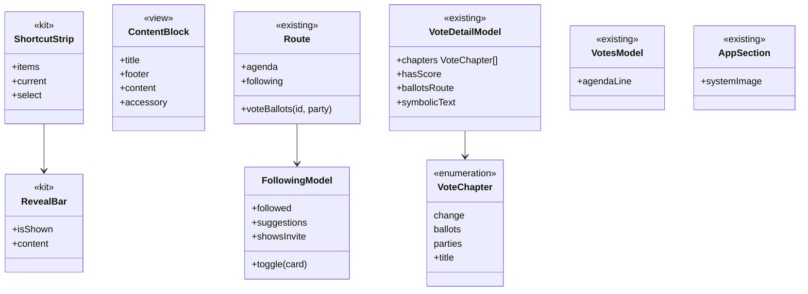

# Barra do topo, votações, região e ícones das abas

## Requirements

**Problema.** O usuário gostou da barra que aparece no topo da página do político e quer usá-la onde algo precisa continuar visível. Votações tem muito conteúdo e começa por uma pauta vencida. No detalhe da votação ele se perde, inclusive quando não houve votos por pessoa. O ✓ e o ✗ estão em cápsulas. Região mistura o lugar com quem a pessoa segue. Os ícones das abas de Feed e Fiscalizar devem mudar.

**Definição de pronto:**

**Barra ao rolar**

1. Dada uma votação nominal, quando o placar sai da tela, então a barra mostra o número da proposta, o placar e os atalhos O que muda, Quem votou e Por partido; tocar num atalho leva à parte dele, com o título logo abaixo da barra.
2. Dado o placar visível de novo, quando a pessoa volta ao topo, então a barra some, sem o conteúdo pular.
3. Dado o detalhe de uma corrida, quando o topo sai da tela, então a barra mostra a corrida e o percentual apurado, sem atalhos.
4. Dadas as notas de um político, quando o topo sai da tela, então a barra mostra o nome, o ano e o total do ano, sem atalhos.
5. Dadas Votações, o Feed e as outras abas, quando a pessoa rola, então não há barra nova.
6. Dada a página do político, quando abre, então ela segue igual, agora com a peça do kit: mesmo cabeçalho, atalhos, gesto e salto.
7. Dada a barra em qualquer tela, quando o Reduzir movimento está ligado, então ela aparece sem deslizar e os saltos não animam.

**Detalhe da votação**

8. Dada uma votação nominal, quando a página abre, então a ordem é placar, O que muda, o que isso quer dizer, outras votações do projeto no dia, quem você apoia, seus representantes, Por partido, orientação dos partidos e "Ver os 513 votos".
9. Dada essa página, quando a pessoa toca em "Ver os 513 votos", então abre uma tela com a lista, a busca por nome, partido ou estado e os filtros de hoje.
10. Dado um partido em Por partido, quando a pessoa toca nele, então abre essa tela já filtrada por aquele partido.
11. Dada uma votação simbólica, quando a página abre, então mostra o resultado que a casa publicou e a frase "Votação simbólica: a casa registrou o resultado, sem o voto de cada pessoa", sem traço, sem zero, sem barra de placar, sem "Quem votou" e sem as seções de votos.
12. Dada uma votação nominal sem nomes publicados, quando a página abre, então mostra o placar e diz que a casa não publicou quem votou como, sem "Ver os N votos".
13. Dado o Mac, quando abre o detalhe, então a tabela de votos continua ao lado, como hoje.

**Sim, Não e textos**

14. Dado o placar do detalhe, quando aparece, então Sim e Não são círculos com o ✓ e o ✗, sem cápsula e sem espaço vazio, e o VoiceOver lê "Sim" e "Não".
15. Dada uma linha de Votações, quando aparece, então o resultado aparece com o símbolo e o texto "Aprovada" ou "Rejeitada", sem cápsula vazia.
16. Dado um único outro voto, quando aparece, então diz "1 outro voto"; com 9, "9 outros votos".
17. Dado um nome como "Albuquerque" em Seus representantes, quando a coluna é estreita, então o nome não quebra no meio da palavra.
18. Dado um bloco de partidos como "BL UNIPPPSD...", quando aparece na orientação, então o nome inteiro é lido, em uma ou mais linhas.

**Votações**

19. Dada a tela aberta, quando há votações, então ela começa pelo dia mais recente com votação, e cada linha tem número, resumo em até duas linhas, resultado, placar e a linha com hora e tema, cabendo ao menos três linhas numa tela do iPhone.
20. Dada uma pauta publicada com sessão futura, quando a tela abre, então uma linha no topo diz "Próxima sessão: qua., 04/11" e a quantidade de itens, e tocar abre a pauta em tela própria. Quando os itens publicados não são daquela sessão, o que é o normal hoje, porque a fonte só publica os itens da sessão do dia, a linha mostra a data e as casas, sem quantidade e sem seta, e não abre a pauta.
21. Dada uma sessão em andamento, quando a tela abre, então a mesma linha diz "Em sessão".
22. Dada uma pauta sem sessão futura nem em andamento, quando a tela abre, então a linha não aparece, e a tela não mostra a pauta vencida. Dada uma pauta de data passada com uma sessão futura, a linha mostra só a próxima data, sem os itens antigos.
23. Dada a tela da pauta, quando abre, então mostra o texto de cada item como hoje, com os temas inteiros, sem corte no meio da palavra, e o link oficial.

**Região, quem você segue e abas**

24. Dada a aba Região, quando abre, então não mostra "Quem você segue" nem "Sugestões", e começa pelo lugar.
25. Dado o filtro Seguindo do Feed, quando selecionado, então a primeira linha é "Quem você segue" com a quantidade, e tocar abre a tela com a lista, as sugestões e o convite de compartilhar.
26. Dada essa tela, quando a pessoa toca em seguir ou deixar de seguir, então funciona como hoje, e o Feed reflete a mudança.
27. Dada uma pessoa sem lugar escolhido, quando abre a tela, então as sugestões não aparecem, e um convite leva a escolher o lugar em Região.
28. Dado alguém que não segue ninguém, quando o Feed abre, então o convite leva a essa tela.
29. Dados `fiscal://region`, o widget do lugar e os links de pessoa, quando abertos, então seguem como hoje; `fiscal://following`, o widget "Quem eu sigo" e a Siri abrem a tela nova.
30. Dadas as abas, quando aparecem, então Feed usa duas pessoas, Região usa o pin com o círculo embaixo e Fiscalizar usa o binóculo, inclusive no destaque da busca, se o sistema aceitar; se não aceitar, o usuário vê o resultado no iPhone antes de qualquer troca.

**Acessibilidade**

31. Dado o maior tamanho de texto e o VoiceOver, quando as telas novas abrem, então nada corta nem quebra no meio da palavra, os títulos são cabeçalhos, a barra ao rolar limita o próprio texto a `xxxLarge` para não cobrir a tela nem travar a rolagem, a linha de Votações mostra o placar só com os números e mantém o rótulo completo no VoiceOver, os atalhos são botões com o traço de selecionado, e o fim é alcançável.
32. Dado o Duo aberto, o iPad e o Mac, quando as telas abrem, então ficam em coluna legível, e o que se abre vai ao outro lado, como nas outras abas.

## Entities

Nenhum arquivo público nem dado do aparelho muda de formato. `RegionModel` deixa de oferecer a lista de quem segue e as sugestões, e `FollowingModel` passa a tê-las.

## Approach

- **Decisões registradas.** O [ADR 0024](../../docs/adr/0024-reveal-bar-following-and-ballots-screens.md) registra onde a barra entra, a saída de quem você segue de Região e os votos em tela própria. Ele emenda a decisão 6 do [ADR 0022](../../docs/adr/0022-feed-first-tab-and-region.md).
- **Barra só onde ajuda.** Decisão do usuário. Entra onde algo precisa continuar visível: no detalhe da votação (proposta e placar), no detalhe da corrida (corrida e apurado), nas notas (pessoa e ano) e na página do político, onde já está. Fica de fora em Votações, no Feed e nas outras abas.
- **Peça no kit.** Regra do repositório: `RevealBar` e `ShortcutStrip` vão para o `byescaleira-kit`, num PR de lá, com versão nova. O conteúdo de cada barra fica no app. A forma é a aprovada na `FSC-014`: camada sobre a rolagem, que só muda de opacidade, porque inserir no layout fez o conteúdo pular.
- **Referências.** FotMob mantém o placar e as abas fixos ao rolar uma partida; Apple Sports mostra o placar como o principal. **O trabalho para na operação 5 para o ok no iPhone.**
- **Detalhe em rolagem.** Decisão do usuário: os votos vão para tela própria com busca e filtros. Sem eles, a página pode ser a mesma `VStack` da página do político, e o salto mede a posição de cada parte. `ProfileBlock` sobe para `FeatureCore` como `ContentBlock`, para as duas telas usarem o mesmo bloco. No Mac, a tabela continua ao lado.
- **Votação simbólica.** Sem Sim nem Não, o placar cede lugar ao resultado e à frase, e as partes de votos somem. Nunca traço nem zero.
- **Círculos.** `StatusCircle`, que o app já usa nas linhas de voto, substitui as cápsulas do placar. O selo da linha de Votações passa a mostrar o texto, sem cápsula.
- **Votações.** Decisão do usuário: uma linha no topo, com a próxima sessão, abre a pauta em tela própria. Pauta vencida não aparece na tela. As linhas perdem peso: o aviso de outras votações sai da linha e fica só no detalhe, e o resumo vai a duas linhas.
- **Quem você segue.** Decisão do usuário: tela própria, aberta pelo filtro Seguindo do Feed, com a lista, as sugestões e o convite. `FollowingModel` lê o lugar escolhido pelo mesmo `HomePlace` que Região usa.
- **Links.** `fiscal://following` passa a abrir a tela nova, em vez de Região; `fiscal://mine` e `fiscal://region` seguem em Região. O widget "Quem eu sigo" e a Siri usam o link novo.
- **Ícones.** `person.2` para o Feed, `mappin.and.ellipse` para Região, pedido do usuário no iPhone, e `binoculars` para Fiscalizar. A busca usa `Tab(role: .search)`; o resultado é visto no iPhone, e o papel da aba não muda sem o ok do usuário.
- **Medida de posição.** O capítulo atual só publica quando muda, como já é, e as telas novas seguem o mesmo caminho. A revisão da `FSC-014` apontou o custo sem medir; é conferido no iPhone.
- **Fora daqui.** Telas de Dinheiro e Fiscalizar, além das notas, ficam como estão.

## Structure

- `byescaleira-kit`: `Sources/ByescaleiraUI/Layout/RevealBar.swift`, `ShortcutStrip.swift`, testes, `CHANGELOG`, versão nova.
- `FiscalKit/Package.swift`: a versão nova do kit.
- `FeatureCore/`: `Navigation/Route.swift` (os três casos novos), `Navigation/AppSection.swift` (ícones), `Components/ContentBlock.swift` (novo, vindo de `ProfileBlock`).
- `FiscalDomain/Integrations/`: `IntegrationLink.following`, `RepresentativesDigest.swift`.
- `FeatureProfile/`: `ProfileScreen.swift`, `ProfileStickyHeader.swift`, `ProfileChapterViews.swift`, sem mudar o comportamento.
- `FeatureVotes/`:
  - novos: `VoteChapter.swift`, `VoteStickyHeader.swift`, `VoteBallotsScreen.swift`, `VotesAgendaScreen.swift`;
  - mudam: `VoteDetailScreen.swift`, `VoteDetailModel.swift`, `VoteDetailModel+Text.swift`, `VoteHeroSection.swift`, `VoteExplainSection.swift`, `VoteSameDaySection.swift`, `VotePartySections.swift`, `VoteBallotsSection.swift`, `VoteScoreRow.swift`, `VotesScreen.swift`, `VotesAgendaSection.swift`, `VotesModel.swift`, `VotesModel+Text.swift`.
- `FeatureRegion/`: novos `FollowingModel.swift`, `FollowingScreen.swift`; mudam `RegionScreen.swift`, `RegionModel.swift`; saem `RegionFollowing.swift`, `RegionModel+Following.swift`, `RegionModel+ShareInvite.swift`, levados para os novos.
- `FeatureFeed/FeedScreen.swift`: linha "Quem você segue" no filtro Seguindo e o convite.
- `FeatureLiveResults/RaceDetailScreen.swift`: a barra da corrida.
- `FeatureMoney/ExpensesScreen.swift`: a barra das notas.
- `AppShell/`: `RouteScreen.swift`, `DeepLink.swift`, `Integrations/FiscalIntents.swift`.
- `Fiscal/FiscalWidgets/RepresentativesWidget.swift`.
- `Fiscal/FiscalUITests/`: `VoteDetailTests.swift`, `FollowingTests.swift`, novos; `LaunchTests.swift`, `ProfileChaptersTests.swift`.
- `Fiscal/Fiscal/Localizable.xcstrings`.
- Testes: `VoteDetailModelTests`, `VotesModelTests`, `FollowingModelTests` (novo), `RegionModelTests`, `FollowIntentTests`, `DeepLinkTests`, `AppSectionTests`, `ProfileChaptersTests`.
- Documentos: `docs/adr/0024-reveal-bar-following-and-ballots-screens.md`, `docs/adr/README.md`, `docs/brief.md`, `docs/architecture.md`, `docs/design-system.md`, `docs/validation.md`, `docs/roadmap.md`, `docs/backlog.md`, `README.md`, `CHANGELOG.md`, `spdd/README.md`, `docs/evidence/FSC-015/qa.md`; `site/index.html`, `site/llms.txt`, sem publicar.

## Operations

1. **Barra e atalhos no kit.**
   - `RevealBar`: camada no topo de uma rolagem, com `isShown`, opacidade, sem toque nem VoiceOver quando escondida, e altura informada a quem usa.
   - `ShortcutStrip`: atalhos em rolagem lateral, com o atual marcado e centralizado, sem rolagem vertical nem herança de `refreshable`.
   - PR no `byescaleira-kit` com os testes do kit. **O merge e a tag do kit esperam o ok do usuário.**
   - Cobre: 2, 7. Verificação: `scripts/verify.sh --full` do kit.
2. **Página do político na peça do kit.** Depende de: 1.
   - A nova versão do kit em `Package.swift`.
   - `ProfileStickyHeader` e `ProfilePage` usam `RevealBar` e `ShortcutStrip`.
   - `ProfileBlock` vira `ContentBlock`, em `FeatureCore`.
   - Cobre: 6. Verificação: `ProfileChaptersTests` de modelo e de interface, sem mudar.
3. **Círculos e textos.** `[P]` com 2.
   - `HeroSide` e `OutcomeCenter`: `StatusCircle` no placar e selo de resultado com texto.
   - Plural de "outro voto" no catálogo, no detalhe e em Votações.
   - Nome de representante com `lineLimit` e sem hifenização no meio da palavra; bloco de partidos inteiro, em mais de uma linha.
   - Cobre: 14 a 18. Verificação: teste de modelo do plural, captura.
4. **Detalhe da votação, no modelo.**
   - `VoteChapter` com `title`.
   - `VoteDetailModel.chapters`: só o que existe; sem Sim e Não, sem `ballots` e `parties`.
   - `hasScore`, `symbolicText`, `ballotsRoute`.
   - `Route.voteBallots(id:party:)` e `VoteBallotsScreen`, com a busca e os filtros de hoje.
   - Cobre: 9 a 12. Verificação: `VoteDetailModelTests`, com nominal, simbólica e nominal sem nomes.
5. **Detalhe da votação, na tela.** Depende de: 2, 3, 4.
   - Ver as referências reais antes de desenhar.
   - `VoteDetailOverview`: rolagem na ordem do cenário 8, com `ContentBlock`.
   - `VoteStickyHeader`: proposta, placar compacto e atalhos.
   - O toque em Por partido abre os votos filtrados; Mac como hoje.
   - **Parar e mostrar no iPhone, com dados reais, antes da operação 6.**
   - Cobre: 1, 2, 8 a 13. Verificação: `VoteDetailTests`, captura com nominal e simbólica, iPhone.
6. **Votações.** Depende de: 3.
   - `VotesModel.agendaLine`: próxima sessão, em sessão ou nada, com a quantidade de itens.
   - `Route.agenda` e `VotesAgendaScreen`, com os itens de hoje e temas inteiros.
   - `VoteScoreRow`: linha mais curta, sem o aviso de outras votações.
   - Cobre: 15, 16, 19 a 23. Verificação: `VotesModelTests`, com pauta vencida, futura e em sessão, captura.
7. **Quem você segue.**
   - `FollowingModel`: lista, sugestões e convite, levados de `RegionModel`, com o lugar por `HomePlace`.
   - `FollowingScreen` e `Route.following`.
   - Sai de `RegionScreen`.
   - Linha no filtro Seguindo e convite do Feed.
   - `IntegrationLink.following`, `DeepLink`, widget e Siri.
   - Cobre: 24 a 29. Verificação: `FollowingModelTests`, `RegionModelTests`, `DeepLinkTests`, `FollowIntentTests`, `FollowingTests`.
8. **Ícones das abas.** `[P]` com 7.
   - `AppSection.systemImage`: `person.2`, `mappin.and.ellipse` e `binoculars`.
   - Ver no simulador o que o sistema mostra no papel de busca.
   - Cobre: 30. Verificação: `AppSectionTests`, captura.
9. **Corrida e notas.** Depende de: 1.
   - `RaceDetailContent` com `RevealBar`: corrida e apurado.
   - `ExpensesOverview` com `RevealBar`: nome, ano e total, sem sair da lista.
   - **Mostrar Votações, Região, a tela nova, as abas e estas barras no iPhone ao terminar.**
   - Cobre: 3, 4, 5. Verificação: captura, iPhone.
10. **Acessibilidade e testes de interface.** Depende de: 5 a 9.
    - Maior tamanho de texto com o fim alcançável, atalhos como botões, títulos como cabeçalhos.
    - Roteiro com Reduzir movimento.
    - Cobre: 7, 31, 32. Verificação: `scripts/ui-test.sh`, captura.
11. **Documentos e site.** Depende de: 9. `[P]` com 10.
    - ADR 0024, brief, arquitetura, design system (a barra e quando usar), validação, `README`, backlog.
    - `site/*` com o que passou a existir, e `python3 -I scripts/site-i18n.py extract` e `check`.
    - Cobre: Safeguard de documentos. Verificação: `check` do site.
12. **Fechamento.** Depende de: todas.
    - `scripts/strings.sh`, `CHANGELOG`, roadmap e índice.
    - QA em `docs/evidence/FSC-015/qa.md`, dizendo o que não foi visto.
    - `scripts/verify.sh --full`, revisão em uma rodada (`spec-reviewer`, interface e código), PR para a `development` e build no iPhone.
    - Verificação: tudo verde, ou a falha relatada como está.

## Norms

- Zero comentários, zero warnings, Swift Testing e tokens do design system em tudo que é número, cor e fonte; arquivo até 400 linhas e tipo até 250, pela regra do lint, dividindo em vez de abrir exceção.
- Textos com chave em inglês e tradução em pt-BR no catálogo; plural pelo catálogo; linguagem simples; só fatos, sem opinião.
- Rótulos curtos nunca quebram no meio da palavra, com `lineLimit(1)` e `fixedSize`; nomes de pessoas e partidos quebram só entre palavras. Pedido do usuário no iPhone, ao ver "Outros" em duas linhas: vale para as cápsulas de todo o app, inclusive em Memória e Compartilhar, e não só nas telas desta fase.
- Cartão ou linha que abre outra tela mostra a setinha à direita, e o toque principal abre o conteúdo, como na `FSC-014`. Link externo mantém o próprio símbolo.
- Dynamic Type até os tamanhos de acessibilidade, Reduzir movimento e VoiceOver; alvo de toque de 44 pt. A exceção é a barra ao rolar, limitada a `xxxLarge`, como as barras do sistema: maior que isso, ela ocupa a tela e impede a rolagem.
- Layout adaptativo no iPhone, no iPad, no dobrável, no Mac e no visionOS.
- Peça genérica vai para o kit, com PR e versão próprios.
- Toda tela testada no simulador antes de ir ao iPhone físico, e entrega com instalação no aparelho, dizendo o que foi entregue.
- Testes com nomes fictícios e dados de teste; capturas versionadas sem a escolha de apoio de alguém nem quem o simulador segue fora da lista fixa.
- Todo commit traz `Canvas: spdd/prompt/FSC-015-202611021500-[Feat]-sticky-bar-votes-region-tabs.md`.
- A análise e o canvas entram no primeiro commit de código.
- Quando um comportamento mudar durante a geração, o canvas muda antes pelo `spdd-prompt-update`.
- Nunca dizer que verificou o que não verificou: Mac, iPad e Duo aberto seguem declarados no PR enquanto não forem vistos.

## Safeguards

- **Só fatos:** nenhuma cor, ordem ou texto novo diz se um voto foi bom ou ruim. Sim e Não mantêm as cores de hoje. **QUEBRA** se a tela sugerir um juízo.
- **Sem dado inventado:** votação simbólica sem número, traço ou zero; sem "Ver os N votos" quando a casa não publicou nomes; a pauta só com a data que a fonte traz.
- **Pauta vencida:** nunca aparece como se fosse atual. **QUEBRA** se Votações mostrar pauta de data passada no topo.
- **Barra só onde ajuda:** só no detalhe da votação, no detalhe da corrida, nas notas e na página do político. **QUEBRA** se entrar em Votações ou no Feed. Nessas telas, o título sai da barra de ferramentas no iOS, para não repetir o que a barra mostra.
- **Sem pular:** a barra nunca muda o layout da rolagem, nem herda o `refreshable`.
- **Página do político:** continua igual. **QUEBRA** se um teste de interface da `FSC-014` precisar mudar de comportamento.
- **Reduzir movimento:** a barra aparece sem deslizar, e os saltos não animam.
- **Votos:** a lista com todos os nomes continua alcançável em toda votação nominal com nomes, com busca. No Mac, a tabela não muda.
- **Seguir:** seguir e deixar de seguir continuam a um toque, sem perda de quem a pessoa já segue. **QUEBRA** se a lista salva mudar.
- **Neutralidade:** as sugestões seguem a ordem por cargo de hoje, e nenhuma tela nova lê o apoio fora do que já lê. `support_stays_private` barra.
- **Compatibilidade:** `fiscal://region`, `fiscal://mine`, `fiscal://person/<slug>`, `?vote=` e os assuntos de compartilhar continuam abrindo. `fiscal://following` abre a tela nova, em vez de Região.
- **Sem servidor:** nenhuma mudança em `server/`, nem deploy, chave nova do site ou AASA.
- **Sem banco novo:** nenhuma mudança de esquema.
- **Privacidade:** nada novo sai do aparelho.
- **Aba de busca:** o papel `.search` não muda sem o ok do usuário.
- **Sem publicar:** o site muda no repositório, e a publicação espera o ok do usuário, pedido na hora.
- **Kit:** merge e tag do kit só com o ok do usuário, pedido na hora.
- **Fora de escopo, QUEBRA se entrar:** dado novo, redesenho do Feed, outras telas de Dinheiro e Fiscalizar, web, publicação sem ok.
- **Merge:** na `development` só com o ok do usuário, com o PR e a revisão prontos.
