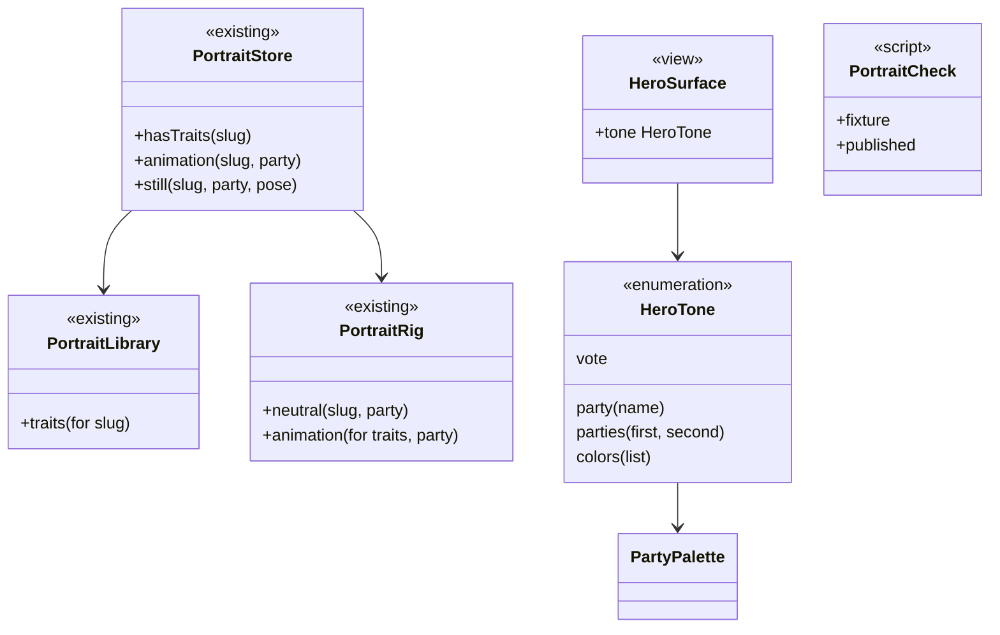

# Cartões no modo claro e bonequinho de todos

## Requirements

**Problema.** Políticos que assumem em 2027, como Eduardo Riedel, aparecem com o rosto genérico, embora todos tenham traços: o app exige o mesmo partido nos traços e no dado. E 17 cartões de destaque ficam escuros no modo claro, destoando do resto do app.

**Definição de pronto**

**Bonequinho**

1. Dado Eduardo Riedel com o partido PSDB num dado e PP nos traços, quando o retrato aparece, então é o desenho dele, com a roupa e o fundo na cor do PSDB.
2. Dado o mesmo Riedel com o partido PP, quando o retrato aparece, então é o mesmo rosto, na cor do PP.
3. Dado Arthur Henrique no cartão de Região, quando aparece, então é o desenho dele, e não o rosto neutro.
4. Dado alguém sem traços, quando o retrato aparece, então é o rosto neutro, na cor do partido que o dado traz.
5. Dadas as 2.356 pessoas publicadas, quando o script de conferência roda, então todas têm traços e o mesmo nome neles, e o resultado diz quantas foram lidas.
6. Dado um identificador com outro nome nos traços, quando o script roda, então ele falha e aponta o identificador, o nome no dado e o nome nos traços.

**Cartões**

7. Dado o detalhe de uma votação no modo claro, quando abre, então o placar tem superfície clara com a cor suave do Sim à esquerda e do Não à direita, texto escuro, e a cor forte só nos círculos e sinais.
8. Dado o mesmo placar no modo escuro, quando abre, então fica como hoje.
9. Dada a página do político no modo claro, quando abre, então o cabeçalho tem superfície clara com a cor suave do partido, e o retrato continua na cor do partido.
10. Dados os cartões de Região ("Quem governa" e "Na sua região agora") no modo claro, quando aparecem, então seguem o mesmo padrão.
11. Dados o destaque do Feed e os cartões da corrida (herói, compacto, eleito) no modo claro, quando aparecem, então seguem o mesmo padrão, e a setinha é legível.
12. Dados os cartões de Fiscalizar (hub, conclusão da investigação, comparar) e de Memória (eleição passada, vencedor, guia de estudo, calendário) no modo claro, quando aparecem, então seguem o mesmo padrão.
13. Dado qualquer um dos 17 cartões no modo escuro, quando aparece, então o visual é o de hoje.
14. Dado o ajuste de Aparência em Claro num aparelho escuro, ou em Escuro num aparelho claro, quando o cartão aparece, então segue o ajuste.
15. Dadas todas as cores de partido da paleta, quando o cartão aparece no modo claro, então o texto principal tem contraste de pelo menos 4,5:1 e o secundário de pelo menos 3:1.
16. Dado Aumentar contraste ligado, quando o cartão aparece no modo claro, então a superfície perde a cor suave e ganha um contorno, e o texto segue legível.
17. Dado Reduzir transparência ligado, quando o cartão aparece, então a superfície continua opaca.
18. Dado um cartaz de compartilhar, em qualquer modo, quando é gerado, então fica igual ao de hoje.
19. Dados o widget e a Atividade ao Vivo, quando aparecem, então o visual fica igual ao de hoje, e o retrato segue a regra nova.
20. Dado o maior tamanho de texto, quando os cartões aparecem, então nada corta nem quebra no meio da palavra, além do que já está no backlog.

## Entities

Nenhum arquivo público, dado do aparelho nem formato de traços muda. `PartyBackdrop`, `voteYesBoard` e `voteNoBoard` continuam para os cartazes.

## Approach

- **Decisões registradas.** O [ADR 0025](../../docs/adr/0025-portrait-by-slug-and-hero-cards-follow-the-mode.md) registra o retrato pelo identificador e os cartões seguindo o modo.
- **Retrato pelo identificador.** A roupa e o fundo já usam o partido que chega, então basta tirar a exigência de partido igual. Medido em 02/11/2026: nenhum dos 2.356 identificadores publicados tem outro nome nos traços; dois têm outro estado (`flavio-bolsonaro`, `rosangela-moro`) e são as mesmas pessoas.
- **Conferência.** Como os traços do app não guardam o nome, a conferência é um script sobre `scripts/avatar-traits.json`. Sem rede, ele lê os dados de teste e entra no `verify --full`. Com `--published`, lê os arquivos publicados, no fechamento e depois de uma carga.
- **Superfície única.** Decisão do usuário: todos os 17 cartões, com superfície clara, cor suave, texto escuro e cor forte só nos sinais. Uma peça, `HeroSurface`, troca o fundo pelo modo: no escuro, o gradiente de hoje; no claro, o cinza dos cartões com a cor em baixa opacidade. O `.environment(\.colorScheme, .dark)` e o branco fixo saem, e os cartões passam a usar `.primary` e `.secondary`, que no escuro dão o mesmo resultado.
- **São 17, não 16.** A análise contou 16; ao ler o código, `ElectionScheduleSection` também usa o fundo escuro fixo.
- **Referências.** FotMob, Apple Sports e o Tempo da Apple são olhados nos dois modos antes de desenhar. **O trabalho para na operação 2 e na operação 4 para o ok no iPhone.**
- **Cartazes.** `PartyBackdrop` e os tokens de placar ficam para os cartazes, que viram imagem. Os cartões saem deles.
- **Partido divergente.** Decisão do usuário: mudança separada logo depois, com a causa dos dados parados em 28/10. Até lá, a mesma pessoa pode aparecer com dois partidos.
- **Fora daqui.** Servidor, novos traços, widgets, Atividade ao Vivo, cartazes e ícone.

## Structure

- `FiscalResource/PortraitLibrary.swift`: `traits(for:)` só com o identificador.
- `FeatureCore/Portraits/PortraitStore.swift`, `PortraitRig.swift`: chave de cache e rosto neutro.
- `FeatureCore/Navigation/RouteCard.swift`: `RouteChevron` seguindo o modo.
- `FiscalDesignSystem/Components/HeroSurface.swift`: novo, com `HeroTone`.
- `FeatureVotes/VoteHeroSection.swift`.
- `FeatureProfile/ProfileHero.swift`, `ProfileStickyHeader.swift`.
- `FeatureRegion/RegionGovernment.swift`, `RegionNow.swift`.
- `FeatureFeed/FeedHighlightHero.swift`.
- `FeatureLiveResults/RaceHeroCard.swift`, `RaceHeroHeader.swift`, `RaceCompactCard.swift`, `RaceWinnerCard.swift`.
- `FeatureSearch/SearchHub.swift`, `InvestigationConclusion.swift`, `CompareParts.swift`.
- `FeatureMemory/PastRaceSections.swift`, `PastWinnerCard.swift`, `PastCardParts.swift`, `StudyGuideScreen.swift`, `ElectionScheduleSection.swift`.
- `scripts/portrait-check.py`: novo. `scripts/verify.sh`: chama o script.
- `Fiscal/FiscalUITests/HeroCardsTests.swift`: novo, com os dois modos.
- `Fiscal/Fiscal/Localizable.xcstrings`, se algum texto mudar.
- Testes: `PortraitLibraryTests`, `PortraitStoreTests`, `HeroSurfaceTests` (novo).
- Documentos: `docs/adr/0025-portrait-by-slug-and-hero-cards-follow-the-mode.md`, `docs/adr/README.md`, `docs/brief.md`, `docs/design-system.md`, `docs/validation.md`, `docs/roadmap.md`, `docs/backlog.md`, `CHANGELOG.md`, `spdd/README.md`, `docs/evidence/FSC-016/qa.md`.

## Operations

1. **Retrato pelo identificador.**
   - `PortraitLibrary.traits(for:)` recebe só o identificador; sai `sameParty` da busca.
   - `PortraitStore`: `hasTraits(slug:)`; a chave de cache continua com identificador e partido, porque a cor muda; o neutro continua por partido.
   - Trocar a expectativa de `refusesTraitsWhenThePartyDiffers`.
   - Cobre: 1 a 4. Verificação: `PortraitLibraryTests`, `PortraitStoreTests`.
2. **Conferência dos traços.** Depende de: 1.
   - `scripts/portrait-check.py`: compara identificador e nome entre `scripts/avatar-traits.json` e `showcase-people.json`; com `--published`, com `index/people.json` e `places/<uf>.json`, e diz quantas pessoas leu.
   - Sai com erro e aponta o caso quando o nome difere, ou quando falta traço a alguém com `--published`.
   - `scripts/verify.sh --full` chama sem rede.
   - **Parar e mostrar Riedel no iPhone, com dados reais, antes da operação 3.**
   - Cobre: 5, 6. Verificação: o script nos dois modos, captura e iPhone.
3. **Superfície do cartão.**
   - `HeroTone`: `party`, `parties`, `vote`, `colors`.
   - `HeroSurface`: no escuro, o gradiente e a película de hoje; no claro, o cinza dos cartões com a cor em baixa opacidade; com Aumentar contraste, só o cinza e um contorno.
   - Cobre: 8, 13, 15, 16, 17. Verificação: `HeroSurfaceTests`, com o contraste de todas as cores da paleta.
4. **Placar da votação.** Depende de: 3.
   - Ver as referências reais antes de desenhar.
   - `VoteHeroSection`: `HeroSurface(.vote)`; sai `BoardStyle`, o modo forçado e o branco fixo; os círculos seguem as cores de Sim e Não.
   - **Parar e mostrar no iPhone, nos dois modos, antes da operação 5.**
   - Cobre: 7, 8. Verificação: captura dos dois modos, iPhone.
5. **Político e Região.** Depende de: 4.
   - `ProfileHero`, `RegionGovernment`, `RegionNow` com `HeroSurface(.party)`.
   - Cobre: 9, 10, 13. Verificação: captura dos dois modos.
6. **Feed e corrida.** Depende de: 4. `[P]` com 5.
   - `FeedHighlightHero`, `RaceHeroCard`, `RaceHeroHeader`, `RaceCompactCard`, `RaceWinnerCard` e `RouteChevron`.
   - Cobre: 11, 13. Verificação: captura dos dois modos.
7. **Fiscalizar e Memória.** Depende de: 4. `[P]` com 5.
   - `SearchHub`, `InvestigationConclusion`, `CompareParts`, `PastRaceSections`, `PastWinnerCard`, `PastCardParts`, `StudyGuideScreen`, `ElectionScheduleSection`.
   - **Mostrar todos os cartões no iPhone, nos dois modos, ao terminar.**
   - Cobre: 12, 13. Verificação: captura dos dois modos, iPhone.
8. **Ajuste de Aparência e testes de interface.** Depende de: 5 a 7.
   - `HeroCardsTests`: abre os cartões nos dois modos e no maior tamanho.
   - Conferir o ajuste de Aparência, Aumentar contraste e Reduzir transparência.
   - Conferir que cartazes, widget e Atividade ao Vivo ficam iguais.
   - Cobre: 14, 16 a 20. Verificação: `scripts/ui-test.sh`, captura.
9. **Documentos.** Depende de: 8. `[P]` com 8.
   - ADR 0025 para Aceito na aprovação, brief, design system, validação e backlog, com o partido divergente.
   - Cobre: Safeguard de documentos. Verificação: leitura.
10. **Fechamento.** Depende de: todas.
    - `scripts/portrait-check.py --published`.
    - `scripts/strings.sh`, `CHANGELOG`, roadmap e índice.
    - QA em `docs/evidence/FSC-016/qa.md`, dizendo o que não foi visto.
    - `scripts/verify.sh --full`, revisão em uma rodada (`spec-reviewer`, interface e código), PR para a `development` e build no iPhone.
    - Verificação: tudo verde, ou a falha relatada como está.

## Norms

- Zero comentários, zero warnings, Swift Testing e tokens do design system em tudo que é número, cor e fonte; arquivo até 400 linhas e tipo até 250, pela regra do lint, dividindo em vez de abrir exceção.
- Textos com chave em inglês e tradução em pt-BR no catálogo; linguagem simples; só fatos, sem opinião.
- Contraste medido: texto principal 4,5:1 e secundário 3:1 ou mais, com todas as cores de partido.
- Rótulos curtos nunca quebram no meio da palavra, com `lineLimit(1)` e `fixedSize`.
- Dynamic Type até os tamanhos de acessibilidade, Reduzir movimento, Reduzir transparência, Aumentar contraste e VoiceOver.
- Layout adaptativo no iPhone, no iPad, no dobrável, no Mac e no visionOS.
- Cartão ou linha que abre outra tela mantém a setinha à direita e o toque principal da `FSC-014`.
- Toda tela testada no simulador antes de ir ao iPhone físico, e entrega com instalação no aparelho, dizendo o que foi entregue.
- Testes com nomes fictícios e dados de teste, salvo Riedel e Arthur Henrique, que são o caso relatado; capturas versionadas sem a escolha de apoio de alguém nem quem o simulador segue fora da lista fixa.
- Todo commit traz o `Canvas:` deste arquivo. A análise e o canvas entram no primeiro commit de código.
- Quando um comportamento mudar durante a geração, o canvas muda antes pelo `spdd-prompt-update`.
- Nunca dizer que verificou o que não verificou: Mac, iPad e Duo aberto seguem declarados no PR enquanto não forem vistos.

## Safeguards

- **Rosto certo:** o traço só vale para o identificador dele. **QUEBRA** se o script achar um nome diferente, ou se um rosto aparecer em outra pessoa.
- **Sem IA nos traços:** nenhum traço novo nem gerado. **QUEBRA** se `scripts/avatar-traits.json` mudar nesta fase.
- **Mesma regra:** o retrato não depende de quem a pessoa apoia, nem do cargo, nem do dado. `support_stays_private` barra.
- **Só fatos:** a cor de Sim, de Não e do partido continua só como informação; nenhum tom novo sugere juízo.
- **Modo escuro igual:** os 17 cartões ficam como hoje no modo escuro. **QUEBRA** se uma captura de comparação mostrar outro fundo ou outro texto.
- **Contraste:** **QUEBRA** se uma cor de partido ficar abaixo de 4,5:1 no texto principal do modo claro.
- **Cartazes:** `PartyBackdrop`, `voteYesBoard`, `voteNoBoard` e `ShareCardView` não mudam. **QUEBRA** se um teste de cartaz mudar.
- **Widgets e Atividade ao Vivo:** o visual não muda; só o retrato segue a regra nova.
- **Sem servidor:** nenhuma mudança em `server/`, deploy ou publicação. O partido divergente fica na mudança separada.
- **Sem banco novo e sem dado novo:** nada de esquema, de arquivo publicado ou de saída do aparelho.
- **Setinha e toque:** a regra de um destino por cartão continua.
- **Fora de escopo, QUEBRA se entrar:** novos traços, redesenho de cartão além da superfície e das cores, telas sem esses cartões, web.
- **Merge:** na `development` só com o ok do usuário, com o PR e a revisão prontos.
