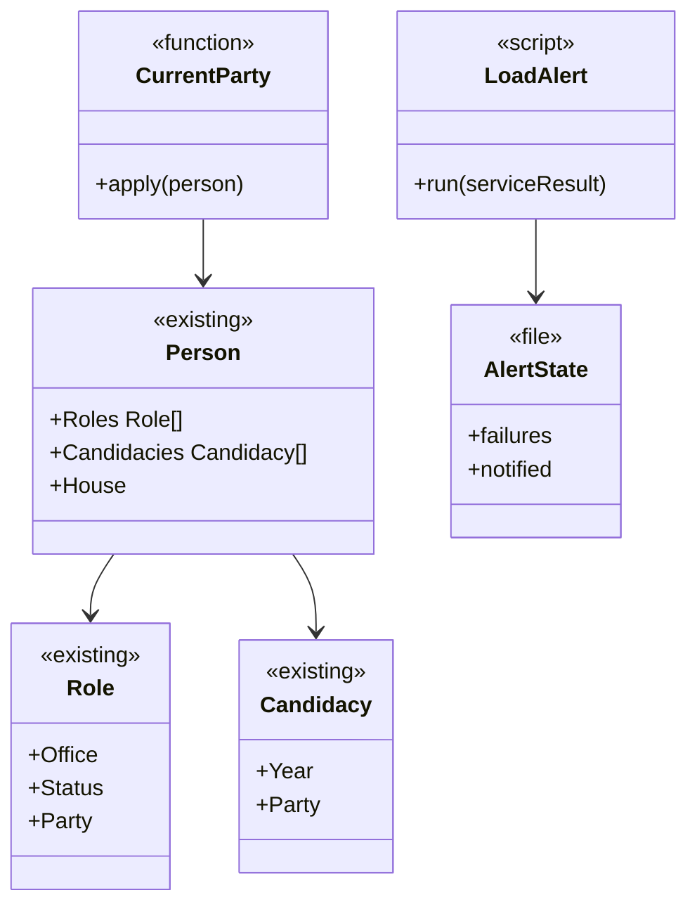

# Partido atual, retratos novos e alerta de carga

## Requirements

**Problema.** A mesma pessoa aparece com dois partidos conforme a tela, em 259 casos. Quatro vices eleitos estão com o rosto genérico. A carga ficou 6 dias parada sem aviso. O limite da Atividade ao Vivo não foi atingido por nenhum destaque publicado em 03/11.

**Definição de pronto**

**Partido**

1. Dado Eduardo Riedel, com PSDB em 2022 e PP em 2026, quando o índice e a lista de MS são gerados, então os dois dizem PP.
2. Dado o histórico dele, quando a página é gerada, então a candidatura de 2022 continua PSDB, e a de 2026, PP.
3. Dado um deputado federal, com um partido na Câmara e outro numa candidatura, quando o índice é gerado, então fica o partido da Câmara. O mesmo vale para senador e Senado.
4. Dada uma pessoa em exercício sem candidatura depois de 2022, quando o índice é gerado, então o partido não muda.
5. Dada uma pessoa sem partido na candidatura mais recente, quando o índice é gerado, então fica o último partido conhecido, sem campo vazio.
6. Dado um deputado estadual confirmado pela assembleia, quando o índice é gerado, então vale a mesma regra, porque a assembleia não publica partido no dado que lemos.
7. Dado o arquivo publicado depois do deploy, quando o script compara o índice com as listas, então nenhuma pessoa tem dois partidos, ou cada caso restante é listado com o motivo.
8. Dada uma mudança de partido no dado, quando o destaque, a comparação de colegas e as checagens são gerados, então usam o mesmo partido do índice.

**Retratos**

9. Dadas Eliane Leal, Gustavo Rocha, Jessica Sales e Larissa, com foto oficial encontrada, quando aparecem no app, então estão desenhadas. Sem foto oficial, continuam com o rosto genérico, e o usuário recebe a lista.
10. Dada a verificação com os dados publicados, quando roda, então `portrait-check --published` termina sem problemas, ou com os casos sem foto declarados.

**Alerta**

11. Dadas 6 execuções seguidas com falha, quando a sexta termina, então chega uma notificação no celular dizendo que a carga falhou, sem nenhum dado de pessoa.
12. Dadas mais falhas depois disso, quando terminam, então não chega outra notificação.
13. Dada a primeira execução boa depois do aviso, quando termina, então chega uma notificação de que voltou.
14. Dados dados com mais de 48 horas sem mudar, com as execuções terminando bem, quando a execução termina, então chega um aviso uma vez, e o título e o texto dizem que os dados estão sem mudar, sem dizer que a carga falhou.
15. Dado o tópico ausente em `secrets/`, quando o script roda, então não derruba a carga e registra no log.
16. Dado o ntfy fora do ar, quando o script roda, então não derruba a carga e tenta de novo na execução seguinte.

**Atividade ao Vivo**

17. Dado o banco de dados na VPS, quando a medida roda, então o usuário recebe quantos destaques passariam de 70, 75 e 85 nos últimos 30 dias, ou quanto histórico existe, e decide. O limite não muda nesta fase sem essa decisão.
18. Dados os registros de token recusados com erro 401, quando investigados, então a causa é relatada, e os testes de `HighlightAlertRule` e `HighlightAlertCenter` cobrem peso mínimo, janela de 24 horas e item já avisado.
20. Dado um destaque do último dia com peso 70, quando o servidor e o app avaliam a regra, então ele entra na Atividade ao Vivo. Com peso 69, não entra. Vale nos dois lados.
21. Dados os Ajustes e o método do peso, quando mostram a regra, então dizem peso 70.

**Dados quentes**

22. Dado o `release.json` publicado depois do deploy, quando o app o lê, então não há o campo `origin`, e `today.json`, `agenda/today.json` e `votes/recent.json` vêm só da Cloudflare, com atraso de até uns 10 minutos.
23. Dada a Cloudflare fora do ar, quando o app lê os dados, então continua recorrendo à VPS, como já faz.

**Documentos**

19. Dados o runbook e o backlog, quando a fase fecha, então registram o caso das imagens, o filtro do cron, o alerta e como conferir, e o App ID da Meta sai do backlog.

## Entities

O formato dos arquivos publicados não muda; só o valor de `party` nos cartões de quem está em exercício. Não há esquema novo no banco.

## Approach

- **Decisões registradas.** O [ADR 0026](../../docs/adr/0026-current-party-and-load-alert.md) registra o partido mais recente e o alerta.
- **Onde o partido muda.** Em `Link`, depois de criar os cargos: em cada cargo em exercício de governador, vice ou deputado estadual, vindo do TSE, o partido passa a ser o da candidatura mais recente que tenha partido. Cargos de Câmara e Senado já vêm da API, e prefeitos e vereadores vêm de `cities.go`: nenhum muda.
- **Assembleias.** O ramo de `link.go` que confirma o deputado estadual pela assembleia usa o partido da candidatura, e `AssemblyMember` não traz partido. A regra vale também ali.
- **Comparação antes de publicar.** Rodar o novo código sobre a mesma entrada e listar quantas pessoas mudam de partido. **O trabalho para na operação 2 com essa lista, antes de qualquer deploy.**
- **Retratos.** Decisão do usuário e regra do projeto: traços descritos a olho a partir da foto oficial, sem IA gerando imagem. Os quatro são vices eleitos, e o dado publicado não traz foto, então a foto é procurada no TSE.
- **Alerta.** Decisão do usuário: notificação pelo ntfy, em tópico privado. `ExecStopPost` em `fiscal-sync.service` chama o script com o resultado da execução. A idade vem de `public/v1/meta.json`. O tópico fica em `secrets/ntfy-topic`, e quem cria o arquivo é o usuário, sem passar pelo chat.
- **Limite do destaque.** Decisão do usuário: medir antes de mudar. Medido em 03/11/2026, pelas ações mais pesadas de cada pessoa, nos últimos 30 dias: 0 destaques com peso 85, 1 com 75 e no máximo 12 com 70, em 9 dias. Com esses números, o usuário decidiu por 70. O limite é uma constante no servidor (`AlertMinWeight`), usada pelo push do `fiscal-api` e pelo método publicado, e uma regra no app (`HighlightAlertRule.standard`). Por isso o deploy inclui o `api`.
- **Dados quentes.** Decisão do usuário em 03/11/2026: a VPS não aguentaria 50 milhões de usuários ativos, então os três arquivos quentes saem dela. `HOT_FROM_ORIGIN` passa a 0 por padrão, no `fiscal-ingest` e no `compose.yaml`. O `release.json` vem da Cloudflare, então o app não precisa de versão nova. O intervalo de `PAGES_DATA_INTERVAL` (10 minutos na VPS, conferido em 03/11/2026) passa a ser o atraso dos dados quentes. O [ADR 0008](../../docs/adr/0008-smart-sync.md) registra a mudança.
- **Push em escala.** Fica fora: o limite de 200 mil registros e o envio pela VPS não chegam a 50 milhões e pedem uma mudança própria. Registrado no backlog.
- **Fora daqui.** Curtir e compartilhar no Feed, sugestões e algoritmo do Feed, Web e publicação do site.

## Structure

- `server/internal/publicdata/link.go`: a regra do partido atual; `link_test.go`: os testes.
- `server/deploy/fiscal-load-alert.sh`: novo. `server/deploy/load_alert_test.go`: novo.
- `server/deploy/systemd/fiscal-sync.service`: `ExecStopPost`.
- `scripts/server-deploy.sh`: leva o script para a VPS, se o estágio atual não levar.
- `scripts/avatar-traits.json` e os arquivos gerados por `scripts/avatars.py`: os traços novos.
- `scripts/party-check.py`: novo, compara os partidos entre o índice e as listas publicadas.
- `FiscalKit/Tests/FiscalDomainTests/`: testes de `HighlightAlertRule`. `FiscalKit/Tests/AppShellTests/`: testes de `HighlightAlertCenter`. `FiscalKit/Package.swift`: `AppShellTests` passa a depender de `FeatureLiveResults`, para o teste implementar `HighlightActivityTracking`.
- `server/internal/publicdata/highlights.go` e `FiscalKit/Sources/FiscalDomain/PublicData/HighlightAlertRule.swift`: o limite. `server/internal/highlightalert/highlightalert_test.go`: o limite no servidor.
- `FiscalKit/Sources/FeatureSettings/SettingsScreen.swift`, `Fiscal/Fiscal/Localizable.xcstrings`, `server/README.md` e `docs/validation.md`: o texto da regra.
- `server/cmd/ingest/main.go` e `server/compose.yaml`: o padrão de `HOT_FROM_ORIGIN`. `docs/adr/0008-smart-sync.md`: a decisão.
- Documentos: `docs/adr/0026-current-party-and-load-alert.md`, `docs/adr/README.md`, `docs/server-runbook.md`, `docs/backlog.md`, `docs/roadmap.md`, `CHANGELOG.md`, `spdd/README.md`, `docs/evidence/FSC-017/qa.md`.

## Operations

1. **Partido atual.**
   - Função que aplica a candidatura mais recente com partido aos cargos em exercício de governador, vice e deputado estadual.
   - Chamada no fim de `Link`, nos dois caminhos do deputado estadual.
   - Cobre: 1 a 6, 8. Verificação: `go test ./internal/publicdata/`.
2. **Comparação.** Depende de: 1.
   - `scripts/party-check.py`, com `--dir` sobre arquivos locais e com `--published`.
   - Rodar o novo código com a entrada real, sem publicar, e listar quem muda.
   - **Parar e mostrar a lista ao usuário antes da operação 3.**
   - Cobre: 7. Verificação: a lista e o script.
3. **Alerta.**
   - `fiscal-load-alert.sh`: contador em arquivo, aviso único, aviso de volta, idade dos dados, sem falhar a carga.
   - `ExecStopPost` em `fiscal-sync.service`.
   - Cobre: 11 a 16. Verificação: teste do script com um servidor falso.
4. **Retratos novos.** `[P]` com 3.
   - Procurar a foto oficial de candidatura dos quatro no TSE e descrever os traços na escala de `avatar-traits.json`.
   - `scripts/avatars.py` regenera o arquivo do app.
   - Cobre: 9, 10. Verificação: `portrait-check`, captura.
5. **Testes e medida do destaque.** `[P]` com 3.
   - Testes de `HighlightAlertRule` e `HighlightAlertCenter`.
   - Medida na VPS, só em leitura, e investigação dos 401 com os logs.
   - **Relatar ao usuário os números e a causa.**
   - Com a decisão do usuário: limite 70 no servidor e no app, e nos textos que citam a regra.
   - Cobre: 17, 18, 20, 21. Verificação: testes e relatório.
5a. **Dados quentes.**
   - `HOT_FROM_ORIGIN` com padrão 0 no `fiscal-ingest` e no `compose.yaml`, e `1` continua aceito para voltar atrás.
   - Cobre: 22, 23. Verificação: teste do padrão, e `release.json` publicado sem `origin` depois do deploy.
6. **Deploy.** Depende de: 2, 3, 4, 5a.
   - O usuário cria `secrets/ntfy-topic` e instala o app ntfy.
   - `scripts/server-deploy.sh --apply` de `api`, `ingest`, `pages` e `units`, **com o ok do usuário, pedido na hora**.
   - Um disparo de teste do aviso, com o ok dele.
   - Cobre: 7, 10, 11, 20, 22. Verificação: `party-check --published`, `portrait-check --published`, notificação recebida, limite 70 em `method/weight.json` publicado, `release.json` sem `origin`.
7. **Documentos e fechamento.** Depende de: todas.
   - Runbook, backlog sem o App ID da Meta, roadmap, índice, `CHANGELOG` e ADR.
   - QA em `docs/evidence/FSC-017/qa.md`, dizendo o que não foi visto.
   - `scripts/verify.sh --full`, revisão em uma rodada (`spec-reviewer`, código e segurança), PR para a `development` e build no iPhone.
   - Cobre: 19. Verificação: tudo verde, ou a falha relatada como está.

## Norms

- Go com `go vet` e `go test`; Swift com zero comentários, zero warnings e Swift Testing; shell com `set -u` e sem imprimir o tópico.
- Só fatos: o partido vem de uma fonte oficial, com a fonte visível; nada é inferido.
- Testes com nomes fictícios, salvo Riedel, que é o caso relatado.
- O agente nunca lê `.env`, `secrets/`, `*.pem` nem `*.p8`, e o tópico do ntfy não passa pelo chat.
- Deploy, escrita na VPS e publicação só com o ok do usuário, pedido a cada vez.
- Todo commit traz o `Canvas:` deste arquivo. A análise e o canvas entram no primeiro commit de código.
- Quando um comportamento mudar durante a geração, o canvas muda antes pelo `spdd-prompt-update`.
- Nunca dizer que verificou o que não verificou. Um commit só sai depois de o teste passar, sem encadear um no outro.

## Safeguards

- **Histórico intacto:** o partido de cada candidatura não muda. **QUEBRA** se o histórico de alguém mudar.
- **Câmara e Senado:** o partido da API continua valendo. **QUEBRA** se um deputado federal ou senador mudar de partido por esta regra.
- **Sem inferência:** nenhum partido vem de nome, imprensa ou outra fonte que não seja oficial.
- **Lista antes do deploy:** o usuário vê quem muda de partido antes de publicar. **QUEBRA** se o deploy vier antes.
- **Traços:** só a partir de foto oficial, sem IA gerando imagem, sem guardar a foto no repositório. Sem foto, a pessoa continua genérica.
- **Rosto certo:** `portrait-check` sem nome diferente.
- **Alerta sem dado pessoal:** a mensagem só diz o estado da carga. **QUEBRA** se levar nome, token ou caminho interno.
- **Alerta não derruba a carga:** falha do script não muda o resultado do serviço.
- **Segredo:** o tópico nunca aparece em log, commit, chat ou processo visível. **Exceção registrada em 03/11/2026:** o nome em uso apareceu no chat, pela forma como o comando de criação foi rodado. A decisão de trocar ou manter é do usuário, e o runbook explica como trocar.
- **Limite do destaque:** 70, por decisão do usuário com os números. **QUEBRA** se o servidor e o app usarem valores diferentes.
- **Dados quentes:** nada além dos três arquivos muda de lugar, e a VPS continua como reserva. **QUEBRA** se o app precisar de versão nova para isso.
- **VPS:** a medida e a investigação são só leitura; o cron não muda de novo nesta fase.
- **Sem esquema novo e sem saída nova do aparelho.**
- **Fora de escopo, QUEBRA se entrar:** Feed, curtir, compartilhar, sugestões, Web e publicação do site.
- **Merge:** na `development` só com o ok do usuário, com o PR e a revisão prontos.
