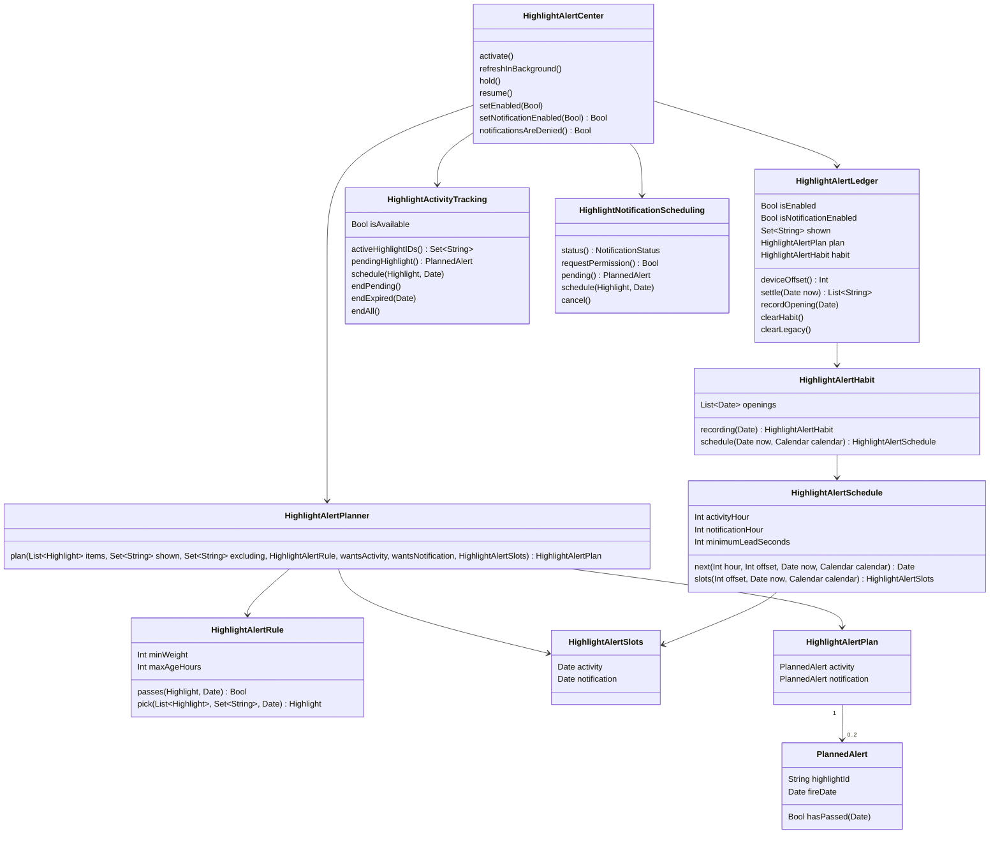

# O app só lê a CDN, e os alertas de destaque são locais

## Requirements

O app deixa de chamar a VPS em qualquer caso: toda leitura vem da CDN, e a VPS só alimenta a CDN. O iPhone passa a decidir e disparar os alertas de destaque sozinho, uma vez por dia em cada horário. A pessoa recebe a Atividade ao Vivo e, se quiser, uma notificação, cada uma num horário em que ela costuma abrir o app, aprendido só no aparelho; sem histórico suficiente, valem 08:00 e 19:00 no relógio do aparelho. Nenhum texto do app cita o horário dos alertas. A Atividade passa a mostrar o bonequinho do político. A apuração continua nas telas, pela CDN, e a Atividade da disputa sai até a próxima eleição. Fora do escopo: bonequinho nos widgets; o Fiscal na Web e a `bridge/`, parados e sem uso pelo app; renomear o `fiscal-api`; horário escolhido pela pessoa; curtir e compartilhar.

Definição de pronto (nomes e pesos são fictícios; quando o cenário não diz, o atraso do aparelho é 0, o fuso é UTC-4, os ids estão fora de `shown`, as Atividades estão permitidas, a preferência da Atividade está ligada e não há histórico de aberturas suficiente, então valem 08:00 e 19:00):

1. **Given** `h1` (peso 92) e `h2` (peso 90), ambos do dia D, **When** o app abre às 22:00 de D **Then** fica uma Atividade pendente de `h1` para 08:00 de D+1, e nenhuma Atividade começa na hora.
2. **Given** o mesmo arquivo **When** o app abre às 07:00 de D, ou às 07:59:30 **Then** o horário é 08:00 de D no primeiro caso e 08:00 de D+1 no segundo, porque o próximo horário precisa estar pelo menos 60 s à frente.
3. **Given** `h1` já pendente para 08:00 de D+1 **When** a abertura roda 6 vezes seguidas com o mesmo arquivo **Then** o pedido ao iOS acontece 1 vez e continua havendo 1 pendente.
4. **Given** `h1` pendente **When** o app abre antes do horário e o arquivo traz `h3` (peso 95) **Then** a pendente de `h1` é encerrada, `h3` fica pendente e nunca há mais de 1.
5. **Given** uma Atividade de `h1` na tela **When** o app abre às 09:00 **Then** ela continua na tela e a do horário seguinte fica pendente, com outro destaque.
6. **Given** só `h4` (peso 92) do dia D-1 **When** o app abre às 23:00 de D **Then** nada fica agendado, porque às 08:00 de D+1 o fato já passou das 24 h depois do fim do dia dele em Brasília, ainda que valesse no momento da abertura.
7. **Given** `h5` (peso 69), ou um arquivo sem destaques, ou a CDN fora do ar **When** o app abre **Then** nada novo é agendado, nenhum erro aparece e um plano já agendado continua valendo.
8. **Given** o plano guardado diz que `h1` era para 08:00 de hoje **When** o app abre às 09:00 **Then** `h1` entra em `shown` e não é escolhido de novo.
9. **Given** o iOS recusa o pedido com `targetMaximumExceeded` ou `visibility` **When** o app tenta agendar **Then** nada entra em `shown`, nenhuma mensagem aparece e a próxima tentativa é só na próxima abertura.
10. **Given** a preferência da Atividade é desligada **When** há pendente e Atividade na tela **Then** as duas são encerradas e as próximas aberturas não agendam Atividade.
11. **Given** o app preso pela atualização obrigatória **When** a política exige atualização **Then** a pendente e a notificação agendada são canceladas, e o plano só volta depois da liberação.
12. **Given** o interruptor da notificação ligado com permissão, `h1` (peso 92) e `h2` (peso 90) **When** o app abre às 22:00 de D **Then** `h1` fica como Atividade de 08:00 de D+1 e `h2` como notificação de 19:00 de D+1, com o mesmo título que o Feed mostra (o resumo simples de `h2`, ou o título oficial se não houver) e corpo "o subtítulo de `h2`".
13. **Given** o interruptor ligado e só `h1` valendo **When** o app abre **Then** `h1` é da Atividade e não sai notificação.
14. **Given** o interruptor ligado e as Atividades desligadas no sistema ou na preferência **When** o app abre com `h1` e `h2` **Then** a notificação leva `h1`, porque não há o que repetir.
15. **Given** um destaque com peso estimado **When** a notificação é montada **Then** o corpo leva o subtítulo e a incerteza curta da `FSC-004`.
16. **Given** a instalação nova **When** o app abre, muda de tela e agenda a Atividade **Then** o interruptor da notificação está desligado, e a pergunta do iOS sobre notificações nunca aparece.
17. **Given** o interruptor desligado **When** a pessoa liga e aceita a pergunta do iOS **Then** fica ligado e a notificação entra no plano. **When** recusa **Then** o interruptor volta para desligado, aparece "As notificações do Fiscal estão desligadas nos Ajustes." e um botão abre os Ajustes do Fiscal, sem nova pergunta.
18. **Given** a notificação agendada **When** a pessoa desliga o interruptor **Then** ela é removida. **Given** a permissão retirada nos Ajustes do sistema **When** o app abre **Then** nada é agendado e o aviso do cenário 17 aparece.
19. **Given** a notificação entregue de um destaque de ação **When** a pessoa toca **Then** o app abre o mesmo destino da Atividade daquele destaque (`IntegrationLink`), com o app fechado ou aberto. **Given** o app em primeiro plano no horário da notificação **Then** aparece o banner, sem som.
20. **Given** a atualização em segundo plano roda e o arquivo traz `h9` (peso 99) **When** a notificação pendente é de `h2` **Then** a notificação passa a levar `h9`, e a Atividade pendente não muda. Se o iOS não rodar a atualização, ou recusar o pedido, nada muda.
21. **Given** a Atividade de um destaque com pessoa e o PNG na prateleira **When** aparece na tela de bloqueio e na Ilha expandida **Then** mostra o bonequinho da pessoa. A Ilha compacta segue com o ícone. **Given** o PNG ausente ou ilegível **Then** aparece a silhueta com iniciais, sem erro. **Given** destaque sem pessoa **Then** não aparece retrato.
22. **Given** duas pessoas com seguidos e apoios diferentes e o mesmo arquivo **When** o plano é montado para o mesmo instante **Then** as escolhas são iguais; a regra não recebe seguidos nem apoio (teste, e o lint `support_stays_private` continua passando).
23. **Given** o servidor novo **When** chega `POST` ou `DELETE` em `/api/v1/highlight-activities`, `/api/v1/live-activities` ou `/api/v1/attest/*`, ou `GET /api/v1/races` **Then** responde 404, e `GET /api/health` responde 200 só em `127.0.0.1`.
24. **Given** o app novo com um token antigo guardado no App Group e o identificador da chave do App Attest em `AppAttestKeyID` (visto no iPhone do usuário em 05/11/2026) **When** abre **Then** os dois são apagados do aparelho e o app não pede token nenhum, nem de início nem de disputa.
25. **Given** o iPhone real, um build DEBUG com horários de teste de 2 e 4 minutos à frente, o app fechado e a tela bloqueada **When** chegam os horários **Then** a Atividade aparece com o bonequinho, fica na tela e não some sozinha, e a notificação chega depois. Prova: roteiro manual no aparelho do usuário.
26. **Given** a política de privacidade **When** a mudança fecha **Then** ela diz que o app não envia código de aparelho nem chave a nenhum servidor, que os dados públicos vêm de arquivos na Cloudflare e explica a notificação; o iCloud e as imagens das checagens seguem descritos como hoje. Landing, suporte, `llms.txt` e os textos da loja deixam de prometer Atividade na apuração. A publicação do site espera o ok do usuário.
27. **Given** os alvos do app e dos widgets **When** o build roda **Then** `FiscalAPIURL` e `FiscalWebBridgeURL` não existem, e o único endereço de dados é `FiscalDataURL`.
28. **Given** o cliente de dados com a CDN respondendo 503 **When** há cache **Then** devolve o cache; **When** não há cache, mas há pacote offline **Then** devolve o pacote; **When** não há nenhum **Then** falha com `PublicDataError.unavailable`, e nenhuma chamada sai para outro endereço (teste com o interceptador de URL).
29. **Given** `v2/races.json` com uma disputa em andamento e `fetchedAt` de 10 minutos atrás **When** `races()` roda **Then** devolve a lista da CDN, com o horário dela na tela, e não chama outro endereço; com a CDN fora, usa o pacote offline.
30. **Given** a apuração no Feed e na tela da disputa **When** há disputa **Then** os números aparecem como antes, e não há botão de acompanhar nem pedido de Atividade da disputa.
31. **Given** o app instalado no iPhone real **When** Feed, Região, Pessoa, Votações, Apuração e Ajustes são abertos, com uma captura de rede **Then** nenhum pedido vai para `fiscal.byescaleira.com/api`. Links do site, privacidade e suporte continuam abrindo no navegador.
32. **Given** o build final **When** as permissões são conferidas **Then** saem App Attest e `NSSupportsLiveActivitiesFrequentUpdates`, e ficam App Group, iCloud, `aps-environment` e `remote-notification` (só para os avisos silenciosos da sincronização do iCloud, sem registro de token em servidor do Fiscal), links universais, `fetch` e `NSSupportsLiveActivities`.
33. **Given** a VPS depois do deploy aprovado **When** a carga e o TSE rodam **Then** `fiscal-pages` continua publicando, inclusive `races.json`, e o log de acesso não recebe mais pedidos do app. Prova no fechamento, com a VPN desligada.
34. **Given** a Atividade de `h1` agendada **When** chega o horário **Then** a Atividade e o alerta do iOS trazem o mesmo título que o Feed mostra, com o subtítulo, em pt-BR, e o alerta usa o som padrão do iPhone; o modo silencioso do aparelho é respeitado pelo sistema. A notificação continua sem som.
35. **Given** aberturas às 12:10, 12:40, 13:05, 12:20 e 12:15, em 5 dias diferentes dos últimos 28, e nenhuma outra **When** o app abre às 14:00 de D **Then** a Atividade fica para 12:00 de D+1 e a notificação para 19:00 de D, porque nenhuma hora com aberturas fica a 4 h ou mais das 12:00 e o padrão 19:00 fica.
36. **Given** 6 aberturas na hora das 21 e 4 na hora das 07, em 5 dias diferentes **When** o app abre às 15:00 de D **Then** a Atividade fica para 21:00 de D e a notificação para 07:00 de D+1.
37. **Given** 4 aberturas, ou 6 aberturas em só 2 dias diferentes **When** o app abre **Then** valem 08:00 e 19:00.
38. **Given** aberturas só entre 22:00 e 06:59 **When** o app abre **Then** elas não contam, valem 08:00 e 19:00, e nenhum alerta é agendado entre 22:00 e 06:59 por causa do hábito.
39. **Given** 10 aberturas às 09h de 20 dias atrás e 5 às 18h dos últimos 3 dias, em 3 dias diferentes **When** o app abre **Then** a Atividade fica às 18:00, porque cada abertura perde metade do peso a cada 7 dias; e aberturas de mais de 28 dias não contam.
40. **Given** 8 aberturas em 10 minutos **When** o histórico é gravado **Then** conta 1 abertura, porque aberturas a menos de 30 min da anterior não contam; o histórico guarda no máximo as 60 mais recentes.
41. **Given** a Atividade e a notificação desligadas **When** o app abre **Then** o histórico de aberturas é apagado e não grava nada novo; ao religar, começa vazio e valem 08:00 e 19:00 até haver histórico.
42. **Given** Ajustes e a tela do método **When** a pessoa lê os textos dos alertas **Then** nenhum cita hora; o interruptor se chama "Notificação de destaque", e o texto diz que o horário é calculado no aparelho a partir de quando a pessoa usa o app e não sai dele.

## Entities

- `HighlightAlertSchedule`: novo; as duas horas do dia e 60 s de margem; `standard` é 08:00 e 19:00, só sem histórico. `slots` devolve os próximos instantes das duas horas, com o atraso do aparelho.
- `HighlightAlertSlots`: novo; o instante da Atividade e o da notificação, que o planejador recebe já calculados.
- `HighlightAlertPlanner.plan`: `excluding` traz os destaques já na tela, para não repetir.
- `HighlightAlertHabit`: novo; função pura sobre as aberturas guardadas, que devolve o `HighlightAlertSchedule` da pessoa.
- `HighlightAlertPlan` e `PlannedAlert`: novos; o que está agendado, guardado no App Group.
- `HighlightAlertPlanner`: novo; função pura, sem seguidos nem apoio.
- `HighlightAlertLedger`: ganha a preferência da notificação, desligada por padrão, o plano, o atraso e o histórico de aberturas; `clearLegacy` apaga o token e o `AppAttestKeyID`; `settle` passa para `shown` o que o plano já disparou; `deviceOffset` sorteia e guarda o atraso. Quem ligou ou desligou a Atividade mantém a escolha.
- `HighlightActivityTracking`: perde `onStartToken`, `onShown`, `observe` e o início na hora, salvo o showcase de DEBUG.
- `HighlightNotificationScheduling`: novo; protocolo para testar sem o sistema.
- `PublicDataClient` e `LiveResultsClient`: só `FiscalDataURL`; saem `baseURL`, `legacy`, `PublicDataRoute`, `PublicDataOrigin`, `OriginRead`, `follow`, `unfollow` e `PushEnvironment`. `LiveResultsService` fica só com `races()`.
- Saem `AppAttestor`, `RaceActivities`, `RaceActivityAttributes`, `RaceActivityPlan` e `HighlightAlertService`.
- `HighlightActivityState`: o fim passa a ser o horário agendado mais 8 h.

## Approach

1. **Estratégia da solução:** a cada abertura, o app lê a CDN e calcula o plano do próximo horário. Ele compara com o que já está agendado e só mexe no que mudou, então repetir a abertura não cria nada novo. O que já passou entra em `shown` na abertura seguinte. O app perde a reserva na VPS, o registro, o App Attest e a Atividade da disputa. O servidor perde o vigia, o APNs, o App Attest e as rotas públicas, e fica só com a carga, a leitura do TSE e a publicação.
2. **Decisões do usuário:** a Atividade e a notificação saem nos horários em que a pessoa costuma abrir o app, aprendidos no aparelho ("o horario ele pode ser dinamico por usuário", resposta "Pelo hábito da pessoa", 05/11/2026), com 08:00 e 19:00 só sem histórico; nenhum texto do app cita horário ("não precisa colocar a informação do horario no app"), e o interruptor se chama "Notificação de destaque"; notificação com o segundo destaque de maior peso; permissão só ao ligar o interruptor próprio, desligado por padrão. Sem veto às decisões anteriores da análise: abrir o app não inicia a Atividade, só o próximo horário, bonequinho na tela de bloqueio e na Ilha expandida. Pedido do usuário: "tirar tudo de bater o app direto na vps" e "só vamos deixar a vps responsavel por popular a cdn". Para vetar nesta parada: a Atividade da disputa sai inteira e volta pelo git; o `fiscal-api` fica só com a leitura do TSE, sem rota pública; sem reserva se a CDN cair; rótulo da loja proposto como "Dados não coletados". Na revisão de 07/11/2026, o usuário decidiu manter `aps-environment` e `remote-notification` só para a sincronização do iCloud ([ADR 0015](../../docs/adr/0015-background-fetch-offline-pack.md)), resposta "Sim, voltar": sem eles, o que a pessoa segue só chegaria aos outros aparelhos quando o app abrisse em cada um; o aviso é da Apple, e o app não envia token a servidor do Fiscal.
3. **Decisões padrão:**
   - A ordem do arquivo publicado continua sendo a ordem de peso, como em `pick`.
   - Hábito: conta só a abertura do app em primeiro plano, no relógio do aparelho, a no mínimo 30 min da anterior; guarda as 60 mais recentes, dos últimos 28 dias, no App Group, fora do iCloud. Cada abertura pesa `0,5^(dias/7)` na hora cheia em que aconteceu, e só contam as horas de 07 a 21, para nunca acordar ninguém. Com ao menos 5 aberturas em 3 dias diferentes, a Atividade fica na hora de maior peso e a notificação na de maior peso a 4 h ou mais dela; sem essa segunda hora, vale 19:00 e, se 19:00 estiver a menos de 4 h, 08:00. Empate fica com a hora mais cedo. O alerta sai no começo da hora, mais o atraso do aparelho, para chegar perto de quando a pessoa costuma abrir.
   - Com a Atividade e a notificação desligadas, o histórico é apagado e não grava, porque não serve a mais nada.
   - Com as Atividades desligadas, a notificação leva o primeiro destaque, porque "o segundo" só existe para não repetir a Atividade.
   - Atraso fixo por aparelho de 0 a 600 s, sorteado uma vez e guardado só no aparelho, porque 50 milhões de toques no mesmo minuto são um risco estimado para a CDN. O hábito espalha mais os horários; sem medição real.
   - O iOS exige um alerta para agendar a Atividade (`alertConfiguration` não é opcional, visto no SDK em 05/11/2026). Decisão do usuário: "Som padrão do iPhone". Se ela não aparecer no teste da operação 2, **paro e pergunto ao usuário**, com a prova.
   - A notificação não pede som (`.alert`).
   - A prateleira reaproveita 120 px e apaga PNGs com mais de 7 dias ao montar o plano, para não crescer sem limite.
   - A abertura monta o plano sem esperar a indexação das pessoas no Spotlight, porque, se a pessoa sair antes, o iOS recusa o agendamento (visto no simulador em 05/11/2026).
   - O app em segundo plano só pode trocar a notificação; a Atividade fica como está, porque o iOS recusa com `visibility`.
   - O app fixa a pasta `v2`, sem ler `release.json`; uma mudança de formato publica uma pasta nova ao lado da antiga.
4. **ADR:** [`docs/adr/0028-app-reads-only-from-cdn-and-local-alerts.md`](../../docs/adr/0028-app-reads-only-from-cdn-and-local-alerts.md), Aceito. Inverte a regra "só por Atividades ao Vivo, nunca por notificação comum" da `FSC-007`, substitui o envio por push e o [ADR 0017](../../docs/adr/0017-app-store-privacy-label.md), e revê os ADRs 0002 e 0007 onde falam de registro e App Attest. O limite de 8 h entre envios da `FSC-017` deixa de valer com o deploy.
5. **Tratamento de erros:** a falha de agendar é silenciosa e tenta de novo na próxima abertura; a CDN fora mantém o plano e, nas telas, cai no cache, no pacote offline e no erro que já existe; a recusa de permissão mostra o aviso uma vez em Ajustes, sem alerta; a falha do retrato cai na silhueta.
6. **Riscos:**
   - Quem não abre o app para de receber → texto em Ajustes e no método.
   - O hábito muda devagar e pode trocar a hora de uma pendente → a troca segue o cenário 4, no máximo uma vez por abertura; quem só abre à noite fica no padrão, pelo cenário 38.
   - O ADR 0028 cita 08:00 e 19:00 como horário fixo → a operação 11 troca por "hábito, com 08:00 e 19:00 sem histórico".
   - Conteúdo de até um dia atrás → a regra é conferida para o horário do alerta, e a data do fato continua no conteúdo.
   - Encerrar uma pendente pode não funcionar como numa ativa (ainda não medido) → teste na operação 2; se falhar, o plano segue com a pendente que existe e nunca pede outra.
   - Agendar notificação em segundo plano não foi medido → a operação 3 registra o resultado; se falhar, nada muda.
   - Migração: o app ainda não saiu, então não há versão publicada dependendo das rotas removidas; o iPhone do usuário recebe o app novo antes do deploy.
   - A reserva escondia falhas da CDN → os cenários 28 e 29 cobrem cada caso, e a captura do cenário 31 confirma no aparelho.
   - A correção dos gastos (`feature/expense-key-and-consistency`) também mexe em `server/` → entra antes, depois do PR #16.
   - Uma eleição fora do calendário usa a apuração só pela CDN, com `fiscal-pages.timer` ligado à mão; o atraso real não foi medido com esta mudança.
   - Medições citadas: apareceu a até cerca de 40 s do horário no simulador; no iPhone só está provado que ficou pendente, e o cenário 25 fecha isso.

## Structure

- `FiscalKit/Sources/FiscalDomain/PublicData/HighlightAlertRule.swift`: novo texto de `summary`; o `HighlightAlertLedger` ganha preferência, plano e atraso, e perde o token.
- `FiscalKit/Sources/FiscalDomain/PublicData/HighlightAlertPlan.swift`: novo; `HighlightAlertSchedule`, `HighlightAlertPlan`, `PlannedAlert` e `HighlightAlertPlanner`.
- `FiscalKit/Sources/FiscalDomain/PublicData/HighlightAlertHabit.swift`: novo; o hábito e a escolha das duas horas.
- `FiscalKit/Sources/FiscalDomain/LiveResults/`: `HighlightActivity.swift` com o fim pelo horário agendado; `LiveResultsService.swift` só com `races()`; `RaceActivity.swift` só com o que as telas usam.
- `FiscalKit/Sources/FiscalData/PublicData/`: `PublicDataClient.swift` e `PublicDataLayout.swift` sem reserva nem rota. `FiscalKit/Sources/FiscalData/LiveResults/`: `LiveResultsClient.swift` só com `races()`; `AppAttestor.swift` removido. `Showcase` e `FiscalKit/Sources/AppShell/FiscalServices.swift` e `Update/UpdateConnections.swift` acompanham.
- `FiscalKit/Sources/FeatureLiveResults/`: `LiveResultsModel.swift` e as telas sem acompanhar; `RaceActivities.swift` removido. `Fiscal/FiscalWidgets/RaceLiveActivity.swift` e `RaceWinnerLockScreen.swift` removidos, e `RaceBoard.swift` fica só no que os widgets usam. `FiscalKit/Sources/FeatureFeed/FeedRaceHero.swift`: sem gravar retrato da disputa.
- `Fiscal/Fiscal/Info.plist`, `Fiscal/FiscalWidgets/Info.plist`, `Fiscal/Fiscal/Fiscal.entitlements` e `Fiscal/Fiscal.xcodeproj/project.pbxproj`: endereços, permissões e modos.
- `FiscalKit/Sources/FeatureLiveResults/HighlightActivities.swift`: agendar, ler e encerrar a pendente.
- `FiscalKit/Sources/AppShell/Integrations/HighlightNotifications.swift`: novo; agenda, pede permissão e trata o toque, entregando o link em `FiscalServices.shared.pendingURL`.
- `FiscalKit/Sources/AppShell/Integrations/HighlightAlertCenter.swift`: o plano. `SystemIntegrations.swift`, `UpdateConnections.swift` e `Fiscal/Fiscal/FiscalApp.swift`: abertura, trava e atualização em segundo plano.
- `FiscalKit/Sources/FeatureCore/Portraits/PortraitStore+Shelf.swift`: limpeza de 7 dias.
- `Fiscal/FiscalWidgets/HighlightLiveActivity.swift` e `HighlightWidgetViews.swift`: retrato pela prateleira, com a silhueta de reserva, só na Atividade.
- `FiscalKit/Sources/FeatureSettings/SettingsScreen.swift` e `SettingsModel.swift`: os dois interruptores, os textos e o aviso. `Fiscal/Fiscal/Localizable.xcstrings` e `Fiscal/FiscalWidgets/Localizable.xcstrings`: as traduções.
- `FiscalKit/Tests/FiscalDomainTests/`, `FiscalKit/Tests/AppShellTests/HighlightAlertCenterTests.swift`, `FiscalKit/Tests/FeatureSettingsTests/`: os testes.
- `server/internal/highlightalert/`, `apns/`, `appattest/`: removidos; `server/internal/store/` sai se ficar sem uso. `server/cmd/server/main.go`, `server/internal/httpapi/`, `live/`, `publish/` e testes: só a leitura do TSE e a saúde local. `server/compose.yaml`: sem `APNS_*`, `HIGHLIGHT_ALERTS` e `HOT_FROM_ORIGIN`. `server/internal/site/` e `server/cmd/ingest/main.go`: sem `Origin`. `server/internal/publicdata/highlights.go`: o texto de `alert`. `server/internal/pages/`: sem a cópia de `published/highlights.json`.
- `docs/adr/0028-app-reads-only-from-cdn-and-local-alerts.md`, `docs/adr/0017`, `0002`, `0007` e `README.md`, `spdd/prompt/FSC-001-…`, `FSC-002-…` e `FSC-007-…` (pelo `spdd-prompt-update`), `site/privacy.html`, `site/index.html`, `site/support.html`, `site/llms.txt`, `docs/app-store/`, `docs/architecture.md`, `docs/validation.md`, `docs/server-runbook.md`, `server/README.md`, `docs/backlog.md`, `CHANGELOG.md`, `docs/evidence/FSC-020/qa.md`.

## Operations

1. **Regra do plano.**
   - Próximo horário, escolha da Atividade, escolha da notificação e atualização do `HighlightAlertLedger`, com o token antigo apagado.
   - A regra é conferida em cada horário; a Atividade pega o primeiro válido; a notificação pega o primeiro válido diferente dela.
   - `HighlightAlertHabit`: grava a abertura com a janela de 30 min e o limite de 60 e 28 dias, e devolve as duas horas pelo peso que cai à metade a cada 7 dias, só de 07 a 21, com o mínimo de 5 aberturas em 3 dias e as horas padrão. O ledger guarda o histórico, apaga com `clearHabit` e, em `clearLegacy`, apaga o token e o `AppAttestKeyID`.
   - Cobre: 1, 2, 6, 7, 8, 12, 13, 14, 22, 24, 35, 36, 37, 38, 39, 40. Verificação: testes de `FiscalDomainTests`.
2. **Agendar a Atividade.** Depende de: 1.
   - `HighlightActivities` lê, agenda e encerra a pendente, com fim em horário + 8 h; saem o token e o início na hora.
   - Agendar com alerta do título e do subtítulo, e som padrão. Medir no simulador: encerrar uma pendente e o limite.
   - Cobre: 3, 4, 5, 9, 34. Verificação: testes com o rastreador falso e captura no simulador. **Se a Atividade não aparecer, parar e perguntar.**
3. **Notificação local.** Depende de: 1.
   - `HighlightNotifications`: permissão, identificador fixo para substituir a anterior, sem som, corpo com a incerteza, toque pelo mesmo destino e banner em primeiro plano.
   - Cobre: 15, 17, 18, 19. Verificação: testes com o agendador falso e o simulador.
4. **Centro.** Depende de: 2, 3.
   - `activate` grava a abertura quando a Atividade ou a notificação estão ligadas, apaga o histórico quando as duas estão desligadas, e monta e aplica o plano com as horas do hábito; `hold` cancela; `setEnabled` e `setNotificationEnabled`; `refreshInBackground` só para a notificação e não grava abertura.
   - Cobre: 1 a 14, 20, 24, 35, 41. Verificação: `HighlightAlertCenterTests`, com os testes antigos do início na hora trocados.
5. **Bonequinho.** Depende de: 4.
   - Gravar o PNG antes de agendar; limpeza de 7 dias; `HighlightPhoto` na tela de bloqueio e na Ilha expandida, com a silhueta de reserva. Os widgets ficam como estão.
   - Cobre: 21. Verificação: captura no simulador nos dois tamanhos, com e sem PNG, tela estreita e tamanho de acessibilidade.
6. **Ajustes.** Depende de: 4.
   - Interruptor novo "Notificação de destaque", textos de Atividade e notificação sem hora, o `summary` da regra no método sem hora, aviso e botão dos Ajustes; só no iOS e no iPadOS.
   - Cobre: 16, 17, 18, 42. Verificação: testes de `SettingsModel`, `scripts/strings.sh` e captura sem quebrar rótulo.
7. **Só CDN na leitura.**
   - `PublicDataClient` e `LiveResultsClient.races()` só com `FiscalDataURL`; saem reserva, `PublicDataRoute`, `PublicDataOrigin`, `FiscalAPIURL` e `FiscalWebBridgeURL`.
   - Cobre: 27, 28, 29. Verificação: `PublicDataClientTests` e `LiveResultsClientTests`, com o interceptador recusando outro endereço.
8. **Sem registro, App Attest nem Atividade da disputa.** Depende de: 4, 7.
   - Remover `follow`, `unfollow`, `AppAttestor`, `RaceActivities`, as views da Atividade da disputa, o botão de acompanhar, o `HoldGate` da disputa e as permissões; as telas da apuração ficam. A sobra `AppAttestKeyID` sai pelo `clearLegacy` da operação 1.
   - Cobre: 24, 30, 32. Verificação: testes de `FeatureLiveResults`, `AppShell` e `FeatureFeed`, `scripts/build.sh Debug` nas três plataformas e captura da apuração no simulador com o cenário de disputa.
9. **Parada no iPhone.** Depende de: 5, 6, 8.
   - Build DEBUG com horários de teste por argumento de lançamento. Primeiro confirmar no simulador; depois instalar no iPhone e seguir o roteiro com o app fechado e a tela bloqueada, mais a captura de rede.
   - Cobre: 25, 31, 34. Verificação: `docs/evidence/FSC-020/qa.md`. **Parar para o ok do usuário antes da operação 10.**
10. **VPS só para a CDN.** Depende de: 9.
    - Remover vigia, APNs, App Attest, rotas, registros, `HIGHLIGHT_ALERTS`, `HOT_FROM_ORIGIN` e `Origin`; ajustar o texto do método, sem hora dos alertas; manter a leitura do TSE, a carga e a publicação.
    - Cobre: 23. Verificação: `cd server && go vet ./... && go test ./...`. **O deploy, o Caddy e apagar arquivos na VPS só com o ok do usuário, pedido na hora; a conferência do cenário 33 vem depois disso.**
11. **Documentos e fechamento.** Depende de: 10.
    - `FSC-001`, `FSC-002` e `FSC-007` pelo `spdd-prompt-update`, ADRs (o 0028 com o hábito no lugar do horário fixo), rótulo, privacidade (o histórico de aberturas fica no aparelho, sem iCloud, e nunca sai), landing, suporte, validação, runbook, arquitetura, backlog e `CHANGELOG`.
    - Cobre: 26, 33. Verificação: `python3 scripts/site-i18n.py check`, `scripts/verify.sh --full`, uma rodada de revisão, com segurança, e PR para a `development`. **Publicar o site só com o ok do usuário.**

## Norms

- Texto em pt-BR no catálogo, com chaves em inglês; zero comentários e zero warnings; tokens do design system; Swift Testing.
- Sem `sleep` bloqueante; toda chamada ao sistema fica atrás de `HighlightActivityTracking` ou `HighlightNotificationScheduling`.
- Rótulo curto nunca quebra no meio da palavra; o retrato tem acessibilidade oculta, porque o nome já está no texto.
- Commits com `Canvas: spdd/prompt/FSC-020-202611042045-[Feat]-app-reads-only-from-cdn-and-local-alerts.md`; identidade e token da conta `byescaleira`; simulador só por `scripts/simulator.sh`.
- Sem apoio nos dados de escolha, e `support_stays_private` sem exceção nova.
- Verificar no simulador antes de instalar no iPhone, e dizer o que foi entregue a cada instalação.

## Safeguards

- **QUEBRA:** todas as rotas públicas de `/api/v1` deixam de existir, inclusive leitura, apuração, registro e App Attest; o app ainda não foi publicado, e o único aparelho com versão antiga é o do usuário.
- **QUEBRA:** a Atividade da disputa e o botão de acompanhar saem até a próxima eleição; o código fica no histórico do git, e o ADR 0028 aponta o caminho de volta.
- **QUEBRA:** abrir o app não inicia mais a Atividade do destaque na hora; a regra "nunca por notificação comum" da `FSC-007` acaba, só para esta notificação.
- O app não faz nenhuma chamada direta à VPS, em nenhum caso, nem como reserva. A leitura dos dados e da apuração continua igual para quem usa, pela CDN.
- Nada de carga, leitura do TSE ou publicação no Pages pode parar com a remoção.
- Máximo: 1 Atividade pendente, 1 notificação pendente e 1 Atividade do destaque na tela. Nunca chamar o iOS para repetir o que já está agendado.
- Exatos: 08:00 e 19:00 no relógio do aparelho só sem histórico; hábito com 5 aberturas em 3 dias, 30 min entre aberturas, 60 aberturas, 28 dias, meia-vida de 7 dias, horas de 07 a 21 e 4 h entre a Atividade e a notificação; pasta `v2`, atraso de 0 a 600 s, margem de 60 s, peso 70, 24 h depois do fim do dia em Brasília, 8 h de vida, 60 ids em `shown`, 120 px no PNG e 7 dias na prateleira.
- A pergunta de notificação só aparece depois que a pessoa liga o interruptor, nunca na abertura, e sem convite do app.
- Nenhum dado sai do aparelho: nem seguidos, nem apoio, nem horário, nem histórico de aberturas, nem atraso, nem código de aparelho. O histórico de aberturas não vai para o iCloud, não entra em evento de métrica e não é lido por nenhuma tela.
- Nenhum texto do app cita a hora dos alertas. Os dados públicos do Fiscal vêm só de arquivos da CDN.
- A escolha só usa peso, data e `shown`. A notificação só traz o fato publicado, sem opinião, e não fala em partido além do que o destaque já mostra.
- Sem servidor novo, sem serviço de notificação de terceiros e sem chave nova.
- Nunca agendar mais de um horário à frente. Nunca insistir em permissão recusada.
- Nada de widget com bonequinho nesta mudança: vai ao backlog, para mostrar variantes antes de ampliar.
- Fiscal na Web, `bridge/` e `admin/` ficam como estão; nenhum deles é chamado pelo app. A chave do APNs na VPS não é lida nem movida por esta mudança; apagá-la é decisão à parte, com o ok do usuário.
- Argumento de horários de teste só em DEBUG; o código do teste de 04/11 não volta ao projeto.
- Deploy na VPS, editar o Caddy, apagar `highlight-registrations.json`, `highlight-alerts.json` e os arquivos de registro e de chaves, push, merge na `development` e publicação do site só com o ok do usuário, pedido a cada vez. O merge do PR #16 e o da correção dos gastos vêm antes. Preenchimento do rótulo no App Store Connect é do usuário.
- Sem captura versionada que mostre apoio ou quem o aparelho segue fora da lista fixa de teste.
- Nunca ler `.env`, `secrets/`, `*.pem` ou `*.p8`.
