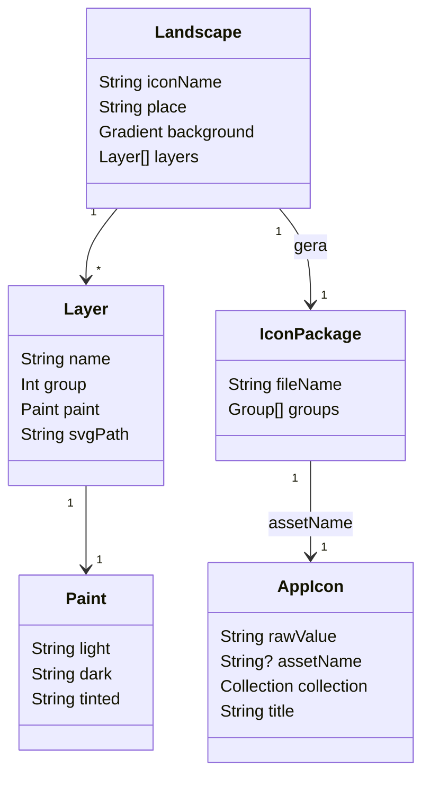

# Ícones do app com paisagens do Brasil vistas de cima

## Requirements

Os 11 ícones das seções "Ícone do app" e "Temas" repetem a mesma floresta vista de frente, e os temas só trocam a cor. Cada um passa a mostrar um lugar real do Brasil visto de cima, com o mapa do Brasil em vidro por cima, que é a marca do Fiscal. Quem escolhe um tema passa a escolher um lugar, e o nome diz qual. Ficam de fora os 6 ícones de fauna, os 30 de partido, o site e a loja.

Definição de pronto:

- **Given** o app instalado no iPhone sem ícone alternativo escolhido **When** a pessoa olha a tela inicial **Then** o ícone é a Amazônia ao amanhecer vista de cima, com a floresta cortada por um rio em curvas e o mapa do Brasil em vidro com borda branca no centro.
- **Given** Ajustes › Aparência aberto **When** a pessoa olha a seção "Ícone do app" **Then** vê, nesta ordem, "Amanhecer na Amazônia", "Dia na Amazônia" e "Encontro das Águas", os três com cena vista de cima.
- **Given** Ajustes › Aparência aberto **When** a pessoa olha a seção "Temas" **Then** vê, nesta ordem, "Cataratas do Iguaçu", "Jalapão", "Pantanal", "Ipês em flor", "Chapada dos Veadeiros", "Fernando de Noronha", "Pão de Açúcar" e "Lençóis Maranhenses", cada um com a sua cena vista de cima e a cor que o tema tinha (verde, urucum, índigo, rosa, dourado, turquesa, grafite e areia).
- **Given** a pessoa tinha escolhido o tema `themeSand` na versão anterior **When** atualiza o app **Then** o ícone continua o alternativo `FiscalIconThemeSand`, agora com os Lençóis Maranhenses, sem voltar ao principal.
- **Given** o iPhone no modo escuro, no tinted e no clear **When** a pessoa olha qualquer um dos 11 ícones **Then** a paisagem continua legível, o rio, a água ou a duna se separam do fundo e o mapa em vidro se destaca.
- **Given** o ícone a 60 pt na tela inicial **When** a pessoa olha **Then** reconhece a paisagem por no máximo 6 formas grandes, sem ruído de detalhe.
- **Given** o gerador rodado duas vezes seguidas **When** compara os arquivos **Then** os 11 `.icon` saem idênticos, byte a byte.
- **Given** o gerador recebe uma paisagem sem camada ou com cor fora do formato **When** roda **Then** para com a mensagem "landscape <nome>: <motivo>" e código de saída 1, sem escrever nenhum `.icon`.
- **Given** a primeira rodada no iPhone **When** o usuário olha Amazônia, Lençóis e Noronha lado a lado, em claro e escuro **Then** aprova o estilo ou pede ajuste antes de os outros 8 serem desenhados.

## Entities

- **`AppIcon`** (existente): os 11 casos, os valores brutos e os `assetName` não mudam; só o título de 9 deles muda (`amazonRiver` e os 8 temas).
- **`Landscape`** (nova, só no gerador): a descrição de uma paisagem — o ícone que ela gera, o lugar, o gradiente do fundo e as camadas.
- **`Layer`** e **`Paint`** (novas, só no gerador): uma forma de uma cor só, com a cor no claro, no escuro e no tinted, que vira um SVG e uma entrada do `icon.json`.
- **`IconPackage`** (existente, formato do Icon Composer): o `.icon` com `icon.json` e `Assets/`. O grupo do mapa (`9 Map.svg`, `9b Rim.svg`, vidro) é copiado do principal sem mudança.

## Approach

1. **Estratégia da solução:** ilustração vetorial caricata de cada lugar visto de cima, gerada por um script Python do projeto a partir de referências reais (fotos aéreas e de satélite, só para olhar), em camadas de uma cor que o Icon Composer pinta por aparência. O mapa em vidro do principal fica igual por cima. Primeiro a rodada de 3 paisagens no iPhone (Amazônia, Lençóis, Noronha); com o ok do estilo, os outros 8; nova parada no iPhone com os 11.
2. **Decisões:**
   - Ilustração vetorial gerada no projeto — decisão do usuário em 05/11/2026; coerente com o vidro, o escuro e o tinted, sem licença de terceiro. Foto de satélite da NASA descartada: a 1024 px não mostra Noronha nem o Pão de Açúcar e vira cinza no tinted.
   - Paisagem por ícone, decisão do usuário em 05/11/2026: principal = Amazônia ao amanhecer com rio em meandros e braços mortos; `amazonDay` = a mesma floresta ao meio-dia; `amazonRiver` = Encontro das Águas (Rio Negro escuro e Solimões barrento); `themeForest` = Cataratas do Iguaçu; `themeAnnatto` = Jalapão; `themeIndigo` = Pantanal na hora azul; `themeIpe` = Cerrado com ipês-rosa; `themeSavanna` = Chapada dos Veadeiros; `themeSea` = Fernando de Noronha; `themeGraphite` = Pão de Açúcar e a Baía de Guanabara; `themeSand` = Lençóis Maranhenses.
   - Nome do lugar nos temas, decisão do usuário em 05/11/2026: chaves novas em inglês ("Iguaçu Falls", "Jalapão", "Pantanal", "Ipês in Bloom", "Chapada dos Veadeiros", "Fernando de Noronha", "Sugarloaf Mountain", "Lençóis Maranhenses", "Meeting of the Waters") com a tradução pt-BR da Requirements. "Amazon Dawn" e "Amazon Day" ficam.
   - Estilo caricato, pedido do usuário na rodada 1 ("mais caricato, que dê pra identificar algo") e aprovado no iPhone em 05/11/2026: formas grandes e exageradas, contorno simples e luz chapada (copas em brócolis com um lado iluminado, cristas de duna em traço, ilha com morros redondos), sem curvas de nível nem textura realista. Cada cena tem um elemento-assinatura que diz o lugar sozinho a 60 pt: Amazônia ao amanhecer = vitórias-régias e uma canoa vazia no lago; Lençóis = cristas brancas com lagoas azuis e verdes; Noronha = os Dois Irmãos e uma tartaruga-marinha; Dia na Amazônia = a mesma floresta com um boto-cor-de-rosa no rio; Encontro das Águas = as duas águas, escura e barrenta, lado a lado sem se misturar; Iguaçu = a Garganta do Diabo em ferradura com espuma branca e arco-íris; Jalapão = dunas laranja, a serra em mesa e um fervedouro redondo turquesa; Pantanal = campo alagado com um tuiuiú de asas abertas; Ipês em flor = copas grandes de ipê-rosa sobre o cerrado; Chapada dos Veadeiros = cânion com cachoeira e piscina natural no capim dourado; Pão de Açúcar = o morro em gota na baía com um veleiro.
   - Mapa em vidro com borda branca igual em todos, no mesmo lugar e tamanho — é a marca do Fiscal (veto não exercido).
   - Valores brutos e `assetName` mantidos — a escolha salva continua valendo (veto não exercido).
   - Gerador em `scripts/landscape-icons.py`, só biblioteca padrão, semente fixa por paisagem, e os `.icon` gerados vão para o git como hoje; as prévias de Ajustes continuam pelo `scripts/icons.sh`.
   - Referências de estilo: os ícones em camadas do Icon Composer (Apple, "Creating your app icon using Icon Composer", WWDC25) e ilustração aérea plana de mapa; referências de lugar: fotos aéreas públicas dos 11 lugares, só para forma e cor, nunca traçadas.
   - O `brief.md` ("Ícone do app") e o `.github/readme/icon*.png` acompanham o principal novo. ADR: não precisa; a identidade do ícone mora no brief, e nada muda em arquitetura, dado ou dependência.
3. **Tratamento de erros:** o gerador valida cada paisagem antes de escrever (camadas presentes, cores `#RRGGBB`, grupos de 1 a 3 abaixo do mapa) e para no primeiro erro com "landscape <nome>: <motivo>" e saída 1, sem escrever nada; o `ictool` que falhar no `scripts/icons.sh` já para o script pelo `set -e`.
4. **Riscos:**
   - Detalhe demais vira ruído a 60 pt → no máximo 6 formas que leem de longe por cena, conferidas na tela inicial e na prévia de Ajustes.
   - Fundo claro (Lençóis, Noronha) apaga o vidro → água ou duna mais escura sob o mapa e a sombra do grupo do mapa, conferido no claro e no escuro.
   - Tinted e clear desbotam → cada camada com tom tinted próprio, em degraus de cinza que separam terra, água e vegetação.
   - Lugar sem forma reconhecível de cima → a rodada de 3 prova a leitura antes dos 8.

## Structure

- **`scripts/landscape-icons.py`** (novo): as 11 paisagens, a validação e a escrita de cada `.icon` (camadas SVG em `Assets/` e `icon.json`), copiando o grupo do mapa do `FiscalIcon.icon`.
- **`Fiscal/Fiscal/FiscalIcon.icon`, `FiscalIconAmazonDay.icon`, `FiscalIconAmazonRiver.icon` e os 8 `FiscalIconTheme*.icon`** (regerados): camadas da paisagem novas; o mapa igual.
- **`FiscalKit/Sources/FiscalResource/Assets/Media.xcassets/AppIcon/`** (regerado pelo `scripts/icons.sh`): as 11 prévias em claro e escuro; as de fauna e partido saem iguais.
- **`FiscalKit/Sources/FeatureCore/Icons/AppIcon.swift`:** títulos novos de `amazonRiver` e dos 8 temas.
- **`Fiscal/Fiscal/Localizable.xcstrings`:** 9 chaves novas com pt-BR e as 9 antigas retiradas pelo `scripts/strings.sh`.
- **`FiscalKit/Tests/FeatureCoreTests/AppIconTests.swift`:** compatibilidade dos 11 nomes.
- **`docs/brief.md`**, **`.github/readme/icon.png`** e **`icon-dark.png`**, **`CHANGELOG.md`**, **`spdd/README.md`**, **`docs/evidence/FSC-022/`** (capturas das rodadas e `qa.md`).

## Operations

1. **Gerador, base e 3 paisagens:** criar `scripts/landscape-icons.py` com `main(argv)` que aceita nomes de ícone (todos por padrão). Para cada `Landscape`: validar; montar as camadas em SVG 1024×1024 (formas de uma cor, caminhos com curvas suaves, semente fixa); escrever `Assets/<n> <Nome>.svg` e o `icon.json` com o gradiente do fundo em claro e escuro, os grupos da paisagem sem vidro, com `fill-specializations` claro, escuro e tinted, e o grupo "Map" copiado do `FiscalIcon.icon` atual. Nesta operação, só `standard` (Amazônia), `themeSand` (Lençóis) e `themeSea` (Noronha). Verificação: `python3 -I scripts/landscape-icons.py FiscalIcon FiscalIconThemeSand FiscalIconThemeSea` duas vezes e `git diff --stat` igual; uma paisagem inválida de teste sai com 1.
2. **Prévias da rodada 1:** `scripts/icons.sh`; folha lado a lado (atual × novo, claro e escuro) em `docs/evidence/FSC-022/round1.png`. Depende de: 1. Verificação: as 3 prévias abrem e o `ictool` exporta claro, escuro e tinted.
3. **Rodada 1 no iPhone:** build Debug com `FISCAL_BUILD_ROOT=~/Library/Developer/FiscalBuild-icons`, conferir no simulador (Ajustes › Aparência e a tela inicial com cada um dos 3), instalar no iPhone, parar e esperar o ok do estilo. Depende de: 2. Cobre: a rodada 1 aprovada.
4. **As outras 8 paisagens:** acrescentar `amazonDay`, `amazonRiver`, `themeForest`, `themeAnnatto`, `themeIndigo`, `themeIpe`, `themeSavanna` e `themeGraphite` no estilo aprovado; regerar os 11 e rodar `scripts/icons.sh`. Depende de: 3. Verificação: `python3 -I scripts/landscape-icons.py` duas vezes sem diff; 11 prévias novas e as 36 de fauna e partido sem diff.
5. [P] **Títulos:** em `AppIcon.localizedTitle`, `amazonRiver` → "Meeting of the Waters"; `themeForest` → "Iguaçu Falls"; `themeAnnatto` → "Jalapão"; `themeIndigo` → "Pantanal"; `themeIpe` → "Ipês in Bloom"; `themeSavanna` → "Chapada dos Veadeiros"; `themeSea` → "Fernando de Noronha"; `themeGraphite` → "Sugarloaf Mountain"; `themeSand` → "Lençóis Maranhenses". `scripts/build.sh Debug ios`, `scripts/strings.sh` e o pt-BR de cada chave. Depende de: 3. Cobre: as listas da Requirements.
6. [P] **Teste de compatibilidade:** em `AppIconTests`, um teste que fixa os `assetName` dos 3 de `main` e dos 8 de `themes`, em ordem, iguais aos de hoje, e que cada tema tem um título diferente. Depende de: 3. Verificação: `scripts/test.sh --affected`.
7. **Brief, README e changelog:** `docs/brief.md` ("Ícone do app": principal e temas vistos de cima, com a lista de lugares); `.github/readme/icon.png` e `icon-dark.png` exportados do principal a 512 px pelo `ictool`; `CHANGELOG.md` em `Unreleased`. Depende de: 4.
8. **Rodada 2 e verificação:** `scripts/verify.sh --quick`; simulador nas 4 aparências; folha dos 11 em `docs/evidence/FSC-022/round2.png` e `qa.md`; instalar no iPhone e parar para o ok final. Depende de: 4, 5, 6, 7. Cobre: modo escuro, tinted, clear, 60 pt e escolha salva.
9. **Fechamento da fase:** `scripts/verify.sh --full`, revisão única (`spdd-code-review` e `/byescaleira-workspace:review`), correções num commit, `spdd/README.md` em dia. Depende de: 8.

## Norms

- Zero comentários e zero warnings no Swift e no Python; Swift Testing para a lógica nova; o gerador só com a biblioteca padrão, rodado com `python3 -I`.
- Chave de texto em inglês e só a tradução pt-BR no catálogo ([ADR 0003](../../docs/adr/0003-portuguese-only.md)); o `Localizable.xcstrings` sincronizado pelo `scripts/strings.sh`, sem chave órfã.
- Estilo caricato em todas as 11 cenas: formas grandes, exageradas e de contorno simples, luz chapada em no máximo um tom de destaque por camada, e um elemento-assinatura por cena (Approach); nada de curva de nível, relevo sombreado ou textura realista.
- Cada camada é uma forma de uma cor só, pintada pelo `icon.json` no claro, no escuro e no tinted; nada de imagem rasterizada, gradiente dentro do SVG nem texto.
- Paisagem desenhada no projeto, a partir de referências reais só para forma e cor; nunca traçada de foto, nunca gerada por IA de imagem.
- O mapa e a borda em vidro (`9 Map.svg`, `9b Rim.svg` e as opções do grupo "Map") são copiados do `FiscalIcon.icon` atual sem mudança.
- Os `.icon` gerados e as prévias do `Media.xcassets` vão para o git, regerados pelos scripts, nunca editados à mão.
- Toda rodada conferida no simulador antes do iPhone; simulador só por `scripts/simulator.sh acquire/release <udid>`, nunca o `7EA9440B-8FB1-4725-8944-FD9DED38B493`; build em `FISCAL_BUILD_ROOT=~/Library/Developer/FiscalBuild-icons`; entrega com instalação no iPhone, dizendo o que foi entregue.
- Rodada 1 com 3 paisagens e parada; os outros 8 só depois do ok do estilo.
- Todo commit traz `Canvas: spdd/prompt/FSC-022-202611051909-[Feat]-icons-aerial-brazil-landscapes.md`; a análise e o canvas entram no primeiro commit de código.
- Quando o usuário pedir outra paisagem, cor ou nome, o canvas muda antes pelo `spdd-prompt-update`.
- Nunca dizer que verificou o que não verificou: Mac, iPad e visionOS seguem declarados no PR enquanto não forem vistos.

## Safeguards

- **Escopo dos ícones:** só os 11 de "Ícone do app" e "Temas" mudam. **QUEBRA** se algum `FiscalIconFauna*.icon`, `FiscalIconParty*.icon` ou a prévia deles aparecer no diff.
- **Escolha salva:** os 11 valores brutos e `assetName` ficam iguais; nenhum caso de `AppIcon` entra ou sai (47 casos). **QUEBRA** se o teste de compatibilidade falhar ou se `ASSETCATALOG_COMPILER_ALTERNATE_APPICON_NAMES` mudar.
- **Marca do Fiscal:** o grupo "Map" sai idêntico ao de hoje nos 11. **QUEBRA** se `9 Map.svg` ou `9b Rim.svg` diferir do principal atual.
- **Leitura a 60 pt:** no máximo 6 formas que leem de longe por cena e nenhuma camada abaixo de 24 px de largura no 1024.
- **Desempenho:** cada `.icon` com até 12 camadas e até 200 KB; o gerador roda os 11 em até 10 s.
- **Elemento-assinatura:** um por cena, legível a 60 pt; animal ou barco vazio, nunca com pessoa a bordo nem nome ou número. **QUEBRA** se alguma cena ficar sem elemento que identifique o lugar sozinho.
- **Neutralidade e lei:** nenhuma pessoa, bandeira, brasão, logotipo, marca, prédio, placa, teleférico, número ou texto na cena; nenhum lugar escolhido por ligação com partido ou político.
- **Licença:** nenhuma imagem de terceiro entra no repositório; as referências ficam citadas por nome do lugar, não baixadas para o git.
- **Fato:** o nome mostrado é o do lugar real, escrito como no IBGE e no ICMBio ("Fernando de Noronha", "Lençóis Maranhenses", "Chapada dos Veadeiros").
- **Integração e compatibilidade:** nenhum dado salvo, link, API, widget ou Atividade ao Vivo muda. **QUEBRA** visível para quem já instalou: o ícone muda de cena e 9 títulos em Ajustes mudam de nome.
- **Fora do escopo, QUEBRA se entrar:** ícones de fauna e de partido, ícone do site e do favicon, capturas e ícone da App Store, tela de Aparência além dos títulos, ícone animado, ícone por estado do país, peça nova no `byescaleira-kit`.
- **Merge e publicação:** push, PR para a `development` e merge só com o ok do usuário, a cada vez.
