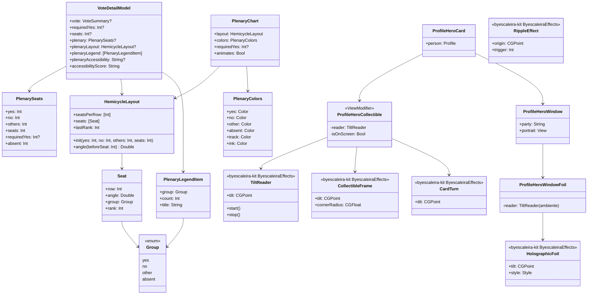

# Plenário em pontos e cartão do político holográfico

## Requirements

O usuário pediu para explorar melhor o Metal (05/11/2026). Depois da [análise](../analysis/FSC-023-202611051933-[Analysis]-metal-in-fiscal.md), da [pesquisa](../../docs/research/2026-11-05-swiftui-shaders.md) e dos protótipos no iPhone, ele escolheu três coisas: o plenário, a onda do curtir e o cartão do político holográfico, "como se fosse um card colecionável". A onda entra no kit agora e só aparece no app com a mudança de curtir, que ainda não existe.

**Definição de pronto:**

1. **Plenário da Câmara.**
   - **Dado:** a votação `camara-2236186-60` (PLP 281/2019, 14/10/2026), com 252 sim, 176 não e 1 outro.
   - **Quando:** a pessoa abre o detalhe da votação.
   - **Então:** o placar mostra 513 pontos em semicírculo no lugar da barra. Os 252 sim ficam à esquerda, os 176 não à direita, e 85 pontos no meio (1 outro e 84 que não votaram). A legenda diz "252 sim · 176 não · 1 outro · 84 não votaram". Não há linha de quórum, porque a regra de hoje só conhece a da PEC.
2. **Plenário do Senado com quórum.**
   - **Dado:** a votação `senado-7107` (PEC 221/2019), com 75 sim, 1 não e 3 outros.
   - **Então:** 81 pontos, 2 deles como "não votaram", e uma linha tracejada entre o 49º e o 50º ponto da esquerda, com o texto "49 para aprovar".
3. **PEC na Câmara:** a linha fica entre o 308º e o 309º ponto, com o texto "308 para aprovar".
4. **Contagem animada uma vez.** Ao abrir o detalhe, os pontos acendem em 2,2 s: sim da esquerda e não da direita no mesmo ritmo, depois o meio. Ao puxar para atualizar ou voltar à tela, eles aparecem completos, sem nova animação.
5. **Sem movimento.**
   - **Dado:** Reduzir movimento ligado, ou o modo leve do kit ativo (Pouca Energia, aparelho quente ou a escolha da pessoa).
   - **Então:** os 513 pontos aparecem completos, sem animação.
6. **VoiceOver.** O rótulo do placar continua o de hoje e acrescenta a frase do plenário, por exemplo "Plenário: 252 sim, 176 não, 1 outro e 84 não votaram, de 513 cadeiras".
7. **Sem plenário (caso de erro):**
   - **Dado:** uma votação simbólica, pendente, de outra casa, sem total, ou com mais votos que cadeiras.
   - **Então:** o placar fica exatamente como hoje (`TallyChart` ou `HeroNoScore`), sem pontos e sem erro.
8. **Cartão do político como carta colecionável.**
   - **Dado:** a página de qualquer político, no iPhone.
   - **Quando:** a pessoa inclina o aparelho.
   - **Então:** o cartão do topo vira uma carta, com três partes:
     - uma moldura metalizada e holográfica em volta;
     - o retrato numa janela de arte, com nuvens coloridas, listras finas e brilhos que acendem conforme o ângulo;
     - a carta inteira girando até 12° com a inclinação.
   - **Conteúdo sem efeito:** o nome, o cargo, o mandato, a situação, o partido e os botões ficam sobre o fundo do partido de hoje, com o mesmo contraste de hoje.
   - **Para todos:** o efeito é idêntico para todo político, partido, lado e cargo.
   - **Escolha:** a faixa sozinha (`KIT-014`) funcionou no iPhone, mas "não parece um card colecionável" (Rafael, 06/11/2026). Do protótipo "Carta colecionável", vale a variante recomendada, "Carta", porque ele respondeu "Não consigo validar agora, vamos seguindo". A validação no iPhone continua pendente e só pode mudar tokens.
9. **Carta parada.**
   - **Movimento:** com Reduzir movimento ou o modo leve ativo, ou no Mac e no visionOS, a moldura e a janela ficam na posição neutra, a carta não gira e o sensor de movimento não liga.
   - **Contraste:** com Aumentar contraste ou Reduzir transparência, a janela fica sem holográfico e a moldura vira um prata liso.
10. **Sensor só com a tela à vista.** Ao sair da página, ao ir para o fundo ou ao rolar o cartão para fora da tela, a leitura do movimento para em até 1 s.
11. **Onda no kit.** O `byescaleira-kit` 0.10.0 publica a onda a partir do toque, testada no catálogo. O Fiscal não a usa nesta mudança, e a ligação fica no backlog para a mudança de curtir.
12. **Sem laboratório na versão da loja.** A tela Desenvolvedor › Metal e o argumento `-FiscalMetalLab` saem do código ao fim desta mudança.

## Entities

- **`PlenarySeats`** é novo, no `FiscalDomain`: um valor só com números, sem lógica de tela.
- **`HemicycleLayout`** sai do laboratório para o `FiscalDesignSystem`, sem mudança de regra.
- **`VoteDetailModel.requiredYes`** continua com o mesmo contrato, e o número de cadeiras passa a vir de `seats`.

## Approach

1. **Decisão:** [ADR 0026](../../docs/adr/0026-shader-effects-never-carry-data.md), "Efeito de shader nunca carrega dado": o dado vai em Canvas, o shader só no efeito decorativo, igual para todos, fora do conteúdo, com uma regra de degradação e a peça genérica no kit.
2. **Plenário em Canvas, no `FiscalDesignSystem`.**
   - **Desenho:** é o desenho do protótipo, com os pontos por fileira proporcionais ao raio, a ordem por ângulo e o sim e o não contando juntos. Os protótipos mostraram que shader e Canvas desenham igual, e a pesquisa pede o dado fora do shader.
   - **Movimento:** a animação usa `TimelineView(.animation(paused:))`, que fica pausado depois dos 2,2 s.
3. **Onde entra:** no lugar da `TallyChart`, dentro do placar (`VoteScoreboard`), quando `plenary` existe. O placar continua com a superfície clara e escura da FSC-016 (`HeroSurface`, `HeroInk`), e as cores dos pontos vêm do mesmo `HeroInk`: sim em `ink.signal(.voteYes)`, não como hoje, outro em `.voteAbstain` e "não votaram" em `ink.track`.
4. **Quórum só onde o app já sabe.** A linha usa o `requiredYes` de hoje, que é só o da PEC (3/5). Maioria absoluta da PLP e maioria simples ficam de fora: a proposição PLP também tem votações de requerimento, e uma linha errada mudaria a leitura de "passou ou não". Isso vai para o backlog, com a fonte da regra.
5. **Cadeiras:** 513 na Câmara e 81 no Senado, as mesmas constantes do `requiredYes`, levadas para `seats`. "Não votaram" é cadeiras menos o total publicado, com o nome dito na legenda. O app não chama isso de "ausentes", porque inclui quem preside a sessão e quem não registrou voto.
6. **Kit primeiro, na mudança `KIT-014` "Efeitos de shader".**
   - **Processo próprio:** análise e canvas no `byescaleira-kit`, com o ok do usuário, um PR para a `main` do kit, merge e tag `v0.10.0` com ok a cada vez.
   - **Módulo novo `ByescaleiraEffects`**, que depende de `ByescaleiraAccessibility` e `ByescaleiraDesign`:
     - `Effects.metal`, com `holographicFoil` e `ripple`;
     - `HolographicFoil`, uma view para usar como camada (`blendMode(.screen)`);
     - `TiltReader`, com o CoreMotion a 30 Hz no iOS e parado nas outras plataformas;
     - `View.ripple(origin:trigger:)`, com `isEnabled` só durante a animação;
     - `EffectsWarmUp.compile()`.
   - **Degradação:** a mesma regra do ADR, lida de `accessibilityReduceMotion` e `\.liteMode`.
   - **Plataformas:** compila nas cinco do kit; no watchOS, as views devolvem o conteúdo sem efeito.
7. **Holográfico no fundo do cartão** (etapa C, substituído pelo item 12 na etapa C2). O `ProfileHeroCard` ganha o `HolographicFoil` sobre o `PartyBackdrop`, dentro do mesmo recorte do fundo. Assim, o texto, o retrato animado (Lottie) e os botões de vidro ficam fora do efeito, que é o achado do 🚫 nos protótipos.
   - **Parâmetros fixos:** força 0,42, faixa a 33°, espectro de 0,85. Nenhum vem do perfil.
   - **Sensor:** o `tiltReading(_:)` do kit liga e desliga o `TiltReader` com o aparecer, a cena e o gate, e o `onScrollVisibilityChange` tira a leitura quando o cartão sai da tela. A cada leitura, só a camada do fundo é redesenhada, porque a inclinação mora numa subview própria.
8. **Compilação antes do uso:** `EffectsWarmUp.compile()` roda uma vez no `task` da página do político, fora do caminho do toque.
9. **Laboratório:** sai na última etapa, junto com o argumento de abertura e a linha em `MainScreen`. Os achados ficam na análise.
10. **Padrões seguidos sem pergunta:**
    - textos com chave em inglês e tradução pt-BR no catálogo (`scripts/strings.sh`);
    - tokens do design system;
    - um teste de modelo para toda lógica;
    - a captura no simulador antes do iPhone.
11. **Etapas com parada no iPhone:**
    - (A) o plenário;
    - (B) o kit `KIT-014` até a tag, com as paradas do processo do kit;
    - (C) o cartão holográfico;
    - (C2) a carta colecionável: a `KIT-015` no kit até a tag `v0.11.0` e o cartão do topo como carta;
    - (D) remoção do laboratório, documentos e fechamento.
12. **Carta colecionável** (prompt-update de 06/11/2026).
    - **Peças do kit:** a `KIT-015` traz `HolographicFoil(tilt:style: .sparkle)`, `collectibleFrame(tilt:cornerRadius:)` e `cardTurn(_:)`, com a mesma degradação da `KIT-014`.
    - **Montagem no Fiscal:** o kit dá as peças, e a carta é montada no `ProfileHero`:
      - o fundo do partido fica atrás do conteúdo, no raio `.radiusGroup` menos a moldura;
      - a moldura e o giro ficam em volta do cartão;
      - o retrato vai para uma janela de arte (`PartyBackdrop` com a folha `.sparkle` por cima, recortada em `.radiusM` e com um contorno branco suave).
    - **Inclinação:** um `ProfileHeroCollectible` é dono do `TiltReader`. Ele aplica a moldura e o giro, põe o leitor no ambiente para a folha da janela e mantém o `tiltReading` com o `onScrollVisibilityChange` da etapa C.
    - **Fora do protótipo:**
      - o reflexo por cima, porque clareava o texto;
      - o formato 63:88, que deixaria o topo da página alto demais;
      - o painel escuro, porque o fundo do partido sem folha já tem o contraste de hoje.
    - **Tamanho:** a moldura soma 9 pt (`.collectibleFrame`) de cada lado. O conteúdo fica 18 pt mais estreito e o cartão 18 pt mais alto, mas a largura externa continua a da página.
13. **Exploração antes do canvas:** o laboratório (`a877737`, `605bf86` e o protótipo da carta, `decf30d`) entrou antes do canvas e da prompt-update, por ser exploração só em DEBUG, pedida para escolher no iPhone. Ele saiu na etapa D, e nada dele fica no app.

## Structure

| Arquivo | Mudança |
| --- | --- |
| `FiscalKit/Sources/FiscalDomain/PublicData/PlenarySeats.swift` | Novo: `PlenarySeats` (números e `absent`) |
| `FiscalKit/Sources/FiscalDesignSystem/Charts/HemicycleLayout.swift` | Movido do laboratório, público |
| `FiscalKit/Sources/FiscalDesignSystem/Charts/PlenaryChart.swift` | Novo: `PlenaryChart`, `PlenaryColors`, `HemicycleGeometry` e a linha do quórum |
| `FiscalKit/Sources/FiscalDesignSystem/Tokens/ChartSize.swift` | Tokens do plenário (proporção, preenchimento, tamanho do ponto, duração) |
| `FiscalKit/Sources/FeatureVotes/VoteDetailModel+Plenary.swift` | Novo: `seats`, `plenary`, `plenaryLegend`, `plenaryAccessibility` |
| `FiscalKit/Sources/FeatureVotes/VoteDetailModel+Text.swift` | `requiredYes` usa `seats`; `accessibilityScore` inclui o plenário |
| `FiscalKit/Sources/FeatureVotes/VoteHeroSection.swift` | `PlenaryChart` no lugar da `TallyChart` quando `plenary` existe, com a legenda |
| `FiscalKit/Package.swift` | `byescaleira-kit` a partir de `0.10.0`, e de `0.11.0` na etapa C2; `ByescaleiraEffects` no `FeatureProfile` |
| `FiscalKit/Sources/FeatureProfile/ProfileHero.swift` | Etapa C: fundo com `HolographicFoil` e uma subview dona do `TiltReader`. Etapa C2: a carta, com `ProfileHeroCollectible`, a janela de arte e a moldura |
| `FiscalKit/Sources/FeatureProfile/ProfileScreen.swift` | `EffectsWarmUp.compile()` no `task` |
| `FiscalKit/Tests/FiscalDesignSystemTests/HemicycleLayoutTests.swift` | Movido de `FeatureSettingsTests` |
| `FiscalKit/Tests/FeatureVotesTests/VoteDetailModelPlenaryTests.swift` | Novo |
| `FiscalKit/Tests/FiscalDomainTests/PlenarySeatsTests.swift` | Novo |
| `FiscalKit/Package.resolved`, `Fiscal.xcworkspace/xcshareddata/swiftpm/Package.resolved` | `byescaleira-kit` 0.10.0 e depois 0.11.0 |
| `docs/evidence/FSC-023/` | QA: roteiro, capturas e contraste medido |
| `FiscalKit/Sources/FeatureSettings/MetalLab/`, `HemicycleLayoutTests` em `FeatureSettingsTests`, `DeveloperScreen.swift`, `AppShell/MainScreen.swift` | Laboratório removido (etapa D) |
| `Fiscal/Fiscal/Localizable.xcstrings` | Textos novos do plenário |
| `docs/design-system.md`, `docs/backlog.md`, `CHANGELOG.md`, `docs/adr/README.md`, `spdd/README.md` | Documentos |
| `byescaleira-kit` (outro repositório) | `KIT-014`: `Sources/ByescaleiraEffects/`, testes, aba no catálogo, `CHANGELOG`, tag `v0.10.0`; `KIT-015`: folha `.sparkle`, moldura e giro, tag `v0.11.0` |

## Operations

**Etapa A: plenário**

1. **`PlenarySeats`** `[P]`
   - **Assinatura:** `public struct PlenarySeats: Hashable, Sendable { let yes, no, others, seats: Int; let requiredYes: Int?; var absent: Int }`.
   - **Init:** `init?(yes:no:others:seats:requiredYes:)` falha se algum número for negativo, se `seats` for 0, ou se `yes + no + others > seats`.
   - **Lógica:** `absent = seats - yes - no - others`.
   - **Verificação:** teste com 252/176/1/513 (`absent` 84), com 600 votos em 513 (nil) e com negativo (nil).
2. **`HemicycleLayout` no `FiscalDesignSystem`** `[P]`
   - **Lógica:** a mesma do protótipo: fileiras pelo menor desajuste entre o arco e a largura da fileira (até 24), cadeiras por fileira por maior resto, ordem por ângulo, sim à esquerda e não à direita com o mesmo ritmo, e o meio depois.
   - **Assinatura:** `public init(yes:no:others:seats:)`, com os números, porque o `FiscalDesignSystem` não depende do `FiscalDomain`. O `VoteDetailModel` passa os valores do `PlenarySeats` em `plenaryLayout`.
   - **Verificação:** os 5 testes do protótipo, movidos para `FiscalDesignSystemTests`, mais 81 cadeiras com 2 "não votaram".
   - **Depende de:** 1.
3. **`PlenaryChart`**
   - **Assinatura:** `public struct PlenaryChart: View { init(layout:colors:requiredYes:animates:) }`, com `PlenaryColors { yes, no, other, absent, track }`.
   - **Desenho:**
     - um `Canvas` com um círculo por cadeira;
     - o raio do ponto é 0,38 da menor medida entre a largura da fileira e o arco da cadeira;
     - até a contagem chegar, a cadeira fica em `track` com opacidade `.opacityTint`;
     - o ponto que acaba de acender cresce até 1,55× e volta em 18 cadeiras.
   - **Linha do quórum:** tracejada entre as cadeiras `requiredYes` e `requiredYes + 1`, com o texto "%lld para aprovar" (chave `"%lld to pass"`) no vão central. Sem `requiredYes`, não há linha.
   - **Animação:** com `animates` verdadeiro, `TimelineView(.animation(paused:))` corre por 2,2 s a partir do aparecimento, uma vez por instância (`@State`); com `animates` falso, desenha completo.
   - **Acessibilidade:** `accessibilityHidden(true)`, porque o rótulo fica no placar.
   - **Verificação:** captura no simulador, claro e escuro, Câmara e Senado; o protótipo serve de referência.
   - **Depende de:** 2.
4. **`VoteDetailModel+Plenary`**
   - **`seats: Int?`:** 513 para `.camara`, 81 para `.senado`, nil para as outras casas. `requiredYes` passa a usar `seats`, com o mesmo resultado.
   - **`plenary: PlenarySeats?`:** existe só quando a votação é nominal, tem placar (`hasScore`), tem `seats` e tem `tally.total > 0`. Usa `yes`, `no` e `others ?? 0`, e o `requiredYes` atual.
   - **`plenaryLayout: HemicycleLayout?`:** o `HemicycleLayout` montado com os números do `plenary`.
   - **`plenaryLegend`:** quatro itens com a contagem, o título ("sim", "não", "outro"/"outros" por plural, "não votaram") e a cor.
   - **`plenaryAccessibility`:** "Plenário: %lld sim, %lld não, %lld outros e %lld não votaram, de %lld cadeiras", e, com quórum, mais "%lld sim para aprovar".
   - **`accessibilityScore`:** acrescenta `plenaryAccessibility` antes do `headline`.
   - **Verificação:**
     - `camara-2236186-60` (252/176/1, PLP): plenário de 513 sem quórum;
     - PEC na Câmara: quórum 308;
     - `senado-7107`: 81 e quórum 49;
     - simbólica, pendente e 600 votos: sem plenário;
     - o `requiredYes` de antes não muda.
   - **Depende de:** 1.
5. **Placar com o plenário**
   - **Lógica:** em `VoteScoreboard`, quando `vote.plenary` existe, `PlenaryChart` no lugar da `TallyChart`, com `PlenaryLegend` embaixo, e `animates = !reduceMotion && !MotionBudget.isConstrained` (`@ReducesMotion`). Sem plenário, o código de hoje fica intacto.
   - **Legenda:** em linha, cada item com `lineLimit(1)` e `fixedSize`; nos tamanhos de acessibilidade, uma coluna.
   - **Verificação:**
     - captura no simulador da `camara-2236186-60` e da `senado-7107`, em claro, escuro, AX3 e com Reduzir movimento;
     - `scripts/ui-test.sh` no fluxo de votação;
     - depois, o iPhone.
   - **Depende de:** 3 e 4.
6. **Textos do plenário**
   - **Lógica:** `scripts/strings.sh` depois do build, com a tradução pt-BR de cada chave nova.
   - **Verificação:** o catálogo sem chave nova em `new` ou `needs_review`.
   - **Depende de:** 5.

**Parada A:** captura e iPhone; espera o ok do usuário.

**Etapa B: kit**

7. **`KIT-014` no `byescaleira-kit`**
   - **Processo:** análise e canvas no kit (parada do kit), código, `scripts/verify.sh --full` do kit (cinco plataformas e catálogo), PR para a `main` do kit, merge e a tag `v0.10.0`, só com o ok do usuário a cada passo.
   - **Contrato que o Fiscal usa:**
     - `HolographicFoil(tilt: CGPoint)`, uma view;
     - `@Observable TiltReader` com `tilt`, `start()` e `stop()`;
     - `View.ripple(origin: CGPoint, trigger: some Equatable)`;
     - `EffectsWarmUp.compile() async`.
   - **Degradação embutida:** com Reduzir movimento ou `\.liteMode.reducesMotion`, `HolographicFoil` ignora a inclinação, `ripple` não anima e `TiltReader.start()` não liga o sensor.
   - **Verificação:** testes do kit (o gate, o limite da inclinação e o `TiltReader` sem sensor), a aba no catálogo e a captura.

**Parada B:** o merge e a tag do kit, com o ok do usuário.

**Etapa C: cartão holográfico**

8. **Kit 0.10.0 no Fiscal**
   - **Lógica:** `Package.swift` a partir de `0.10.0`, e `ByescaleiraEffects` como dependência do `FeatureProfile`.
   - **Verificação:** `scripts/build.sh Debug` nas três plataformas.
   - **Depende de:** 7.
9. **Fundo holográfico do `ProfileHeroCard`**
   - **Lógica:**
     - o `background` do cartão passa a ser uma subview `ProfileHeroBackdrop(party:)`, com o `PartyBackdrop` e o `HolographicFoil(tilt: reader.tilt)` por cima, recortados juntos em `.radiusGroup`;
     - o `TiltReader` é um `@State` dessa subview, ligado pelo `tiltReading(_:)` do kit (aparecer, cena ativa e gate), num filho que sai quando o `onScrollVisibilityChange` diz que o cartão saiu da tela;
     - nada do `Profile` entra no efeito, além do partido, que já pinta o `PartyBackdrop` hoje.
   - **Verificação:**
     - captura no simulador, arrastando a inclinação pelo catálogo do kit;
     - o iPhone inclinando;
     - o contraste do nome e do cargo medido com a faixa no centro, em 3 cores de partido (claro, médio e escuro);
     - o sensor parado ao sair da página, coberto pelos testes do `TiltReader` no kit.
   - **Depende de:** 8.
10. **Compilação antes do uso**
    - **Lógica:** `await EffectsWarmUp.compile()` no `task` da `ProfileScreen`.
    - **Verificação:** a página abre sem engasgo no iPhone, medida com "Medir quadros" antes de remover o laboratório.
    - **Depende de:** 8.

**Parada C:** iPhone; espera o ok.

**Etapa C2: carta colecionável**

13. **`KIT-015` no `byescaleira-kit`**
    - **Processo:** análise e canvas no kit, código, `scripts/verify.sh --full` do kit, PR para a `main` do kit, merge e tag `v0.11.0`, só com o ok do usuário a cada passo.
    - **Contrato que o Fiscal usa:**
      - `HolographicFoil(tilt:style:)`, com `.sparkle`;
      - `View.collectibleFrame(tilt:cornerRadius:)`;
      - `View.cardTurn(_:)`.
    - **Verificação:** os testes do giro no kit e a captura do exemplo "Carta" no catálogo.

**Parada C2:** push, merge e tag do kit, com o ok do usuário.

14. **Kit 0.11.0 no Fiscal**
    - **Lógica:** `Package.swift` a partir de `0.11.0`, com os dois `Package.resolved`.
    - **Verificação:** `scripts/verify.sh --quick ios`.
    - **Depende de:** 13.
15. **Cartão do topo como carta**
    - **Lógica:**
      - o `ProfileHeroBackdrop` sai;
      - o conteúdo do cartão fica sobre o `PartyBackdrop`, recortado em `.radiusGroup - .collectibleFrame`;
      - o `ProfileHeroCollectible` envolve o cartão com `collectibleFrame(tilt:cornerRadius: .radiusGroup)` e `cardTurn(_:)`, é dono do `TiltReader` e o põe no ambiente;
      - o retrato fica numa janela de arte com `PartyBackdrop` e `ProfileHeroWindowFoil`, que lê o leitor do ambiente e desenha a folha `.sparkle`;
      - o crédito "Fiscal Illustration" fica embaixo da janela.
    - **Verificação:**
      - captura no simulador, em claro e escuro, com Reduzir movimento e com Aumentar contraste;
      - o contraste do nome, do cargo e da situação medido em 3 cores de partido, igual ao de antes da etapa C;
      - o iPhone, quando o usuário puder validar.
    - **Depende de:** 14.

**Etapa D: fechamento**

11. **Laboratório removido**
    - **Lógica:** apagar `FeatureSettings/MetalLab/`, os testes do laboratório, a seção em `DeveloperScreen` e o `MetalLabLaunch` em `MainScreen` (e o `import FeatureSettings` que só ele usava).
    - **Verificação:** `grep -r "MetalLab\|FiscalMetalLab"` sem resultado; build nas três plataformas.
    - **Depende de:** 5, 10 e 15.
12. **Documentos**
    - **`docs/design-system.md`:** seção "Efeitos" com as seis regras do ADR 0026, o plenário e o holográfico.
    - **`docs/backlog.md`:** a onda do kit no curtir; a linha de quórum da PLP (maioria absoluta, art. 69 da Constituição) com a regra de quando vale; a medição com Instruments e Power Profiler num aparelho antigo.
    - **`CHANGELOG.md`:** `Unreleased`.
    - **ADR 0026:** Aceito.
    - **`spdd/README.md`:** a linha da `FSC-023`.
    - **Verificação:** `scripts/verify.sh --full` e a rodada única de revisores.
    - **Depende de:** 11.

## Norms

- **Plataforma:** iOS, iPadOS, macOS e visionOS a partir do 26. No Mac e no visionOS, o plenário é igual e o holográfico fica parado.
- **Arquitetura** (constituição, regra 3): a lógica do plenário fica no model e no `HemicycleLayout`; a view só desenha. Features não se importam; o `FeatureVotes` usa o `FiscalDesignSystem`.
- **Código:**
  - zero comentários e zero avisos;
  - tokens do design system, sem número solto fora deles;
  - Swift Testing em `PlenarySeats`, `HemicycleLayout` e `VoteDetailModel+Plenary`.
- **Textos:** chaves em inglês com tradução pt-BR; números por `PublicFormat.number`, exceto as contagens do plenário (até 513), que ficam em `%lld` para o catálogo escolher o plural ("1 outro", "84 não votaram") e nunca passam de três dígitos.
- **Movimento:** `@ReducesMotion` e `MotionBudget.isConstrained` no app; `accessibilityReduceMotion` e `\.liteMode` no kit, que é a mesma regra.
- **Fato, não opinião** (regra 14): a cor de cada ponto é o voto, a ordem é a do voto, a linha é a regra publicada e o holográfico é igual para todos.
- **Verificação:** `scripts/verify.sh --quick` durante o trabalho; `--full` no fim; captura no simulador antes do iPhone; `FISCAL_BUILD_ROOT=~/Library/Developer/FiscalBuild-metal`.
- **Commits:** em inglês, com `Canvas: spdd/prompt/FSC-023-202611052151-[Feat]-plenary-and-holographic-card.md` no corpo, e o e-mail `rafaelescaleira@icloud.com`.

## Safeguards

- **Proibido variar o efeito por dado.** O holográfico e a onda não recebem nada do político, do partido (além do fundo que já existe), do cargo, do resultado, do seguir, do apoio ou de qualquer número. Nada de "carta rara" para alguns.
- **Proibido shader no dado.** O plenário é `Canvas`; nenhum `colorEffect`, `layerEffect` ou `distortionEffect` desenha ponto, barra, número ou texto.
- **Proibido envolver o conteúdo com o efeito.** O efeito não envolve texto, número, retrato ou botão: só camada de fundo. Nenhum `layerEffect` em volta de view com Lottie.
  - A moldura pinta atrás do cartão.
  - O giro é uma transformação, sem shader.
  - Não há reflexo nem folha por cima do texto.
- **Proibida linha de quórum sem regra conhecida.** Só a PEC (3/5 de 513 = 308; de 81 = 49). PLP e maioria simples ficam no backlog.
- **QUEBRA:** a `TallyChart` sai do placar quando há plenário. A acessibilidade do placar ganha uma frase, e o `requiredYes` não muda de valor.
- **Contagem igual ao dado:**
  - o total de pontos é sempre 513 ou 81;
  - sim, não e outros são exatamente os publicados;
  - "não votaram" é o resto, nunca negativo;
  - com mais votos que cadeiras, não há plenário.
- **Sensor:** o `TiltReader` nunca liga com Reduzir movimento ou o modo leve, fora da tela ou com a cena inativa; 30 Hz no máximo.
- **Sem animação contínua em tela de dado:** a contagem dura 2,2 s e para; o holográfico só redesenha quando a inclinação muda.
- **Kit:**
  - nada do kit entra no Fiscal antes da tag `v0.10.0`, e nada da carta antes da `v0.11.0`;
  - push, merge e tag no kit e no Fiscal só com o ok do usuário, a cada vez;
  - nenhuma dependência nova de terceiros.
- **Fora de escopo:**
  - curtir e a onda no app;
  - papel nos cartazes;
  - o mapa da arrecadação (`FSC-021`);
  - fluxo do dinheiro e abertura com shader;
  - widgets, Atividade ao Vivo e o site;
  - cartazes de compartilhar do político;
  - o formato 63:88 e o reflexo do protótipo;
  - linha de quórum da PLP;
  - servidor e dados.
