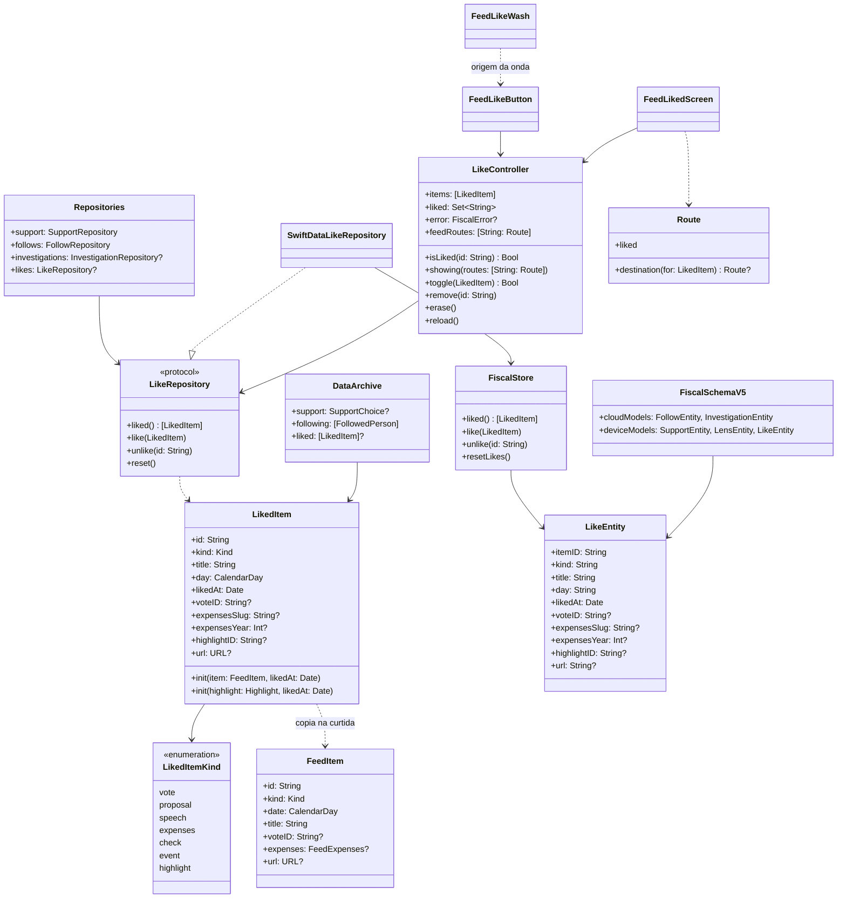

# Curtir no Feed com a onda

## Requirements

O usuário pediu o curtir com a onda escolhida na FSC-023 ("depois cria a FSC-024 do curtir com a onda", 06/11/2026). A [análise](../analysis/FSC-024-202611061413-[Analysis]-like-with-ripple.md) levou a três escolhas dele: o curtir é privado e sem contagem, fica só no aparelho, e a lista "Curtidas" fica no Feed, ao lado de "Meu apoio". Sem veto às outras decisões:
- o coração vai em todas as linhas do Feed e nos cartões do topo;
- só o botão do coração, sem os dois toques no cartão;
- o coração no rodapé, à direita, com 44 pt;
- a `FiscalSchemaV5`.

**Definição de pronto:**

1. **Curtir uma votação.**
   - **Dado:** o Feed com a linha da votação `camara-2236186-60` (PLP 281/2019) e o coração vazio.
   - **Quando:** a pessoa toca no coração.
   - **Então:**
     - o coração fica cheio, na cor de destaque do app;
     - uma faixa de cor aparece atrás da linha, com a onda saindo do coração, e some em 1,6 s;
     - o texto, os números e o retrato da linha não se mexem;
     - o iPhone dá um toque háptico leve;
     - a votação aparece no topo da lista "Curtidas".
2. **Descurtir.**
   - **Dado:** a mesma linha curtida.
   - **Quando:** a pessoa toca no coração de novo.
   - **Então:** o coração fica vazio, sem onda e sem toque háptico, e a votação sai da lista "Curtidas".
3. **Guardado.** Ao fechar e abrir o app, o coração da votação continua cheio.
4. **Sem movimento.**
   - **Dado:** Reduzir movimento ligado, ou o modo leve do kit ativo (Pouca Energia, aparelho quente ou a escolha da pessoa).
   - **Quando:** a pessoa curte.
   - **Então:** o coração fica cheio sem faixa e sem onda, e o toque háptico continua.
5. **VoiceOver.**
   - O coração é um elemento próprio, depois do cartão, e lê "Curtir, botão de alternância, desligado".
   - Ao ativar, ele lê "ligado".
   - O rótulo do cartão não muda.
6. **Lista "Curtidas".**
   - **Quando:** a pessoa abre o menu do coração na barra do Feed e escolhe "Curtidas".
   - **Então:**
     - a lista mostra o mais recente primeiro, com o símbolo do tipo, o título e o dia do item;
     - tocar na votação abre o detalhe da votação;
     - tocar num gasto abre os gastos do mês;
     - tocar num destaque abre o destaque;
     - tocar numa checagem abre a página do Comprova no navegador;
     - uma proposta, um discurso ou um evento sem votação e sem link abre o mesmo destino da linha enquanto continua no Feed; quando sai do Feed, fica sem toque e diz "Este item saiu do Feed";
     - o rodapé diz "Suas curtidas ficam só neste aparelho, fora do iCloud e do backup."
7. **Lista vazia.** Sem curtidas, a tela mostra "Nada curtido" e "Toque no coração de um item do Feed para guardar aqui."
8. **Apagar curtidas.**
   - **Quando:** a pessoa escolhe "Apagar curtidas" e confirma.
   - **Então:** a lista fica vazia, e todos os corações do Feed ficam vazios.
   - Arrastar uma linha para a esquerda mostra "Descurtir", que tira só aquela.
9. **Destaque do topo.**
   - O destaque tem o mesmo coração, no canto inferior direito, em branco, a tinta do cartão.
   - A faixa com a onda é branca e fica entre o fundo do cartão e o conteúdo.
   - A apuração fica sem coração nesta fase (Approach 13).
10. **Privacidade.**
    - A entidade das curtidas está só em `deviceModels`, e o `Device.store` continua fora do backup.
    - A exportação de dados traz as curtidas.
    - Nenhuma curtida vai para CloudKit, servidor, telemetria, Spotlight, widget, Siri, notificação ou cartaz.
11. **Migração.**
    - **Dado:** um banco na `FiscalSchemaV4`, com apoio e dois seguidos.
    - **Quando:** o app abre na V5.
    - **Então:** o apoio e os seguidos continuam iguais, e há zero curtidas.
12. **Curtir não muda o Feed.** Com e sem curtidas, a ordem e os itens do Feed são os mesmos, e o filtro "Seguindo" não muda.
13. **Erro ao gravar (caso de erro).**
    - **Dado:** o repositório falha ao gravar.
    - **Quando:** a pessoa toca no coração.
    - **Então:** o coração volta ao estado de antes, e o aviso de erro aparece como no seguir.
    - Dois toques rápidos no mesmo coração fazem uma mudança só.
14. **Exportação antiga.** Um arquivo exportado antes desta mudança, sem o campo das curtidas, continua sendo lido.

## Entities

## Approach

1. **Curtida privada** ([ADR 0027](../../docs/adr/0027-private-likes-on-device.md), Proposto):
   - escolha do usuário em 06/11/2026;
   - sem contagem e sem nada fora do aparelho;
   - curtir não muda o Feed.

   É a mesma política do apoio ([ADR 0021](../../docs/adr/0021-end-of-lens-support-on-device.md)).
2. **Dado:**
   - a `LikedItem` copia do item o que precisa para mostrar e reabrir: tipo, título, dia e os identificadores de destino;
   - `ContentDetail` não é `Codable` e não é guardado. Enquanto o item está no Feed, a lista usa a rota que o Feed mostra agora; quando ele sai do Feed, uma proposta, um discurso ou um evento sem votação e sem link mostra "Este item saiu do Feed" na lista;
   - o `id` é o mesmo do `FeedItem` (`vote-…`, `check-…`, `expenses-…`), e `highlight-<id>` no destaque.
3. **Esquema:**
   - a `FiscalSchemaV4` vira uma versão congelada, com cópias aninhadas das quatro entidades, como a V3;
   - a `FiscalSchemaV5` aponta para os tipos atuais e acrescenta `LikeEntity` em `deviceModels`;
   - a etapa `addLikes` é uma migração leve, de V4 para V5;
   - o `FiscalDatabase` abre a V5.
4. **Repositório:**
   - `Repositories.likes` é opcional, com `nil` por padrão, como `investigations`, para não quebrar quem monta `Repositories` hoje (testes, vitrine);
   - `SwiftDataLikeRepository` chama o `FiscalStore`.
5. **Estado na tela:**
   - um `LikeController` em `FeatureCore`, no molde do `FollowController`, criado pela `FiscalWindow` e posto no ambiente;
   - ele guarda o conjunto de ids curtidos, a lista e o erro;
   - um id pendente ignora o segundo toque até a gravação voltar;
   - a falha desfaz a mudança e põe o `FiscalError`.
6. **Botão:**
   - um `Toggle` com estilo próprio, para o VoiceOver ler o estado;
   - `heart` e `heart.fill` na cor de destaque (`\.appTint`), ou em branco no destaque do topo, que já usa o branco como tinta, com `.contentTransition(.symbolEffect(.replace))`;
   - alvo de `.badgeL` (44 pt);
   - `.sensoryFeedback(.impact(weight: .light))` só quando passa a curtido.

   O vermelho fica de fora, porque é a cor do "não" nas votações.
7. **Onda** ([ADR 0026](../../docs/adr/0026-shader-effects-never-carry-data.md), regra 3):
   - **Camada:** a `FeedLikeWash` é um retângulo na cor de destaque com `.opacityTint` (branco no destaque do topo), posto atrás do conteúdo da linha.
   - **Movimento:**
     - a faixa aparece no curtir e some em `RippleTiming.duration` (1,6 s);
     - o `ripple(origin:trigger:)` do kit roda nela, com a origem no centro do coração, medida num espaço de coordenadas da linha;
     - o brilho do shader desenha os anéis sobre a cor lisa.
   - **Conteúdo intocado:** texto, números e retrato nunca entram no `layerEffect`.
   - **Sem movimento:** com `@ReducesMotion` ou `MotionBudget.isConstrained`, a faixa não aparece. O kit já desliga a onda pela mesma regra.
   - **Pré-compilação:** `EffectsWarmUp.compile()` no `task` do Feed.
8. **Menu do Feed:**
   - O botão "Meu apoio" da barra vira um menu com o ícone `heart` e duas opções: "Meu apoio" (`heart`) e "Curtidas" (`heart.text.square`).
   - Assim, o coração da barra continua sendo "o que é seu", e a lista fica ao lado do apoio, como o usuário escolheu.
   - O rótulo do menu para o VoiceOver é "Meu apoio e curtidas".
   - É a decisão de porta `veto` desta fase.
9. **Lista:**
   - **Onde fica:** a `FeedLikedScreen` fica no `FeatureFeed`, aberta pela rota `.liked` no `RouteScreen`.
   - **Destino de cada linha:** `Route.destination(for: LikedItem)` devolve:
     - `.vote` quando há `voteID`;
     - `.expenses` quando há slug e ano;
     - `.highlight` quando há `highlightID`;
     - nada nos outros casos.

     Sem destino guardado, vale a rota que o Feed mostra agora (`LikeController.feedRoutes`, preenchida pela `FeedScreen` a cada carga); depois, o link externo quando só há `url`.
   - **Ações:** "Descurtir" ao arrastar e "Apagar curtidas" na barra, com confirmação.
   - **Ordem:** pela data da curtida, a mais recente primeiro, sem limite. A lista é preguiçosa.
10. **Exportação:**
    - o `DataArchive` ganha `liked: [LikedItem]?`;
    - o `DataExportModel` lê as curtidas quando há repositório;
    - um arquivo antigo, sem o campo, continua sendo lido.
11. **Dependência:**
    - o `FeatureFeed` passa a usar o `ByescaleiraEffects`;
    - o kit continua a partir da 0.11.0, sem versão nova;
    - a branch `feature/like` sai da `feature/metal-exploration` e só vira PR depois do merge do [PR #18](https://github.com/byescaleira/fiscal/pull/18).
12. **Tamanho:** L, por causa do dado novo com migração, numa fase só, que segue como uma M. A linha entra no roadmap, na etapa 8.3.

13. **Apuração fora desta fase** (`spdd-prompt-update` de 06/11/2026, durante a geração):
    - o cartão da apuração vem pronto do `FeatureLiveResults` (`RaceHeroCard`), com dois desenhos (ao vivo e com vencedor), fundo e recorte próprios, e sem canto livre;
    - pôr a faixa entre o fundo e o conteúdo pediria abrir esse cartão para o Feed, e pôr por cima cobriria números;
    - a apuração é um evento ao vivo, não um item do Feed, e a de 2026 já terminou;
    - por isso, só o destaque do topo ganha o coração, e a apuração entra no backlog.

## Structure

| Arquivo | Mudança |
| --- | --- |
| `FiscalKit/Sources/FiscalDomain/Likes/LikedItem.swift` | Novo: `LikedItem` e `LikedItem.Kind` |
| `FiscalKit/Sources/FiscalDomain/Repositories/LikeRepository.swift` | Novo: o protocolo |
| `FiscalKit/Sources/FiscalDomain/Repositories/Repositories.swift` | `likes: (any LikeRepository)? = nil` |
| `FiscalKit/Sources/FiscalData/Store/Entities/LikeEntity.swift` | Novo |
| `FiscalKit/Sources/FiscalData/Store/Schema/FiscalSchemaV4.swift` | Novo: a V4 congelada, com cópias aninhadas |
| `FiscalKit/Sources/FiscalData/Store/Schema/FiscalSchema.swift` | `FiscalSchemaV5` e a etapa `addLikes` |
| `FiscalKit/Sources/FiscalData/FiscalDatabase.swift` | Abre a V5 e monta `SwiftDataLikeRepository` |
| `FiscalKit/Sources/FiscalData/Store/FiscalStore+Likes.swift` | Novo: `liked`, `like`, `unlike`, `resetLikes` |
| `FiscalKit/Sources/FiscalData/Repositories/SwiftDataRepositories.swift` | `SwiftDataLikeRepository` |
| `FiscalKit/Sources/FeatureCore/Likes/LikeController.swift` | Novo |
| `FiscalKit/Sources/FeatureCore/Navigation/Route.swift` | `case liked` e `destination(for: LikedItem)` |
| `FiscalKit/Sources/FeatureCore/Export/DataArchive.swift`, `DataExportModel.swift` | `liked` |
| `FiscalKit/Sources/AppShell/FiscalWindow.swift` | Cria e põe o `LikeController` no ambiente |
| `FiscalKit/Sources/AppShell/RouteScreen.swift` | `.liked` abre a `FeedLikedScreen` |
| `FiscalKit/Sources/FeatureFeed/FeedLike.swift` | Novo: `FeedLikeButton`, `FeedLikeWash` e o espaço de coordenadas |
| `FiscalKit/Sources/FeatureFeed/FeedLikedScreen.swift` | Novo |
| `FiscalKit/Sources/FeatureFeed/FeedRows.swift` | Coração no rodapé e a faixa atrás da linha |
| `FiscalKit/Sources/FeatureFeed/FeedHighlightHero.swift` | Coração e faixa entre o fundo e o conteúdo |
| `FiscalKit/Sources/FeatureFeed/FeedScreen.swift` | Menu "Meu apoio e curtidas" e `EffectsWarmUp.compile()` |
| `FiscalKit/Package.swift` | `ByescaleiraEffects` no `FeatureFeed` |
| `FiscalKit/Tests/FiscalDomainTests/LikedItemTests.swift` | Novo |
| `FiscalKit/Tests/FiscalDataTests/LikeStoreTests.swift` | Novo |
| `FiscalKit/Tests/FiscalDataTests/SchemaMigrationTests.swift`, `SupportPrivacyTests.swift`, `DeviceStoreTests.swift` | V5, migração V4 para V5 e curtidas fora do iCloud |
| `FiscalKit/Tests/FeatureCoreTests/LikeControllerTests.swift` | Novo |
| `FiscalKit/Tests/FeatureCoreTests/DataExportModelTests.swift`, `NavigationTests.swift` | Curtidas na exportação e destino da curtida |
| `FiscalKit/Tests/FeatureFeedTests/` | O Feed igual com e sem curtidas |
| `Fiscal/Fiscal/Localizable.xcstrings` | Textos novos |
| `docs/evidence/FSC-024/` | QA: roteiro, capturas e a sequência da onda |
| `docs/adr/0027-private-likes-on-device.md`, `docs/adr/README.md` | ADR novo |
| `docs/design-system.md`, `docs/backlog.md`, `docs/roadmap.md`, `CHANGELOG.md`, `spdd/README.md` | Documentos |

## Operations

**Etapa A: dado**

1. **`LikedItem`** `[P]`
   - **Assinatura:** `public struct LikedItem: Codable, Hashable, Identifiable, Sendable`, com `Kind: String, Codable` e os campos de Entities.
   - **`init(item:likedAt:)`:**
     - copia `id`, `title` e `date` do item;
     - o tipo vem de `item.kind`;
     - copia `voteID`, os gastos (`slug` e `year`) e `url`.
   - **`init(highlight:likedAt:)`:**
     - `id` é `highlight-<id>`, com o tipo `.highlight`;
     - copia título, data e `url` do destaque;
     - `highlightID` é o id do destaque;
     - `voteID` só quando o destaque é de votação.
   - **Verificação:** testes com uma votação, um gasto, uma checagem com link, e um destaque de votação. Cada um confere o `id` e os campos de destino.
   - **Cobre:** requisitos 1 e 6.
2. **`LikeRepository` e `Repositories.likes`** `[P]`
   - **Assinatura:** `liked() async throws -> [LikedItem]`, `like(_:) async throws`, `unlike(id:) async throws` e `reset() async throws`.
   - **Repositories:** `likes` é opcional, com `nil` por padrão no `init`.
   - **Verificação:** os testes que montam `Repositories` hoje compilam sem mudança.
3. **Esquema V5 e `LikeEntity`**
   - **Lógica:**
     - `LikeEntity` com `#Index` em `itemID`;
     - `day` guarda o `CalendarDay` em texto ISO, e `kind` guarda o valor bruto;
     - a V4 é congelada num arquivo próprio, com as entidades aninhadas;
     - a V5 tem `cloudModels` iguais aos da V4 e `deviceModels` com `SupportEntity`, `LensEntity` e `LikeEntity`;
     - a etapa `addLikes` é leve e entra em `FiscalMigrationPlan.schemas` e `stages`;
     - o `FiscalDatabase.open` usa a V5 nas duas configurações.
   - **Verificação:** um teste em `SchemaMigrationTests` abre um banco V4 com apoio e dois seguidos, reabre na V5 e confere que nada mudou e que há zero curtidas. Os testes de privacidade conferem `LikeEntity` só em `deviceModels`.
   - **Depende de:** 1.
   - **Cobre:** requisitos 10 e 11.
4. **`FiscalStore+Likes` e `SwiftDataLikeRepository`**
   - **Lógica:**
     - `like` insere ou atualiza pelo `itemID`;
     - `unlike` apaga pelo `itemID`;
     - `liked` ordena por `likedAt`, a mais recente primeiro;
     - `resetLikes` apaga tudo;
     - toda gravação passa pelo `commit()`.
   - **Verificação:** `LikeStoreTests`:
     - curtir duas vezes o mesmo id deixa uma linha;
     - a ordem;
     - descurtir;
     - apagar tudo;
     - o `Device.store` fora do backup depois de curtir.
   - **Depende de:** 2 e 3.
   - **Cobre:** requisitos 3, 8 e 10.
5. **Exportação** `[P]`
   - **Lógica:**
     - `DataArchive.liked` é opcional;
     - o `DataExportModel` preenche quando `repositories.likes` existe;
     - a decodificação aceita a falta do campo.
   - **Verificação:** `DataExportModelTests` com curtidas, e a leitura de um JSON antigo, sem `liked`.
   - **Depende de:** 2.
   - **Cobre:** requisitos 10 e 14.

**Etapa B: estado e rota**

6. **`LikeController`**
   - **Assinatura:** `@MainActor @Observable public final class LikeController`, com `init(likes:now:)`, `items`, `liked`, `error`, `isLiked(_:)`, `toggle(_:) async -> Bool`, `remove(id:) async`, `erase() async` e `reload() async`.
   - **`toggle`:**
     - ignora o id pendente;
     - muda o estado antes de gravar;
     - grava;
     - se falhar, volta o estado e põe `error = .onSave`.
   - **`items`:** mantido em ordem pela data.
   - **`showing(_:)`:** guarda as rotas dos itens que o Feed mostra agora, só na memória.
   - **Sem repositório:** `toggle` devolve o estado atual e não muda nada.
   - **Verificação:** `LikeControllerTests` com repositório falso:
     - curtir e descurtir;
     - falha que volta o estado;
     - dois toques com a gravação pendente fazem uma mudança;
     - `erase` esvazia o conjunto.
   - **Depende de:** 2.
   - **Cobre:** requisitos 2, 8 e 13.
7. **Rota e janela**
   - **Lógica:**
     - `Route.liked`;
     - `Route.destination(for: LikedItem)` como em Approach 9;
     - a `FiscalWindow` cria o `LikeController` com `repositories.likes`, carrega no início e o põe no ambiente;
     - o `RouteScreen` abre a `FeedLikedScreen` em `.liked`.
   - **Verificação:** `NavigationTests` com os quatro destinos e o caso sem destino.
   - **Depende de:** 1 e 6.
   - **Cobre:** requisito 6.

**Etapa C: interface**

8. **`FeedLikeButton` e `FeedLikeWash`**
   - **Botão:**
     - `Toggle` com estilo próprio;
     - rótulo "Like" (pt-BR "Curtir");
     - os detalhes de Approach 6.
   - **Faixa:**
     - os detalhes de Approach 7;
     - `allowsHitTesting(false)` e `accessibilityHidden(true)`;
     - o gatilho da onda é um contador de curtidas da linha, que só sobe ao curtir.
   - **Ligação:** os dois se encontram pela origem, publicada com `onGeometryChange` no espaço de coordenadas da linha.
   - **Verificação:**
     - captura no simulador do primeiro quadro e do meio da onda;
     - captura com Reduzir movimento.
   - **Depende de:** 6.
   - **Cobre:** requisitos 1, 4 e 5.
9. **Linha e cartões do topo**
   - **`FeedCard`:**
     - ganha, no fim do conteúdo, uma linha com o coração à direita;
     - a faixa vai num `background` que fica atrás do `CardBackdropButton`, sem roubar o toque.
   - **Destaque do topo:**
     - `FeedHighlightHero` põe o coração no canto inferior direito, no rodapé, depois do botão do método;
     - a faixa fica entre o fundo e o conteúdo, dentro do mesmo recorte.
   - **Verificação:**
     - capturas da linha de votação, do gasto, da checagem, e do destaque;
     - VoiceOver no simulador pelo Accessibility Inspector.
   - **Depende de:** 7 e 8.
   - **Cobre:** requisitos 1, 5, 9 e 12.
10. **Menu do Feed e pré-compilação**
    - **Lógica:**
      - o botão "Meu apoio" vira o menu de Approach 8;
      - `.task { try? await EffectsWarmUp.compile() }` no Feed.
    - **Verificação:** captura do menu aberto.
    - **Depende de:** 7.
    - **Cobre:** requisito 6.
11. **`FeedLikedScreen`**
    - **Lógica:**
      - lista preguiçosa dos `items`;
      - cada linha mostra o símbolo do tipo (o mesmo da linha do Feed), o título com até 2 linhas e o dia por `PublicFormat`;
      - o destino segue `Route.destination(for:)`, depois `feedRoutes`, ou abre o link externo;
      - sem destino, a linha mostra "Este item saiu do Feed", sem toque;
      - "Descurtir" ao arrastar;
      - "Apagar curtidas" na barra, com `confirmationDialog`;
      - `ContentUnavailableView` na lista vazia;
      - o rodapé com o texto do requisito 6.
    - **Verificação:** capturas com três curtidas, da lista vazia e da confirmação. `FeatureFeedTests` confere que o Feed fica igual com e sem curtidas.
    - **Depende de:** 7.
    - **Cobre:** requisitos 6, 7, 8 e 12.

**Etapa D: fechamento**

12. **Textos, documentos e QA**
    - **Textos:** `scripts/strings.sh`, com as chaves em inglês e pt-BR no catálogo.
    - **Documentos:**
      - `CHANGELOG` em Unreleased;
      - "Efeitos" no design system, com a onda do curtir;
      - backlog: sai "Onda no curtir" e entra "Curtir a apuração";
      - roadmap: a linha 8.3 da FSC-024;
      - ADR 0027 e índice de ADRs.
    - **QA:** `docs/evidence/FSC-024/qa.md`, com cada requisito, as capturas no simulador e o que fica para o iPhone.
    - **Verificação:** `scripts/verify.sh --full`.
    - **Depende de:** 1 a 11.

## Norms

- **Plataforma:** iOS, iPadOS, macOS e visionOS a partir do 26.
  - No Mac e no visionOS, o coração e a lista são iguais.
  - A onda segue o kit: no watchOS não existe, e nos outros sistemas para pela mesma regra de movimento.
- **Arquitetura** (constituição, regra 3):
  - o dado fica no `FiscalDomain` e no `FiscalData`;
  - o estado fica no `LikeController` do `FeatureCore`;
  - a view só desenha;
  - as features não se importam entre si.
- **Código:**
  - zero comentários e zero avisos;
  - tokens do design system (`.badgeL`, `.opacityTint`, `RippleTiming.duration`), sem número solto;
  - Swift Testing em `LikedItem`, no armazenamento, na migração, no `LikeController`, na rota e na exportação.
- **Textos:**
  - chaves em inglês com tradução pt-BR: "Like", "Liked items", "My Support and liked items", "Unlike", "Delete liked items", "Nothing liked", "This item left the Feed" e o rodapé de privacidade;
  - "Curtidas" e "Curtir", nunca "Likes" na tela.
- **Movimento:** `@ReducesMotion` e `MotionBudget.isConstrained` no app; `accessibilityReduceMotion` e `\.liteMode` no kit, que é a mesma regra.
- **Fato, não opinião** (regra 14): o coração não tem número, não muda o Feed e tem o mesmo desenho e a mesma onda em todo item.
- **Verificação:**
  - `scripts/verify.sh --quick` durante o trabalho e `--full` no fim;
  - captura no simulador antes do iPhone;
  - `FISCAL_BUILD_ROOT=~/Library/Developer/FiscalBuild-metal`;
  - simulador só por `scripts/simulator.sh`.
- **Commits:** em inglês, com `Canvas: spdd/prompt/FSC-024-202611061418-[Feat]-feed-like-with-ripple.md` no corpo e o e-mail `rafaelescaleira@icloud.com`.

## Safeguards

- **Proibida contagem.** Nenhum número de curtidas aparece em lugar nenhum, nem "1 curtida" da própria pessoa.
- **Proibido sair do aparelho.** `LikeEntity` nunca entra em `cloudModels`. Nenhuma curtida vai para:
  - servidor;
  - telemetria ou `FiscalEvents`;
  - Spotlight;
  - widget;
  - App Intents ou Siri;
  - notificação;
  - Atividade ao Vivo;
  - cartaz de compartilhar.

  A única saída é a exportação pedida pela pessoa.
- **Proibido curtir mudar o app.** A curtida não entra na ordem, no filtro, no destaque, nas sugestões, no "Seguindo" nem no "Meu apoio". Curtir não segue ninguém.
- **Proibido o efeito envolver o conteúdo** (ADR 0026):
  - o `ripple` roda só na `FeedLikeWash`;
  - nenhum `layerEffect` em volta de texto, número, retrato ou botão;
  - nenhum em volta de retrato animado.
- **Proibida animação contínua:**
  - a faixa e a onda duram 1,6 s e param;
  - o shader fica desligado fora da animação;
  - sem onda ao descurtir.
- **Proibido variar por dado.** A cor é a de destaque do app (branco no destaque do topo) e a onda tem os mesmos parâmetros em todo item, tipo, partido e resultado. Nada de vermelho ou verde do voto no coração.
- **Toque principal preservado:**
  - o cartão continua com um destino só;
  - o coração tem alvo próprio de 44 pt e não abre o cartão;
  - sem gesto de dois toques.
- **QUEBRA:**
  - o banco sobe de V4 para V5, com migração leve. A V4 vira cópia congelada, e os testes que leem `FiscalSchemaV4.deviceModels` passam a ler a V5;
  - o botão "Meu apoio" do Feed vira menu, e "Meu apoio" passa a ficar a um toque a mais;
  - o `DataArchive` ganha um campo opcional.
- **Rótulo de privacidade:** não muda, porque nada sai do aparelho.
- **Dependência:**
  - nenhuma dependência nova;
  - o kit continua na 0.11.0;
  - a FSC-024 vira PR só depois do merge do PR #18;
  - push e merge só com o ok do usuário, a cada vez.
- **Fora de escopo:**
  - contagem ou curtida pública;
  - curtir a apuração;
  - curtir fora do Feed (detalhe da votação, perfil, busca, Região);
  - partículas;
  - deep link para "Curtidas";
  - curtidas no widget, no Spotlight ou na Siri;
  - sincronizar entre aparelhos;
  - o compartilhar dentro desta mudança;
  - guardar `ContentDetail` inteiro;
  - o site e o Fiscal na Web.
