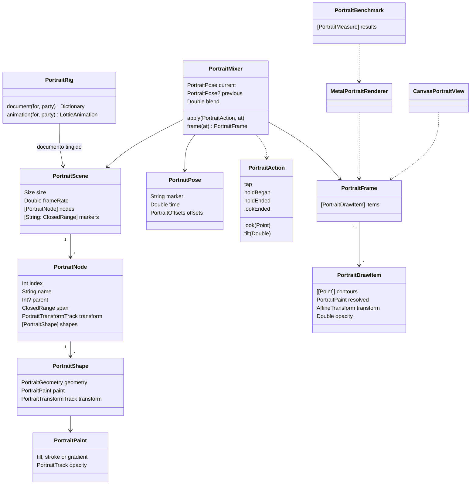

# Bonequinhos em Metal, fase 1: prova de viabilidade

## Requirements

O bonequinho é a peça mais vista do Fiscal e hoje é um Lottie que não aceita shader, não mistura ações e não segue o dedo. Esta fase prova, no iPhone, se um motor próprio em Metal desenha o mesmo bonequinho com custo menor que o Lottie e com ações vivas, antes de qualquer troca no app. Ela compara três motores lado a lado (Lottie de hoje, `Canvas` do SwiftUI e Metal) numa tela de laboratório só de desenvolvimento, mede os três e termina com a decisão de seguir ou parar, registrada em evidência.

Fica de fora: trocar o retrato em qualquer tela do app, mudar o `avatars.py` ou o formato do rig, widget, alerta, cartaz, macOS e visionOS além de compilar, e efeito de shader sobre o retrato.

Definição de pronto:

- **Given** um build Debug no iPhone **When** a pessoa abre Ajustes, "Developer", "Bonequinhos em Metal" **Then** vê o mesmo bonequinho (`eduardo-riedel`, PP) desenhado três vezes, com os rótulos "Lottie", "Canvas" e "Metal", todos animando o `idle`.
- **Given** a tela do laboratório **When** a pessoa troca a pessoa no seletor para `lula` (PT), `tabata-amaral` (PSB) ou um identificador sem traços ("rosto neutro") **Then** os três motores mostram a mesma pessoa, com o mesmo traço e as mesmas duas cores de partido.
- **Given** os motores Canvas e Metal **When** cada um desenha uma imagem parada de 480 px de 25 pessoas fixas (24 da fixture, cobrindo os 4 rostos, os 7 cabelos e as 3 barbas, mais o rosto neutro) no quadro 0 e nas 8 poses paradas (`wavePose` a `thinkPose`) **Then** a diferença para a imagem do `PortraitStill` tem média por canal de no máximo 1,5%, sobre todos os pixels, e percentil 99,5 de no máximo 12%, medido fora do anel de 1 px em volta das bordas de cor da imagem de referência.
- **Given** o bonequinho Metal ou Canvas em repouso **When** a pessoa toca nele **Then** ele faz um gesto neutro sorteado entre `wave`, `smile` e `browRaise`, com o háptico `.impact(weight: .light)`, e volta ao `idle` sem salto.
- **Given** o bonequinho Metal ou Canvas **When** a pessoa segura por 0,5 s **Then** ele entra no `think` e fica no `thinkLoop` enquanto o dedo estiver na tela; **When** solta **Then** volta ao `idle` em 0,3 s, misturando as duas poses, sem salto.
- **Given** o dedo arrastando sobre o bonequinho Metal ou Canvas **When** o dedo vai para a esquerda, direita, cima ou baixo **Then** olhos e rosto seguem o dedo, nunca além do maior desvio que o gesto `lookAround` já faz no rig, e voltam ao centro em 0,4 s quando o dedo sai.
- **Given** o iPhone inclinado para os lados **When** o laboratório está à vista **Then** a cabeça do bonequinho Metal ou Canvas inclina junto, até o maior giro que o gesto `tilt` já faz, e o sensor desliga ao sair da tela.
- **Given** um toque durante o `wave` **When** a nova ação começa **Then** a pose atual se mistura com a nova em 0,2 s, sem voltar ao quadro 0.
- **Given** Reduzir movimento, Modo Pouca Energia ou aparelho quente (`MotionBudget.isConstrained` ou `@ReducesMotion`) **When** o laboratório abre **Then** os três motores mostram a imagem parada, toque e arrasto não animam, o sensor não liga e o rodapé diz "Movimento reduzido: só imagem parada".
- **Given** o botão "Medir" **When** a pessoa toca **Then** cada motor roda sozinho por 20 s com 3 bonequinhos de 120 pt, um depois do outro, e a tabela mostra por motor: CPU do processo (%), memória acrescentada (MB), quadros perdidos, tempo de GPU por quadro (ms, só Metal) e estado térmico no fim.
- **Given** um aparelho sem Metal disponível (`MTLCreateSystemDefaultDevice()` nulo) **When** o laboratório abre **Then** a coluna Metal mostra "Metal indisponível neste aparelho" e as outras duas seguem.
- **Given** a medição feita no iPhone do usuário **When** a fase fecha **Then** `docs/evidence/FSC-025/proof.md` traz a tabela das três medições do app, a captura do Instruments (Metal System Trace e Power Profiler) e a decisão "seguir" ou "parar" pela régua de Safeguards, com o que não foi medido dito por extenso.

## Entities

- **`PortraitRig`** (existe) ganha `document(for:party:)`, que devolve o dicionário já filtrado pelos traços e tingido pelo partido; `animation(for:party:)` passa a usá-lo e não muda de comportamento.
- **`PortraitScene`** é o rig tingido lido uma vez: nós com pai, janela de quadros e trilhas de transformação, e formas já achatadas em contornos.
- **`PortraitNode`, `PortraitShape`, `PortraitPaint`** cobrem só o subconjunto que o rig usa hoje: camada de forma e nula, grupo, retângulo, elipse, caminho, preenchimento, traço de ponta e junção redondas, gradiente linear, transformação e opacidade com interpolação linear.
- **`PortraitFrame` e `PortraitDrawItem`** são a lista do que desenhar num instante, igual para os dois motores novos.
- **`PortraitPose`** é um ponto da linha do tempo (marcador e tempo) mais os desvios vivos (olhar e inclinação).
- **`PortraitMixer`** decide a pose a cada quadro a partir das ações e mistura duas poses durante uma troca.
- **`PortraitAction`** é o que a pessoa faz: tocar, segurar, soltar, arrastar, tirar o dedo e inclinar.
- **`MetalPortraitRenderer`, `CanvasPortraitView` e `PortraitBenchmark`** desenham e medem; só existem no laboratório nesta fase.

Nada muda em `PortraitLibrary`, `PortraitStore`, `PersonPortrait`, nos traços ou no rig: o app de produção continua igual.

## Approach

1. **Estratégia da solução:** a análise aprovou provar antes de trocar. A prova mede três motores sobre o mesmo bonequinho e decide pela régua de Safeguards. Os dois motores novos compartilham o leitor do rig, a linha do tempo e o misturador de poses, e diferem só no desenho, para que a comparação meça o desenho e não o resto.
2. **Decisões:**
   - **Ler o rig Lottie atual em vez de exportar malha nesta fase** — o rig usa um subconjunto pequeno (medido em 06/11/2026: 90 camadas, 175 grupos, 58 retângulos, 60 elipses, 99 caminhos, 158 preenchimentos, 22 traços redondos, 2 gradientes, 104 propriedades animadas, toda interpolação linear, sem máscara, matte ou quadro de espera), então um leitor próprio dá paridade sem mexer no `avatars.py`; a exportação em malha da análise fica para a fase 2 e só se a prova mostrar que ler o rig pesa. Isso diverge da decisão "Formato do rig" da análise só no tempo: a malha não é descartada, é adiada.
   - **Ações vivas sobre a linha do tempo** — o rig não traz os 22 canais, só as trilhas assadas. O toque e o segurar tocam marcadores que já existem; o olhar e a inclinação somam desvios aos nulos que o `avatars.py` já usa para `turn`, `eyeX`, `eyeY` e `roll` (`eyes`, `head` e os `…Turn` com as profundidades 0,35 a 0,9 do gerador), limitados ao maior valor que `lookAround` e `tilt` já alcançam.
   - **Mistura entre poses** — avaliar os dois instantes e interpolar transformações e pontos, possível porque o mesmo rig tem a mesma topologia em todo quadro.
   - **Preenchimento em Metal por estêncil e cobertura** com multiamostragem 4× — preenche contorno côncavo e com furo sem triangular na CPU, e a forma da boca muda a cada quadro. Referência: a técnica clássica de preenchimento de caminho na GPU ("stencil, then cover", Kilgard e Bolz, NVIDIA, 2012). Traço vira faixa de triângulos com ponta e junção redondas na CPU, porque são só 22.
   - **Um buffer de vértices por bonequinho por quadro, em três cópias**, e o pipeline compilado ao abrir o laboratório, para medir o primeiro quadro como seria no app.
   - **`Canvas` como segunda comparação** — a análise pediu, e se ele bastar para 3 bonequinhos a troca fica sem Metal próprio.
   - **Laboratório só em Debug**, como o laboratório da FSC-023: um link no Developer e o argumento de lançamento `-portraitLab` para abrir direto. Todo o código Swift novo fica dentro de `#if DEBUG`; o `.metal` entra no pacote como a FSC-023 fazia.
   - **Sensor de inclinação** pelo `CMMotionManager` direto no laboratório; a leitura do kit (`ByescaleiraEffects`) só chega com o PR #18 e entra na fase 5.
   - **Medição** dentro do app (CPU por `getrusage`, memória por `phys_footprint`, quadros perdidos pelo intervalo do `CADisplayLink`, GPU pelos tempos do `MTLCommandBuffer`, estado térmico) e no Instruments 26 pelo `xctrace` (Metal System Trace e Power Profiler), porque nenhuma fonte mediu shader do SwiftUI nem Lottie (pesquisa de 05/11/2026).
   - ADR: não precisa nesta fase, porque nada do app muda. O ADR da troca nasce na fase 3 com o resultado desta prova.
3. **Tratamento de erros:**
   - rig ou traços ausentes: o laboratório mostra "Sem rig de retrato neste build" e nenhum motor;
   - um recurso do Lottie fora do subconjunto no rig: o leitor falha inteiro com o nome do recurso, o laboratório mostra "Rig fora do subconjunto: <recurso>" e o teste quebra;
   - sem Metal: a coluna mostra "Metal indisponível neste aparelho";
   - pipeline que não compila: o mesmo texto, com o erro no log do Developer;
   - movimento restrito: só imagem parada, com o rodapé da definição de pronto.
4. **Riscos:**
   - opacidade de camada aplicada por forma muda o resultado onde formas da mesma camada se sobrepõem → o teste de paridade aponta; se falhar, a camada é composta numa textura própria;
   - serrilhado nas bordas com 4× → medido nas imagens de 480 px; o percentil 99,5 fica fora do anel de 1 px das bordas, porque a primeira rodada (06/11/2026) teve 2 de 225 imagens do Metal acima de 12% só por antisserrilhado (12,9% e 12,2%, mapa em `docs/evidence/FSC-025/parity-edges-diff.png`), com média de 0,2%; campo de distância só se a paridade falhar fora da borda;
   - Metal pedir quadro em repouso → a view pausa quando nada se mexe e mede o repouso à parte;
   - medição de uma só rodada enganar → três rodadas por motor, com a mediana na tabela;
   - aparelho antigo indisponível → registrado como não medido, e a decisão diz isso.

## Structure

- `FiscalKit/Sources/FeatureCore/Portraits/PortraitRig.swift`: alterado, ganha `document(for:party:)`.
- `FiscalKit/Sources/FeatureCore/Portraits/Engine/` (novo, todo em `#if DEBUG`):
  - `PortraitScene.swift`: leitor do rig tingido, nós, formas, trilhas e achatamento de curvas;
  - `PortraitTrack.swift`: interpolação linear de número, ponto, cor e forma;
  - `PortraitFrame.swift`: avaliação de um instante em lista de desenho, com transformações por pai;
  - `PortraitMixer.swift`: ações, poses, desvios vivos e mistura;
  - `PortraitStroke.swift`: traço em triângulos com ponta e junção redondas;
  - `MetalPortraitRenderer.swift`: dispositivo, pipelines de estêncil, cobertura e gradiente, buffers triplos, desenho na tela e fora dela;
  - `MetalPortraitView.swift`: a view SwiftUI sobre `MTKView`, com pausa em repouso e fora da tela;
  - `PortraitInteraction.swift`: os gestos de tocar, segurar e arrastar, o háptico e as ações de acessibilidade, iguais para o Metal e o Canvas, e o relógio `PortraitClock`;
  - `PortraitSceneBuilder.swift`: o leitor das camadas e propriedades do rig e o achatamento de curvas, separado de `PortraitScene.swift` pelo limite de tamanho de arquivo;
  - `CanvasPortraitView.swift`: o mesmo quadro desenhado em `Canvas` dentro de `TimelineView`, calculado no corpo da `TimelineView` a cada tique, fora do `Canvas`, para o desenho mudar a cada quadro;
  - `PortraitEngine.metal`: vértice e fragmento de estêncil, cobertura sólida e gradiente linear.
- `FiscalKit/Sources/FeatureCore/Portraits/Lab/` (novo, todo em `#if DEBUG`):
  - `PortraitLabScreen.swift`: seletor de pessoa, os três motores, gestos, rodapé e botão "Medir";
  - `PortraitBenchmark.swift`: as rodadas e as medidas;
  - `PortraitTilt.swift`: o sensor de inclinação ligado só com a tela à vista.
- `FiscalKit/Sources/FeatureSettings/DeveloperScreen.swift`: link "Bonequinhos em Metal" em `#if DEBUG`.
- `Fiscal/Fiscal/FiscalApp.swift`: o argumento `-portraitLab` em `#if DEBUG`, na raiz da janela, para o laboratório abrir mesmo quando o banco do aparelho não abre (achado no iPhone: banco gravado por outra branch, com esquema mais novo).
- `FiscalKit/Tests/FeatureCoreTests/PortraitEngineTests.swift` (novo).
- `docs/evidence/FSC-025/` (novo): `proof.md`, capturas e os traces resumidos.
- `docs/roadmap.md`: a seção das seis fases da FSC-025.
- `spdd/README.md`: estado da linha.

Dependências: o motor usa só `Metal`, `MetalKit`, `CoreMotion` e `SwiftUI` do sistema e os tipos de `FeatureCore`. Nenhum pacote novo.

## Operations

1. **`PortraitRig.document(for:party:)`:** extrair de `animation(for:party:)` a parte que filtra as camadas pelos traços e tinge as formas; devolve o dicionário ou nulo quando a paleta falha. `animation(for:party:)` passa a ser `document` seguido de `LottieAnimation(dictionary:)`. Verificação: `PortraitStoreTests` sem mudança, `scripts/verify.sh --quick`.
2. **`PortraitTrack`:** valor fixo ou quadros-chave lineares para número, vetor, cor e forma (vértices e tangentes); `value(at frame: Double)` com borda presa no primeiro e no último quadro. Recusa quadro de espera e interpolação não linear com erro nomeado. Depende de: nada. Verificação: testes de interpolação no meio, nas bordas e fora da janela.
3. **`PortraitScene(document:)`:** lê tamanho, quadros por segundo, marcadores e camadas; para cada camada guarda índice, nome, pai, janela `ip`/`op`, transformação (âncora, posição, escala, rotação, opacidade) e formas. Grupo vira forma com transformação própria; retângulo e elipse viram contornos; caminho guarda os vértices e tangentes para achatar depois. Qualquer chave fora do subconjunto (máscara, matte, efeito de camada, modo de mistura diferente de 0, quadro de espera) falha com o nome do recurso. Depende de: 1, 2. Cobre: "Rig fora do subconjunto".
4. **Achatamento de curvas:** cada segmento cúbico em pontos com tolerância de 0,25 unidade do rig (200×200), sempre com o mesmo número de pontos para a mesma forma em qualquer quadro. Depende de: 3. Verificação: teste de contagem de pontos igual em dois quadros da boca.
5. **`PortraitFrame` (`scene.frame(at time:, offsets:)`):** avalia as camadas vivas no quadro, compõe as transformações pela cadeia de pais, soma os desvios vivos nos nulos `eyes`, `head` e `…Turn`, multiplica a opacidade da camada pela da forma e devolve os itens na ordem de pintura do Lottie (última camada primeiro). Depende de: 3, 4. Verificação: teste do nó `eyes` deslocado pelo olhar e do `head` girado pela inclinação.
6. [P] **`PortraitStroke`:** polilinha e largura em faixa de triângulos com ponta e junção redondas, em 8 segmentos por meia-volta. Depende de: 4. Verificação: teste da quantidade de triângulos de uma linha reta e de um L.
7. **`PortraitMixer`:** estado com a pose atual, a anterior e o peso da mistura. `apply(_ action:, at:)`: `tap` sorteia `wave`, `smile` ou `browRaise` (sorteio injetável para teste); `holdBegan` depois de 0,5 s toca `think` e segue no `thinkLoop`; `holdEnded` volta ao `idle`; `look(point)` converte o ponto relativo ao centro em desvio de olhar e de giro, preso ao maior valor de `lookAround`; `lookEnded` volta a zero em 0,4 s; `tilt(roll)` prende ao maior giro de `tilt`. Troca de pose mistura em 0,2 s (0,3 s ao soltar). `frame(at:)` avalia as duas poses e interpola pontos e transformações pelo peso. Os limites são lidos das trilhas do próprio rig na carga. Depende de: 5. Verificação: testes de cada ação, da mistura sem volta ao quadro 0 e dos limites.
8. **`PortraitEngine.metal`:** função de vértice com matriz por item; fragmento de estêncil sem cor; cobertura sólida com cor e opacidade; cobertura de gradiente linear de duas paradas. Depende de: nada. Verificação: compila no `scripts/build.sh Debug ios`.
9. **`MetalPortraitRenderer`:** dispositivo e fila únicos, pipelines compilados por `prepare()`, alvo com 4 amostras e estêncil de 8 bits, três buffers de vértices por bonequinho com semáforo. `draw(_ frame:, in:)` escreve todos os contornos e traços do quadro num buffer, e por item faz estêncil (não zero, em leque) e cobertura com teste de estêncil que zera ao passar. `still(_ frame:, side:)` desenha fora da tela e devolve `CGImage` em sRGB, reaproveitando as texturas e o buffer de leitura por tamanho e devolvendo o buffer de vértices ao semáforo depois do desenho. Guarda o tempo de GPU do último quadro. Depende de: 5, 6, 8. Cobre: imagens paradas da paridade.
10. **`MetalPortraitView`:** `MTKView` em `UIViewRepresentable` (e `NSViewRepresentable` no Mac, para compilar) com 30 qps em repouso e 60 ou 120 durante ação; pausa sem movimento, fora da tela (`onScrollVisibilityChange` e `onDisappear`) e com movimento restrito; recebe gestos de toque, segurar e arrastar e manda ao `PortraitMixer`, com o háptico do toque pelo `sensoryFeedback`. Depende de: 7, 9. Cobre: toque, segurar, olhar e mistura.
11. [P] **`CanvasPortraitView`:** `TimelineView(.animation)` com `Canvas` que desenha o mesmo `PortraitFrame` com `Path`, preenchimento, traço redondo e gradiente; mesmos gestos e mesmas pausas; `still(side:)` pelo `ImageRenderer`. Depende de: 7. Cobre: toque, segurar, olhar e mistura no Canvas.
12. **Teste de paridade:** as 25 pessoas da definição de pronto (escolhidas uma vez na fixture e fixadas por identificador) no quadro 0 e nas 8 poses paradas, Metal e Canvas contra o `PortraitStill`, com a média por canal sobre todos os pixels e o percentil 99,5 só nos pixels fora do anel de 1 px em volta das bordas da referência (pixel de borda é o que difere de um vizinho de 8 por mais de 8% em algum canal). Fora do simulador sem Metal, o teste de Metal é pulado com o motivo. Depende de: 9, 11. Cobre: paridade.
13. **`PortraitTilt`:** `CMMotionManager` a 30 Hz só com a tela à vista, rolagem em graus para `tilt(roll)`, desligado ao sair e com movimento restrito. Depende de: 7. Cobre: inclinação.
14. **`PortraitBenchmark`:** para cada motor, três rodadas de 20 s com 3 bonequinhos de 120 pt em `idle` e uma ação a cada 3 s, um motor de cada vez e 5 s de pausa entre eles; mede CPU do processo, memória acrescentada, quadros perdidos (intervalo maior que 1,5 vez o esperado), tempo de GPU médio e p95 (Metal) e estado térmico no fim; guarda a mediana e escreve no log do Developer. Depende de: 10, 11. Cobre: "Medir".
15. **`PortraitLabScreen` e ligações:** seletor com `eduardo-riedel`, `lula`, `tabata-amaral` e "rosto neutro"; as três colunas rotuladas; rodapé de movimento; botão "Medir" e tabela; textos de erro de Approach; link "Bonequinhos em Metal" no Developer e `-portraitLab` na raiz da janela em `FiscalApp`, tudo em `#if DEBUG`; o modelo da tela entra pelo `ModelHost`. Os textos ficam em `Text(verbatim:)` como no laboratório da FSC-023, porque não vão para o catálogo. Depende de: 10, 11, 13, 14. Cobre: abrir o laboratório, trocar a pessoa, sem Metal, movimento restrito.
16. **Medição no iPhone e decisão:** instalar o Debug no iPhone do usuário, rodar "Medir" três vezes, gravar com `xctrace` o Metal System Trace e o Power Profiler de cada motor, capturar a tela, preencher `docs/evidence/FSC-025/proof.md` e aplicar a régua dos Safeguards. Depende de: 15. Cobre: evidência e decisão.
17. **Documentos:** a seção das seis fases da FSC-025 em `docs/roadmap.md` (fase 1 com o resultado, as outras como planejadas ou canceladas conforme a decisão), `docs/backlog.md` se a prova abrir item, `CHANGELOG.md` em `Unreleased` ("Laboratório de bonequinhos em Metal, só em Debug") e a linha do `spdd/README.md`. Depende de: 16. Verificação: `scripts/verify.sh --full`.

## Norms

- Constituição: zero comentários, zero warnings, Swift Testing para toda lógica nova, tokens do design system para espaço, raio e tamanho na tela do laboratório.
- Concorrência estrita do Swift 6: motor e misturador em `@MainActor`; o Metal só recebe dados prontos; nada de `@unchecked Sendable` novo.
- Leitura do rig com o mesmo `JSONSerialization` do `PortraitRig`; nenhum decodificador de terceiros.
- Interpolação, limites e tempos do misturador vêm do rig carregado ou de constantes nomeadas no tipo, nunca de números soltos no corpo.
- Mesma regra de movimento do app: `MotionBudget.isConstrained` e `@ReducesMotion`, pausa fora da tela, nada de sensor com movimento restrito.
- Acessibilidade no laboratório: cada bonequinho com `accessibilityLabel` "Ilustração de <nome>, motor <Lottie|Canvas|Metal>" e ações de acessibilidade "Reagir", "Pensar" e "Olhar para o lado", para que nenhuma ação dependa de gesto.
- O identificador e o partido seguem o ADR 0025: traços pelo identificador, cor pelo partido que se escolhe no seletor.
- Testes do motor rodam no `FiscalKitTests` pelo `scripts/test.sh --affected`; o teste de Metal pula com motivo quando não há dispositivo.
- Commits em inglês, com `Canvas: spdd/prompt/FSC-025-202611061422-[Feat]-portraits-metal-proof.md` no corpo; a análise e este canvas entram no primeiro commit de código.
- Aparelho: build no iPhone do usuário na entrega, com captura antes no simulador (sim-monitor, no máximo dois simuladores).

## Safeguards

- **Funcional:**
  - nenhuma tela do app de produção muda: `PersonPortrait`, `PortraitStore`, `PortraitArtView`, widgets, alertas e cartazes seguem desenhando com o Lottie;
  - nenhuma ação humilha, julga ou faz o bonequinho falar: só `wave`, `smile`, `browRaise`, `think`, olhar e inclinar, iguais para toda pessoa e todo partido;
  - o olhar e a inclinação nunca passam do maior desvio que `lookAround` e `tilt` já fazem no rig;
  - quem não tem traços continua com o rosto neutro nos três motores.
- **Desempenho (régua de seguir ou parar, mediana de 3 rodadas no iPhone do usuário, 3 bonequinhos de 120 pt):**
  - **seguir com Metal** se, contra o Lottie: CPU do processo pelo menos 30% menor, memória acrescentada não maior, no máximo 1% de quadros perdidos, GPU p95 de no máximo 2 ms por quadro para os 3, energia no Power Profiler não maior, e paridade dentro do limite da definição de pronto;
  - **seguir com Canvas** se o Canvas cumprir a mesma régua e o Metal não ganhar dele em CPU ou energia por mais de 15%;
  - **parar** se nenhum dos dois cumprir; a fase 2 vira "ações sobre o Lottie" (alternativa da análise);
  - em repouso (nenhum movimento por 5 s), Metal e Canvas não pedem quadro;
  - o pipeline compila em no máximo 150 ms e o primeiro quadro sai em no máximo 50 ms depois de pronto.
- **Segurança e privacidade:** nenhum dado novo; nada sai do aparelho; o sensor de inclinação não grava nem registra valores; o log do Developer guarda só as medidas.
- **Integração e compatibilidade:**
  - o código Swift novo fica inteiro em `#if DEBUG`; o Release só ganha o `metallib` do `PortraitEngine.metal`, sem nenhuma chamada;
  - `PortraitRig.animation(for:party:)` devolve o mesmo resultado de antes (testes atuais sem mudança);
  - os arquivos `fiscal-portrait-rig.json` e `fiscal-portrait-traits.json`, o `avatars.py` e o caminho remoto `avatars/` não mudam;
  - compila nas três plataformas (`scripts/build.sh Debug` iOS, macOS e visionOS); só o iPhone é medido.
  - **QUEBRA:** nenhuma.
- **Fora do escopo:** usar o motor novo em qualquer tela de produção; exportar malha ou mudar o `avatars.py`; efeito de shader sobre o retrato; o selo do partido; widget, alerta e cartaz; dependência nova; cache além dos três buffers por bonequinho; texto no catálogo de idiomas; ADR; publicação ou envio para a loja.
