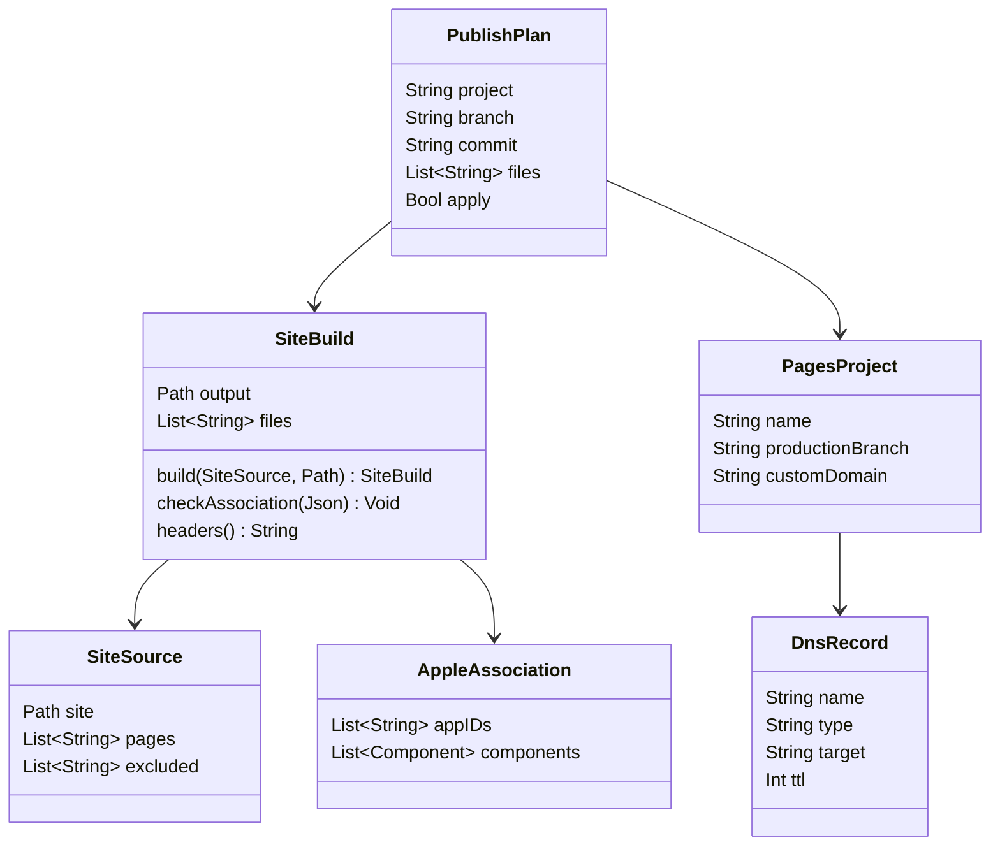

# O site e os links universais na Cloudflare Pages

## Requirements

O site público de `fiscal.byescaleira.com` e o arquivo dos links universais vão ao ar num projeto próprio da Cloudflare Pages, o `fiscal-site`, publicado do Mac por um script que só mostra o plano até receber `--apply` e o ok do usuário. O domínio deixa a VPS por um CNAME na Vercel, e o bloco do Caddy sai depois. Os links que os cartões de compartilhar imprimem (`?person=`, `?vote=`, `?race=` e os outros) passam a abrir o app no iPhone. A primeira publicação só acontece depois do deploy e da limpeza da VPS da `FSC-020`. Fora do escopo: o Fiscal na Web (`/app`, `link.html`, a ponte), o admin, mudar textos do site além da página 404, ícones e capturas da loja, e mudar o app.

Definição de pronto (o "site" é a pasta `site/` da `development`; o `wrangler` é o `4.149.0`, a mesma versão do `fiscal-pages`):

**Etapa A, no repositório**

1. **Given** `site/` como está **When** `node scripts/site-build.mjs <pasta>` roda **Then** a pasta tem exatamente: `index.html`, `privacy.html`, `terms.html`, `support.html`, `404.html`, `llms.txt`, `style.css`, `assets/favicon.png`, `assets/icon.png`, `assets/icon-dark.png`, `fonts/BricolageGrotesque.woff2`, `fonts/OFL.txt`, `.well-known/apple-app-site-association` e `_headers`. Ficam de fora `app.html`, `app.js`, `link.html`, `web.css`, todos os `web*.js`, `vendor/`, `web-crypto.test.mjs` e `package.json`.
2. **Given** a mesma montagem **When** o `_headers` é lido **Then** a regra de `/.well-known/apple-app-site-association` tem só `Content-Type: application/json`, e a regra `/*`, que também vale para esse caminho, tem `Strict-Transport-Security: max-age=31536000; includeSubDomains`, `X-Content-Type-Options: nosniff`, `Referrer-Policy: strict-origin-when-cross-origin` e `Cache-Control: public, max-age=300`. Nenhum cabeçalho aparece nas duas regras, porque a Pages juntaria os valores com vírgula.
3. **Given** o arquivo da Apple sem `appIDs` com `Q7QLR2PH2X.com.byescaleira.fiscal`, ou com JSON inválido, ou ausente **When** a montagem roda **Then** ela falha com uma mensagem que diz qual problema, e nenhuma pasta parcial fica para trás. Com o arquivo certo, os 8 `components` de hoje (`/link` e as 7 chaves na raiz) passam iguais.
4. **Given** a pasta de saída já existe e não está vazia **When** a montagem roda **Then** ela falha sem apagar nada, para nunca limpar uma pasta errada.
5. **Given** `site/404.html` **When** `python3 scripts/site-i18n.py check` roda **Then** ele conta 5 páginas em pt-BR, sem problemas. A página diz que o endereço não existe, tem o link para a página inicial, o mesmo estilo e `noindex`, e não anuncia o Fiscal na Web.
6. **Given** `scripts/site-publish.sh` sem `--apply` **When** roda na worktree da `development`, limpa **Then** imprime o plano (projeto `fiscal-site`, branch `main`, commit, quantidade e lista de arquivos) e não envia nada.
7. **Given** a árvore suja em `site/` ou no script, outra branch que não a `development`, o `site-i18n.py check` com problema, ou a montagem com falha **When** o script roda, com ou sem `--apply` **Then** ele para antes de publicar e diz o motivo.
8. **Given** o ok do usuário **When** `scripts/site-publish.sh --apply` roda **Then** publica a pasta montada com `npx --yes wrangler@4.149.0 pages deploy <pasta> --project-name fiscal-site --branch main --commit-hash <sha> --commit-dirty=false` e apaga a pasta temporária ao fim, com sucesso ou não. **Given** o `wrangler` sem login **Then** ele falha e diz para fazer o login no app Terminal, sem ler nem pedir token.
9. **Given** `scripts/verify.sh` **When** roda **Then** inclui `node --test scripts/site-build.test.mjs`.

**Etapa B, no ar (cada passo com o ok do usuário, pedido na hora)**

10. **Given** o deploy da `FSC-020` feito, a limpeza da VPS (runbook, seção 8, passos 1 a 4) feita e o PR #21 na `development` **When** o projeto `fiscal-site` é criado e a primeira publicação roda **Then** `https://fiscal-site.pages.dev` responde 200 com o `curl` em `/`, `/privacy`, `/terms`, `/support`, `/llms.txt`, `/style.css`, `/assets/icon.png` e `/fonts/BricolageGrotesque.woff2`. O arquivo da Apple responde 200, com `application/json` e sem redirecionamento. `/api/v1/races`, `/app` e `/link` respondem 404. A política publicada é a nova ("Dados que coletamos: Nenhum").
11. **Given** o domínio `fiscal.byescaleira.com` adicionado ao projeto no painel da Pages e o TTL do registro `fiscal` anotado **When** o registro `fiscal` na Vercel passa de A para CNAME com o subdomínio `*.pages.dev` que a Pages imprimiu ao criar o projeto (o esperado é `fiscal-site.pages.dev`), sem proxy **Then** o domínio fica Active na Pages, o certificado é válido e as rotas do cenário 10 respondem igual em `https://fiscal.byescaleira.com`. Volta atrás: o registro A anterior.
12. **Given** o DNS apontando para a Pages **When** o bloco `fiscal.byescaleira.com` sai do Caddy (backup `.bak.<epoch>`, `caddy validate`, `systemctl reload caddy`) **Then** os outros blocos seguem iguais, e `curl -s http://127.0.0.1:3130/api/health` na VPS continua respondendo `{"ok":true,…}`.
13. **Given** até um dia depois da publicação **When** `curl -s https://app-site-association.cdn-apple.com/a/v1/fiscal.byescaleira.com` roda **Then** devolve os mesmos `appIDs` e `components` do arquivo publicado.
14. **Given** o app instalado no iPhone do usuário e a CDN da Apple atualizada **When** a pessoa toca em `https://fiscal.byescaleira.com/?person=<slug>`, `?vote=<id>` e `?race=<id>` no Notas e no Mensagens **Then** o app abre no perfil, na votação e na disputa. Em Ajustes › Desenvolvedor › Links universais › Diagnóstico, a mesma URL aparece como aberta pelo Fiscal. **Given** `https://fiscal.byescaleira.com/privacy` no Safari **Then** abre a página, sem o app. Prova: roteiro manual no aparelho do usuário.
15. **Given** a mudança fechada **When** os documentos são lidos **Then**:
    - `docs/web.md` (Publicar) descreve o script e o `curl` das rotas;
    - o runbook troca a seção 9 pela saída do bloco do Caddy e pela volta atrás do DNS;
    - o ADR 0030 está Aceito;
    - o backlog guarda o host próprio do admin e da ponte;
    - o `CHANGELOG` registra a mudança.

## Entities

- `SiteSource`: o que já existe em `site/`, mais `404.html`, que é novo. A lista do que fica de fora é a mesma do `docs/web.md`.
- `SiteBuild`: novo; função pura sobre arquivos, em `scripts/site-build.mjs`.
- `AppleAssociation`: o arquivo que já existe, só conferido e copiado, nunca reescrito.
- `PublishPlan`: novo; o que `scripts/site-publish.sh` imprime e, com `--apply`, publica.
- `PagesProject` e `DnsRecord`: fora do repositório, no painel da Cloudflare e na Vercel, cada mudança com o ok do usuário.

## Approach

1. **Estratégia da solução:** a montagem é uma função pura em Node, que copia só o que sobe, confere o arquivo da Apple e escreve o `_headers`. Ela tem testes e entra no `verify.sh`. O script de publicação faz as checagens, chama a montagem numa pasta temporária, imprime o plano e só com `--apply` chama o `wrangler` de versão fixa. A etapa A é código e documento e pode entrar na `development` antes. A etapa B é operação no ar, na ordem: projeto, primeira publicação em `pages.dev`, domínio, DNS, Caddy, CDN da Apple e iPhone. Cada passo da etapa B tem o ok do usuário.
2. **Decisões do usuário:**
   - Cloudflare Pages para o site e o arquivo dos links universais: "Cloudflare Pages (Recomendado)", 07/11/2026.
   - Publicação do Mac com script: "Do Mac, com script (Recomendado)", 08/11/2026.
   - Primeira publicação depois da `FSC-020`: "Depois da FSC-020 (Recomendado)", 08/11/2026.
   - Sem veto ao projeto `fiscal-site` separado e ao CNAME na Vercel.
3. **Decisões padrão:**
   - O `404.html` vive em `site/`, como página de verdade, para passar pelo `site-i18n.py`; a Pages o usa sozinha quando ele está na raiz.
   - `/link` fica no arquivo da Apple sem página: com o app abre o app, sem o app responde 404. A página volta com o Fiscal na Web.
   - As páginas sem `.html` usam o comportamento padrão da Pages. Não há `_redirects`.
   - A pasta de saída é temporária (`mktemp -d`), fora do repositório, e o script a apaga ao fim. Por isso não há nada novo no `.gitignore`.
   - O build de desenvolvimento não ganha `?mode=developer` no `applinks:`; o teste no iPhone espera a CDN da Apple.
   - O ADR novo é o 0030. O 0029 fica para o renúmero do ADR repetido da `FSC-017` (PR #16).
4. **ADR:** [`docs/adr/0030-site-on-cloudflare-pages.md`](../../docs/adr/0030-site-on-cloudflare-pages.md), Aceito com o ok deste canvas em 08/11/2026 ("etapa A, manda tudo e de uma vez").
5. **Tratamento de erros:**
   - A montagem e o script falham cedo, com uma mensagem que diz o problema, sem publicar nada.
   - Uma falha do `wrangler` deixa a publicação anterior no ar; a volta é o Rollback no painel da Pages.
   - Uma troca de DNS errada volta com o registro A anterior.
6. **Riscos:**
   - O certificado da Pages leva minutos a sair depois do CNAME → o domínio é ligado no painel antes, e a troca fica para um horário de pouco uso.
   - O Caddy tenta renovar o certificado depois da troca → o cenário 12 vem logo em seguida.
   - O cenário 33 da `FSC-020` usa o log da VPS → ele é conferido antes da troca do DNS.
   - O `_headers` pode não valer para arquivo sem extensão em `/.well-known/` → o `curl -sI` do cenário 10 prova em `pages.dev` antes da troca; se falhar, paro e trago a prova.
   - A CDN da Apple pode levar até um dia → o cenário 14 espera o cenário 13.
   - Nada desta mudança foi medido sob carga; um site estático na CDN não muda o que a VPS recebe, a não ser para menos.

## Structure

- `site/404.html`: novo.
- `scripts/site-i18n.py`: `PAGES` ganha `404.html`.
- `scripts/site-build.mjs`: novo; a montagem.
- `scripts/site-build.test.mjs`: novo; os testes dos cenários 1 a 4.
- `scripts/site-publish.sh`: novo; plano, checagens e `--apply`.
- `scripts/verify.sh`: roda o teste novo.
- `docs/web.md`, `docs/server-runbook.md` (seção 9; a seção 7, das rotas `/api/*` no Caddy, é reescrita pela `FSC-020`), `docs/adr/0030-site-on-cloudflare-pages.md`, `docs/adr/README.md`, `docs/backlog.md`, `CHANGELOG.md`, `spdd/README.md` e `docs/evidence/FSC-025/qa.md`.
- Fora do repositório: o projeto `fiscal-site` no painel da Cloudflare, o registro `fiscal` na Vercel e o bloco do Caddy na VPS.

## Operations

1. **Página 404.**
   - `site/404.html` no estilo de `terms.html`, em pt-BR, com `noindex` e o link para a página inicial; `404.html` em `PAGES` do `site-i18n.py`.
   - Cobre: 5. Verificação: `python3 scripts/site-i18n.py check` e a página aberta em `node scripts/site-server.mjs`.
2. **Montagem.** Depende de: 1.
   - `scripts/site-build.mjs <pasta>`: lista de inclusão fixa; confere o arquivo da Apple; recusa pasta existente não vazia; escreve `_headers`; se algo falhar, apaga o que começou a escrever.
   - Cobre: 1, 2, 3, 4. Verificação: `node --test scripts/site-build.test.mjs`.
3. **Script de publicação.** Depende de: 2.
   - `scripts/site-publish.sh [--apply]`, no modelo do `server-deploy.sh`: confere branch, árvore limpa e `site-i18n.py`; monta numa pasta temporária; imprime o plano; com `--apply`, chama o `wrangler` fixo; apaga a pasta com `trap`.
   - Cobre: 6, 7, 8. Verificação: rodar sem `--apply` na `development` e fora dela, e `bash -n`.
4. **Verificação e documentos da etapa A.** Depende de: 3.
   - `verify.sh` com o teste novo; `docs/web.md` (Publicar), runbook (seção 9, com a ordem da etapa B e a volta atrás), ADR 0030 Aceito, backlog e `CHANGELOG`.
   - Cobre: 9, 15. Verificação: `scripts/verify.sh --quick` e a revisão da fase. **Parar com o PR da etapa A; o merge na `development` espera o ok.**
5. **Projeto e primeira publicação.** Depende de: 4, do deploy da `FSC-020`, da limpeza da VPS e do PR #21 na `development`.
   - O usuário faz o login do `wrangler` no Terminal. Com o ok, `npx --yes wrangler@4.149.0 pages project create fiscal-site --production-branch main`, depois `scripts/site-publish.sh --apply`.
   - Cobre: 10. Verificação: o `curl` das rotas em `fiscal-site.pages.dev`. **Parar e mostrar antes do DNS.**
6. **Domínio e DNS.** Depende de: 5.
   - O usuário adiciona `fiscal.byescaleira.com` no painel da Pages. Anoto o TTL. Com o ok, o registro `fiscal` na Vercel vira CNAME `fiscal-site.pages.dev`.
   - Cobre: 11. Verificação: `dig`, o painel Active e o `curl` das rotas no domínio.
7. **Caddy.** Depende de: 6.
   - Com o ok, sai o bloco `fiscal.byescaleira.com`, com backup, `caddy validate` e reload.
   - Cobre: 12. Verificação: a saúde local do `fiscal-api` e o log do Caddy sem erro de renovação.
8. **Links no iPhone e fechamento.** Depende de: 6.
   - A CDN da Apple e o roteiro no aparelho; QA em `docs/evidence/FSC-025/qa.md`; `spdd/README.md` entregue.
   - Cobre: 13, 14. Verificação: o QA. **Parar para o usuário ver no iPhone.**

## Norms

- Zero comentários; Node só com a biblioteca padrão e `node:test`; Bash com `set -euo pipefail` e `trap` para a pasta temporária.
- Textos do site em pt-BR, conferidos pelo `site-i18n.py`.
- O `wrangler` sempre por `npx --yes wrangler@4.149.0`, nunca a versão mais nova.
- Commits com `Canvas: spdd/prompt/FSC-025-202611081040-[Feat]-site-and-universal-links-on-cloudflare-pages.md`, com a identidade e o token da conta `byescaleira`.
- A branch `feature/site-on-pages` sai da `development`; a análise e o canvas entram no primeiro commit de código.
- Nunca dizer que um passo foi conferido sem a saída do comando.

## Safeguards

- **QUEBRA:** `fiscal.byescaleira.com` deixa de apontar para a VPS. Os pedidos dos builds antigos a `/api/*` passam a receber o 404 da Pages, e o log de acesso da VPS para de ver esse domínio.
- Publicar, criar o projeto, adicionar o domínio, trocar o DNS, mexer no Caddy, push, merge na `development` e a tag só com o ok do usuário, pedido a cada vez.
- A primeira publicação nunca vem antes do deploy da `FSC-020`, da limpeza da VPS e do PR #21 na `development`. A política publicada precisa ser verdadeira no dia.
- O login do `wrangler` e qualquer token ficam com o usuário, no app Terminal. O script nunca lê, imprime nem pede token, e nunca lê `.env`, `secrets/`, `*.pem` ou `*.p8`.
- Nada do Fiscal na Web sobe: `app.html`, `app.js`, `link.html`, `web.css`, `web*.js` e `vendor/`. Nada de `package.json` nem de teste.
- O arquivo da Apple sobe idêntico ao do repositório. O script não o reescreve.
- O projeto `fiscal-dados` não é tocado: nem deploy, nem domínio, nem configuração.
- O projeto `fiscal-site` nunca é apagado com o CNAME `fiscal` no ar.
- Só o registro `fiscal` muda na Vercel. `dados.fiscal` e os outros registros de `byescaleira.com` ficam como estão.
- Só o bloco `fiscal.byescaleira.com` sai do Caddy. Os outros blocos e serviços da VPS ficam como estão.
- O cenário 33 da `FSC-020` é conferido antes da troca do DNS.
- Sem servidor novo, sem Function da Pages e sem dependência nova no repositório.
- O texto das páginas não muda nesta mudança, além da 404.
